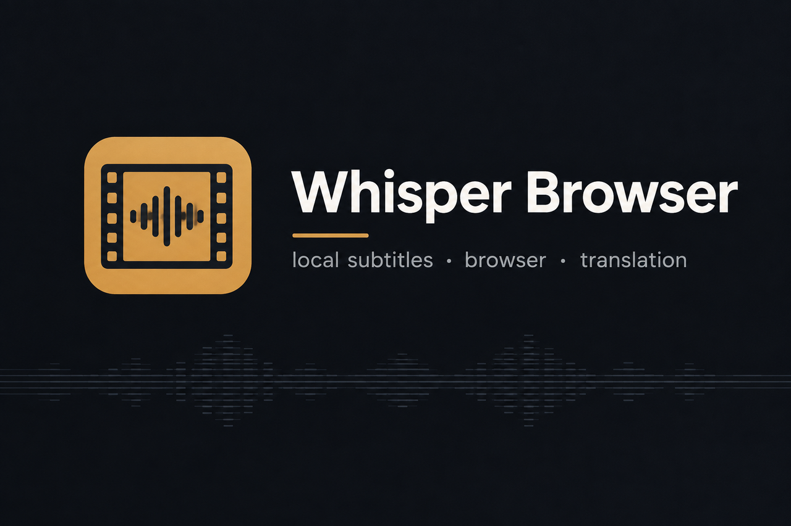
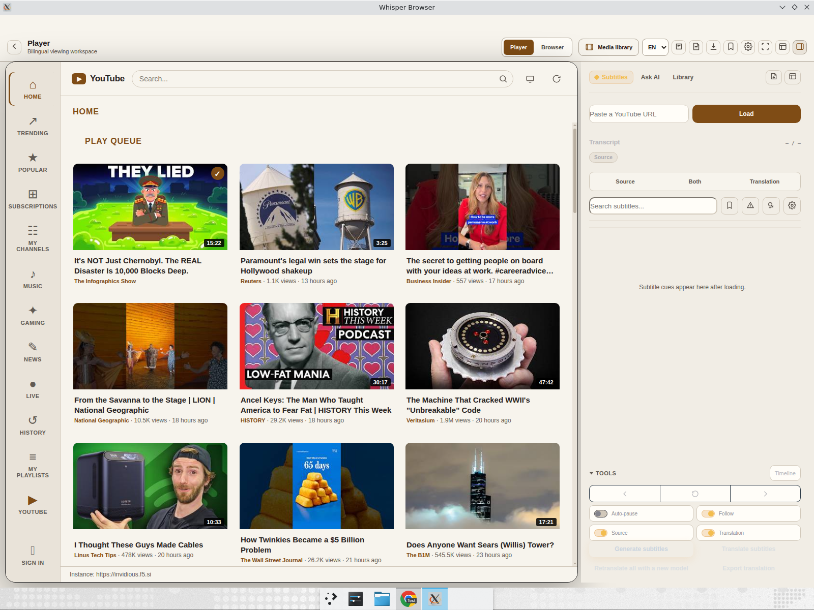
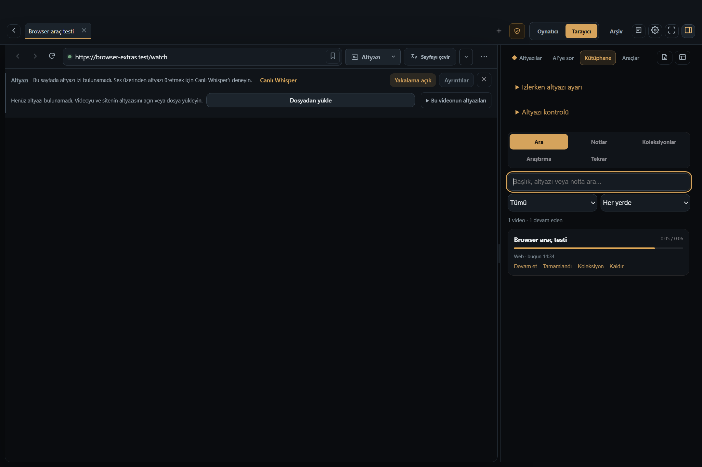
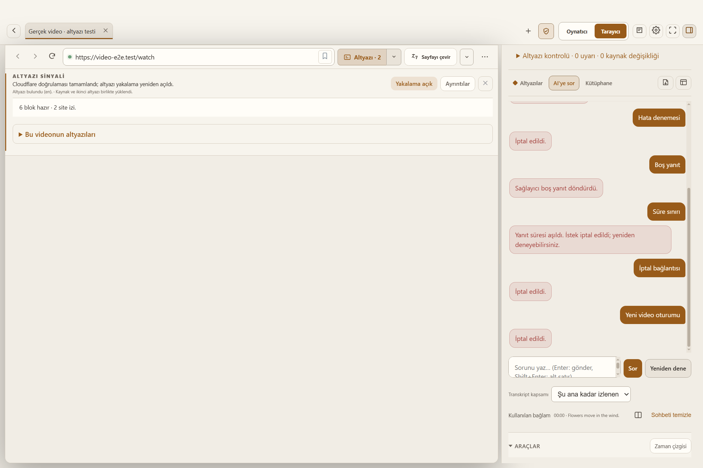
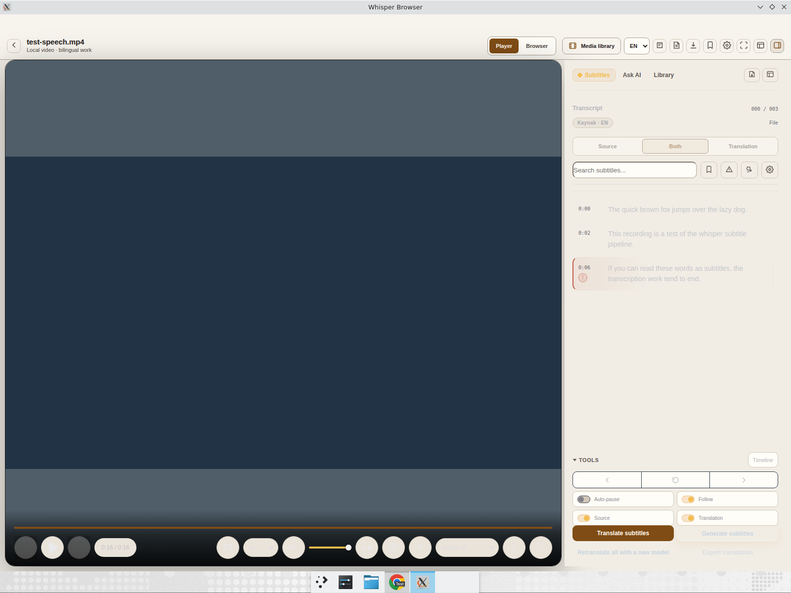
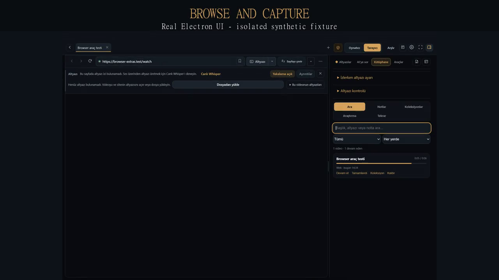

<div align="center">



**A personal media library and player/browser with discovery, feeds, an assistant, subtitles, translation and dubbing.**

[](https://github.com/dorukakindev/whisper-browser/actions/workflows/ci.yml)
[](LICENSE)


[Installation](docs/INSTALLATION.md) · [Usage guide](docs/USAGE_GUIDE.md) · [Architecture](docs/ARCHITECTURE.md) · [Privacy](docs/PRIVACY.md) · [Troubleshooting](docs/TROUBLESHOOTING.md)

</div>

---

Whisper Browser is a desktop media library, player and embedded browser, with discovery, reading feeds and a context-aware assistant. Its local transcription and dubbing workflows connect media to subtitles and translated speech; optional online features use configured services. Transcribe local files and YouTube with faster-whisper, watch video with source and translation tracks side by side, capture accessible subtitle tracks from websites in the embedded browser, and translate with timing preserved. The interface supports English and Turkish; some older diagnostic messages are still Turkish while localization continues.

> **Beta** — back up important subtitle files and review generated text before publishing.

## Proje bilgisi ve kaldığın yer

**Güncel başlangıç · 2026-11-11 12:49:** [Kısa proje/mimari ve çalışma özeti](docs/PROJECT_CONTEXT.md), [son devir](docs/devir/2026-11-11-1249.md). Ürün teslimi PR #913, sonuç belgeleri PR #914 ile master'a birleşti; doğrulanan yerel/uzak HEAD `089f2686bf2fd4b28e0b26e5c8593dce4d13f126`. Actions çalışmadı. Yeni sohbet için AGENTS → README → BACKLOG → güncel devir; yalnız ilgili teknik ayrıntıyı aç. Aşağıdaki önceki durum kayıtları tarihseldir; eski “Git teslimi yok/sonraki” satırları güncel görev değildir.


**Son kullanıcı düzeltmesi · 2026-11-11-1235:** [Stremio eklenti/debrid ayarları ve torrent motoru](docs/devir/2026-11-11-1235.md). Eklentiler → Ayarlar → kendi configure sayfası → Ayarları kaydet akışı eklendi. Torrent motoru doğrulanarak kuruldu; kişisel film başlatılmadı. Kullanıcı debrid/film kabulü ve Git teslimi ayrı.

**Son yerel çalışma · 2026-11-11-1147:** [Fable son üçlü](docs/devir/2026-11-11-1147.md). Dublaj hız sahipliği, yapıt/kaynak ayrımı ve film çeviri bağlamı hedefli doğrulandı; Fable aktif uygulama maddeleri bitti, büyük tasarımlar dışarıda. Canlı native/kalite kabulü ayrı; Git teslimi yok. Güncel kanıt/sınırlar BACKLOG ve devirde.

**Son çalışma · 2026-11-11 03:49:** [Stremio / Oynatıcı Pro ve Git teslimi](docs/devir/2026-11-11-0349.md). Stremio eklentileri, kaynak/kütüphane/puanlama ve ortak Pro araçları önceki R853/R854 ve sıcak amber korunarak birleştirildi. 14 hedefli dosya ve 38 korunum kontrolü geçti; tam paketin eski başarısızlıkları ve gerçek native kabul sınırları devirde. Kullanıcı Git teslimini yetkilendirdi; güncel push/PR/master durumu BACKLOG'dan doğrulanır.

**Son yerel çalışma · 2026-11-11 03:11:** [R854 kalan uygulama kapsamları](docs/devir/2026-11-11-0311.md). R854-01…12 / G01…G68 için açık ürün uygulama işi kalmadı; hazır parçalar tekrar yazılmadan kalanlar tamamlandı. Sıcak amber ve önceki geliştirmeler korunuyor. 200 hedefli kontrol geçti; gerçek Electron/site/sağlayıcı/GPU ve ASUS kabulü ayrı, Git teslimi yok. Güncel devam için BACKLOG ve bu devir esas alınır; aşağıdaki eski sonraki listeler tarihsel kayıttır.

**Git teslimi:** [PR #910](https://github.com/dorukakindev/whisper-browser/pull/910) · [devir ve Claude sınırı](docs/devir/2026-11-10-2244.md). Birikmiş doğrulanmış geliştirmeler ve R853/R854 belgeleri; 177/177 teslim regresyonu geçti, native/görsel kabul açık. R853 G02/G06/G07/G08/G09 bizde; Claude için R854 ayrı çalışma paketi. Görsel kanıtlar kullanıcıdaki evidence854.rar ile sağlanır.

**Son çalışma · 2026-11-11 01:23:** [R853 kalan 18 kapsam](docs/devir/2026-11-11-0123.md). Alan bağlı asistan/arşiv, kaynak karşılaştırma, gerçek gönderim seçimi, kalıcı görev özeti ve makbuz, yeniden inceleme/seçili podcast pasajı ve tekil yorum yenilemesi. Yerel uygulama ve hedefli testler tamam; Windows/ASUS görseli ve canlı sağlayıcı kabulü açık. Git teslimi yok; R854/Claude paketi ayrı.

**Son çalışma · 2026-11-11 00:25:** [R853 medium G10/N01/N07/N08/L07](docs/devir/2026-11-11-0025.md). Tema/yazar dayanağı ve sentez sınırları; ilişki karar geçmişi; harita dışı kapsam ve sağlanan metinde kaynaklı arama. 51/51 hedefli kontrol; native/görsel/canlı kabul açık. Sonraki A02 → A01 → A03 → A04 → A13 (tamamı medium; mevcut sahiplerde salt okunur köprüler ve normal gezinme). Git teslimi yok.

**Son çalışma · 23:47:** [R853 medium D04/D08/N02/N04/N06](docs/devir/2026-11-10-2347.md). Seçili geçmiş yönetimi, kaynaklı kısmi koleksiyon makbuzu, ağ alıntısı/asıl kaynak ayrımı, RSS/raf podcast kimlik incelemesi ve gizlenen referans/temizlik etkisi. 59/59 hedefli test; native/görsel/canlı kabul açık. Sonraki G10 → N01 → N07 → N08 → L07 (tamamı medium; mevcut veriyle açıklama/inceleme kapsamı). Git teslimi yok.

**Son çalışma · 23:22:** [R853 medium G12/D01/D06/L02/L08](docs/devir/2026-11-10-2322.md). Profil eşleşmeme nedenleri, puan kaynak envanteri, sıralama etkileri, yorum örneğinin kapsam dökümü ve analize özel geri bildirim. 52/52 hedefli kontrol; gerçek site/Windows görsel kabulü açık. Sonraki D04 → D08 → N02 → N04 → N06 (tamamı medium). Git teslimi yok.

**Son çalışma · 23:10:** [R853 medium G02/G06/G07/G08/G09](docs/devir/2026-11-10-2310.md). Seçili hatalı satır retry'si, tercih kapsamı, filtre eleme nedenleri ve sabit örnek önizlemesi; kayıtlı Letterboxd örneği/devamı ve AI öncesi örnek karşılaştırması. 69/69 hedefli test; native/görsel/canlı kabul açık. Sonraki G12 → D01 → D06 → L02 → L08 (tamamı medium). Git teslimi yok.

**Son çalışma · 22:37:** [R853 medium G03/G04/G05/G11/G14](docs/devir/2026-11-10-2237.md). Podcast hedef/işlem özeti, son oynatma sırası, işlem bekleyenler ve salt okunur metin; ağ havuz/filtre/tavan kapsamı. 83/83 + 1/1 hedefli kontrol geçti; native/görsel kabul açık. Sonraki G02/G06/G07/G08/G09, tamamı medium. Git teslimi yok.

**Son çalışma · 22:25:** [R853 medium S02/S04/S06/S07/S08](docs/devir/2026-11-10-2225.md). Kayıt/ekrana bağlama, kaynaklı çıktıya dönüş, iki kanal zaman hesabı, sona yakın devam seçimi ve çevrimdışı açıklaması. 38/38 hedefli test; native/görsel kabulü açık. Sonraki G03/G04/G05/G11/G14; tamamı medium. Git teslimi yok.

**Son çalışma · 22:16:** [R853 medium B03/B05/B08/G01/S05](docs/devir/2026-11-10-2216.md). Browser kaynak incelemesinde kalite, geri dönüş, gözlenen sürüm farkı ve dublaj bekleme nedeni. 16/16 hedefli test geçti; native/görsel kabulü açık. Sonraki S02/S04/S06/S07/S08; tamamı medium. Git teslimi yok.

**Son çalışma · 22:09:** [R853 high beşli B01/B02/B06/B04/B07](docs/devir/2026-11-10-2209.md). Browser altyazı araçlarında **Sekmeler ve altyazı durumu** açılır alanı; eksik yakalama, saat kanıtı, kanal geri yükleme ve köken açıklamaları. 34/34 hedefli test, 6 mevcut betik ve 7 JS syntax geçti. Native/görsel/canlı yayıncı kabulü açık; Git teslimi yok. Yalnız R853'ten devam: **B03 → B05 → B08 → G01 → S05; beşi de high**. Gruplar beşli ve tek eforlu.

**Son çalışma · 21:48:** [E10/P02/S03 high üçlüsü](docs/devir/2026-11-10-2148.md). Metin/dosya undo kapsamı, doğrulanmış indirme devamı ve rol/hash onaylı eksik altyazı bağlama. 47/47 hedefli test, mevcut çift dosya kurtarma betiği ve 6 JS syntax geçti. Git teslimi yok; native/görsel/canlı yayıncı kabulü açık. Sonraki **B01 → B02 → B06: üçü de high**. Gelecek üçlüler tek eforla önerilir.

**Son çalışma · 21:21:** [Kalan altı tamam; aynı onlu 10/10](docs/devir/2026-11-10-2121.md). RSS bölüm araçlarında **Kalıcı çevrimdışı tut / Kopyayı doğrula ve aç**; İleri araçlarda ve Browser cümle akışında **İki kanal kayıt durumu**, **Ses ve senkron profillerini karşılaştır** ve **Aktif satır eşleşmesini incele**. İkinci kanal kendi dosyasında tekil düzenlenir; draft kaynak kartı gösterilir. 84/84 hedefli Node + 5 betik geçti. Git teslimi yok; gerçek native/görsel/dinleme kabulü açık. Sıradaki P06/P08/E05.

**Son çalışma · 21:01:** [P04/E04 ve kalan altı iş](docs/devir/2026-11-10-2101.md). Podcast yayını yenilenirken kaynak farkını incele; onaylanan RSS örneği uygulanır. Tekil disk geçmişi çakışmasında yalnız doğrulanan satır güncel disk sürümüne yeniden uygulanabilir. Mevcut onlu 4/10; kalıcı offline ve sonraki beş high iş henüz tamamlanmadı. Git teslimi yok.

**Son çalışma · 20:52:** [Medium E08/E09; mevcut onlunun 2/10 işi](docs/devir/2026-11-10-2052.md). Transkriptte ve Browser cümle listesinde **Sorun türü** metin aramasıyla birleşir; görünen/eşleşen/toplam sayılır, filtre dışı aktif satıra açık dönüş vardır. Zaman önerileri ve Browser Senkron paneli başlangıç/bitiş medya etkisini gösterir; kalan sapma ölçülmediyse uydurulmaz. 4/4 seçilmiş test + 7 mevcut betik geçti. Kalan sekiz iş high bekliyor; Git teslimi ve gerçek native/görsel kabulü yok.

**Son grup · 20:42:** [R853 asistan sürekliliği · C01–C10](docs/devir/2026-11-10-2042.md). Sohbet menüsünde **Görev özeti taslağı**, kapasite göstergesi; yanıtta kayıtlı adım/sonuç, görev mesajı teslimi ve önceki kartlar. Tarihsel kart yalnız yeni inceleme taslağı hazırlatır; eski onayı canlandırmaz. Gönderi önizlemesi son 12 mesaj / mesaj başına 5.000 karakter sınırını açıklar. Kayıp çıktıda sohbet korunur, otomatik yeniden üretim yapılmaz. 114/114 hedefli kontrol geçti; gerçek Windows/ASUS/görsel ve canlı sağlayıcı kabulü açık. Git teslimi yok; sonraki onlu BACKLOG başında.

**Son grup · 20:09:** [Altı veri/kaynak onarımı ve dört podcast güvenilirlik işi](docs/devir/2026-11-10-2009.md). Podcast → **Depolama ve saklama**: hazırlık sesi, döküm sesi, metin kopyaları ve kişisel orijinal metadata’sı; korunan kayıtlar/kota/yedek araçları. Kuyruk → **Kurtarmayı incele**, mevcut işlem kartında gerçek byte/aşama ilerlemesi. Tekil geri alma, geç timing yanıtları, farklı ses kaynağı, podcast budaması/kurtarması ve iki kanal ses profili düzeltildi. 114/114 izole hedefli test + kuyruk/senkron kontrolleri geçti; gerçek Windows/ASUS/start.bat/HLS/GPU/dinleme/görsel kabulü açık. Git teslimi yok; kesin sonraki onlu BACKLOG başında.

**Son grup · 19:50:** [Beş Browser/öneri onarımı ve beş ürün işi](docs/devir/2026-11-10-1950.md). RSS okuyucusunda kaynaklı podcast bağları ve kalıcı/revizyon bağlı okuma yeri-kesitler; tarihli ülke bulunabilirliği; mevcut dublaj A/B kanıt tablosu; ortak önerilerde açık önizlemeli sabit örnek/model raporu karşılaştırması. 100/100 hedefli test + iki ayrı betik geçti. Kişisel profil/açık uygulama korundu; gerçek native/ASUS/start.bat/site/GPU/dinleme/görsel kabulü açık, yeni Git teslimi yok. Kesin sonraki onlu BACKLOG başında; eski gruplar tarihseldir.

**Son grup · 19:18:** [Altı R853 onarımı ve dört ürün görünümü](docs/devir/2026-11-10-1918.md). İzlediklerim/Anime/Manga → **Arşiv görünümleri**: tüketim çeşitliliği, gerçek puan tarihli dönemler ve ayrı kimlikli/onaylı uyarlama-sürüm bağları. Bu akşam → **Yerel film ve bölümleri planla** mevcut İzleme rotasını kalan süre/mola ile genişletir; eski watchlist korunur. 171/171 hedefli test, paket 3/3 ve rota/katalog kontrolleri geçti. Kişisel profil/açık uygulama/Git teslimi yok; gerçek ASUS/start.bat/site/GPU kabulü açık. Sıradaki kesin onlu BACKLOG'da. Aşağıdaki gruplar tarihsel.

**Son grup · 18:40:** [Bağlı kullanım ve R853 onarımı](docs/devir/2026-11-10-1840.md). Not/kaynak/asistan/makbuz dönüş zinciri kontrollü doğrulandı; dokuz kaynak/izin/kayıt/öneri/podcast hatası düzeltildi. 141/141 hedefli Node, shelf 3/3; gerçek ASUS/Windows/start.bat/site/GPU kabulü açık. Kişisel profil ve açık uygulama korunur; Git teslimi yok. Sıradaki kesin onlu BACKLOG'da; aşağıdaki eski gruplar tarihsel.

**Son yerel geliştirme grubu:** [çalışma alanı, asistan ve üretim incelemesi — 10 iş, 14–23](docs/devir/2026-11-10-1822.md). Başlıktaki **Çalışma alanı** kitap oturumları, mevcut sahibine dönüş, kaynaklı notlar, işlem makbuzları ve yoğunluk/metin/hareket tercihlerini birleştirir. Asistan ilk gönderi eki onaydan önce donar; eksik çeviri seçimi mevcut onarım kuyruğuna gider; dublaj sonucu kaynak/ses/seçenek makbuzu ve prova bağlantısı taşır. Kişisel veri, ana ilerleme ve ileri seçenekler korunur. [Uygulama kaydında](docs/plans/2026-11-10-library-reliability.md) 1–23 yerelde uygulandı, 24 bağlı kabul açık. **10'ar iş** sürer; sıradaki kesin grup BACKLOG'da. Yeni Git teslimi yok. Gerçek ASUS/Windows/start.bat ve sağlayıcı/GPU kabulü yapılmadı.

**Güncel yerel çalışma:** [kişisel yedek kapsamı ve güvenli hedef doğrulaması](docs/devir/2026-11-10-1713.md). Yeni koleksiyon/ağ/raf/not/takip dosyaları mevcut çalışma paketine dahil; [envanter ve kapsam dışı](docs/WORKSPACE-DATA.md). Bu, kullanıcı tarafından burada uygulanması istenen 24 maddelik kapsamın ilk üçlüsüdür; [kalan sıra](docs/plans/2026-11-10-library-reliability.md). Sırada kurtarma günlüğü, kesinti/geri dönüş kanıtı ve veri bakım ekranı var. Değişiklikler yerel; yeni Git teslimi yapılmadı.

**Yeni sohbet başlangıcı:** [güncel Git teslim kaydı](docs/devir/2026-11-10-1519.md). [Tek 50 işlik planda](docs/plans/2026-11-10-next-50.md) 1–6 grupları kaynak sınırlarıyla yerelde uygulandı. İzlediklerim/Anime/Manga içinde Seri haritası, kişisel tüketimden ayrı Yayın takvimi, seçili yayınlardan ICS ve Tür/tema portresi var. Bilinmeyen hikâye sırası, tekil cilt tarihi ve eksik tür/tema uydurulmaz. Kullanıcının seçtiği 11/12/15 grubu da yerelde uygulandı; 7–9 bekler. 13/14 ve 16 kaynak kapsamıyla yerelde eklendi; MAL yolu XML tabanlı, doğrudan hesap API bağlantısı yok. 17/18/20 de yerelde uygulandı: ayrı kaynak kimlikleri, alan kökeni ve kontrollü yenileme. 19/23/25 de yerelde eklendi: seçili çevrimdışı kapaklar, seri ilerlemesi ve akıllı raflar. 24/26/28 de yerelde eklendi: onaylı toplu düzenleme, koleksiyon sunumu ve ayrı ara verme notları. Yeni önerilen grup 29/30/32. Git teslim paketi [PR #909](https://github.com/dorukakindev/whisper-browser/pull/909), gerçek ana dal master; ürün commit’i `5a3bec18c3b70af6cab1ad9e9d27f4b8acf66244`. Ürün ve belgeler ayrı commitlerdir; birleştirme kimliği PR kaydındadır.

**Koleksiyonlar ve notlar:** Kayıtları seçip toplu durum/üyelik farklarını inceleyebilirsin. Koleksiyonlar kapak/açıklama/sıra ve tamamlanma özeti taşır; mevcut katalog etiketleri korunur. Ara verme/bırakma gerekçesi puanı veya durumu değiştirmez. Kaynak/not araçları kartın Diğer işlemler menüsündedir.

**Kütüphane düzeni:** Arşiv araçlarından seçili Anime/Manga kapaklarını çevrimdışı saklayıp boyutlarını yönetebilirsin. Seri ilerlemesi bilinmeyen toplamları ayrı gösterir; Akıllı raflar kayıtlı koşulları güncel kütüphaneye uygular ve eşleşme nedenini açıklar. Film afişleri mevcut yerel dosyalarında kalır; kişisel puan/ilerleme otomatik değişmez.

**Kaynak bilgileri:** Kaynak kimlikleri alanı MAL/AniList/IMDb/TMDB bağlantılarını ayrı gösterir; kayıtlı olmak doğrulanmış olmak değildir. Karttaki Kaynaklar / yenile, alan kökenini, tarihini ve kişisel düzeltmeyi gösterir; yalnız seçilen kaynak alanları uygulanır. Eski bilinmeyen köken tahmin edilmez.

**Arşiv araçları:** Kaynak sürümlerini karşılaştırma, yeni aktarımlar için seçili geri alma ve fark önizlemeli AniList açık liste/MAL XML okuması var. Anime/Manga kartından kaynak eşleşmesini aday incelemesiyle düzeltip geri alabilir, XML aktarımında alan farklarını seçebilir ve kayıtlı havuzları açıklamalı JSON/CSV olarak önizleyip dışa aktarabilirsin. Kişisel kimlik/puan/ilerleme korunur; dışa aktarım tüm uygulama yedeği değildir.

**İçerik ağı eşitlemesi:** kişisel 310 anime/manga kaydının referansları yedek alınarak ağa eklendi. Ağdaki Koleksiyonu eşitle düğmesi gizli kayıtları korur ve dışlama nedenlerini sayar. Puan ile tamamlama ayrıdır; MAL kaynaklı puansız 0, olumsuz tercih değildir. [Kanıt ve sınırlar](docs/devir/2026-11-10-1344.md).

**Öneriler:** film ve anime için kendi puanlarından, Letterboxd/AniList profilinden veya seçtiğin bir yapıma benzerlerden başla. Keşfet ve İzlediklerim düğmeleri aynı sayfaya gider. Halka açık profil örneğinin kapsamı ayrıca gösterilir. [Güncel teslim](docs/devir/2026-11-10-1250.md) · [Ayrı 50 iş yol haritası](docs/plans/2026-11-10-next-50.md).

**İzlediklerim → Takvim / Zevkime göre:** tarihli işlem geçmişi, kaynağı doğrulanmış anime/manga kapakları ve destek/karşıt puanlarla açıklanan öneriler. Anime/manga bilgilerini tamamlama işi mevcut MAL kimliğini AniList yanıtında doğrular; puan ve ilerleme korunur. [13 kaynak incelemesi](docs/research/2026-11-10-recommendation-repositories.md).

Üst menüde **İzlediklerim** tamamlananları, devam edilenleri ve sıradakileri bir arada gösterir. **Anime** ve **Manga / Manhwa** sol üst medya menüsünden de açılır; MAL XML/gzip kayıtları kaynak kimlikleriyle birleştirilir. **Zevkim** film, dizi, belgesel, anime, manga, podcast ve kitap için ayrı puan/tercih havuzu ve İçerik ağı bağlantısı sunar. İzlenmiş/okunmuş olmak beğeni sayılmaz. [Yerel teslim](docs/devir/2026-11-10-1127.md).

Proje bilgisi sohbetle sınırlı tutulmaz. Yeni çalışmaya aşağıdaki kök dosyalardan başla:

**Son teslim (2026-11-09):** Podcast, altyazı ve dublaj iyileştirmelerinin kapsamı ve doğrulama sınırları [teslim notunda](docs/devir/2026-11-09-1633.md). Açık kabuller [BACKLOG.md](BACKLOG.md) dosyasında.

| Dosya | Ne için? |
| --- | --- |
| [AGENTS.md](https://github.com/dorukakindev/whisper-browser/blob/master/AGENTS.md) | Kısa çalışma, tasarım, doğrulama ve teslim kuralları. |
| [BACKLOG.md](BACKLOG.md) | Açık/yarım işler; dal, PR, kanıt, kabul koşulu ve sonraki adım. |
| [CHANGELOG.md](CHANGELOG.md) | Tamamlanan değişiklikler; tarihsel kayıt korunur. |
| [DEVIR-NOTU.md](https://github.com/dorukakindev/whisper-browser/blob/master/DEVIR-NOTU.md) | Ayrıntılı, tarihli teslim ve devir notlarının indeksi. |
| [DESIGN.md](https://github.com/dorukakindev/whisper-browser/blob/master/DESIGN.md) | Onaylı görsel kimlik ve ekran kararları. |
| [YENI-BILGISAYAR.md](https://github.com/dorukakindev/whisper-browser/blob/master/YENI-BILGISAYAR.md) | Ortamı yeniden kurma ve özel verileri koruma bilgisi. |

Ayrıntılı teknik kurallar [çalışma rehberinde](docs/WORKING_GUIDE.md), mimari [ARCHITECTURE.md](docs/ARCHITECTURE.md) içindedir. Arşivdeki bir rapor, tek başına o işin hâlâ açık olduğunu göstermez. Yarım iş BACKLOG'a yazılır; yalnız doğrulanmış tamamlanmış değişiklik CHANGELOG'a geçirilir.

Claude tam v2 tasarımının ürün entegrasyonu tamamlandı; kapsam ve doğrulama sınırları [tasarım devam kaydında](docs/design/claude-redesign-handoff-2026-11-05.md), açık işler [BACKLOG.md](BACKLOG.md) içindedir. Maket görüntüsü ile çalışan ürün kanıtı ayrı tutulur.

Podcast/Çift dilli görünümünde **Transkripti çevir** zaman bilgisi olmayan metni de mevcut sağlayıcıyla çevirir; sahte eşzamanlama eklemez. Metindeki kaydet eylemi cümleyi veya seçili sözcük/pasajı isteğe bağlı notla mevcut araştırma defterine ekler. Kayıtlar bölüm ve kaynak sürümüne bağlıdır; zamansız kayıt zaman atlatmaz. Asistan “bu podcasti yazıya dök ve çevir” komutunda mevcut kuyruğu kullanır ve sonuç kaydını bekler.

Whisper kapsamından bölümün tamamını veya başlangıç/bitiş aralığını seçebilirsin; işlenecek süre başlamadan görünür. Örneğin “bu podcasti 30. saniyeden 2. dakikaya kadar yazıya dök ve çevir” aynı kuyruğu kullanır. Doğrulanmış kısmi SRT çevirisindeki **Yalnız eksikleri tamamla**, başarılı satırları korur; eski/uyumsuz sonuçta sessiz tam çeviriye dönmez. Kütüphanede bölümün **Kayıtlı pasajlar ve notlar** alanı mevcut araştırma defterindeki kayıtlarını açar. Zevk profilindeki kanıtlar kaynaklarını gösterir ve ilgili puan/yorum/öncelik düzeltmesine götürür.

Asistanın kütüphane önerileri gerçek kayıtlı puanlara dayanır; gerekçelerde puanın günlük/kütüphane kaynağı ve ters yöndeki kanıt da aktarılır. Kabul edilmiş yorum analizi açık tercihlerden ayrı tutulur. Önerilen yapımı açma ve izleme listesine ekleme mevcut incelenmiş eylemler üzerinden yürür; önizleme kayıt değildir. [Son doğrulama](docs/devir/2026-11-05-1337.md).

Aktif podcastte “bu bölümü yazıya dök” veya “eksik çeviriyi tamamla” diyebilirsin; asistan aynı bölümün mevcut kuyruğunu kullanır. “Bu ana kadar özetle” isteği, tam transkript seçili olsa bile soru anından sonraki konuşmaları kullanmaz. Podcast ve Çift dilli görünümlerinde aynı kaynak bağlamı korunur.

## Yeni sohbet için kısa teknik özet

- **Ürün:** Windows üzerinde kişisel film/dizi, müzik, kitap/PDF ve podcast kütüphanesi; yerel oynatıcı, gömülü browser, Keşfet, RSS ve bağlamı bilen asistan.
- **Arayüz:** Electron + Node.js; ağırlıklı düz JavaScript/HTML/CSS, React değil. Sıcak amber/grafit, renkli kapak ve dengeli ortam ışığı taşıyan canlı sinematik kimlik ve onaylı Claude v2 kompozisyonları korunur. Browser, ana sayfa, RSS ve yerel girişler ortak Podcast/Çift dilli Sahne'yi kullanır; kaynağın mevcut oynatma sahibi korunur.
- **Sınırlar:** `src/main.js` ve servisleri dosya/oturum/iş/sağlayıcı ve alt süreçleri yönetir; `src/preload.js` sınırlı `window.api` IPC köprüsüdür; sandbox ve context isolation açık `src/renderer/` arayüz ve özellik modülleridir.
- **Medya/AI:** Python `backend/`, faster-whisper, CTranslate2, PyTorch/CUDA, opsiyonel WhisperX/konuşmacı ayrımı; FFmpeg, yt-dlp, VoxCPM2. PDF.js, HLS.js, JASSUB; Ghostery ve Dark Reader. Haricî LLM sağlayıcıları mevcut ayarlardan kullanılır. Python ilerlemesi NDJSON → main → IPC → renderer akar.
- **Tamamlanan yakın işler:** Spotify bağlantısından RSS adayı; Podcast dinleme kuyruğu, kaynaklı transkript araması ve notlar; Keşfet karar akışı ve zevk dayanaklarını düzeltme; asistan kaynak kartları, onay makbuzları ve dublaj iş geçmişi. Son teslimde Browser/Podcast/Çift dilli geçişleri, indirilebilir sesin ortak Whisper hattı, kısmi çevirinin gösterimi, doğrulanmış ses kopyasında zamanlı takip, doğru dublaj paneline devir, kuyruk görünürlüğü ve İleri araçlar düzeltildi. Asistanın “bu ana kadar” sınırı ve kalıcı değişiklik onayları korunur. Ayrıntı ve gerçek kabul sınırları [önceki ürün tesliminde](docs/devir/2026-11-09-1220.md).
- **Kalanlar:** [BACKLOG.md](BACKLOG.md) esas alınır. Kaynak erişimi/Spotify DRM, tüm sağlayıcılar ve GPU koşulları için genel başarı garantisi yoktur. Tamamlanan işi eski rapor var diye yeniden açma; test ve canlı/native kanıtını ayır.

Yeni sohbet yalnız repoyu görebilir: önceki konuşma veya ekran görüntülerine eriştiğini varsayma. Gerekli görsel referansları dosya/ZIP olarak sağla. Güncel çalışma kökü `D:\Whisper Local`, gerçek ana dal adı `master`, normal açılış `start.bat`. Kişisel profil ve yerel farkları koru; Computer Use, dosya izin penceresi, uzun matris/CPU kampanyası ve GitHub Actions kullanma. Ayrıntı [AGENTS.md](AGENTS.md), [DESIGN.md](DESIGN.md) ve [çalışma rehberinde](docs/WORKING_GUIDE.md).

## Feature tour

| | |
| --- | --- |
| 🎬 **Player** | Watch local media with dual subtitles — cue search, click-to-seek transcript, editing, loops, notes, per-scene AI questions. |
| 🌐 **SmartTube home** | YouTube browsing built in: home/trending/popular feeds with thumbnails, subscriptions, playlists — sign in with a device code, no Google Cloud setup needed. |
| 🗣️ **Local transcription** | faster-whisper (or optional WhisperX) on CUDA, with automatic CPU fallback. SRT, VTT, ASS, TXT, JSON export. |
| 🧭 **Browser capture** | HLS/DASH, WebVTT, TTML/IMSC and text-track capture on sites that expose accessible subtitles — then translate or fall back to Live Whisper. |
| 🌍 **Context translation** | Cue timing never moves: context-aware translation writes a separate target file, source untouched. |
| 📄 **Page & PDF** | Articles, manga regions and bounded PDF batches translated via configured providers. |
| 📚 **Media library** | Local catalog with watch progress, collections, posters and resume — plus OPML/CSV/NewPipe subscription import/export. |
| 📝 **Subtitle providers** | Download tracks from OpenSubtitles and Stremio (keyless fallback); legacy encodings (cp1251, GBK, Shift-JIS…) auto-detected. |

Whisper Browser does not decrypt protected media, bypass DRM, or extract data from a CDM. Capture works only where a site exposes an authorized, accessible subtitle track.

## Screens



| Browser workspace | Context-aware AI | Player transcript |
| --- | --- | --- |
|  |  |  |
| Capture and inspect accessible web subtitle tracks. | Ask questions grounded in the current scene. | Transcription lands here — search, edit, correct. |

[](docs/media/whisper-browser-tour.mp4)

*26-second MP4: English source track + context-aware Turkish translation over [*Tears of Steel*](https://www.youtube.com/watch?v=OHOpb2fS-cM) (Blender Foundation, CC BY 3.0). Audio omitted on purpose; no account, key or history data included.*

## Ways to use it

| Workflow | Use it for |
| --- | --- |
| **Local file or folder** | GPU transcription, batch queues, subtitle repair, translation, SRT/VTT/ASS/TXT/JSON export. |
| **YouTube source mode** | A complete local subtitle file from a permitted YouTube video or selected time range. |
| **Player mode** | Source/translation tracks, cue search, editing, loops, notes, timing tools. |
| **Browser mode** | Watch websites, capture accessible tracks, retrieve full tracks where supported, translate — or Live Whisper. |
| **Page, manga & PDF** | Translate articles/selections, supported image regions, bounded PDF batches. |

## Quick start

Requirements: **Windows 10/11** (production target), Node.js 22.13+, Python 3.10–3.11, FFmpeg. NVIDIA CUDA recommended (CPU fallback is automatic).

```bat
git clone https://github.com/dorukakindev/whisper-browser.git
cd whisper-browser
install.bat        :: Linux/Ubuntu: ./install.sh
start.bat          :: Linux/Ubuntu: ./start.sh
```

Always launch via `start.bat`/`start.sh` — they configure the CUDA library paths. Default folders: `Downloads\Whisper\GİRDİ` → `Downloads\Whisper\ÇIKTI` (configurable).

**Platform notes:** the GUI, tests and the pinned Castlabs Electron runtime also run on Ubuntu 22.04+ for development/CI. DRM/VMP signature repair (`drm-kur.bat`), optional WhisperX/diarize installers and CUDA-tuned transcription are verified on Windows only; macOS is not a target.

## Development

```powershell
npm ci --ignore-scripts
node node_modules/electron/install.js --no   # Electron binary for smokes
python3.11 -m venv backend/venv
backend/venv/bin/pip install -r backend/requirements-ci.txt
npm test
npm run test:electron-bridge                  # real Electron bridge smoke
node --check src/main.js; node --check src/preload.js; node --check src/renderer/renderer.js
python -m py_compile backend/transcribe.py backend/media.py
```

`npm test` runs Node and Python suites; Python side needs `backend/venv` (or `WHISPER_TEST_PYTHON`). `requirements-ci.txt` pins need Python 3.11 (same as CI); production supports 3.10–3.11. On Windows use `venv\Scripts\pip.exe`.

Transcription is local. Optional online flows are documented in [Privacy](docs/PRIVACY.md); secrets never travel in command-line args and supported credentials use Electron safeStorage.

## Docs

- [Installation](docs/INSTALLATION.md) · [Usage guide](docs/USAGE_GUIDE.md) · [Architecture](docs/ARCHITECTURE.md)
- [Privacy](docs/PRIVACY.md) · [Troubleshooting](docs/TROUBLESHOOTING.md) · [Changelog](CHANGELOG.md)
<!-- Katkı/davranış belgeleri Windows paketinden dışlanır; göreli bağlantılar
     paket içinde kırılmasın diye mutlak GitHub adresi kullanılır. -->
- [Contributing](https://github.com/dorukakindev/whisper-browser/blob/master/CONTRIBUTING.md) · [Support](SUPPORT.md) · [Security](SECURITY.md) · [Code of Conduct](https://github.com/dorukakindev/whisper-browser/blob/master/CODE_OF_CONDUCT.md) · [Third-party notices](THIRD_PARTY_NOTICES.md)

Historical audit/handoff records under `docs/` are evidence, not current product documentation.

---

<div align="center">
<sub>MIT licensed · dependencies keep their own licenses · you're responsible for applicable law, service terms and content rights.</sub>
</div>
