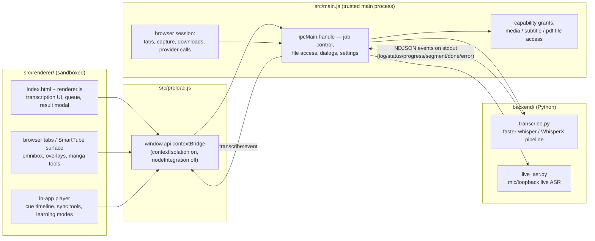

# Architecture

Whisper Browser is a Windows-first Electron app (English UI with EN/TR switch) that pairs a
sandboxed renderer with a Python transcription backend. It has three cooperating surfaces:
the subtitle/transcription workstation, the built-in SmartTube-style browser, and the
in-app player.

## Processes and data flow

- **`src/main.js`** owns the privileged side: window/session management, all
  `ipcMain.handle` endpoints, file authorization, settings and queue persistence,
  provider HTTP calls (translation, OpenSubtitles/Stremio, DeArrow, RYD, RSS), and
  every subprocess spawn (Python, ffmpeg, yt-dlp).
- **`src/preload.js`** exposes the single `window.api` bridge. Renderer code cannot
  touch Node, `require`, or the network directly; every capability is one IPC call.
- **`src/renderer/`** is a single-page sandboxed UI. `renderer.js` holds view state
  and DOM logic; feature modules (`browser-*.js`, `queue-lifecycle.js`,
  `status-copy.js`, …) are plain scripts loaded before it.
- **`backend/transcribe.py`** is invoked with argparse and reports progress by
  printing NDJSON events to stdout; main parses them line-by-line and forwards them
  as `transcribe:event` IPC. Secrets travel via environment variables, never argv.

## Transcription pipeline

`transcribe()` order: input (local file / yt-dlp URL) → ffmpeg extract to 16 kHz mono
WAV (optional `--clip-start/--clip-end`) → engine (`faster` / `faster-batched` /
`whisperx`) → per-segment hallucination filter + split strategy + text cleanup →
`merge_short_entries` → optional LLM post-process → optional diarization →
`normalize_timings` → format writers (`write_srt`/`write_vtt`/`write_ass`/
`write_dual_srt`/`write_json`).

Adding a backend option means touching four places in sync: `transcribe.py` argparse,
`main.js` (`options.X` → `--x`), `renderer.js` (`buildOptsFromUI`), and `index.html`
(the control). `tests/main-args.test.js` locks the argv contract.

## Browser capture

Media subtitles are captured through parallel paths — HLS playlists (rolling,
`$Time$` templates), DASH/MPD, `TextTrack` API observation, mux.js CEA-608/708 in
fMP4, and timedtext responses — each with integrity diagnostics and provenance so a
caption file can always be traced to the response that produced it.

## File access model

Local files are capability-granted: picker results and pipeline outputs are granted
exactly; unknown paths trigger a consent dialog (`mediaFileAccess` /
`subtitleFileAccess` / `pdfFileAccess` in `src/local-file-access.js`). Browser content
can never reach privileged IPC; renderer-sent subtitles are written atomically
(`writeSubtitleAtomic`) with `.bak` backups on edit.

## Queue

The transcription queue lives in the renderer (`state.queue`); each item freezes its
options at add-time. `renderer/queue-lifecycle.js` is the shared helper module:
`renderer.js` uses its job-id helpers (`createJobId`, `eventMatchesActiveJob`,
`queueOutputNameSuffix`, `snapshotOptions`) and `main.js` uses
`createProcessTerminalLatch` + `isValidOutputNameSuffix` for the terminal-state
latch. Queue item transitions (`processNextQueueItem`, `finalizeQueue`) live in
the renderer; the process terminal latch lives in main.

## Testing surfaces

- `npm test` — `tests/run-all.js`: unit + contract + fuzz tests (Node, no Electron).
- `node tests/run-electron-smokes.js --all` — real-Electron smokes
  (`electron-*.smoke.js`); running without `--all` only lists discovered smokes.
- `tests/run-resource-soak.js` — memory/resource soak harness with JSON report.
- Backend: `backend/test_*.py` (auto-discovered by `run-all.js`); golden writer
  fixtures under `backend/golden-writers/` (LF-pinned via `.gitattributes`).
