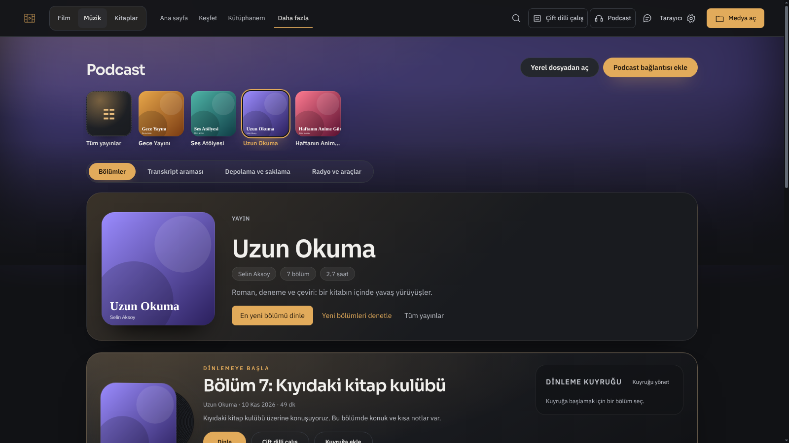
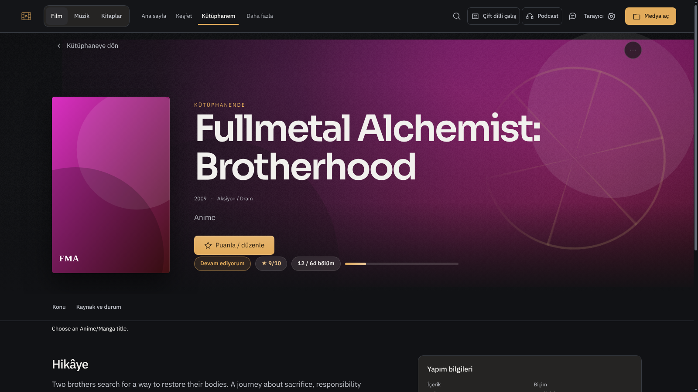
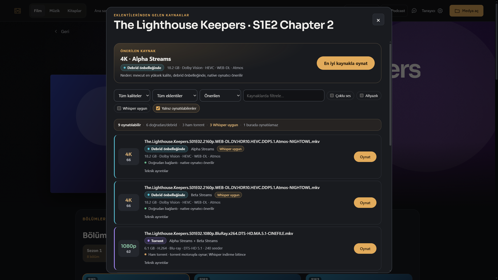

# Claude çalışmalarından tasarım dersleri · 2026-11-13

Bu çıkarımlar görüntü ve kaynak incelemesidir; Claude'un açıklanmamış düşünce süreci hakkında iddia değildir. Yeni bir ürün tasarımı veya canlı kabul bu tur yapılmadı. Referanslar sentetik içerik kullanır; temsilî kapakları üretim içeriği gibi değerlendirme.

Güncel kullanım: kullanıcı sürekli koyu tema kullanır. Bu referanslardan kompozisyon ve kullanım sırasını öğren; açık tema tasarım turu yapma.

## İncelenen somut çalışmalar

| Kaynak | Görselden/koddan çıkarılan yararlı karar | Aktarılmayacak kusur veya sınır |
|---|---|---|
| Claude 1.3 Podcast yayın sayfası; `podcast-studio.css`, `podcast-library-ui.js` | Kapak rafı taramayı, seçili yayın başlığı kimliği, bölüm listesi dinleme kararını taşır. Kapak ve başlık aynı hizaya bağlanır; üretici/süre/bölüm sayısı yardımcı ölçekte kalır. Atmosfer kapak rengiyle ilişkilidir. | Raf, yayın hero'su ve devam kartı peş peşe çok yükselirse asıl bölümler aşağı itilir. Aynı sarı düğmeyi bütün eylemlere yaymak gerekmez. |
| Claude 1.3 anime ayrıntısı; ortak `CinemaUI.film` ve koleksiyon durum şeridi | Kapak + başlık + kişisel durum/puan/ilerleme bir yapım kimliği oluşturur. Hikâye ve kişisel kayıt aynı bilgi gibi sunulmaz. Büyük/küçük yazı, aynı boydaki kartlara göre daha belirgin okuma sırası sağlar. | Büyük hero her kayıtta doğru oran değildir. Örnekte İngilizce kalan durum metni ve aşırı büyük başlık otomatik örnek alınmaz. Eksik metadata yalnız boş bir sinematik zeminle telafi edilemez. |
| HTML'den kurtarılan Claude 1.4 kaynak seçici; `stremio-studio.css`, `stremio-ui.js`; yerel entegrasyon görüntüsü | Önerilen kaynak ana karar olarak ayrılır. Kaynak satırında başlık, kullanılabilirlik, teknik bilgiler ve oynatma tek okunabilir sıradadır. Teknik ayrıntının katlanması bilgiyi silmeden ilk bakışı düzenler. Farklı durumlar adlarıyla ayırt edilir. | En iyi kaynak ve her satırdaki oynatma düğmesi aynı baskın rengi taşıdığında rekabet oluşur. Öneri/filtre/özet çok yer kaplarsa gerçek seçenekler aşağı itilir. Renkli durum çubuğu, gerçek oynatılabilirlik kanıtı değildir. |

### Referans görüntüler

Claude paketinden doğrudan çıkarılan Podcast örneği:

Claude paketinden doğrudan çıkarılan anime ayrıntısı:

Kurtarılan 1.4 tasarımının mevcut Windows Electron entegrasyon görüntüsü; Claude'un özgün paket ekranı olarak sunulmaz:

## Başka ekranlara taşınabilecek anlayış

1. **Önce içerik ve karar sırası.** Oynatma, okuma, keşfetme ve iş yönetimi farklı kompozisyon ister. Aynı kart/kapsül şablonu hepsinin çözümü değildir.
2. **Ölçekler arasında ilişki.** Kapak, başlık, yardımcı metin ve eylemin boyutları birbirini destekler. Büyük başlık tek başına güçlü tasarım değildir; satır ölçüsü ve kullanılabilir alanla birlikte çözülür.
3. **Menü, görünümün parçasıdır.** Araçların konumu, adı, açılışı ve geri dönüşü tasarlanmalıdır. Düzenli bir üst bar, arkasında anlaşılmaz paneller varsa tamamlanmış sayılmaz.
4. **Atmosfer içeriğe dayanır.** Görsel/renk/ışık ilişkisi sayfanın kimliğini güçlendirebilir. Tek bir amber veya nötr palet zorunlu değildir; tüm sayfalara aynı renkli sis katmanı eklemek de tasarım değildir.
5. **Ayrıntı korunarak önem sırası kurulabilir.** Katlanır teknik bilgi, açık ana eylem ve okunur durum özeti, özellik silmeden daha iyi bir ekran oluşturabilir. Gereken bilgi gereksiz yere menüye saklanmaz.
6. **Kaynak kodda oranlar ve sağlam yerleşim.** İncelenen CSS'teki `minmax(0, 1fr)`, sarılabilen filtreler, kapakların ezilmemesi ve kapsayıcıya göre uyarlama, kompozisyonu gerçek uzun başlıklarda koruyan araçlardır. Bunlar zorunlu kolon, radius veya piksel reçetesi değildir.
7. **Görüntüye eleştirel bak.** Referansın iyi yanını öğrenirken onun eksik dilini, boşluğunu, tekrarlanan eylemini ve eski bug'ını kopyalama. Uygulama sonrası yeniden gör; modelin veya tasarımcının adına dayanarak kalite kabulü verme.

Güncel çalışma promptu: [DESIGN_SELF_BRIEF.md](DESIGN_SELF_BRIEF.md). Sabit renk/font/yerleşim kısıtlarının kaldırılması: [19:03 devir kaydı](../devir/2026-11-13-1903.md). Görseller bu sayfaya eklenmiş tarihî referanslardır; yerel entegrasyon kaynaklarının uzak master'da bulunduğu varsayılmaz. Güncel kod ve kabul durumu ayrıca doğrulanır.
