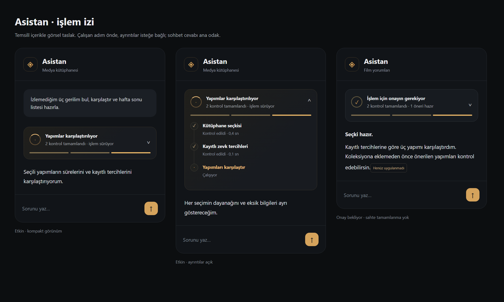
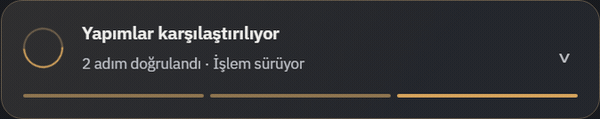
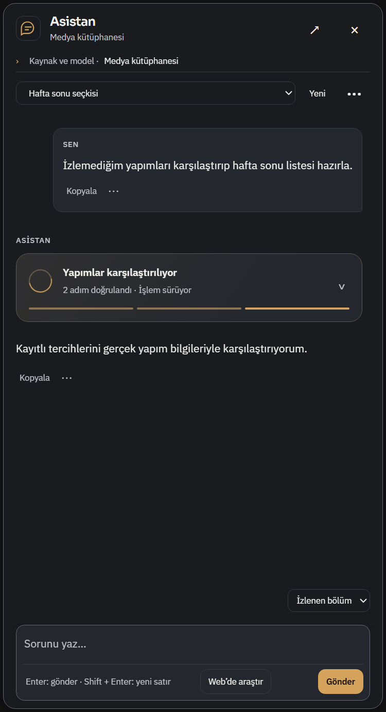
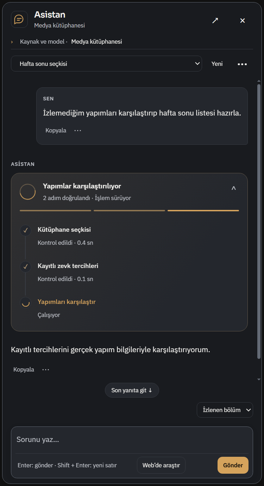
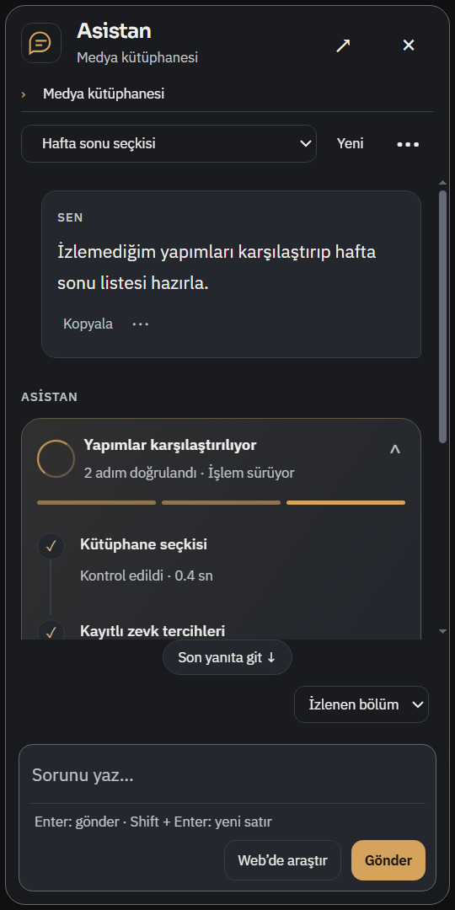
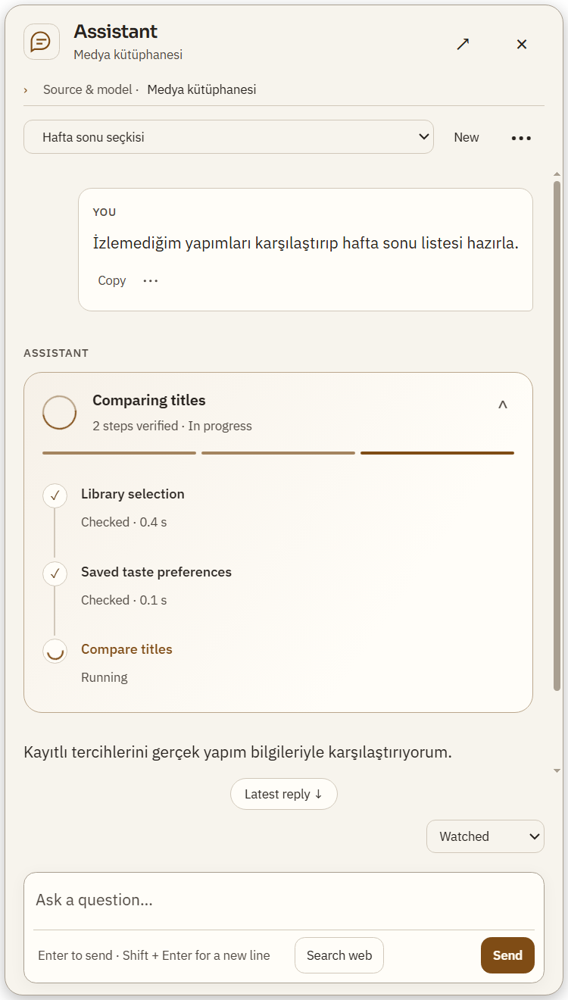

# Asistan: uçtan uca medya akışları ve işlem görünümü

Başlangıç master `85507eaded7a8a57c100ebf2e39694eb65cfcfd1`.
Ürün commit `22ccfdcdc18e058c17228c1be48e8bff4e8a16af`; dal `codex/assistant-end-to-end-flows`.

## Altı kullanıcı akışı
| İstek | Uygulanan bağlantı | Dürüst sınır |
|---|---|---|
| Bul, karşılaştır, koleksiyon oluştur | Yeni prepare_media_selection, typed AND sorgusunu gerçek katalog metadata/eksikleri ve açık kayıtlı zevk kanıtıyla birleştirir. Tür/ad araması search_library üzerinden; item_ids gerçek sonuçları seçkiye taşır. compare_film_titles → plan_library_collection → apply_library_collection mevcut sahipleri kullanılır. | Semantik içerik analizi/uydurma uygunluk puanı yok. Sayım seçilen ID altkümesiyse açık selectionScope var; sayfalama aynı item_ids/revision ile devam eder. Tek kart insan onayından önce yazmaz. |
| Bunu beğendim/bu bölümde kaldım | get_current_media_match açık Keşfet/kütüphane film sayfasının doğrulanmış kimliğini çözer. Kişisel servis get/preview/apply sahiplik ve revizyonu korunur. | Browser başlığı film veya bölüm kanıtı sayılmaz. Dizi sayfası tek başına bölüm değildir; bölüm belirtilmediyse sorulmalıdır. Beğeni izlendi anlamına gelmez. |
| Letterboxd'dan yorum getir, analiz et, sonra sor | analyze/load sonucu ayrı sınırlı doğrulanmış kaynak belleğinde tutulur. Eski düzenlenebilir UI taslağı ezilmez. get_film_context ve citation navigation yeni tam orijinal yorumlara erişir; kaynaklı alıntılar devam yanıtlarına taşınır. | İstenen/yüklenen/analiz edilen sayılar ayrı. Taze analiz historical:false; spoiler gizleme/kimlik/alıntı denetimi korunur. Örneklem genel kanaat değildir. Gerçek Letterboxd erişimi bu turda sınanmadı. |
| Takip ettiğim kaynaklarda ne var | get_feed_digest mevcut aboneliklerin yerel girdilerini query/kind/unread/saved/later/feed_id ile süzer;1–12özet ve açık RSS tercih dayanaklarını döndürür. open_feed_entry onay kartı mevcut service.context izni ve revision ile aynı okuyucuyu açar. | Canlı yenileme/makale indirme değil. Genel film zevkiyle otomatik benzerlik puanı yok; model get_taste_profile ile ayrı açık kanıtı karşılaştırabilir. Tool excerpt ID'leri ekli sohbet alıntısı gibi sunulmaz; gerçek URL gösterilebilir. Açmak read/saved/watched durumunu değiştirmez. |
| Başlattığım iş ne oldu | inspect_job_next_steps kesin main ledger işi, source-binding, normalleştirilmiş eksik/başarısız satır sayısı, gerçek artifact rolü ve hata tanısını döndürür. Yalnız kaynak eşleşen tamamlanmış subtitle işi için source/translation kullanımı önerilir. | Kısmi çıktı için açık insan incelemesi ve allow_partial gerekir. Genel otomatik retry/resume eklenmedi; kanıtlanmayan yeniden deneme önerilmez. İş kabul edildi, tamamlandı demek değildir. |
| Ne yapıldığını anlaşılır biçimde gör | Ortak RunCard grafit/amber kompakt başlık, gerçek adım segmentleri ve açılan dikey işlem izi kullanır. Çalışan halka, durum renkleri ve açılma geçişi vardır. DOM kimliği, açık ayrıntı ve klavye odağı mesaj akışında korunur. | Sahte yüzde/gelecek adım yok. İleri ayrıntılar isteğe bağlı. Azaltılmış hareket seçimi çalışır. Öneri–adım proposalId bağı ve gerçek apply makbuzu sayesinde tamamlanan işlem onay bekliyor kalmaz. Eski bağsız öneriler tarihsel hazırlanmış kart diye etiketlenir. |

## Görsel yaklaşım ve kanıt
Üretim kodundan önce temsilî içerikle kompozisyon hazırlanıp gösterildi. Mevcut üst medya menüsü/film sayfası/palet değişmedi. Yeni stile ek paket veya ikinci stil sistemi alınmadı; make-interfaces-feel-better + mevcut frontend/premium ilkeleri, ortak assistant-overlay tokens/locale/CSP/sahipleri kullanıldı. Bağımsız GPT-6.1 Sol medium ajanları ürün alt akışlarında ve çapraz incelemede çalıştı.








## Yakalanıp giderilen doğruluk sorunları
- Yeni Letterboxd örneğinin eski UI taslağı yüzünden sonraki asistan sorularında kaybolması; taze analizin tarihsel diye etiketlenmesi.
- Kesin açık film sayfası varken current match'in yalnız browser kaynağı/fuzzy sorguya bakması.
- Yeni işlem görünümünde Apply sonrasında tarihsel proposed adımının onay bekliyor kalması: provider/main step proposalId ve Workspace.actionResult/replaceProposal ile uzlaştırıldı. Accepted başlatılan iştir, completed değildir.
- Çapraz incelemede yeni yönerge eklemesinin message.role içine yanlış yerleştirilmesi bulundu; geçerli ayrı system.content yapıldı, gerçek sağlayıcı rol sözleşmesi regresyonu eklendi. Bu ara hata teslimden önce giderildi.
- Digest'te abonelikten çıkarılan eski duplicate yerini mevcut kaynak alırken article filtresinin video döndürmesi; son kaynakta kind tekrar doğrulanır. Gerçek feed store regresyonu var.
- Eksik store.context çağrısı mevcut feed service.handle(context) sahibine, gerçek yetkili IPC event'iyle bağlandı. Öneri ve Apply sırasında izin/spoiler/revision tekrar doğrulanır.

## Hedefli doğrulama
**18dosya /136PASS /0FAIL**, yaklaşık1.35sn. Syntax **26JS** ve git diff --check geçti. İlk birleşik koşuda yeni UMD bağımlılığı yüklenmeyen önceki VM fixture'ı hata verdi; gerçek index yükleme sırası fixture'a taşındı, assertion kaldırılmadı.

```powershell
node --test --test-isolation=none tests/assistant-media-selection.test.js tests/assistant-review-followup.test.js tests/assistant-selected-review-integration.test.js tests/assistant-feed-job-guidance.test.js tests/assistant-end-to-end-service.test.js tests/assistant-selection-journey.test.js tests/assistant-personal-media.test.js tests/assistant-film-evidence.test.js tests/assistant-capabilities.test.js tests/assistant-app-actions.test.js tests/assistant-command-power.test.js tests/assistant-provider.test.js tests/assistant-overlay.test.js tests/assistant-flow-state.test.js tests/assistant-flows.test.js tests/assistant-run-steps.test.js tests/assistant-threads.test.js tests/assistant-agent-service.test.js
```

Actual main + renderer/JSDOM + temporary gerçek catalog/collection store ile arama → seçki → karşılaştırma → plan → tek gerçek öneri → onay → kesin3ID'nin güncellenmesi doğrulandı. Öncesinde katalog değişmez; yanlış sohbet, replay ve arada hedef metadata değişmesi reddedilir, kısmi koleksiyon yazımı olmaz. Provider yanıtları kontrollü, gerçek model tercih kalitesi kanıtı değildir.

RSS owner fixture'ları gerçek registerFeeds/store ile excerpt/revision, kısmi sayılar, yabancı sohbet, revizyon değişimi ve onay kontrollü okuyucu açmayı sınar. Yeni review testleri gerçek renderer modüllerini çalıştırır; taslak koruma, exact Discovery film/dizi, metadata drift, kaynak alıntısı ve spoiler sınırını doğrular.

`tests/electron-assistant-end-to-end.smoke.js`: ayrı sentetik profille gerçek Windows main/preload/renderer ve asistan overlay. Kontrollü sağlayıcıya6istekle seçki/digest/open kartı; gerçek RSS reader açılması; read/saved/later değişmemesi; gerçek Workspace apply sonucunun adım durumuna işlenmesi geçti. 500/360px TR koyu,500px EN açık panelde overflow/composer sınırı; sabit DOM/odak/disclosure; aktif animasyon/durması; prefers-reduced-motion geçti. Son kanıt `tmp/visual-identity/assistant-end-to-end-delivery.log`, exit0; kalıcı makbuz windows-acceptance.json. Ağ engeli nedeniyle adblock filtre güncellemesi uyarısı beklenen fixture sınırıdır, reklam engelleme testi değildir.

## Sınırlar ve teslim
Canlı DeepSeek/ücretli API/kişisel anahtar, gerçek Letterboxd/YouTube/RSS sitesi, GPU/DRM, start.bat ve tam npm test çalıştırılmadı. Modelin gerçek Türkçe istekleri her seferinde doğru araçla çözmesi garanti edilmez. Kaynak alıntısı ve doğrulanmış araç makbuzları model varsayımından üstündür. Yeni bağımlılık, kalıcı ayar veya credential erişimi yok. Step kaydı yalnız opsiyonel proposalId/applied alanlarıyla geriye uyumlu genişledi. Kaynak/review belleği oturum içinde bounded; kişisel taslaklar/kütüphane değişiklikleri mevcut sahiplerde kalır.

Eski bug raporlarına dokunulmadı. Kişisel OFFLINE-MANIFEST/.codex ve ana kopyadaki INDEX/start.sh/start.bat korunur. Normal push/PR/merge ve ana kopya ff-only teslimi [skip ci]; GitHub Actions başlatılmaz. Kullanıcının açık uygulaması kapatılmaz; yeni renderer için yeniden açması gerekir.
