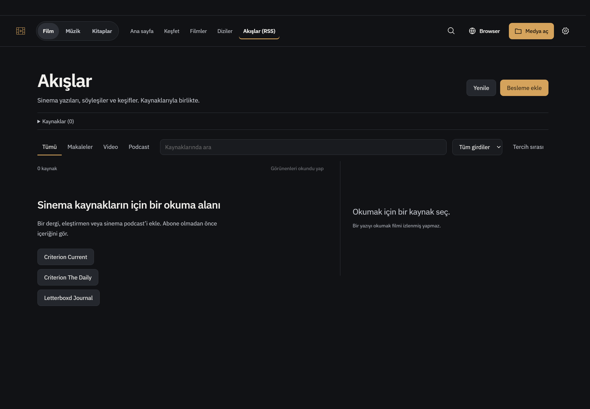
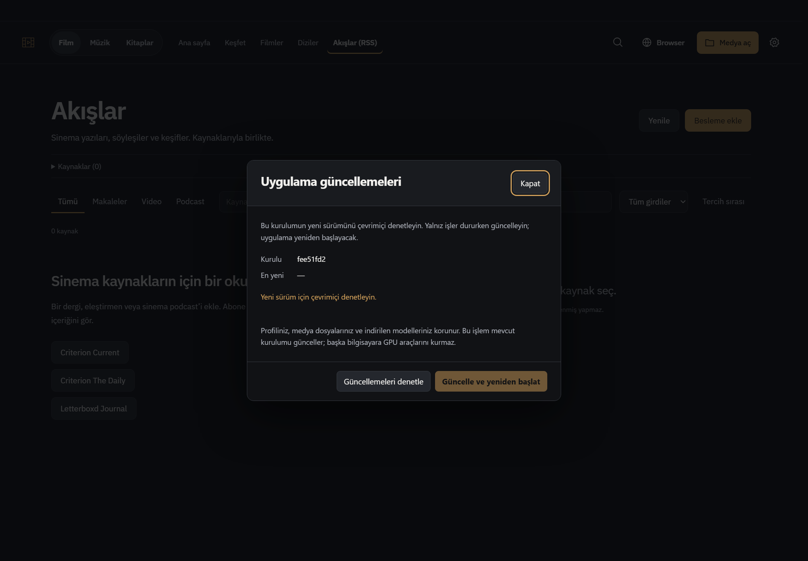
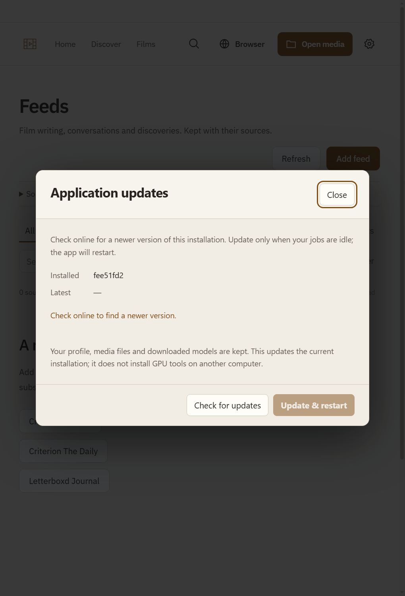

# RSS entry, Windows EXE, explicit source updates and R843

Base `fee51fd2585848c0624348017010a353a5688195`. EXE product `08e9e851`; final product `18846ceaa7fbff757788dd01aaea0fbb039d17ff`. Original R843 and review843 evidence remain local-only, untouched and untracked; this is a separate implementation receipt.

## User entry points

- Open **D:\Whisper Local\Whisper Browser.exe**. It lives with this installation and starts the existing Electron runtime without a console, with the current Python/CUDA/FFmpeg PATH. Same profile, library, reference voices and models; no migration. `start.bat` remains supported. The single-instance application must be fully closed once after active jobs finish to leave an older running renderer; relaunching another entry does not refresh an already running instance.
- **Akışlar (RSS) / Feeds (RSS)** is now the fifth top media navigation item. At narrow widths it moves as a whole accessible item into the left application menu. No second arbitrary toolbar row.
- Left application menu → **Application updates / Uygulama güncellemeleri** → Check → explicit **Update & restart / Güncelle ve yeniden başlat**. No background install or automatic restart.

## What the EXE/update path actually is

This is a small branded .NET Framework Windows entry point for the **existing local installation**, not a standalone GPU installer or a Squirrel release. Source is `tools/whisper-launcher.cs`; reproduce with `npm run build:launcher:win` on Windows. Existing Electron/Python/GPU dependencies are reused. Do not move the EXE away from its installation directory. Built binary is intentionally ignored by Git; it is present locally. SHA256 `08ac293d12fea148ec943e7f66e79f06cb89717161939304a1225e5dcc165760`.

Updates use only this repository's exact trusted HTTPS origin and `master`. Check fetches master without modifying working files. Install repeats base/remote/branch/dirty-overlap checks, rejects divergence and dependency/lock/runtime changes, refuses active jobs/playback/asynchronous assistant or Recall analysis, and schedules only one update. A detached helper waits until the current app PID exits, rechecks source identity and uses only `git merge --ff-only` to the exact reviewed commit, then relaunches. No reset/clean/stash, scripts from network strings, opaque executable download or Actions invocation. Personal changes not overlapping incoming paths and untracked files remain; Git refuses destructive collisions. A dependency/runtime update requires explicit installation maintenance rather than starting new source with old node_modules. Failures are recorded for the next application start and shown without credentials.

The source updater depends on installed Git and the current local source layout. Native Electron autoUpdater is for installed MSIX/Squirrel formats; it is deliberately not presented as configured here ([official contract](https://www.electronjs.org/docs/latest/api/auto-updater)). Existing full packaging remains separate (`npm run package:win`, [Electron distribution](https://www.electronjs.org/docs/latest/tutorial/application-distribution)). `start.bat`'s optional interactive DRM repair prompt is not reproduced by the quiet launcher; the existing signed Electron binary and in-app DRM diagnostics remain unchanged.

## R843 corrections

| IDs | Delivered result |
|---|---|
| 01 | Existing shared feedback identity validation rejects a previous film's personal like/note after identity correction. |
| 02 | Available-source filtering happens before page limits; actual server-side search and paging reach sources after2601 films. |
| 03 | Positive support and negative/mixed counter-evidence have separate freshness gates. |
| 04 | Receipt identity includes scope, reaction revision and absolute UTF-16 range; same quote at another passage/reaction no longer aliases old evidence. Old receipts are not guessed/migrated. |
| 05 | Purge reconciles alias targets; independently supported surviving concepts/edges remain visible, including old dangling aliases. |
| 06 | All-selected graph action removes focus only and preserves domain/query/like/date controls. |
| 07 | Rolling podcast refresh retains older episodes and their personal file binding/progress/notes. |
| 08 | Duplicate RSS corrections carry physical source ID/revision; each displayed correction is acknowledged exactly and stale acknowledgements fail. |
| 09 | Returning to the read baseline removes the outstanding correction; initially-read/no-snapshot baseline remains stable. |
| 10 | A full successful fresh host/frame/native-audibility check can recover an earlier unknown unload state. Unknown or changed-owner states still refuse unloading. |
| 11 | Reclaimer delegates transient cached flags to current safety checks; two-attempt bound and durable protection remain. |
| K843-01 | Recoverable native history/API validation errors use URL fallback; aborted/superseded/network errors are not replayed. The original native occurrence remains conditional. |

Detailed new implementation notes: [Recall](r843-recall.md), [Feeds/podcast](r843-feed.md), [Browser](r843-browser.md). Deferred research capabilities (full browser/subtitle capture, semantic recommendations, internet-wide candidate fetching) are unchanged and not counted as fixed bugs.

## Observed verification, without broad CI

- Update logic:3/3 actual temporary Git-repo tests after sandbox EPERM was resolved by permitted execution. Final double-install guard: only relevant test rerun1/1. Added lock-only guard: new test1/1. Check is read-only; busy/stale/dirty/wrong-origin/runtime rejection, exact after-exit fast-forward and preserved personal/untracked fixtures.
- Update dialog:1/1 DOM lifecycle/explicit action test; final error-copy changes syntax checked. No automatic install.
- Actual compiled EXE in D:\Whisper Local created a separate-profile application window, then only that test window was closed. Initial worktree EXE test failed because that checkout has no private node_modules; real primary installation test passed. Personal application untouched. Electron `ELECTRON_RUN_AS_NODE` helper mode verified (Node24.19.0).
- Windows RSS/update screen:1440 TR/dark and680 EN/light, no horizontal overflow, visible RSS at wide width and complete menu fallback at narrow. Four captures below; real update status IPC, no live installation click.
- R843 Recall6/6; added persisted dangling-alias case only1/1. Feed/podcast+existing K07 contract4/4; refined initially-read baseline case only1/1. Browser3/3; affected existing memory test1/1. Correct expected behavior assertions, not old broken-behavior probe PASS.
- Final native full application: graph6 nodes at both widths; actual installed userscript marker; tab unload/restore and native Back to A; eight captures, no console errors observed. Conditional native history rejection remains a controlled regression, not reproduced spontaneous native corruption.
- Final changed R843 JS15 syntax paths passed; EXE/root updater/UI syntax checks and diff whitespace checks passed. Separate Sol6.1 medium review found assistant-in-flight and lock-only update gaps, both corrected before delivery.

No full npm suite, Actions, actual remote release install/restart into the user's running profile, live API/RSS account/GPU/DRM or full installer acceptance claimed. The installed EXE opens the existing application; it does not independently bundle Python/models. Existing personal files/reports/profile are not published. Source and documentation commits remain separate.

