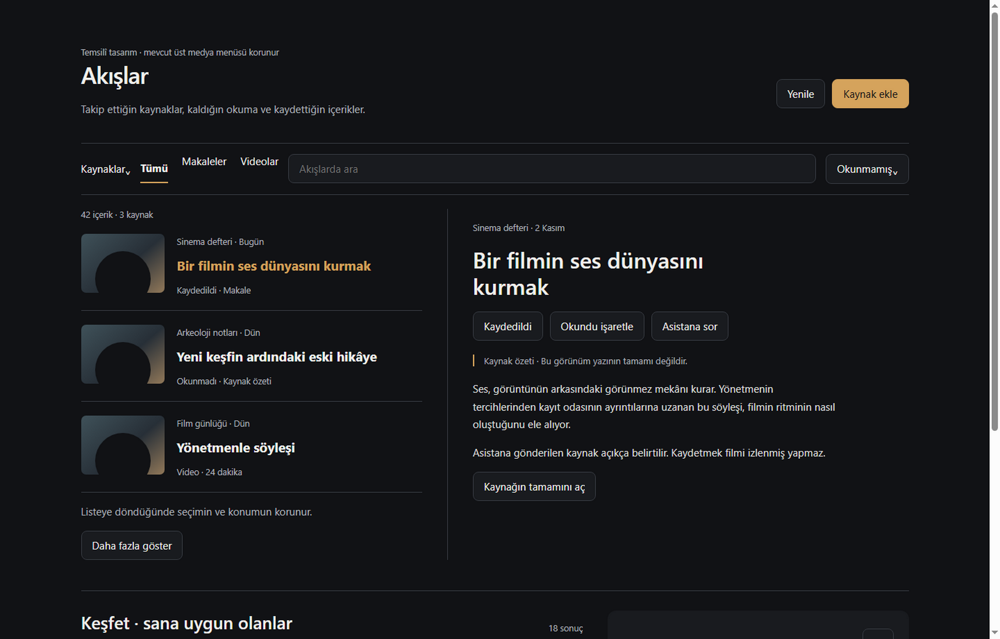
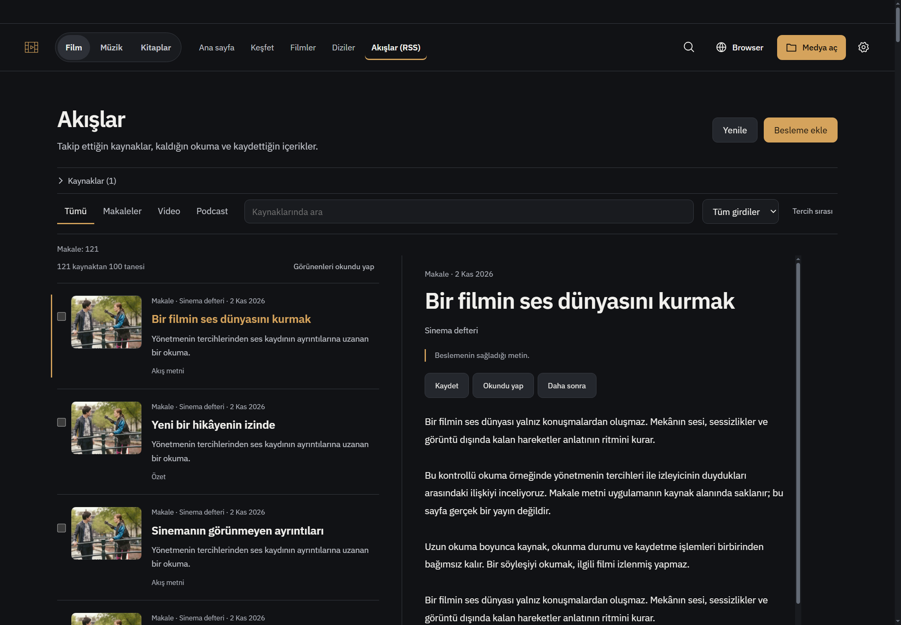
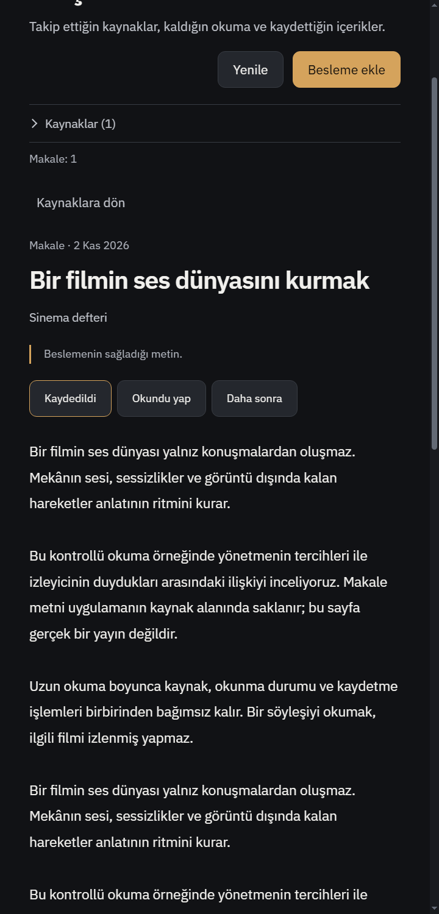
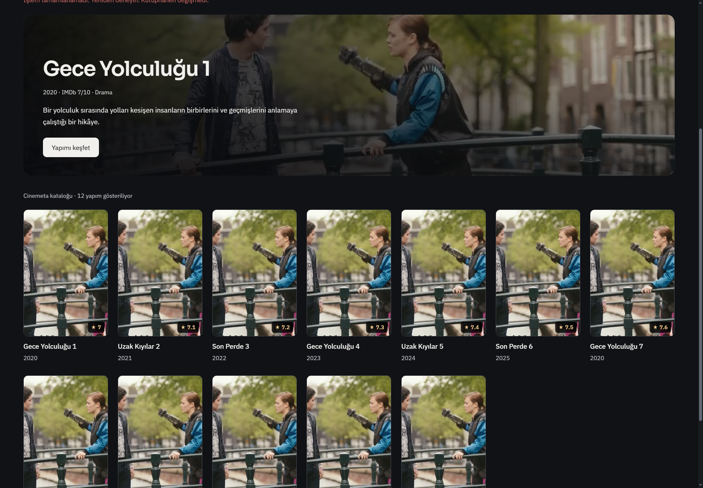
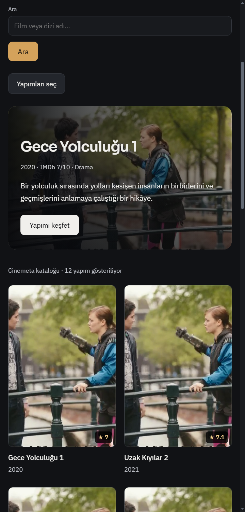
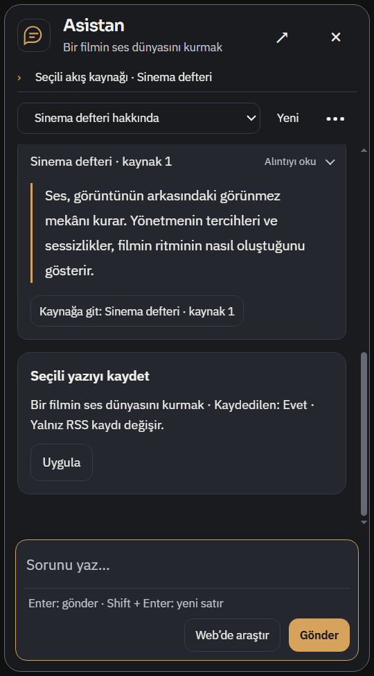
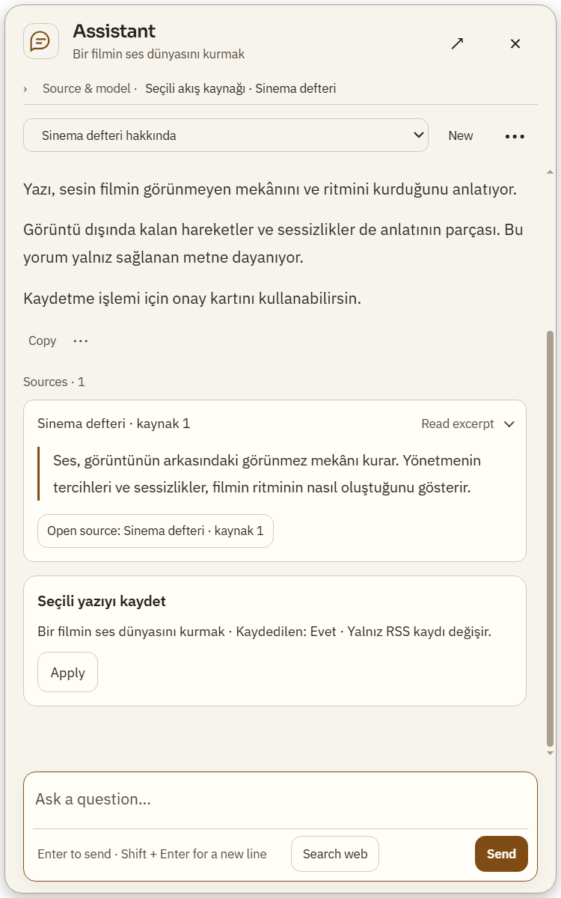

# RSS, Keşfet ve asistan teslimi — 2026-11-02

## Ürün değişiklikleri
- RSS: en yeni girdiler tarih sırasıyla; 100 sonrası daha fazla yükle; tüm abonelikleri sekizli sınırlı gruplarla yenileme. Kaynak adı, klasörü ve yenileme aralığı düzenlenebilir.
- Okuyucu: kaynak/listenin yanında okunabilir metin; dar ekranda tek akış. Arama, kaynak, filtre, seçili yazı ve kaydırma geri dönüşte korunur. Ana sayfadan okumaya dönülebilir.
- Keşfet: yeniden deneme aynı sayfa imlecini korur; mevcut kartlar ve hero yükleme sırasında kalır; sonuçsuz/filtreli/tükenmiş durumlar ayrıdır. Kartta kişisel durum ve puan çakışmaz.
- Asistan: seçili RSS yazısının durumunu okur; kaydet/okundu/daha sonra değişikliklerini başlık ve değişecek alanlarla onaya sunar. Kaynak ve durum değişmişse eski kart uygulanmaz. Birden fazla kaynakta belirsiz hedef reddedilir. Aynı yazının mevcut kanonik kopyaları açıkça belirtilerek birlikte güncellenir; film izlendi durumu değişmez.
- Alıntılar katlanabilir; cevap alanı korunur. Akış güncellemesinde açık/kapalı durum ve aynı mesajdaki klavye odağı korunur.

## Doğrulama
150 hedefli Node testi geçti (20 ilgili test dosyası, 4.45 saniye). Değişen JS sözdizimi ve git diff --check geçti. Tam npm test çalıştırılmadı; Actions başlatılmadı.

Gerçek Windows Electron testleri ayrı kontrollü profillerde geçti:
- tests/electron-feeds-discovery-assistant.smoke.js: 1440/480; gerçek store/preload, 121 yazının sayfalanması, arama/kaynak/kaydırma dönüşü, aynı imleçten retry, gerçek browser kaynak açma ve okumaya dönüş, bağlı asistan kaynağı.
- tests/electron-assistant-evidence-desk.smoke.js: 500/360; TR koyu ve EN açık, alıntı sürekliliği, doğru kaynak callback'i ve giriş alanının mesajları örtmemesi.
- tests/feed-navigation-race.test.js: peş peşe A/B tıklamasında geciken A, B'yi ezmez. Eski gövde yalnız bellekte yeniden kurularak negatif kontrolle B→A hatası tekrarlandı.

Native kontrollerde katalog/ağ/sağlayıcı cevapları kontrollüdür. Canlı DeepSeek dil başarısı, gerçek yayıncı erişimi, GPU, DRM ve kişisel hesaplar bu teslimde sınanmadı. Görseller temsilî içeriklidir; gerçek yayın veya kişisel veri değildir. Mevcut kişisel uygulama kapatılmadı. start.bat değiştirilmedi ve kişisel başlatma oturumu yeniden açılmadı.

## Görsel kompozisyon ve uygulama
Önce temsilî görsel taslak üretildi; ardından uygulama geniş/dar Windows görüntüleriyle incelendi. Üst medya menüsü ve film üst bölümü değişmedi. Grafit/amber dil ve ayrıntılı ayarlara erişim korunur.

## İncelenen upstream kod
- Miniflux finder.go: https://github.com/miniflux/v2/blob/main/internal/reader/subscription/finder.go — sınırlı cevap ve feed/HTML keşfi yaklaşımı; mevcut altyapı korundu. Go/framework taşınmadı.
- FreshRSS normal.phtml: https://github.com/FreshRSS/FreshRSS/blob/edge/app/views/index/normal.phtml — kaynak/girdi kimliği, okunma/kaydetme ayrımı ve aşamalı listeleme incelendi. PHP kodu kopyalanmadı.
Yeni bağımlılık veya yerel LLM eklenmedi. Üç GPT-6.1 Sol medium ajanı bağımsız alanlarda çalıştı; kaynak eylemleri ve son gezinme/alıntı farkları çapraz incelendi.
