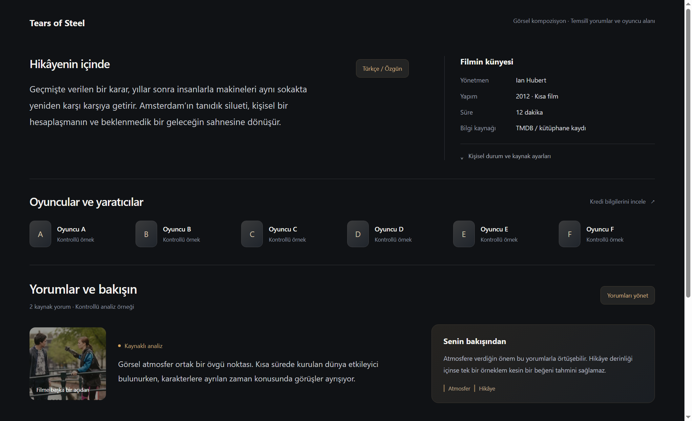
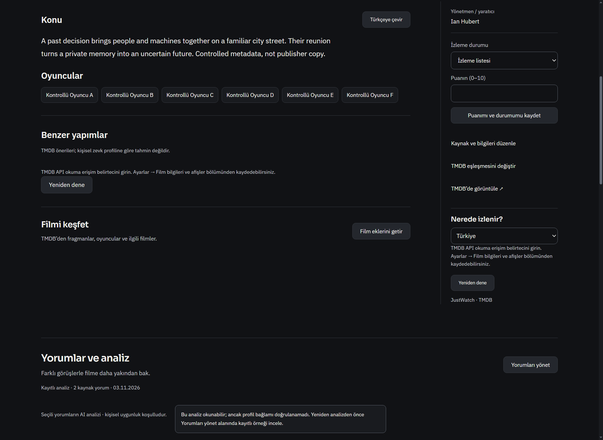
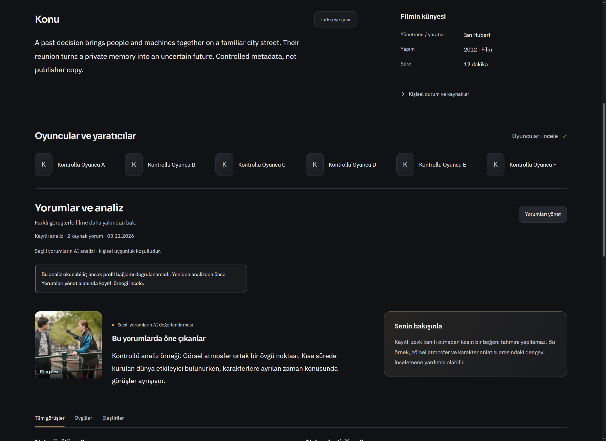
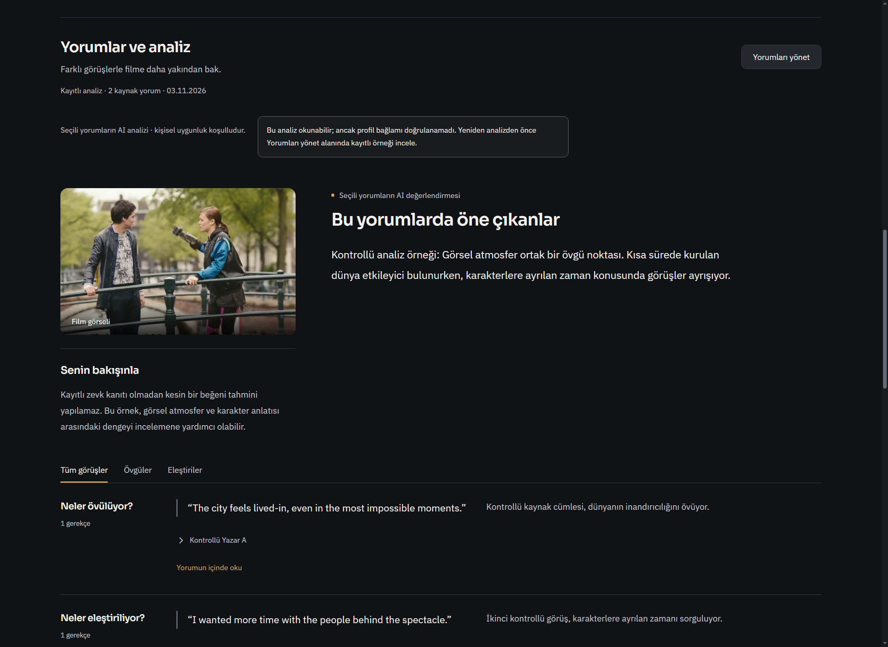
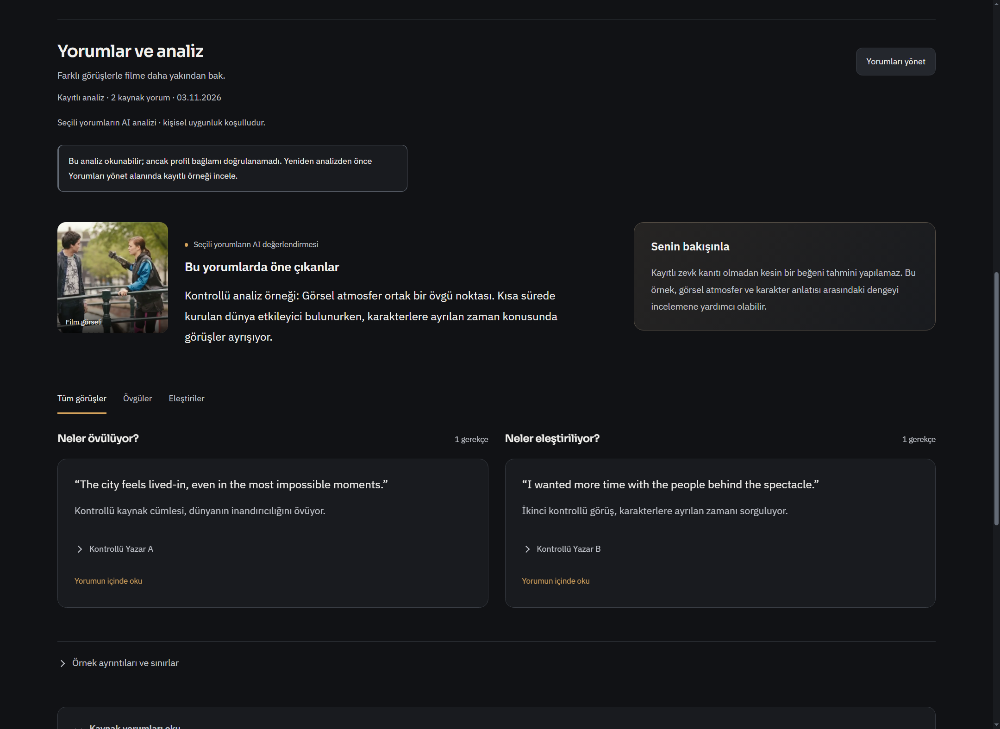

# Film sayfası: ortak künye ve yorum deneyimi

2026-11-03. Kullanıcının istediği alan: film sayfasının özellikle alt bilgi, oyuncu ve yorum/analiz bölümü. Beğenilmiş üst medya menüsü ve film hero düzeni değiştirilmedi. Başlangıç `c21903340ba954fb8975db4fb138609223cd78c9`; ürün commit `e8716d0138b30c1d325292c2972ac68785208011`.

## Görsel karar ve uygulama

Önce aşağıdaki tamamlanmış kompozisyon hazırlanıp sohbette gösterildi. Ardından aynı içerik hiyerarşisi gerçek yerel/Keşfet sayfalarına uygulandı. Kaynak adı/yorum/kişi uydurup ürün verisi gibi gösterilmez: taslak ve Windows kanıtındaki örnekler açıkça kontrollü olarak etiketlidir.



- **Konu ve künye:** okunabilir uzunlukta anlatım ile yönetmen, özgün ad, yapım ve süre aynı baz çizgisinde. Yalnız mevcut gerçek alanlar çizilir. Konu çevirisi mevcut eylem sahibindedir.
- **Oyuncular ve yaratıcılar:** kaynakta bulunan isimler ayrı şerit oluşturur. “Oyuncuları incele” mevcut TMDB bilgi sahibini kullanır; gelen gerçek kişi fotoğrafları/biyografileri kendi alanına bağlanır. Fotoğraf yoksa isim baş harfi görünür. Yeni otomatik ağ/AI çağrısı eklenmedi.
- **Yorumlar:** özet ve kişisel uygunluk iki farklı okuma odağıdır. Övgü/eleştiri kaynak alıntıları ile AI gerekçeleri ayrı gösterilir. Filtre, özgün metne atlama, uzun kaynak metni, spoiler izni ve önceki analiz karşılaştırması korunur. Güncel olmayan/belirsiz profil uyarısı gizlenmez.
- **İleri araçlar:** mevcut DOM ve sahipleri taşınır; yeniden yazılmaz. Puan/durum taslağı ve açık ayrıntı, yerel konu çevirisinin sayfayı çizmesinde korunur. İzleme/kaynak/günlük araçları tek isteğe bağlı ayrıntı alanında durur.
- **Hareket:** oyuncu şeridi, açılan ayrıntı ve seçili yorum kümesi için kısa, bağlama bağlı 200 ms giriş; sürekli dekorasyon yok. Mevcut global reduced-motion kuralı korunur; native emülasyonda algılanır geçiş kaldırılması doğrulandı.

## Windows önce / sonra

| Önce | Sonra |
|---|---|
|  |  |
|  |  |

[Geniş oyuncu ayrıntıları](local-credits-1440.png) · [Dar TR konu](local-overview-480-tr.png) · [Dar TR analiz](local-analysis-480-tr.png) · [EN açık tema konu](local-overview-940-en.png) · [EN açık tema analiz](local-analysis-940-en.png) · [Keşfet konu](discovery-overview-1440.png) · [Keşfet kayıtlı analiz](discovery-analysis-1440.png) · [Keşfet boş analiz](discovery-empty-1440.png).

## Doğrulanan entegrasyon onarımları

1. Keşfet detayının ham `providerId` kaydı günlük/izleme sahiplerine yerel katalog kimliği gibi gönderiliyordu. Geçerli Keşfet IMDb kimliği artık açık `discovery:{kind,id}` sözleşmesiyle aktarılıyor; gerçek yerel `id` varsa aynen korunuyor. Native kabulde gerçek servis, aynı filmin yerel kayıtlı analizini Keşfet'ten de buldu; kaynak/günlük ve izleme hazırlığı okundu. Kimlik doğrulaması atlanmadı.
2. Metadata sahibi yerel film ana bloğu henüz sayfaya bağlanmadan kurulabiliyor. Yeni oyuncu alanı bağlanırken gerçek sayfa tekrar belirlenir; controller WeakMap anahtarı gerçek metadata section düğümüdür. Geç yanıt/ayrılma kontrolü sürer. Yeni kurulum sırasında yakalanan null WeakMap anahtarı hatası teslimden önce düzeltildi ve ayrı regresyonla kapatıldı.
3. Discovery'nin eski genel başlık/ayrıntı stilleri yeni alanları büyütüyordu. Dossier kapsamı içinde ortak tipografi/kenarlık sahibi tanımlandı. Yeni yerleşim kimlikleri tekil; bilinmeyen ek özellik düğümleri de düşürülmeden korunuyor.

## Kısa kontroller

- Beş hedefli test dosyası: **28 PASS / 0 FAIL**, yaklaşık 1,1 s. Kaynak kimliği, spoiler, profil güncelliği, metadata geç yanıtı, kaynak alıntısı, taslak ve mevcut eylemler dahil. [Gerçek çıktı](unit.log).
- Değişen dokuz JS dosyası `node --check`: **9/9**. [Sonuçlar](syntax.json).
- Gerçek Windows Electron main/preload/renderer, ayrı sentetik profil: **PASS**, 1440 TR koyu / 480 TR koyu / 940 EN açık, on ekran yakalaması; reduced-motion da emüle edildi. [Makbuz](acceptance.json).
- Native test, gerçek katalog/yorum/günlük/izleme servislerini kullanır. Metadata/çeviri/Keşfet katalog ağ verisi kontrollüdür. Boş analiz ekranı için yalnız sentetik test profilindeki yorum fixture'ı silinir. Kişisel profil, anahtar ve kullanıcı dosyası okunmaz/değiştirilmez.
- İlk native koşularında keşfedilen kurulum hatası ve CSS çakışmaları giderildi. Dil/tema varyantları arasında test açık film sayfasını kapatıp ev sahibini yeniden açar; yerinde canlı dil değişimi bu tasarım tesliminin garantisi değildir. İlk reduced-motion probunun tam `0s` beklentisi, mevcut global `0.00001s` politikasıyla düzeltildi; algılanır geçiş kabul edilmedi.
- Canlı TMDB/Letterboxd/AI, gerçek kişilerin fotoğrafları, GPU/DRM, `start.bat` yeniden başlatması ve tam test paketi bu turda koşulmadı. Geliştirme native penceresinin geçmesi bunları doğrulamaz. GitHub Actions başlatılmadı; teslim `[skip ci]`.

## Kaynak ve yeniden çalıştırma

Yeni bağımlılık, API ayarı, hesap veya upstream kod kopyası yok. Mevcut MediaTitle, MediaDiscovery, FilmContextFeatures ve MediaReviewDecision sahipleri kullanıldı. `frontend-design` / `make-interfaces-feel-better` ilkeleri mevcut DESIGN.md sınırlarına göre uygulandı. Görsel demo `docs/media/demo-poster.png` içindeki Tears of Steel karesinin yalnız görüntü bölümünden gelir; asıl atıf/lisans `docs/media/README.md` içinde (Blender Foundation, CC BY 3.0).

```powershell
node --test --test-isolation=none tests/film-page-lower.test.js tests/film-page-enhancements.test.js tests/film-review-inline.test.js tests/film-review-editor.test.js tests/film-context-features.test.js
# Windows: mevcut native başlatıcıyla (ELECTRON_RUN_AS_NODE kaldırılmış olarak)
$env:ELECTRON_RUN_AS_NODE = $null
& .\node_modules\electron\dist\electron.exe tests/electron-film-lower.smoke.js
```

Native test kendi sentetik profilini `tmp/film-lower-native-*` altında oluşturur. Geçmiş koşu profilleri teslim belgelerine dahil edilmedi; yalnız bilinen sentetik görüntüler ve kontrol çıktıları arşivlendi.
