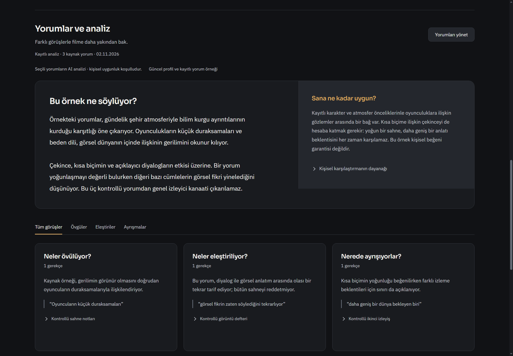
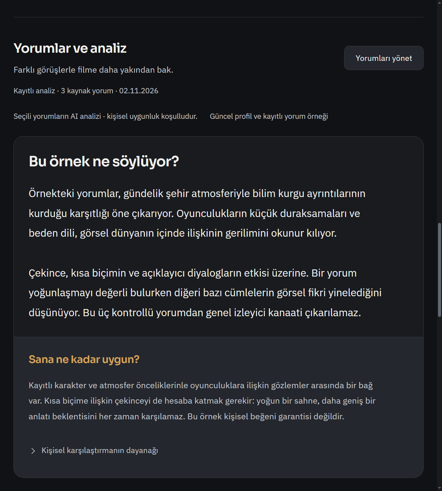
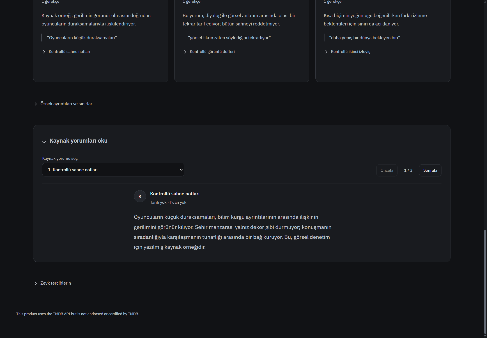

# Film yorumları ve analiz: alt bölüm tasarımı

Başlangıç `691c56cc56087a47fe372542c501a133877537ab`; ürün `fbb1f5262f7937c09cd8330e104f7aa16d6a4715`.

Kullanıcı üst film alanını beğendi; o alan korunur. Yeni CSS yalnız `.media-title-page` içindeki yorum bölümünü hedefler. Ortak grafit zemin, amber vurgu, IBM Plex Sans ve mevcut EN/TR düzeni korunur. Yeni bağımlılık, sunucu isteği, sağlayıcı veya kullanıcı kaydı değişikliği yok. Agent kullanılmadı.

## Tasarım kararı ve uygulama

Önceki eşit ağırlıklı metin blokları yerine iki parçalı analiz odağı: geniş ana özet ve daha sakin kişisel uygunluk yüzeyi. Ardından övgü/eleştiri/ayrışma için kaynak alıntılı ayrı görüş alanları. Dar görünümde kolonlar doğal sırayla yığılır. Boş durumda kaynak yorumu/karşılaştırma işini anlatan kısa bir giriş; sahte analiz veya puan yok. Özgün yorum okuyucusu varsayılan açık, yazar/bağlantı ve önceki/sonraki kontrolü korunur. Tam metin ve spoiler kapıları korunur. Ayrıntılar, kanıt sınırları, kayıt geçmişi, profil ve inline üretim editörü kaldırılmaz.

Değişiklikler: `review-decision-ui.js` başlık/giriş/semantik görüş alanları ve açık kaynak okuyucu; `film-review-cinema.css` alt bölümün duyarlı hiyerarşisi; `index.html` yerel CSS yüklemesi. Üst menü, hero ve oynatma kontrolü değişmez. `frontend-design` ve mevcut tasarım tokenları kullanıldı; premium skill dosyası katalog yolunda bulunamadığından okunmuş/kullanılmış iddia edilmez.

## Kanıt

`node --test --test-isolation=none tests/film-review-inline.test.js tests/film-review-editor.test.js` **11/11 PASS**. Kaynak alıntısı doğrulama/spoiler ve kayıt bağlamı davranışları korunur. JS syntax/diff geçti. İzole gerçek Windows uygulamasında1440 koyu,900/%125 koyu/açık film/analiz/kaynak okuyucu görüntüleri; yatay taşma yok ve övgü filtresi yalnız övgü alanını gösteriyor. İlk filtre fixture'ında click sonrası mikro-görevi beklemeden yapılan kontrol düzeltildi. Son yerel yeniden kontrol12görüntü üretti. Kişisel açık uygulama ve profil kullanılmadı. Sentetik yorumlar ve mevcut lisanslı demo görseli kullanıldı; canlı Letterboxd/AI kalite kanıtı değildir. Tam suite/Actions yok.

