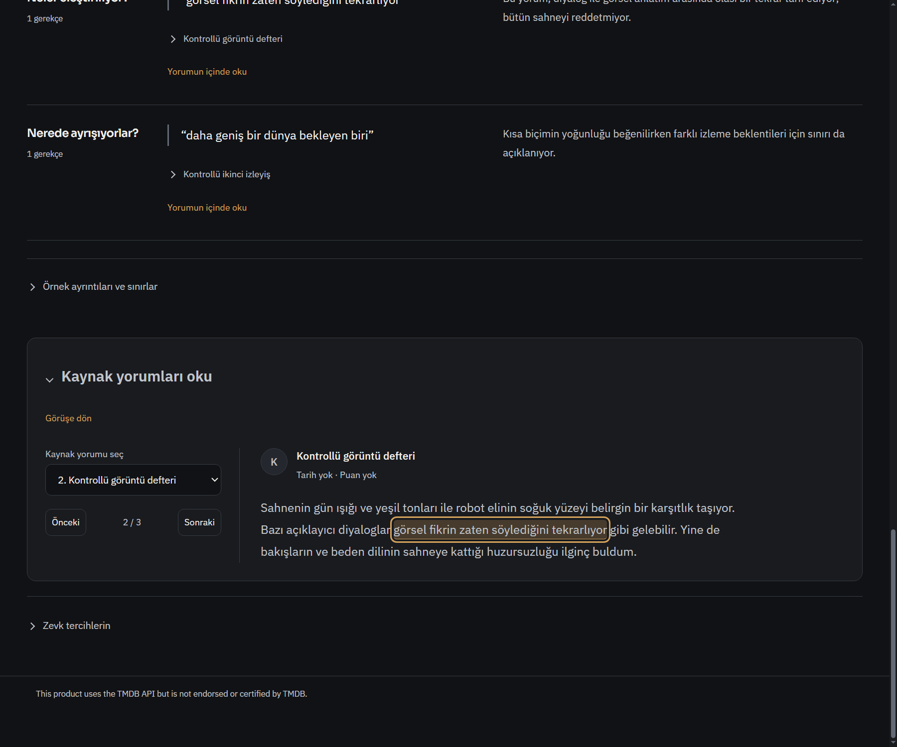
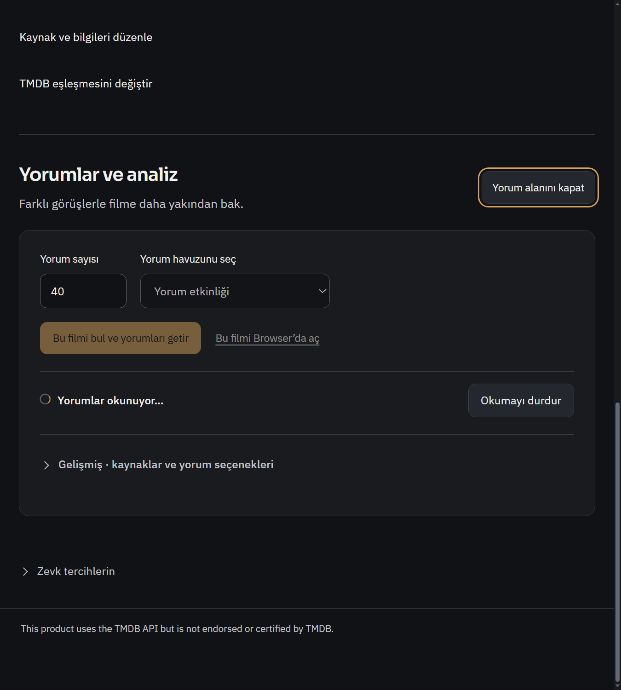
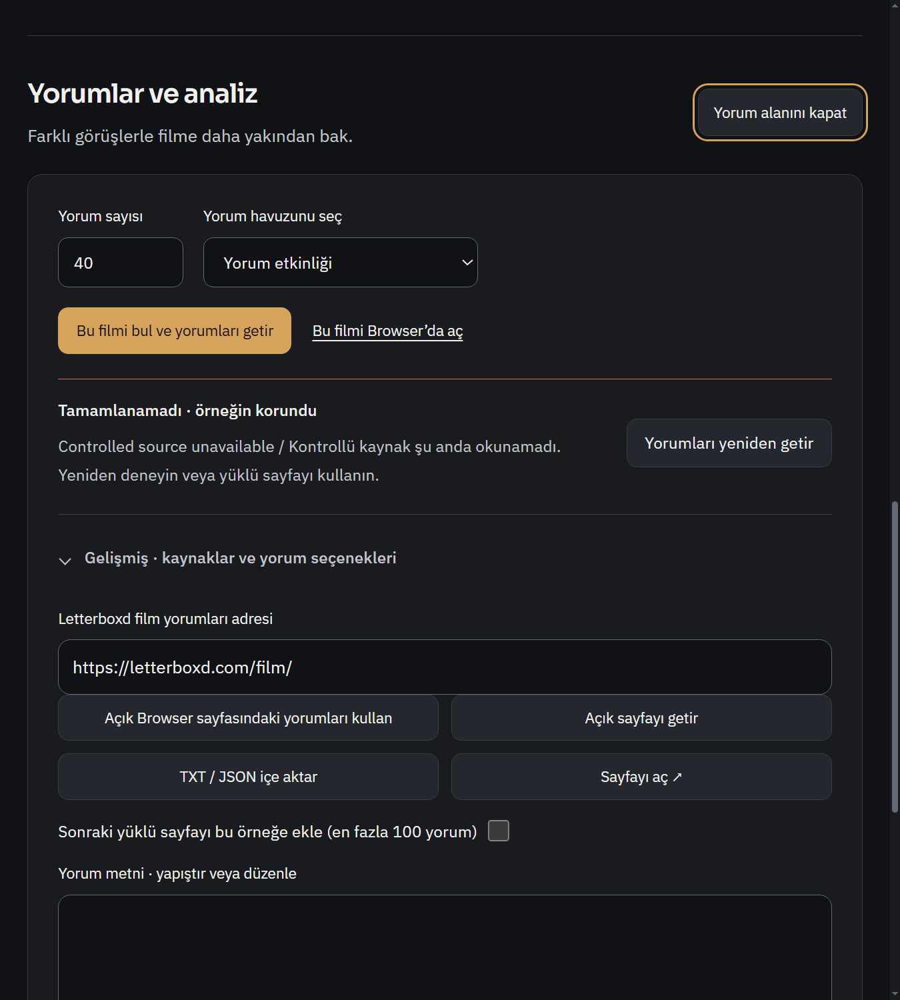
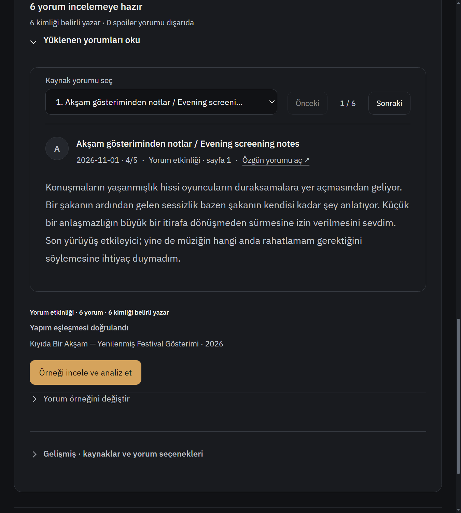
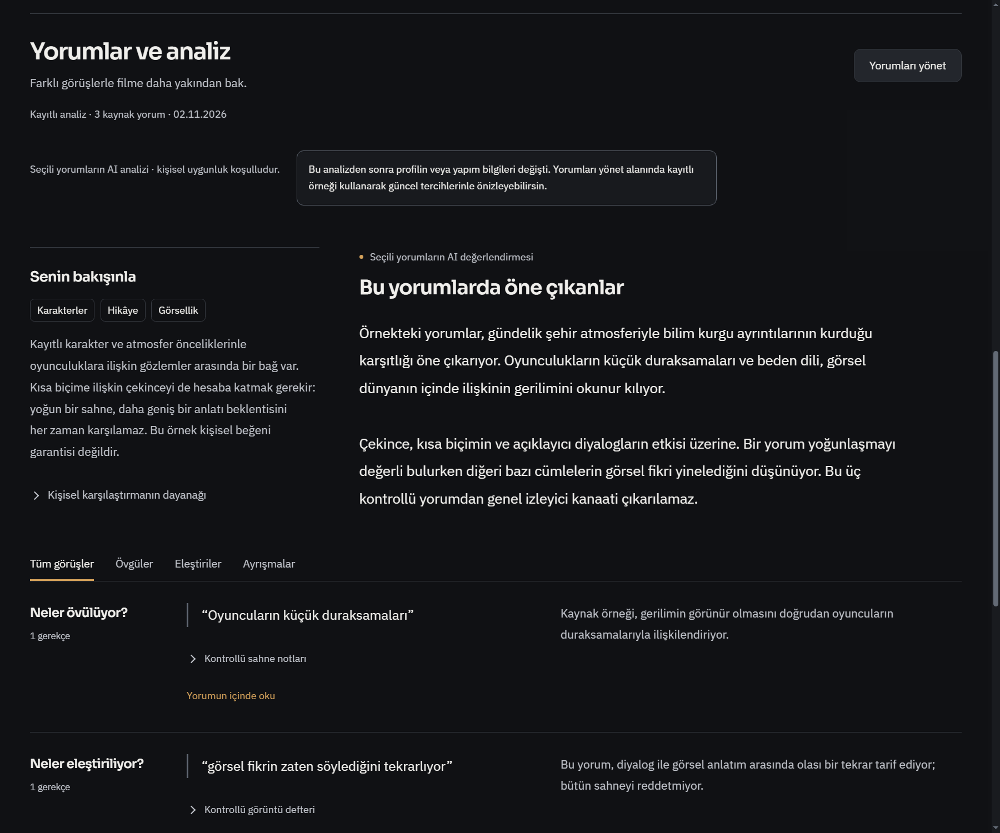

# Film yorum akışı: beş bağlantılı iyileştirme

Başlangıç `3bbd51b1b0e81db9f5f99bfb01dd45b41762a771`; ürün `538bf01e83380d63ed200047af72204f7950d254`.

Önce [görsel taslak](concept.png) [ayrı HTML](concept.html) olarak render edilip sohbette gösterildi. Sonra üretim arayüzüne uygulandı. Prototipin durum örnekleri/yorumları kontrollü görsel girdilerdir; statik düğmeler çalışan uygulama iddiası değildir. Mevcut grafit/amber medya kimliği ve üst film alanı korunur. Agent yok.

| Hedef | Teslim edilen davranış |
|---|---|
| Yorum yönetimi | Yorum sayısı/havuzu/okuma komutları ortak kontrol alanında; birincil yolun tekrarlı teknik açıklamaları gelişmiş kaynaklara taşındı. TXT/JSON, Browser, elle düzenleme, spoiler, ek sayfa ve örnek seçimi korunur. |
| Analizden kaynağa | **Yorumun içinde oku / Read in context** tam yorum kimliğini seçer, doğrulanmış alıntıyı özgün metinde `mark` ile vurgular, tam paragrafı gösterir. **Görüşe dön** ilgili kontrolün odağına döner. DOM text node kullanılır; kaynak metin HTML yapılmaz. |
| Kişisel uygunluk | Analizle saklanan açık önceliklerin ilk üçü görünür. Profil yoksa açık koşulluluk uyarısı; dayanak disclosure'ı ve eski/güncel/bilinmeyen bağlam metinleri korunur. Bu çipler yeni bir AI tahmini veya yüzde puanı değildir. |
| Durumlar | İlk yükleme/hata, kaynak okuma/durdurma/yeniden deneme, analiz hazır/kayıtlı ve eski bağlam gerçek durumlara bağlıdır. Sıfır uygun yorum ayrı `empty` durumu; boş örnekte AI önizleme gizlenir. Hareket yalnız etkin işte, reduced-motion'da durur. |
| Süreklilik | Film/discovery sayfaları oturum içinde kaydırma konumunu; analiz filtre/yorum seçimini sınırlı yerel UI hafızasında korur. Geri dönüş liste konumunu geri getirir. İlk async analiz yüklenmesi bittikten sonra sayfa konumu yeniden uygulanır. Bunlar uygulama yeniden başlatıldığında tüm geçici UI durumlarının diskten geri gelmesi iddiası değildir. |

## Dosyalar

`review-decision-ui.js`: kaynak bağlantısı, güvenli vurgu, gerçek kişisel dayanak, boş örnek durumu, kontrol sırası, kimlik kapsamlı100kayıt sınırıyla filtre/yorum seçimi. `film-review-cinema.css`: kontrol alanı, durum göstergesi, kaynak vurgusu ve duyarlı düzen. `media-title.js`:100girdilik sayfa konum hafızası ve async restore. `media-discovery-ui.js`: kesin provider/kind/year sayfa anahtarı ve restore çağrısı. Üç mevcut test dosyası: yeni kaynak/kişisel/boş örnek regresyonları ve okuyucunun yan yana ya da alt alta olmasına uygun gerçek dikdörtgen kesişim kontrolü. Geometri testi gevşetilmez; iki boyutlu çakışma ölçülür.

## Doğrulama

`node --test --test-isolation=none tests/film-review-inline.test.js tests/film-review-editor.test.js tests/review-workflow.test.js tests/review-discovery-handoff.test.js` **57/57 PASS**, yaklaşık1,5sn. Değişen JS syntax ve diff kontrolü geçti. İlk kaynak vurgusu/görüşe dönüş ve filter/reader refresh testleri; profil yok/güvenilir açık öncelikler; boş örneğin AI önizlemesini engellemesi kontrol edildi.

Mevcut gerçek Windows reader/workflow kontrolü EN/TR geniş/dar, seçim, tam metin, spoiler, yükleme ve kaynak hatasında geçti. Ardından tek dar görünümle kontrol alanının son CSS sıralaması/ölçüleri ve durumları yeniden görüntülendi. Görsel incelemede bulunan eski `order` kuralı ve renderJob kaynak sırası çakışması düzeltildi.

Ayrı kısa native akış gerçek preload/main/catalog/discovery/analysis yollarında kontrollü provider metadata ile: tam alıntı/yorum kimliği, görüşe dönüş odağı, film konumunun birebir geri gelmesi, yorum seçiminin korunması, Keşfet listesine dönüş ve aynı filmi yeniden açma geçti. [Makine okunur akış sonucu](flow-result.json).

Yeni bağımlılık/veri şeması yok. Tam suite/Actions/live Letterboxd/live DeepSeek/GPU/DRM/kullanıcı profili kullanılmadı. Gerçek model kalitesi ve tüm sitelerde erişim garantisi iddia edilmez. Açık kişisel uygulama kapatılmaz; ana kopya güncellemesi sonrası yeniden açılmalıdır. Eski raporlar ve kişisel dosyalar bu teslim kapsamı değildir.
