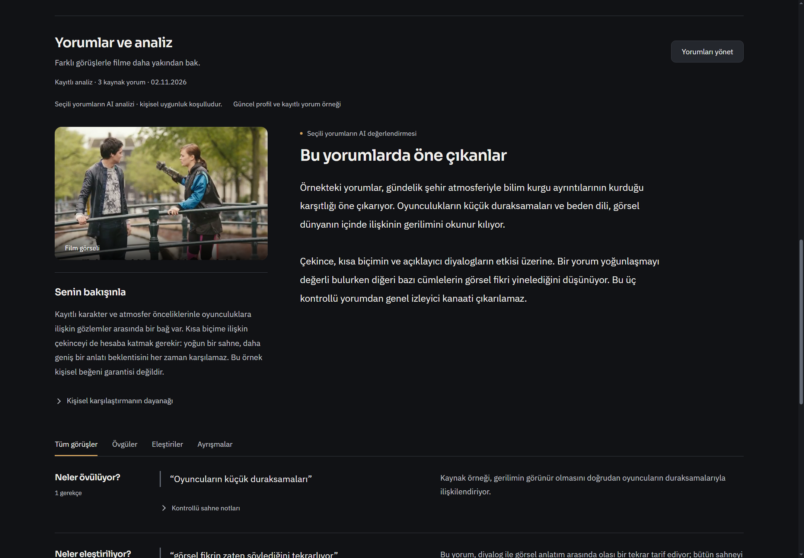
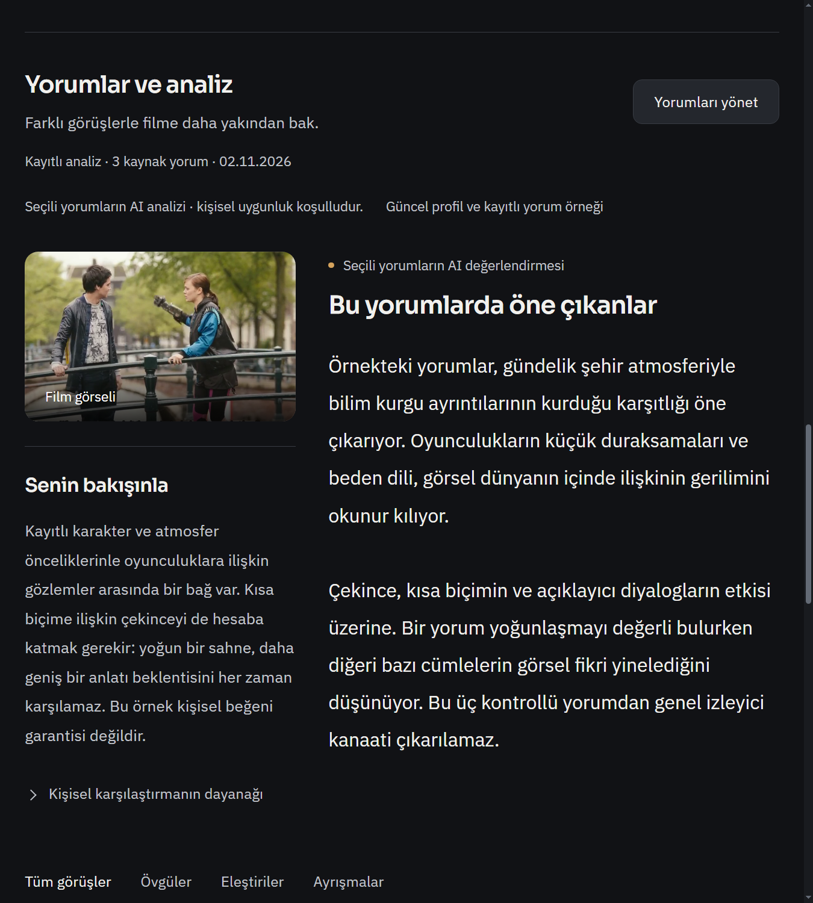
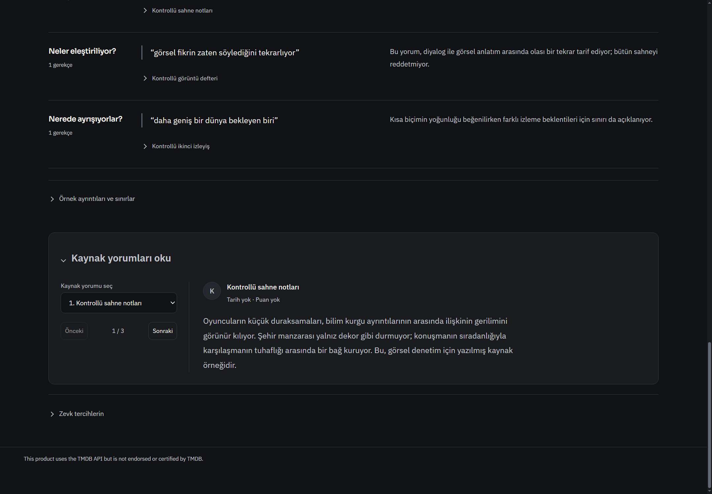

# Önce görsel tasarım: film alt bölümü

Başlangıç `fdb4adefec1f532d118c5c6ac1539416fd03ebb1`; ürün `c20cfa280cefafc7c6ceb4870a7a6cfef70d4503`.

Önce [bağımsız HTML kompozisyonu](concept.html) render edildi ve kullanıcıya [taslak görüntüsü](concept.png) gösterildi. Üretim uygulamasına bundan sonra geçildi. Görsel tez: filmin atmosferini sürdüren görsel/kişisel bakış rayı; sağda açık, çerçevesiz analiz okuması; alt bölümde kartlar yerine alıntı ve gerekçenin yan yana geldiği kanıt satırları; özgün yorumda seçim/okuma ayrımı. Ortak grafit/amber ve fontlar korunur. Üst film hero'su veya genel menü değiştirilmedi. Agent kullanılmadı. Her tasarımda önce görsel hazırlama kullanıcı kuralı AGENTS.md içinde yayımlanır.

## Uygulama

- `review-decision-ui.js`: yalnız film sayfasında görsel ray, mevcut güvenli data-image film backdrop/afişinin kullanılması, geç gelen görsel için observer ve sayfa kapanınca temizliği. Kaynak metin/alıntı/parafraz ayrımı, spoiler kapısı ve mevcut profil/kanıt ayrıntıları korunur. Yeni ağ veya AI isteği yok. Mevcut görsel yoksa sahte görsel üretilmez, boş resim gösterilmez.
- `film-review-cinema.css`: önceki kart düzeni değiştirilir; yorum okuma alanında yan seçim, doğal metin yüksekliği, duyarlı tek kolona dönüş. Yeni stiller yalnız film alt bölümüne kapsamlıdır. Reduced-motion korunur.
- `film-review-inline.test.js`: geç yüklenen gerçek mevcut görselin bağlanması ve kaynak okuyucu/kişisel bölümün korunması kontrolü.

Prototipteki yorum metni ve lisanslı Tears of Steel demo görseli açıkça kontrollü örnektir. Prototip HTML statik görsel çalışma; düğmeleri üretim işlevi değildir. Gerçek sürüm mevcut uygulama araçlarına bağlıdır. Yeni bağımlılık ve veri şeması yok.

## Kontrol

`node --test --test-isolation=none tests/film-review-inline.test.js tests/film-review-editor.test.js`: **12/12 PASS**, yaklaşık0,8sn. JS syntax/diff geçti. Gerçek izole Windows Electron'da1440 koyu ve900/%125 koyu/açık analiz/yorum görselleri, yatay taşma kontrolü ve görüş filtresi geçti. İlk incelemede uzun select esnemesi bulundu; sabit42px kontrol ve flex düzeltmesi uygulanıp son native görüntüler yeniden alındı. Önceki CSS katmanlarını üst üste eklemek yerine bu bölüme ait CSS dosyası yeniden yazıldı.

Sınırlar: canlı model/Letterboxd/kişisel profil/GPU/DRM/full suite/Actions yok. Görsel karşılaştırma ve işlev kontrolleri estetiğin kullanıcı tarafından beğenildiğini kanıtlamaz. Açık kişisel uygulama kapatılmaz. Geçerli eski analiz verisi olduğu gibi gösterilir; bu tasarım eski AI metnini yeniden üretmez.
