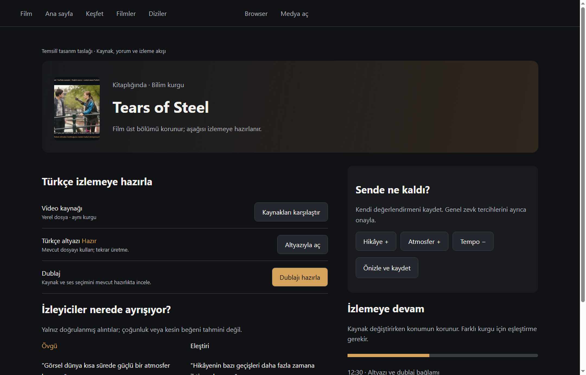
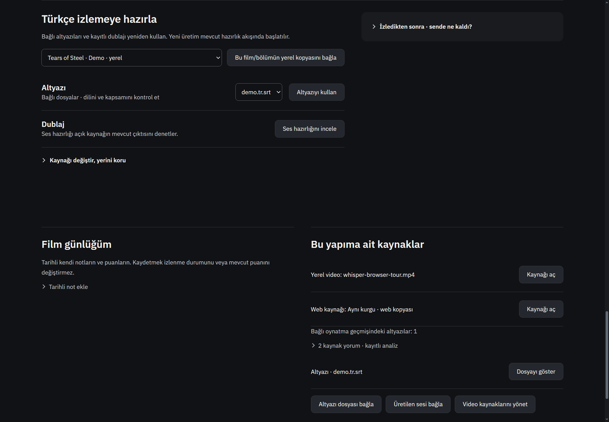
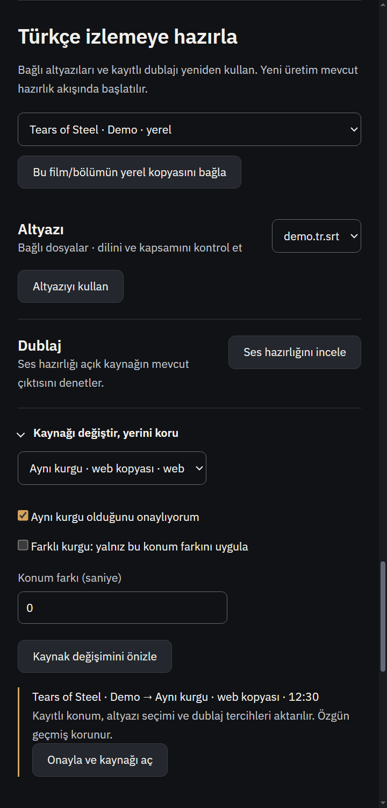
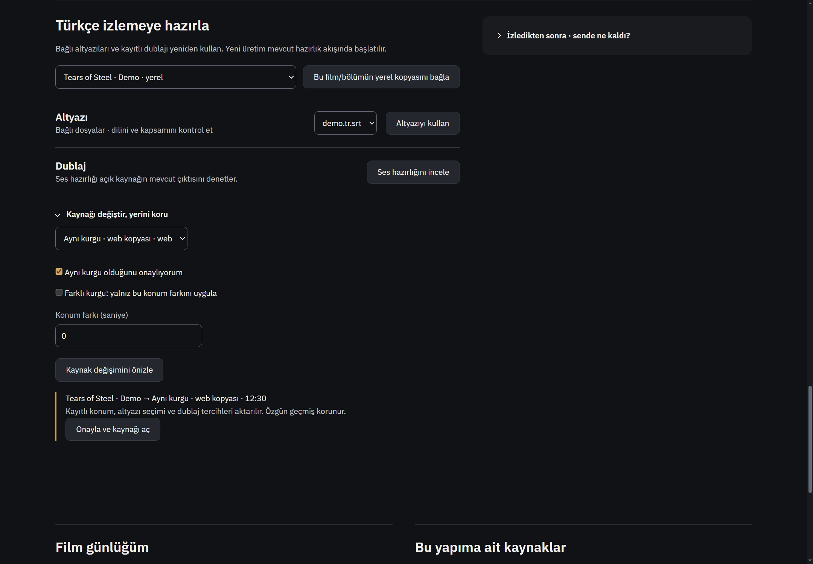
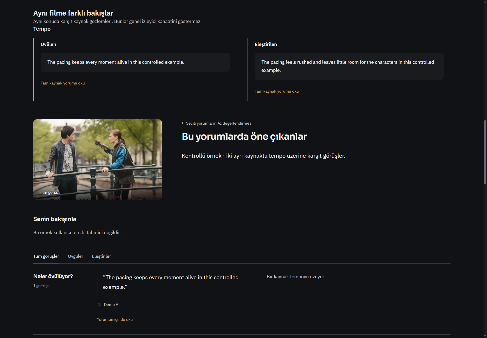
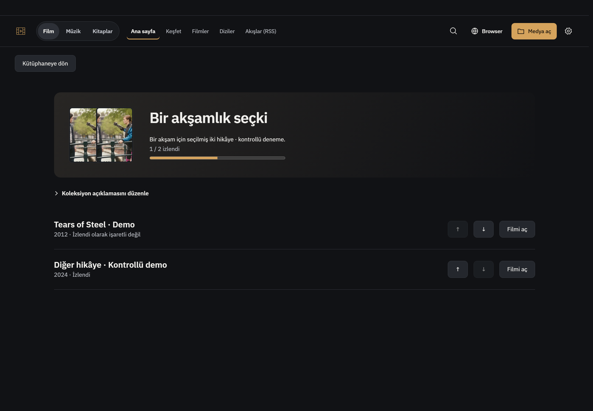
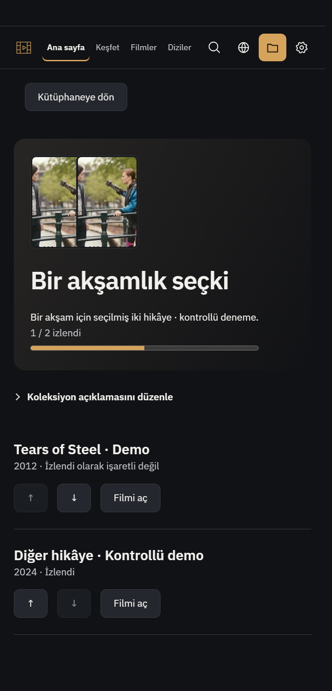
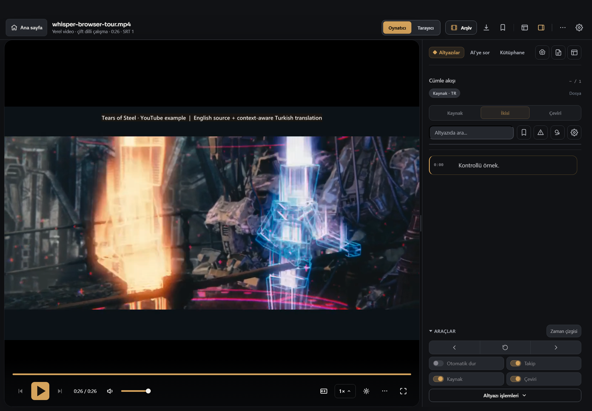

# Film izleme deneyimi — yedi hedef

Başlangıç: `47980a200c67681fa1372134ce90aff8d0baadee`. Ürün commit’i: `0dfc29f67e4ad026c59831c60e2df2f276c8f2f6`.

## Kullanım ve tamamlanan işler

| Hedef | Yeni erişim / davranış | Korunan sınır |
|---|---|---|
| Türkçe izleme hazırlığı | Film sayfası altındaki **Türkçe izlemeye hazırla**: gerçek kaynak, bağlı altyazı/ses dosyaları, kayıtlı dublaj işareti, mevcut ses hazırlığına geçiş. Kayıtlı altyazı doğrudan açılır. Kaynağa bağlı dublaj incelemesi mevcut çıktıyı arar. Yerel altyazı yoksa doğru dosya Whisper stüdyosunda hazırlanır; web için mevcut altyazı menüsü açılır. | Dil/kapsam dosya adına bakılarak kanıtlanmış sayılmaz. Yeni Whisper/AI/dublaj işi düğmeye basılmadan başlatılmaz. |
| Günlük asistan araçları | `get_evening_candidates`, `read_daily_library`, `open_daily_library`, `set_watchlist_section`. Gerçek süre/tür adayları ve kayıtlı bölüm konumu; onaylı liste bölümü değişikliği. | Liste değişikliği gerçek aksiyon kartı ister; kartın liste revision’ı sonradan değişmişse reddedilir. Mevcut bölüm kaydetme ve koleksiyon onayı tekrar yazılmadı. |
| Karşıt yorumlar | Aynı konuya ait doğrulanmış övgü/eleştiri, farklı kanonik yazar hesaplarından geliyorsa **Aynı filme farklı bakışlar**. Alıntıya basınca tam metindeki doğru konum vurgulanır. | Model konu alanı yalnız doğrulanabilir konu sınıflarını kabul eder. Eski konusuz analizde sahte karşıtlık çıkarılmaz. Spoiler işaretli kaynaklar eşleştirilmez; örnek çoğunluk/uzlaşı garantisi değildir. |
| İzleme sonrası değerlendirme | **İzledikten sonra · sende ne kaldı?** içinde açık hikâye/oyunculuk/tempo/görsellik/ses/duygu/atmosfer görüşleri. Ayrıntılarda genel önceliklerin 0–5 değişimi, önce önizleme sonra açık onay. | Film görüşü kaydetmek beğeni, izlenme veya genel zevk ağırlığı eklemez. Genel değişim diğer öncelik, kaçınma ve notları korur. AI profil öğrenmesi diye sunulmaz. |
| Kaynak devamlılığı | Film veya **tam bölüm** için native seçiciyle yerel kopya bağlama. Kaynak değişimi önizlemesi: aynı kurgu onayında konum/altyazı seçimi/dublaj tercihleri aktarılır; özgün kayıt korunur. Farklı kurgu için saniye cinsinden konum farkı önizlenir. | Farklı kurguya yalnız konum aktarılır; altyazı/dublaj otomatik uyumlu varsayılmaz. Kaynak/ilerleme değişince eski onay reddedilir. Bölüm kopyasının ilerlemesi ortak kişisel kayıtta/dizi merkezinde izlenir; başka bölüm izlenmiş yapılmaz. |
| Koleksiyon sayfaları | Filmler listesindeki koleksiyon filtresinden **Koleksiyon sayfasını aç**. Mevcut afişlerden kompozisyon, açıklama, kişisel sıra, izlenen sayısı; sıra oklarla kalıcı değişir. | Üyeler değiştiğinde eski sıralama/açıklama yazımı reddedilir. Üyelik ekleme için mevcut önizleme/onay sistemi korunur. |
| Yalnız sorunlu dublaj grubu | Mevcut video anından grubu açma akışı korunur. Metin düzenleyicide **Metni kaydet · yalnız bu grubu üret** tek adımı; yanında **Önceki ve yeni kaydı karşılaştır**. | Sadece seçili grup forceGroups’a gider; diğer hazır kayıtlar önbellekte kalır. A/B kayıt denetimi ve uyumsuz eski kaydı uygulama yasağı korunur. |

## Mimari / değişen dosyalar

- `film-watch-service.js`: mevcut yetkili media-tools IPC’sinden hedef/kaynak doğrulama, native seçilmiş dosya ilişkileri, sender-bound süreli onay, optimistic revision, kalıcı koleksiyon açıklaması/sırası. `userData/film-watch.json` v1, üst sınır 8 MB; yerel alternatifler 2000 ile sınırlı. Kaynak eşlemeleri katalog eser/bölüm kimliğiyle saklanır. Alias okuması stat imzasıyla sınırlı cache kullanır; büyük kütüphanede her kart için JSON tekrar parse edilmez.
- `media-tools-service.js` ve `main.js`: mevcut kanal içinde bağlama; ham renderer yolu alıp yetki veren yeni IPC yok. Native import kontrolü sürer.
- `dub-playback-assets.js`: var olan native seçim/opaque token mekanizması, doğrulanmış native-picked film sesiyle paylaşılır; yeni renderer path endpoint’i yok.
- `personal-media-state.js`, `personal-media-service.js`, `media-catalog-service.js`, `media-daily-service.js`: tam bölüme bağlı alternatif yerel kaynağın gerçek ilerlemesi; belirsiz/bonus kaynak otomatik bölüm işaretleyemez.
- `renderer.js`: ana süreçteki yeni elle bölüm konumu, daha eski oynatma geçmişiyle ezilmez; son geçmiş tercih önbelleği yenilenir.
- `film-watch-ui.js/.css`, `index.html`, `film-page-enhancements.js`, `media-home.js`, `media-daily-ui.js`: görünür film hazırlığı, onaylı kaynak devamı, detaylı görüşler, koleksiyon sayfası ve alternatif kaynaktan dizi devamı.
- `assistant-capabilities.js`, `assistant-agent-service.js`, `assistant-provider.js`, `assistant-daily-actions.js`, `assistant-library-actions.js`: kayıtlı araç tanımı, değişiklik öncesi revision yakalama ve uygulama.
- `media-tools-model.js`, `review-decision-ui.js`: kaynakla doğrulanan konu etiketleri ve iki karşıt kaynağın tam yorumuna gezinme.
- `dub-generator-ui.js`, `dub-group-takes-ui.js`: tek grup kaydet/yeniden üret ve mevcut A/B alanına kısa yol.

Yeni bağımlılık, framework, yerel LLM veya hesap kurulumu yok. Beğenilmiş üst medya menüsü ve film üst bölümü değiştirilmedi. EN/TR kullanıcı metinleri ve dar ekran düzeni var; ayrıntılı ayarlar kapatılmadı.

## Kontroller

**128 hedefli kontrol geçti**, yaklaşık 3,6 saniye. Komut:

```powershell
node --test --test-isolation=none tests/film-watch.test.js tests/personal-media-state.test.js tests/assistant-capabilities.test.js tests/assistant-library-actions.test.js tests/assistant-agent-service.test.js tests/assistant-provider.test.js tests/dub-generator-ui.test.js tests/dub-group-takes.test.js tests/dub-playback-assets.test.js tests/media-daily.test.js tests/media-catalog-service.test.js tests/film-page-enhancements.test.js tests/film-review-inline.test.js tests/film-review-editor.test.js tests/media-tools.test.js
```

Yeni anlamlı kanıtlar: değişmiş liste revision’ında yazım yok; model araç çağrısının gerçek aksiyon kartı ve yakalanan revision ile uygulanması; film görüşü ≠ genel tercih; bozuk shelf’in korunması; tekrar kullanılan ses token’ı; imported dosyanın seçiciyi atlayamaması; aynı kurgu aktarımında özgün kaydın korunması; farklı kurguda yalnız konum; başka bölüme aktarım yasağı; yerel bölüm alternatifinin ortak devam ve tam bölüm tamamlanmasına yansıması; **gerçek renderer köprüsünde** eski geçmişin elle konumu ezmemesi; gerçek dublaj UI’sinin yeni düğmesinin yalnız seçili grup ve düzenlenmiş metni göndermesi.

Değişen JS dosyaları `node --check`, diff boşluk kontrolü temiz. Sözdizimi kontrolü işlev kanıtı yerine sayılmadı.

### Tarihsel test sözleşmesi kayması

`tests/media-tools.test.js` eski beklentisi iki farklı yüzeyde aynı filme ait doğrulanmış notların ayrı kalmasıydı. Güncel ortak kişisel kayıt sözleşmesi en yeni doğrulanmış görüşü paylaşır. Eski `master` media-tools kaynak koduyla salt okunur koşum aynı `null`/`undefined` uyuşmazlığını yeniden üretti. Kaynak kimliği eşleşmediğinde geçersiz görüşün yokluğu `undefined` sözleşmesine getirildi; test, daha yeni gerçek görüşün aynı filme iki yüzeyden de yansımasını doğruluyor. Kimlik reddi kaldırılmadı, test eşiği gevşetilmedi. Kırmızı sonuç gizlenmedi.

### Gerçek Windows kontrolü

İzole sentetik profil, gerçek Electron ana süreç+renderer; **1440 ve 480 CSS px**. Film hazırlığı; kişisel görüşün beğeni/izlenme durumuna dönüşmemesi; yazmayan genel tercih önizlemesi ve açık onay; shelf şeması; kaynak önizlemesindeki doğru 12:30; iki doğrulanmış alıntıdan tam kaynak yorumuna geçiş; kalıcı koleksiyon sırası/açıklaması; **gerçek yerel demo videosunun bağlı SRT ile açılması** geçti. Sonuç `native-result.json`.

Yeniden koşulabilir native senaryo: `tests/electron-film-watch.smoke.js`. Electron ile çalıştır; `ELECTRON_RUN_AS_NODE` ortam değişkeni kaldırılmış olmalı. Sentetik profil ve ekranları `tmp/film-watch-native-<zaman>` altına yazar. Kişisel uygulamayı kapatmaz. Dış katalog yanıtları kontrollü, dış ağ kapalıdır; reklam filtrelerinin indirilememesi bu ortamda beklenen uyarıdır.

İlk native bekleyici, görüş kaydı diske düştüğü anda henüz eski DOM’a tıklıyordu; tekrar çizimin bitmesini bekleyecek şekilde düzeltildi. Ürün hatası diye sayılmadı. Bölüm alternatif testinde aynı video başka yapımın bonusu olarak da kullanıldığında belirsizlik koruması haklı olarak reddetti; bağımsız test dosyası ilişkisiyle doğrulandı, koruma kaldırılmadı.

## Araştırmadan ne alındı?

Bu hedeflerde mevcut repo mekanizmaları öncelikli kullanıldı. [mpv’nin kaynakta tutulan kullanım belgesi](https://github.com/mpv-player/mpv/blob/master/DOCS/man/mpv.rst) konumla birlikte ses/altyazı tercihlerinin saklanması yaklaşımı için incelendi; [girdi komutları](https://github.com/mpv-player/mpv/blob/master/DOCS/man/input.rst) ve [Jellyfin’in medya sürümü tartışması](https://github.com/jellyfin/jellyfin-web/discussions/7969) kaynak/sürüm seçiminin oynatma hedefinden ayrılmaması açısından değerlendirildi. README iddiasından çalışan özellik çıkarılmadı. Upstream kod kopyalanmadı, lisanslı bir framework taşınmadı; mevcut mimariye özgün entegrasyon yapıldı.

## Doğrulanmayanlar ve gerçek sınırlar

- Canlı DeepSeek araç seçimi/doğal dil kalitesi, yeni AI yorum analizi kalitesi, gerçek TMDB/Letterboxd/YouTube erişimi denenmedi. Araç protokolü kontrollü sağlayıcıyla sınandı.
- Yeni GPU ses üretimi yapılmadı; yeni UI düğmesinin tam doğru tek-grup isteği göndermesi doğrulandı. Sesin doğal/iyi olduğu iddia edilmiyor.
- Farklı kurgu otomatik ses hizalaması yok; açık saniye farkıyla konum önizlemesi var, ses/altyazı aktarımı yok. Aynı kurgu onayı kullanıcıya aittir.
- Kaynak eşlemeleri güvenilir dosya seçimi ve mevcut kayıt kimlikleriyle sınırlı. Diskteki bütün dosyalar veya tüm yönetmen filmografisi taranmadı.
- Yeni Actions istenmedi, tam test paketi/soak/start.bat yeniden başlatması koşulmadı. Kişisel açık uygulama kapatılmadı.

## Görseller

Taslak, üretim kodundan önce hazırlandı; alıntılar ve içerikler açıkça temsilîdir. Native afiş, repodaki Tears of Steel demo karesinden kesittir; resmî afiş değil (Blender Foundation CC BY 3.0, docs/media/README.md).









