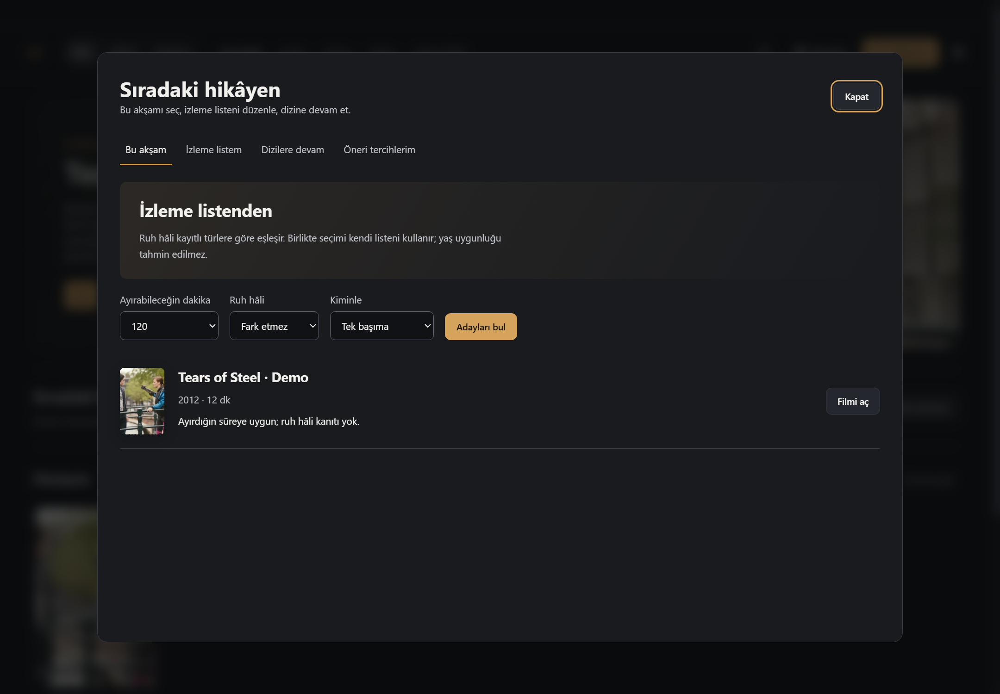
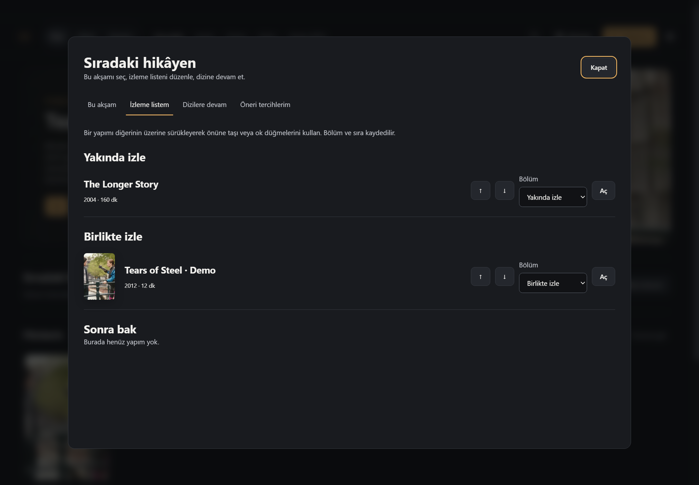
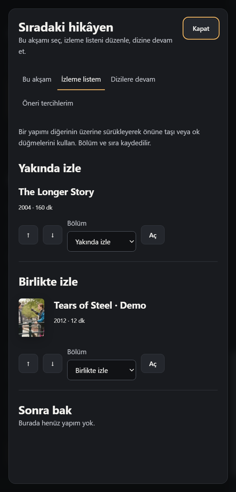
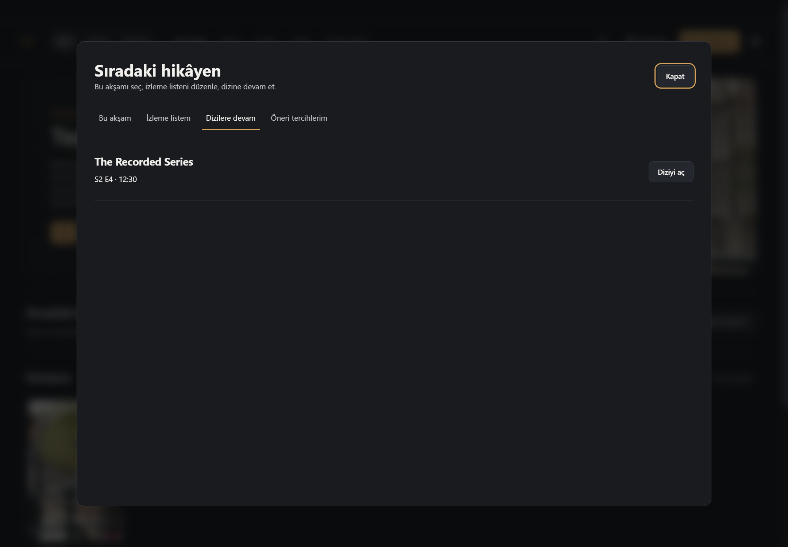
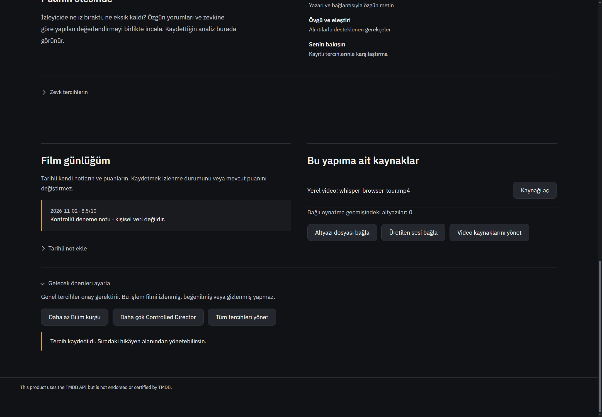
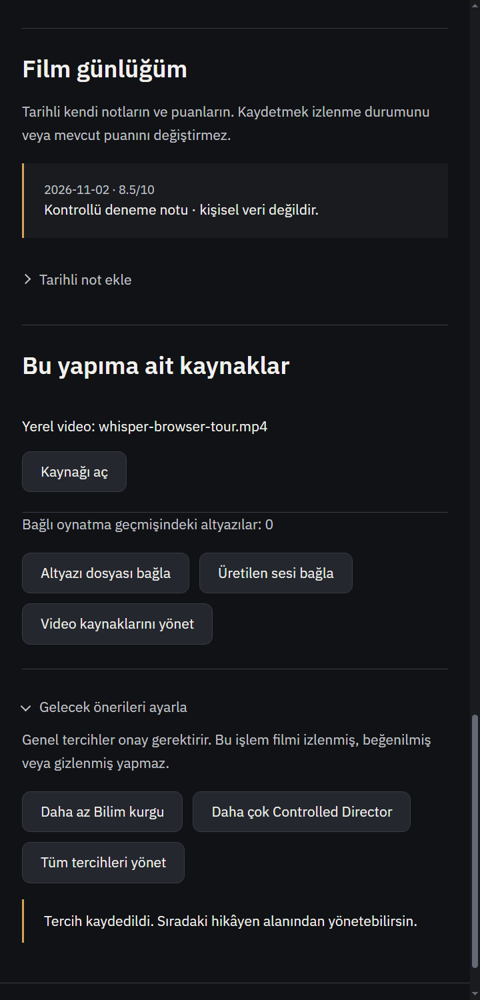
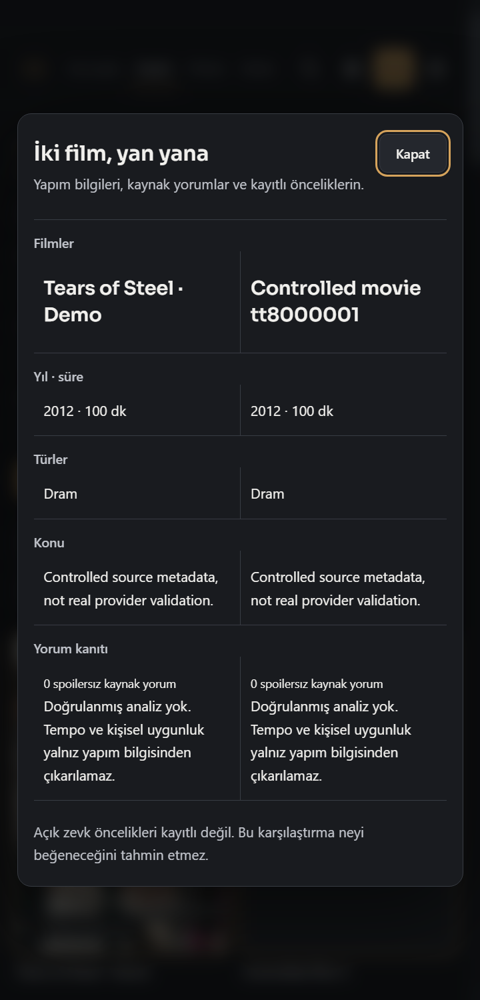

# Günlük medya deneyimi — 2026-11-02

Başlangıç: `6abcfd4584c454955c686d29f5cc56902b1d6b79`. Ürün: `faff22af058bd3975bd641a66243039fa30bc6b9`.

## Yedi hedef ve kullanım

1. **Ana sayfa → Sıradaki hikâyen → Bu akşam:** gerçek izleme listesinde süre sınırı ve kayıtlı türler üzerinden adaylar. Ruh hâli bir tür sezgisidir; süre, tempo veya yaş uygunluğu uydurulmaz. Kaynağı olmayan kayıt oynatılabilir gibi gösterilmez.
2. **İzleme listem:** Yakında izle / Birlikte izle / Sonra bak; bölüm seçimi, sürükleyerek önüne taşıma ve klavye erişimli yukarı/aşağı düğmeleri. Yeniden açıldığında kalıcıdır. Başka bölüme sürükleme hedef bölümünü de kaydeder.
3. **Dizilere devam:** kayıtlı bölüm ve dakika; var olmayan sonraki bölüm üretilmez. Kaynak yoksa dizinin sayfası açılır. Yalnız bilinen bölümler arasından devam seçilir.
4. **Keşfet → Yapımları seç → iki kart → İki yapımı karşılaştır:** mevcut alıntı ve karşılaştırma sistemi doğrudan açılır; kütüphaneye sessiz ekleme yoktur.
5. **Film sayfası → Film günlüğüm:** tarihli not ve isteğe bağlı puan eklenir; önceki kayıtlar tutulur. Bu geçmiş, mevcut puan veya izlenme bayrağını otomatik değiştirmez. Letterboxd günlük içe aktarımıyla aynı şey diye sunulmaz.
6. **Film sayfası → Gelecek önerileri ayarla:** yalnız o filmde kayıtlı tür/yönetmen üzerinden genel tercih önizlemesi ve açık onay. Tek film beğenmemesi ile genel tercih ayrıdır. Tüm tercihler merkezden kaldırılır. Tür tercihi öneri tohumlarını/sırasını, yönetmen tercihi gerçek kredisi eşleşen sonuçları etkiler. Katalog yönetmen aramasında eşleşme dönmezse sonuç uydurulmaz; tüm filmografiyi tarama garantisi yoktur.
7. **Film sayfası → Bu yapıma ait kaynaklar:** temel video, sürüm/kısım/bonus/bölüm kaynakları; eşleşen kayıtlı yorum analizleri; oynatma geçmişindeki altyazılar. Yerel seçiciyle altyazı veya üretilen ses dosyası bağlanabilir ve dosya klasörde gösterilir. Dublajın otomatik film eşlemesi veya bütün diski tarama yapılmaz. Ses dosyası bağlamak oynatıcıya otomatik dublaj takmak anlamına gelmez.

## Doğrulanan ek hata

Yeni merkez 12:30 elle devam konumunu gösterebiliyordu; mevcut `media-catalog-service play` yalnız watch-library konumuna baktığından sıfırdan açabiliyordu. Artık aynı bölüm için geçerli elle konum kullanılır; daha yeni oynatma kaydı önceliklidir, tamamlanmış daha yeni oynatma eski işareti diriltmez. Konum başka bölüme taşınmaz.

## Kod ve veri

- `media-daily-service.js`: yetkili mevcut media-tools kanalı içinde atomik, 8 MB sınırlı `userData/media-daily.json`; kuyruk, eklemeli günlük, açık tercihler ve seçilmiş dosya ilişkileri. Stale revision reddi; tercih planı gönderene bağlı, süreli ve tekrar metadata kontrolüyle uygulanır. Bozuk dosya üzerine varsayılan yazılmaz.
- `media-tools-service.js`: mevcut yetkili kanal günlük işlemleri yönlendirir; yeni preload kapısı yok.
- `media-catalog-service.js`: tam bölüm konumu onarımı.
- `media-discovery-service.js`: açık tür/yönetmen tercihlerinin kanıtlı sıralaması.
- `media-daily-ui.js/.css`: merkez ve film alt bölümü; afişler mevcut güvenli poster API’siyle, üç istek eşzamanlılık sınırıyla; afişsiz boş resim kutusu yok. EN/TR metinler, dar ekran ve azaltılmış hareket.
- `media-home.js`, `film-page-enhancements.js`, `discovery-personal-ui.js`, `index.html`: görünür girişler, kapatma/yeniden çizimde kaynak temizliği, doğrudan iki kart karşılaştırması.
- `tests/media-daily.test.js`: yeni davranışlar ve gerçek katalog oynatma handler’ı regresyonu.

Mevcut üst medya menüsü ve film üst kompozisyonu korundu. Üçüncü taraf framework/kod taşınmadı, yeni bağımlılık yok. Mevcut personal-media-state, film evidence, medya kataloğu, atomik yazma ve doğrulama sözleşmeleri kullanıldı.

## Kanıt ve sınırlar

- 34 hedefli kontrol geçti, yaklaşık iki saniye: `node --test --test-isolation=none tests/media-daily.test.js tests/media-catalog-service.test.js tests/discovery-personal-workflows.test.js tests/media-discovery-service.test.js tests/personal-media-state.test.js tests/film-page-enhancements.test.js tests/assistant-film-actions.test.js`.
- Değişen JS dosyaları `node --check`; `git diff --check` temiz.
- Gerçek Windows Electron, ayrı sentetik profil, 1440/480 CSS px. Liste bölümünün yeniden açılınca korunması, tam S2E4 / 12:30 gösterimi, günlük kaydı, yazmayan tercih önizlemesi/açık onay, doğrudan karşılaştırma açılması. Kanıt `native-result.json`. Bu browser mock’u değil gerçek uygulama penceresidir; dış katalog yanıtları kontrollüdür.
- Taslak üretim kodundan önce render edildi: [taslak](concept.png). Son native görsellerde afiş ve geniş ekranda günlük/kaynak yan yana yerleşimi iyileştirildi. Kişisel profil kullanılmadı; afiş, repodaki Tears of Steel demo karesinden temsilî kesittir (Blender Foundation CC BY 3.0; docs/media/README.md). Resmî film afişi değildir.
- Native harness ilk denemesinde yeniden çizim anındaki geçici boş DOM’u test bekleyicisi hataya çevirdi; bekleyici düzeltildi, ürün hatası diye sayılmadı. Son native koşum geçti. Yalıtılmış ağ nedeniyle reklam listesi yükleme uyarısı beklenen fixture sınırıdır.
- Canlı DeepSeek/TMDB/Letterboxd, gerçek internetten yönetmen filmografisi, GPU, tüm test paketi, start.bat yeniden başlatma doğrulanmadı. Kullanıcının açık uygulaması kapatılmadı. Yeni Actions çalışması istenmedi.

## Son ekranlar

