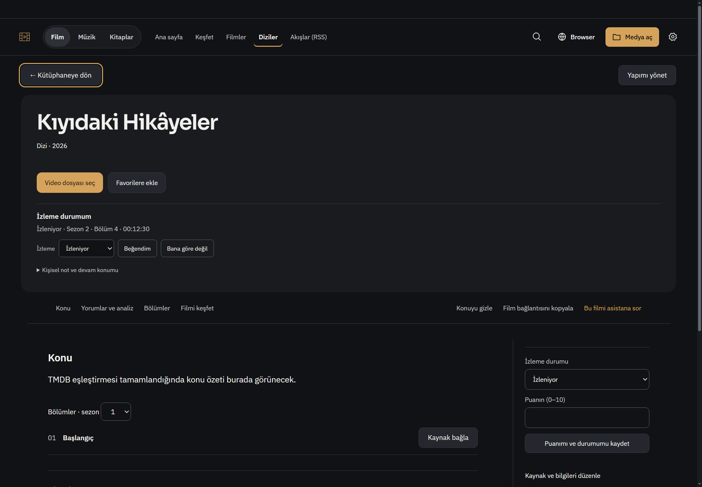
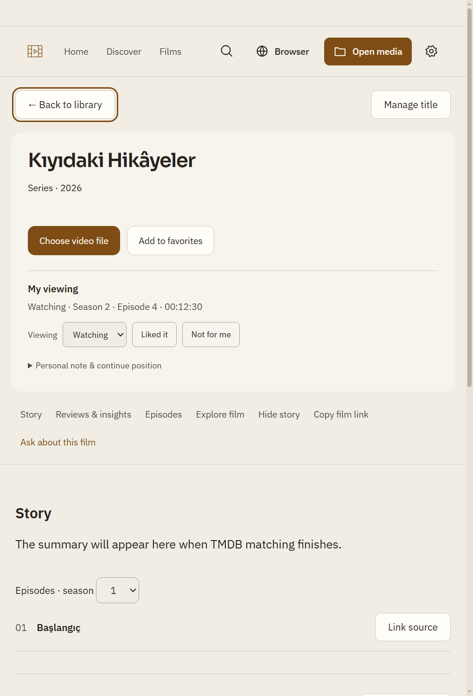

# Kişisel medya durumu: asistan, Keşfet ve kütüphane

Başlangıç: `08fa9b14a036b4eb172f6e89bd83ec488ccbf5c9`. Ürün commit'i: `955dedde2ba6602f0b36b7011321ee553f8610bf`.

## Kullanıcı akışları

- Asistandan “Bu filmi beğendim”, “Bu dizinin 2. sezon 4. bölümünde 12:30’da kaldım” veya “Bu içeriği beğendim” denebilir. Modelin araç çağrısı gerçek kaynak/konuşma kapsamında doğrulanır; değişiklik önizleme kartından açık onayla kaydedilir. Salt okuma kaydı değiştirmez.
- Film/dizi ve Keşfet detayında **İzleme durumum / My viewing** aynı kişisel kaydı gösterir. Beğeni, izleme durumu, kişisel not ve elle devam konumu ayrıdır. İleri not/bölüm/konum alanları disclosure içindedir. Kaydetmeden önce değişiklikler görünür.
- Aynı adlı veya eşleşmemiş browser içeriği film kimliği sayılmaz. İsim araması seçim adayları verir. Geçerli sağlayıcı kimliği veya kullanıcı tarafından seçilmiş yapım/bölüm gerekir; açık video tam o bölüme onayla bağlanabilir.
- Bağlı kaynağın sonraki gerçek oynatma kaydı doğru film/bölüme senkronize edilir. Bonus, sürüm/kesim ve birden fazla eşleşme sessizce ana film olarak işaretlenmez. Bölüm bitmesi bütün diziyi veya önceki bölümleri bitirmez.
- YouTube/yazı beğenisi kendi içerik türünde saklanır. Film/dizi olarak uydurulmaz. Yalnız açıkça kaydedilmiş kaynak metadata/notu `web-personal-media.json` içinde sınırlı saklanır; bütün gezinti veya tam video/yazı içeriği kopyalanmaz.
- Yeni kişisel kayıt ilgili kaynağı Recall/zevk ağına ekler. Ortak beğeni ağın kaynak tepkisine ve Keşfet’in mevcut tür temelli öneri tohumlarına yansır. Film, okuma ve YouTube alanları ayrı kalır. Otomatik model eğitimi veya her beğenide ücretli AI analizi yoktur.
- Önceden içe aktarılmış kişisel Letterboxd puan/izleme kayıtları korunur ve mevcut zevk profili tarafından kullanılır. Başkalarının film yorumları kullanıcının beğenisi değildir. Bu paket canlı Letterboxd hesap senkronu eklemez veya bütün eski kayıtları otomatik grafiğe seçmez.

## Kayıt ve sahiplik

Film beğeni/notunun sahibi mevcut `media-enrichment.json`; izleme/bölüm/elle devam konumunun sahibi mevcut katalogdur. Eski favoriler ve kişisel yüksek puanlar açık beğeni yokken geriye uyumlu sinyal verir. Sağlayıcı kimliğiyle ortak geri bildirim eski başka-yapım kaydına bağlanmaz; daha yeni açık tepki önceliklidir.

Asistan araçları: `read_personal_media`, `get_current_media_match`, `propose_personal_media_update`. Model keyfi dosya, URL, kaynak sahibi veya önizleme token'ı gönderemez. Token bir kullanımlık, süreli ve sender/kaynak/konuşma/revizyona bağlıdır. Browser yön değiştirdiyse eski kart uygulanmaz. Kullanıcı ekranından yapılan işlemler de preview/apply sözleşmesini kullanır.

Gerçek oynatma, elle konulan yer iminden yeniyse görünür devam konumu gerçek oynatma olur. Elle yer imi ayrıca korunur. Durum değişmedikçe katalog her zamanlayıcı tikinde tekrar yazılmaz. Kayıt/ağ senkronu hata ayrımı backend sonucunda bulunur; ana kişisel kayıt başarısını ağ hatası silmez.

## Değişen alanlar

- `personal-media-state/service/web`: kimlik, ortak tercih, native kaynak, süreli önizleme, yeni web sahibi ve oynatma eşleme.
- `main/preload`: yetkili IPC, gerçek aktif browser kaynağı, gerçek izleme kaydı sonrası katalog ve Recall köprüleri.
- `assistant-capabilities/agent-service` ve renderer adaptörleri: araç keşfi, doğrulanmış önizleme, onay ve güncel kişisel okuma.
- katalog/Keşfet/medya araçları/Recall: ortak kişisel görünüm, kaynak türü ve tarih önceliği; eski kayıt biçimleri korunur.
- film/Keşfet renderer ve `personal-media-ui`: EN/TR, mevcut grafit/amber tokenları, isteğe bağlı ayrıntı ve durum yenilemesi.

Yeni bağımlılık yok. Ayar, anahtar, kişisel profil veya açık uygulama değiştirilmedi.

## Doğrulama

`node --test --test-isolation=none tests/personal-media-state.test.js tests/personal-media-web.test.js tests/personal-media-playback.test.js tests/personal-media-ui.test.js tests/assistant-personal-media.test.js tests/assistant-capabilities.test.js tests/media-discovery-service.test.js tests/media-catalog-service.test.js tests/recall-network.test.js`

**38/38 geçti**, yaklaşık1,8 saniye. İlk entegrasyon koşusunda Keşfet’in opsiyonel `userData` olmayan iki testi yeni kişisel projeksiyonda hata verdi; opsiyonel kişisel sahibi olmayan kullanımın boş tercihyle çalışması düzeltildi, aynı kapsam yeniden geçti. Testler gevşetilmedi.

Değişen JS sözdizimi ve `git diff --check` geçti. İzole gerçek Windows Electron penceresinde asistan kayıt okuması, gerçek IPC, film beğeni→ağ, S2E4/12:30, kaynak değişince ret, yazı beğeni→reading alanı, TR1440/koyu ve EN680/açık taşmasız panel doğrulandı. Yeni kayıt sonrası eski sidebar durumunu yenileme ve puan taslağını koruma da native kontrolde geçti. İlk fixture'ın konuşma hazırlamadan araç okuması ve kapalı sayfaya erişimi düzeltilerek gerçek akış izlendi; ürün korumaları gevşetilmedi.

[Makine okunur native sonuç](native-result.json).

Tam suite, GitHub Actions, canlı DeepSeek/Letterboxd/kişisel hesap, GPU/DRM ve tüm internet siteleri bu teslimde sınanmadı. Kontrollü araç/native sonuçları doğal dil modelinin her cümlede doğru araç seçeceği iddiası değildir. Görüntüler sentetik metadata ile çekildi; afişsiz fixture sinematik afiş başarısı olarak sunulmaz. Açık kişisel uygulama yeniden başlatılmadı.
