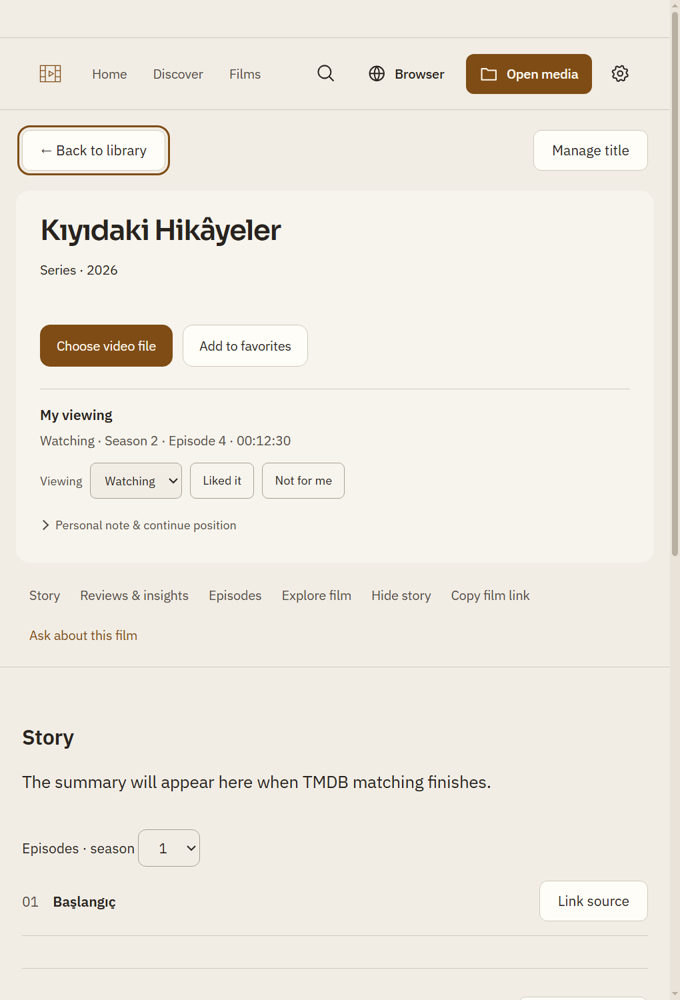

# Kişisel medya akışının ikinci kontrolü

Başlangıç `0acb7f880541757cfc7e89de06c608551cd22c17`; ürün `92aea55a7bf7981838027b3a5933e7be01499720`.

- Asistan apply sonrasında tipli `media-personal-changed` yayınlar; yeni panel doğru kişisel kaydı yeniler.
- Ağ senkronu başarısızlığı araç sonucundan kaybolmaz. Model ağın güncellendiğini iddia etmemesi için açık sonuç alır; doğrudan panel kaydetmede kayıt/ağ başarısı ayrılır.
- İlk kayıt yüklenirken kontroller devre dışıdır: gecikmiş yükleme kullanıcının düzenlemesini ezmez.
- Başka yapıma ait olaylar ve açık ayrıntı/önizleme sırasında genel yenileme taslağı silmez.
- Zaman girişi `12:30` ve `00:12:30` kabul eder; geçersiz saniye veya saatli girişin dakika taşması reddedilir.
- Önizleme hedef yapımını gösterir. İki kolonlu başlık/özet, dar ekranda tek kolon, özel disclosure oku, ölçülü renk geçişleri ve reduced-motion desteği mevcut paletle uygulanır. Yeni tasarım sistemi/bağımlılık yok.

Kontrol: `node --test --test-isolation=none tests/personal-media-ui.test.js tests/assistant-personal-media.test.js` **7/7 PASS**, yaklaşık0,8sn. JS syntax/diff kontrolü geçti. İzole native Windows1440TR/koyu ve680EN/açık panel, kayıt/ağ/bölüm/sahiplik/asistan okuma akışı geçti. İlk test düzeninde dış olay da sayıldığı için olay sayacı beklentisi düzeltildi; ürün davranışı gevşetilmedi. Tam suite/Actions/canlı DeepSeek/kişisel hesap/GPU denenmedi. Bu tur agentsız tamamlandı.

