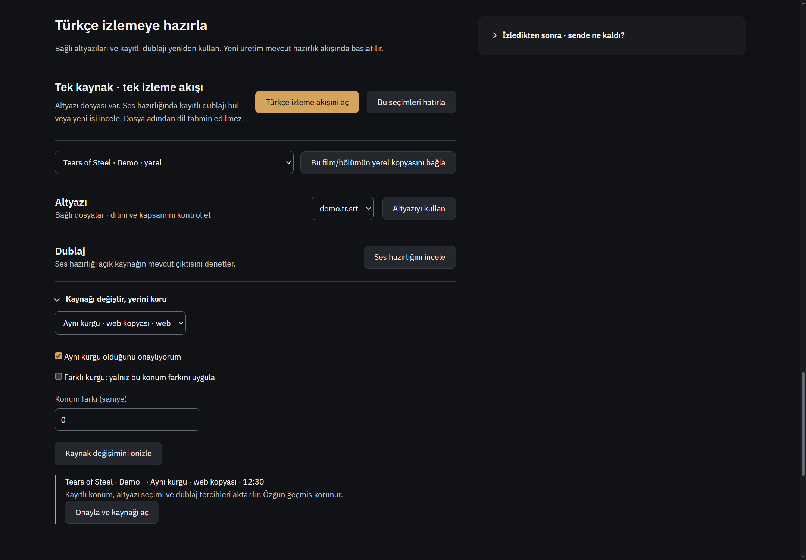
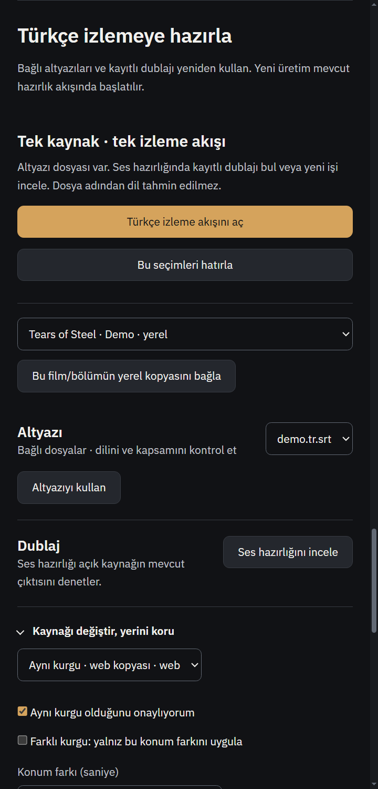

# R846 — Güncel kod doğrulaması ve onarımlar

Başlangıç master `610d830a1d4cc62014fdc2919f219a5b063948b8` (PR794 sonrası). 2–3 Kasım 2026. R846 ve ilgili altı alan eki okundu; özgün rapor/kanıtlar değiştirilmedi.

## Sonuçlar
| Kayıt | Doğrulanan onarım |
|---|---|
| R846-01 | Altyazı ve ses kullanma, tıklama anındaki kaynak/asset/seçim sürümüne bağlı. Asset çözme ve playback IPC beklemeleri boyunca seçim değişirse işlem uygulanmaz; A→B→A da eski isteği canlandırmaz. Aynı seçim pozitif kontrolü çalışır. |
| R846-02 | Tamamlanmış üretim tarifi bekleyen metinlerden ayrıldı. Dar onarım sadece istenen grupların taslaklarını tamamlanmış tarif üzerine koyar; başka bekleyen editler editörde kalır. Başarısız/iptal onarım yeni tamamlanmış temel olmaz. Cache bağlam anahtarı zayıflatılmadı. |
| R846-03 | Dar retry gönderene ait önceki iş referans makbuzunu gerektirir; çözümlenmiş referans ses/döküm yolu ve içerik hash'i karşılaştırılır. Değişmiş/kayıp referansta başka ses sessiz kullanılmaz; anlaşılır hata verilir. Eski referansı geri getirme veya yeni referansla tam üretim mümkündür. Soğuk motor release beklemesinden sonra spawn öncesi tekrar kontrol edilir. |
| R846-04 | Salt aspect görüşü mevcut favori/yüksek puan kaynaklı genel beğeniyi düşürmez. Eksik reaction ile açık null/neutral/dislike ayrıdır; açık olumsuz karar yüksek puanla yeniden like yapılmaz. Recall aynı etkili tepki politikasını kullanır. |
| R846-05 | İlk kısmi öncelik yazımı etkili varsayılanları korur. Değiştirme kalan alanlar sessiz sıfır olmaz; kullanıcının açık sıfırı desteklenir. |
| R846-06 | Bölüm diyaloğu yetkili personal get ile history/alternatif kaynak dahil güncel konumu yükler. Yüklerken alanlar/kaydet kapalıdır. Preview expectedRevision ve apply mevcut opak revision guard ile eski form yeni izlemeyi ezemez. |
| R846-07 | Bütün dizi completed ise günlük devam listesi eski bitmemiş bölümle bunu geçersiz kılmaz; bölüm geçmişi korunur. İnsan açıkça Bu bölümde kaldım ile yeniden devam ederse bütün dizi watching olur; otomatik history sync completed kararını kaldırmaz. |
| R846-08 | JSON ve SSE ortak bounded tool-call denetimi kullanır. 12000 karakter analysis şemasının JSON kaçışlarıyla genişlemesi de desteklenir. Argümanlar 80k, argüman dışı metadata 16k, ID200/ad100 ve8çağrı, toplam2MB sınırları korunur. |
| K846-01 | Büyük ağ read parçası tek SSE olayı sayılmaz. Tamamlanmış satır/olaylar ayrıştırıldıktan sonra gerçek biriken olay ve bitmemiş satır160k sınırı uygulanır. Küçük birden fazla olay kabul edilir; tek dev bitmiş/bitmemiş/çok satırlı frame reddedilir. Koşullu taşıma kaydı P2 sayısına katılmadı. |

Referans makbuzu bütün kaynak/ayar tarifinin sunucu imzası değildir; referans eşliğini doğrular. Dosyalar motor çalıştıktan sonra değiştirilemez diye bir garanti veya değişmez ses snapshot'ı iddiası yok. GPU üretimi veya ses dinleme başarısı da iddia edilmez.

## Hedefli testler
- Son birleştirilmiş Node koşusu: 18 dosya, **153 PASS /0FAIL**,4.92sn. Gerçek üretim modülleri/servisleri, JSDOM ve kontrollü worker/transport kullanılır.
- İki eski script `node tests/dub-service.test.js` ve `node tests/dub-generator-ui.test.js` kendi süreçlerinde exit0.
- `tests/dub-group-identity637.test.js`: ayrı izinli Node koşusunda1/1PASS; Python saf grup/tarif kimliği. GPU/model yok.
- Değişen JS `node --check` ve `git diff --check` geçti.
- İlk karışık `--test-isolation=none` koşusunda eski async dublaj script'i ortak process fixture etkisiyle `invalid count` assertion'ı verdi; bu sonuç başarılı sayılmadı. İki legacy script ayrı süreçte yeniden geçti; kalan18dosya final exit0. Test eşiği/ürün davranışı bu yüzden değiştirilmedi.

Son koşu:
`node --test --test-isolation=none tests/film-watch-asset-ownership.test.js tests/assistant-provider.test.js tests/assistant-agent-service.test.js tests/four-assistant-mechanisms.test.js tests/assistant-capabilities.test.js tests/r846-dub-recipe.test.js tests/dub-service-warm-start.test.js tests/dub-group-takes.test.js tests/dub-group-receipt652.test.js tests/film-watch.test.js tests/media-taste.test.js tests/personal-media-state.test.js tests/personal-media-playback.test.js tests/discovery-personal-workflows.test.js tests/media-discovery-service.test.js tests/media-daily.test.js tests/recall-network.test.js tests/r843-recall.test.js`.

Yeni regresyonlar düzeltme öncesi hatayı gösterdi: A.srt/B, taslak edit sızıntısı, referans drift, salt aspect like kaybı, ilk ağırlık sıfırlama, eski bölüm kaydı, completed devamı, JSON/SSE farkı ve büyük birleşik read. Çapraz inceleme ikinci playback await'i, hash sonrası warm release boşluğunu ve gerçek episode payload'lı yeniden izlemeyi ayrıca kapattı.

## Gerçek Windows kabulü
`tests/electron-film-watch.smoke.js` ayrı kontrollü profilde exit0: 1440/480, kaynak hazırlığı/hatırlama, film aspect görüşü ve genel öncelik önizleme-onayı, kaynak konum önizlemesi, yorum alıntısı, koleksiyon düzeni ve gerçek yerel demo videosuna altyazı açma geçti. `tmp/visual-identity/report846-native-film.log` makbuzunda ok:true. Aşağıdaki görüntüler kontrol edildi; yeni tasarım/CSS yapılmadı, mevcut düzen korundu.

## Sınırlar ve teslim
Üç GPT-6.1 Sol medium ajanı + ana ajan alanları onardı; bağımsız çapraz inceleme yapıldı. Yeni bağımlılık, yerel LLM veya üçüncü taraf kod alınmadı. R846 sahip koduyla doğrulama işidir; araştırma kartı uygulaması değildir.

Gerçek DeepSeek/ücretli API, canlı feed/Letterboxd, gerçek hesap, gerçek dublaj/GPU, start.bat yeniden başlatma ve DRM sınanmadı. Tam npm test ve Actions yok. Kişisel açık uygulama kapatılmadı; özgün R846 ve ekleri, OFFLINE-MANIFEST/INDEX/start.sh kişisel değişiklikleri korunur. Ana kopya güncellemesi teslim makbuzuyla kontrol edilir.
