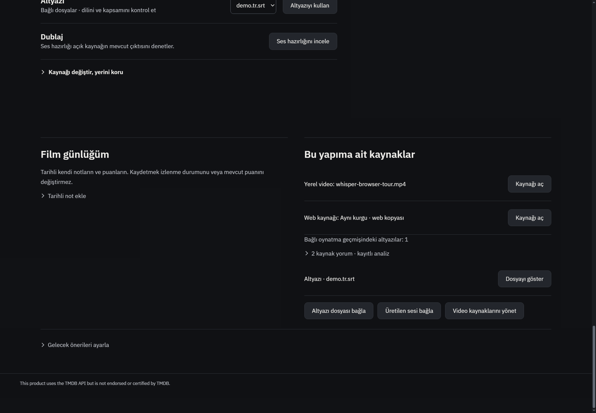
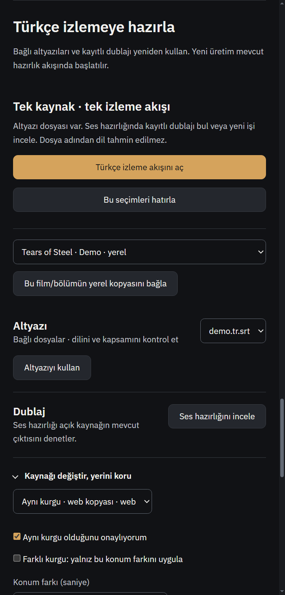

# R848 onarım teslimi — 3 Kasım 2026

Başlangıç master `8e5287e056599bd0985330afa6856a03120eba7c` (PR795 sonrası). Özgün R848 ve alan ekleri okundu, değiştirilmedi. Beş bulgu güncel kodda doğrulanıp onarıldı.

## Sonuçlar
| Kayıt | Onarım ve sınır |
|---|---|
| R848-01 | Film hazırlığı ve günlük, kesin itemId varsa onu korur. Aynı IMDb'li A/B yerel kayıtlarından B seçiliyken A'nın fiziksel kaynağı alınmaz. Keşfet'ten fiziksel kaynağa geçiş birden fazla yerel eşleşmede açık kesin seçim ister; eski/missing exact ID başka kayda rematch edilmez. |
| R848-02 | Yeni kişisel ilişki anahtarları katalog ID + kind + eser sağlayıcı kimliğine bağlıdır; değişebilir yıl/başlık içermez. Günlük, queue, asset, alternatif kaynak ve hatırlanan seçimler yıl değişiminde/restart/year undo sırasında korunur. Farklı provider'a gerçek retarget eski dosyaları taşımaz. |
| R848-03 | Renderer→main ve aynı-tur sonuç deposu ortak512000karakter per-result bütçesini kullanır. On bölümden gelen16944karakter geçerli kitap araması artık stored_result/read_tool_result yoluna ulaşır; kaynak/sayfa kimlikleri kesilmez.1MBturn,12000inline,6000sayfa,owner/sender/status kapıları korunur. |
| R848-04 | Ham A/B play, diğer önizlemeleri durdurmanın yanında mevcut BrowserDubAudio pauseSource + stop yoluyla kaynak video ve bağlı tam dublajı durdurur. Aynı play listener düğme ve nativeaudio kontrolünü kapsar; kapanış durdurması korunur. |
| R848-05 | Aynı tam hipotez/kanıt kimliği yeniden analizde mevcut insan incelemesini ve reviewedAt/legacy ID'yi korur. Support, counter, kaynak ve reaction revizyonu kimliğe dahildir; kanıt değişince ayrı proposed kayıt olur, eski review silinmez. Yeni model çalışması kullanıcı kararını sıfırlama yetkisi değildir. |

## Eski ilişki geçişi ve hata semantiği
`media-title-relations.json` yalnız eski anahtar→kanıtlı sahip alias'ı saklar; günlük, dosya yolu, queue veya source satırlarını kopyalayıp silmez. Katalog kimlik/yıl topolojisi değiştirilmeden önce eski kesin kayıtlar hâlâ varken tekil sahiplik kaydedilir. Aynı provider'da iki eski fiziksel kayıt varsa belirsiz ilişki null/unclaimed olarak korunur; dosyalar rastgele A/B'ye atanmaz. Geçmişte hangi kayda ait olduğu kanıtlanamayan ilişkiler yılı yok sayarak otomatik kurtarılmış sayılmaz.

Alias parse/yazma/fsync hatası ilgili metadata değişimini katalog/yedeği değişmeden durdurur; unrelated status/title saves bu IO'ya girmez. Alias yazılıp sonraki katalog yazımı başarısızsa sadece geçerli eski-sahip kanıtı kalır ve yeniden deneme güvenlidir; bu çok-dosyalı atomik transaction diye sunulmaz.

Okuyucular yetkili katalog snapshot'ı ve request-local Map indeksleri kullanır. Katoloğu raw dosyadan tekrar okuyup daha küçük limit uygulamazlar.4100yapımlık >16MBkatalog/80dizi ile hem sağlam primary hem bozuk primary/geçerli backup sınandı: daily işleminde1yetkili list snapshot'ı,0helper katalog/yedek okuması,1ortak alias okuması ve<=1alternatif sidecar okuması.

Çapraz inceleme sonrası birleşik bucket+beforeId işleminin yeni bucket'ı eski indeks değeriyle ezmesi de fail-before testle kapatıldı. Sıralama artık o işlemde yazılmış güncel queue değerini önceler.

## Doğrulama
- Birleşik15dosya Node koşusu:142PASS/0FAIL,4.37sn. Son bucket/sıra düzeltmesinden sonra ilgili daily/ownership15test ayrıca geçti. Sayılar üst üste toplanmadı.
- Katalog service/store standalone kontrolleri ve standalone dayanıklılık matrisi46kontrol geçti; process.exit kullanan script in-process test paketine karıştırılmadı.
- Yeni testler düzeltme öncesi kusurları üretti. Kitap testi gerçek scanner/BookAssistantUI→main→provider sonucunu parça parça byte-aynı JSON olarak geri kurdu;10kaynak/sayfa kimliği korundu. Yabancı sender, bütçe aşımı ve turn-local erişim sınırları da sınandı.
- A/B testi gerçek takes/workspace/BrowserDub controller koduyla kontrollü JSDOM media state kullanır. Decoder/gerçek ses dinleme başarısı değildir.
- İnsan ret testi gerçek store/restart ve aynı/farklı counter/source/reaction kanıtını sınar.
- Değişen JS syntax ve diff whitespace geçti.

Komut:
`node --test --test-isolation=none tests/assistant-book-result-transport.test.js tests/assistant-agent-service.test.js tests/assistant-provider.test.js tests/four-assistant-mechanisms.test.js tests/media-title-relations.test.js tests/film-watch.test.js tests/media-daily.test.js tests/personal-media-state.test.js tests/personal-media-playback.test.js tests/media-discovery-service.test.js tests/r848-recall-review.test.js tests/r848-dub-takes-preview.test.js tests/recall-network.test.js tests/r843-recall.test.js tests/dub-group-takes.test.js`.
Son ek kontrol: `node --test --test-isolation=none tests/media-daily.test.js tests/media-title-relations.test.js`.

## Windows kabulü
Ayrı kontrollü profilde `tests/electron-film-watch.smoke.js` geçti; makbuz `tmp/visual-identity/report848-native-film.log`:oktrue.1440/480film hazırlığı, kaynak seçimlerinin hatırlanması, görüş/öncelik önizlemesi, koleksiyon sırası ve gerçek yerel demo videosuna altyazı açma doğrulandı. Görüntüler incelendi; bu tur görsel tasarım/CSS değişmedi.

## Teslim sınırları
Üç GPT-6.1Sol medium ajanı ve ana ajan çalıştı; bağımsız çapraz incelemede katalog boyut/yedek/IO regresyonları teslimden önce giderildi. Yeni bağımlılık, model/framework veya üçüncü taraf kod alınmadı. Standart code-review doğrula-sonra-uygula yaklaşımı izlendi.

Gerçek model/API, canlı dış servis, kişisel profil/kütüphane, GPU/dublaj akustiği, DRM ve start.bat yeniden başlatma sınanmadı. Tam npm test ve Actions yok. Açık kişisel uygulama kapatılmadı; kullanıcı dosyaları ve özgün raporlar korunur.
