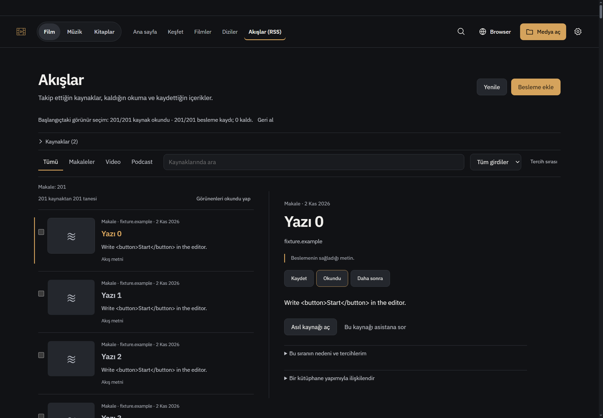
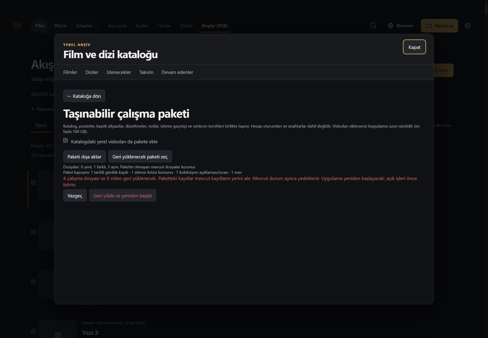
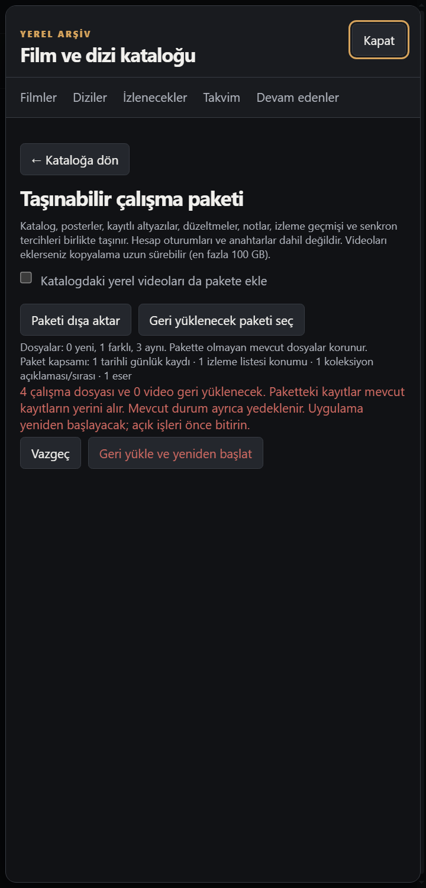

# R850 onarım teslimi — 3 Kasım 2026

Başlangıç master `94346a66129010eb4d7ba1ac7764dab2589d179d` (PR796 sonrası). R848'in beş kaydı önceki PR796/R851 tesliminde kapanmıştı; tekrar açılmadı. R850 ve ilgili alan ekleri güncel kodla karşılaştırıldı, üç bulgu doğrulanıp düzeltildi. Özgün raporlar değiştirilmedi.

## R850-01 — Eksik kişisel paket kapsamı
`media-daily.json`, `film-watch.json`, `media-title-relations.json` export/read/validate/restore kapsamına alındı. Günlük/not/puan, liste bölümü/sırası, koleksiyon açıklaması/özel sırası, dosya ilişki metadata'sı ve önceki R848 yıl-sahiplik alias'ları temiz hedefte korunur.

Yeni helper `workspace-personal-media.js` gerçek üretici şemalarını mevcut 8 MB/16 MB sınırlarıyla doğrular. Yalnız tanımlı yol alanları taşınır; kişisel not/başlık/koleksiyon metni yol sanılıp değiştirilmez. Paket içindeki doğrulanmış subtitle üyesi kopyalanır; hatırlanan source/asset ID'leri portable ve restore yollarıyla uzlaştırılır.

Dış ses/video referansı büyük medya dosyasının yedeklendiği anlamına gelmez. Metadata needsRelink/imported kalır; açık yerel dosya seçimi öncesi stat/exists/read/grant/play/reveal yapılmaz. Tekrar export ve otomatik restore-öncesi yedek de bu izin sınırını aşamaz. Preview yeni-store dış yollarını yok diye iddia etmeden doğrulanmamış gösterir. Traversal, ağ/device yolu, geçersiz şema ve sahte alias reddedilir. Yerel picker ile yeniden bağlama aynı sahip/rol/kanonik dosyadaki imported kopyayı değiştirir; eski duplicate yeni onayı gölgelemez.

Mevcut araç açıklaması ve paket kapsam satırına EN/TR günlük, liste, koleksiyon, bağlı dosya ve alias sayıları eklendi. Yeni yedekleme sistemi/sıklık/kurtarma özelliği eklenmedi.

## R850-02 — Düz metnin ikinci kez HTML sayılması
RSS/Atom/JSON adapter'ları girişin plain/html provenance bilgisini korur. JSON content_text, düz metadata ve Atom text literal kalır; gerçek HTML/XHTML mevcut inert dönüşümden bir kez geçer. Parser'ın `textFormat:'plain'` çıktısı store'da yeniden etiket ayıklamasından geçmez; NUL/uzunluk sınırları sürer. İşaretsiz eski/internal girdinin eski HTML temizleme davranışı korunur.

Literal `<button>Start</button>` ve literal script/kod metni okuyucuda textContent olarak kalır; DOM düğme/script/img oluşmaz. Gerçek HTML script/style/template dışlanır. Parser→subscribe→diskten yeniden açma/refresh kontrol edildi. Daha önce silinmiş metin eski diskte kendiliğinden geri üretilemez; yeni feed parse/yenilemesi doğru metni getirebilir.

## R850-03 — Görünür toplu okuma kapsamı
Görünür satır ve kanonik fiziksel ID kümesi tıklama anında sabitlenir. En fazla 4000 fiziksel kayıt, en fazla 200 ID'lik sıralı isteklerle işlenir; sınır kaldırılmaz ve sessiz slice yapılmaz. Makbuz işlenen kaynak/fiziksel kayıt/kalan sayılarını açıklar. Başarısız ikinci parti, kalanları durdurma ve kaynak/filtre/yaşam değişimi tam başarı diye gösterilmez.

Undo tamamlanan partileri ters sırada uygular; yalnız doğrulanmış başarılı token tüketilir, başarısız/kalan token tekrar için korunur. Yüklenen görünür aralık 201'den100'e düşmez. Okunmamış filtrede mark sonrası0satır olsa bile Undo aynı görünümde asıl201satır kapsamını geri yükler. Yeni metinler EN/TR; mevcut durum alanı kullanılır, sayfa/CSS yeniden tasarlanmadı.

## Doğrulama
Son birleşik13dosya koşusu **100 PASS /0FAIL**,7.41sn. Değişen JS syntax ve git diff --check geçti. İlk regresyonlar missing package store, plain-code kaybı,201→200, izin dışı export probe ve imported native relink gölgelenmesini düzeltme öncesinde üretti; kontroller ürünün bozuk davranışını PASS diye sunmaz.

`node --test --test-isolation=none tests/workspace-personal-media.test.js tests/media-title-relations.test.js tests/film-watch.test.js tests/media-daily.test.js tests/r850-feed-text.test.js tests/feed-parser.test.js tests/feed-store.test.js tests/feed-service.test.js tests/r843-feed-podcast.test.js tests/r844-feed-regressions.test.js tests/feed-visible-read850.test.js tests/feed-ui.test.js tests/media-tools.test.js`.

Ayrı mevcut `workspace-privacy.test.js`4kontrol, `workspace-restore-regressions.test.js` ve `report815-package-regressions.test.js`1kontrol geçti. Kapsamlar ortak olduğundan toplamlar üst üste eklenmedi. Paket restore/re-export testi outside exists/stat/lstat/read/grant çağrılarını izleyip0buldu; yalnız sentetik dosyalar kullanıldı.

## Gerçek Windows kabulü
- Yeni odaklı `tests/electron-report850.smoke.js`: gerçek main/preload/feed store;201read+201undo, literal kodun inert görünümü, gerçek backup export ve metadata kapsam sayıları1440/480 geçti. Profil ve yayınlar kontrollü, API yok. Makbuz `tmp/visual-identity/report850-focused-native.log`, ok:true.
- Mevcut `tests/electron-media-tools.smoke.js`: tonight, yorum taslağı/sahte AI akışı, health, backup, restore önizlemesi, audio ayarları ve asistan pin devamı geçti;700TRkoyu/940ENaçık dâhil. İlk koşu eski sabit nth-child pin seçicisinde exception verdi; tanı görüntüleri backup dâhil önceki adımların geçtiğini gösterdi. Seçici gerçek `.message-more`/Sabitle eylemine uyarlandı; assertion kaldırılmadan son koşu exit0. Makbuz `tmp/visual-identity/report850-native-tools-final.log`.

## Teslim sınırları
Üç GPT-6.1 Sol medium ajanı ve ana ajan, bağımsız çapraz inceleme ile çalıştı. Yeni bağımlılık/model/framework yok. Kişisel açık uygulama kapatılmadı; özgün R848/R850/ekler ve kullanıcı dosyaları korunur. Gerçek kişisel profil/hesap, canlı feed/model/API, GPU/DRM, gerçek dublaj kalitesi ve start.bat yeniden başlatma sınanmadı. Tam npm test ve Actions çalıştırılmadı.
