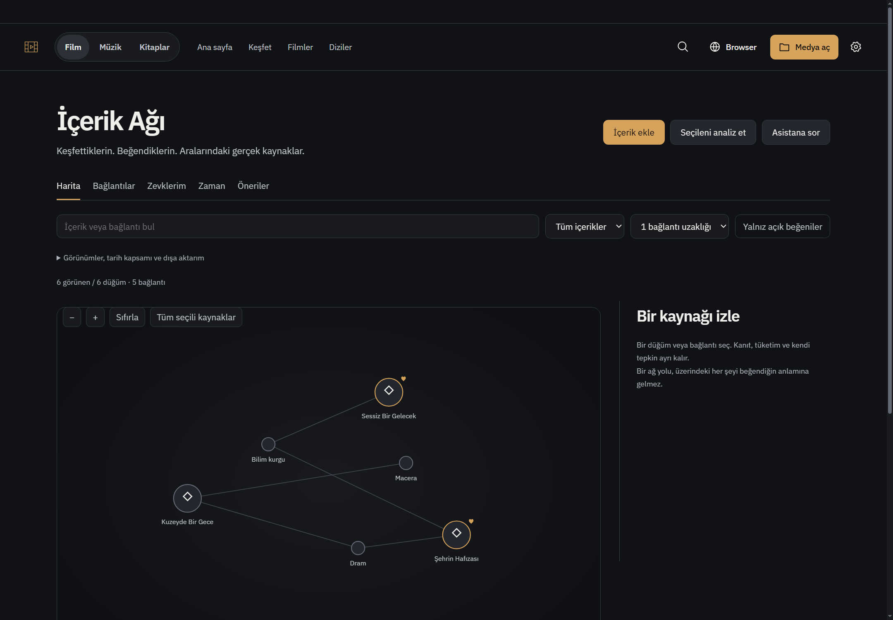
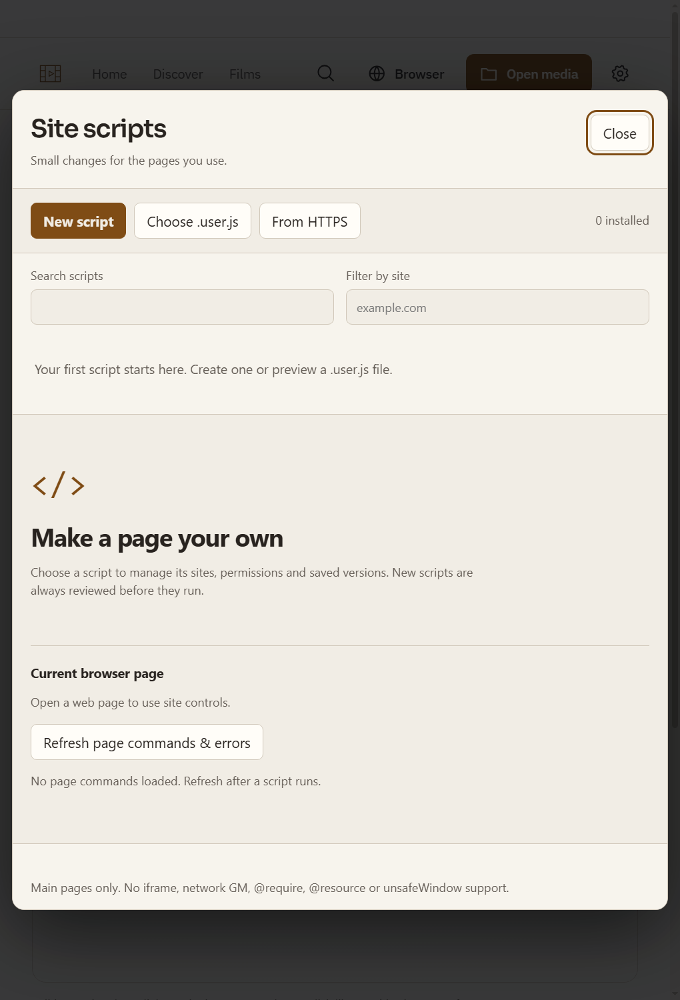
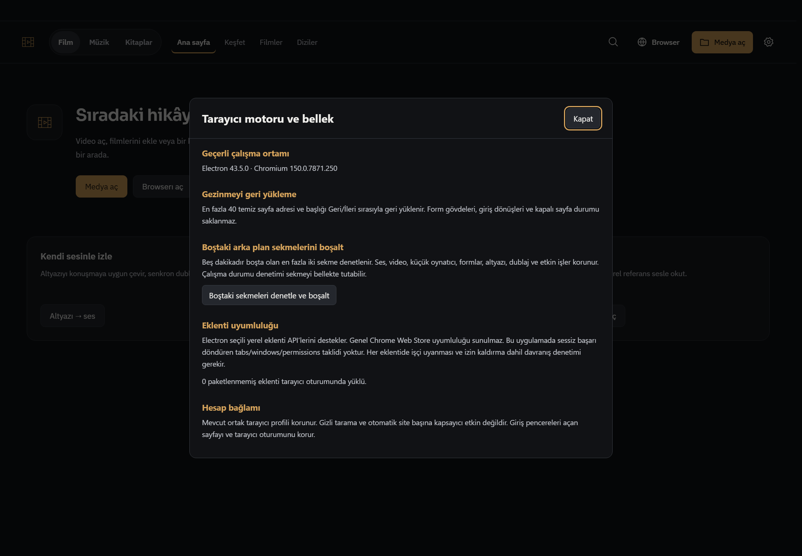
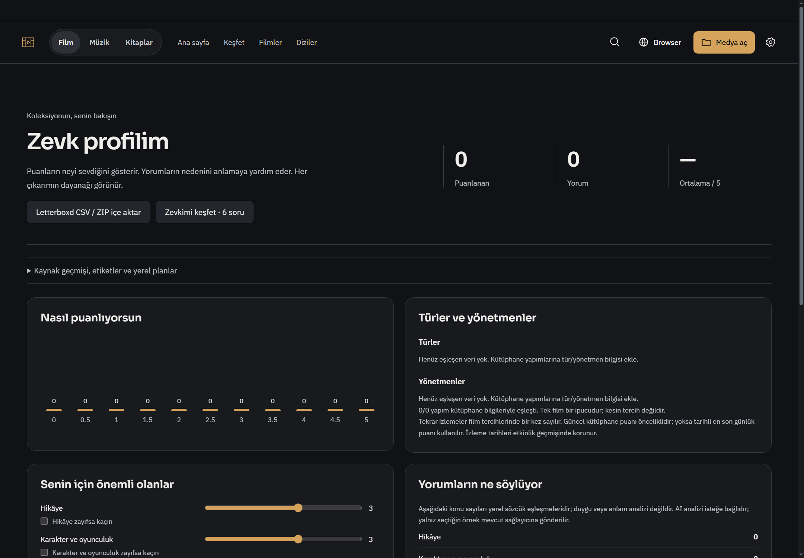

# Five research folders — integrated product delivery

Starting master: `8af5637a8cfd6cf9e90743c0f22d583fe4872b26`. Product: `56fc9bfa0e51fdc21414b50525bbfdcc88d00c68`.

The four requested research directories plus Recall and its appendices were reviewed against the current product. This is a delivery of applicable mechanisms, **not a claim that every investigated platform or future feature was installed**. All original local-only research reports/source manifests remain outside this publication. Current media owners and existing permissions remain authoritative; no local LLM, new dependency, paid test request or Actions run was introduced.

## Where to use it

- Left application symbol → **Knowledge & taste / İçerik ve zevk ağı**: add current sources; Map, Connections, My taste, Time and separate recommendation pools. Inspect evidence, explicit reactions, source revisions and manual/API proposals. Selected-source **Ask assistant** prepares context; **Analyze selection** explicitly uses the existing configured provider.
- Same application menu or browser More menu → **Browser scripts / Tarayıcı scriptleri** and **Browser engine & memory / Tarayıcı motoru ve bellek**.
- Assistant while an ordinary agent task is running: **Steer now / Yön değiştir** or **After answer / Bitince ekle**. These are separate bounded queues, source/thread bound, with receipts; neither silently applies action cards.
- Taste profile → **Source history, tags & local plans**. Letterboxd import previews retain source/date/score conflicts; orphaned records remain distinct. Country policies, real filtered facets and a bounded viewing-time draft are available in the disclosure.
- Feeds → Personal order, Corrections, Revisit and saved query views; reasons and read state remain separate. A changed article does not silently erase its read status.
- Radio/podcast episode → local-file tools with picker-authorized preview, confirm, identity checks and undo. Original files are personal media, never evictable cache.

## Delivered mechanisms and boundaries

| Folder | Decision ledger |
|---|---|
| Media/discovery/RSS | [K01–K12](media-cards.md); eleven applicable mechanisms plus original-file ownership boundary for conditional K10. |
| Assistant | [23 technical cards](assistant-cards.md); RUN01–03 delivered, current contracts reused, voice/local-engine/optimizer proposals explicitly classified. |
| Electron browser | [C01–C12 / E01–E12 / M01–M15](../browser-mechanisms-2026-11-01.md); ownership, conservative popup distinction, native history and bounded explicit memory action. |
| Userscripts | [Requirement disposition](userscript-cards.md) and [runtime contract](../userscript-runtime-2026-11-01.md). |
| Recall + appendices | [A01–A36 and source basis](recall-cards.md); one thin graph overlay referencing actual owners. |

Recall separates metadata, personal review, explicit like/dislike and consumption. A graph path is not evidence that someone liked everything on it. Frozen source/quote/reaction revisions reject stale AI results; assertions begin as proposals. UTF-16 quote ranges and source citations are checked. Film, YouTube and reading recommendation pools do not propagate taste between domains. The present candidate pool is existing owners, not an internet-wide recommender. Current browser/subtitle/notebook capture adapters remain unconnected; book references are metadata rather than an implied complete manuscript. Graph display is capped, with an equivalent keyboard list; no unmeasured large-library performance claim.

Userscripts support main frames and the documented value/style/menu APIs. **No iframe execution, network GM APIs, @require, @resource or unsafeWindow**; these scripts are blocked from activation. No arbitrary H5Player/full-extension compatibility claim. There is no new generic extension host, private partition UI or DRM certification. Those require actual multi-consumer profile/permissions/playback acceptance rather than labels. There is no managed podcast-download ledger to support cache eviction, nor conversational microphone/TTS runtime to apply voice-turn frameworks to. These concrete limits are recorded rather than hidden.

## Verification actually observed

| Check | Result / scope |
|---|---|
| Assistant mechanisms + final native-overlay unit boundary | Final short run: 7/7 PASS, 329ms. Covers queue, safe parallel read, partial/final read ownership and overlay forwarding/sanitization. |
| Browser mechanisms | 8/8 PASS; owner rollback, popup classification, session history, bounded reclaim/protection. |
| Userscript model / runtime / manager | 8/8 + 4/4 + 1/1 PASS. Native fixture independently verifies real document-start, no Node/trusted bridge, values, listeners, menu and cleanup. |
| Media K01–K12 | Initial 10/11; K04 country-code bug fixed, only failed case rerun 1/1 PASS. No later full-suite rerun claimed. |
| Recall core | Initial 8/9; whitespace-query bug fixed, failed source-staleness/purge case rerun 1/1 PASS. No later whole-core-suite rerun claimed. |
| Recall assistant | 1/1 PASS with controlled provider; valid proposal, unlike/stale rejection, no automatic like. |
| Syntax | 64 changed JS/related Python paths checked without failures; media_shelf.py separately compiles. |
| Theme color ratchet | Observed 407/419 ceiling PASS after using canonical manager theme tokens. |
| Actual Windows app | Isolated profile: Recall at1440px TR/dark and680px EN/light, eight captures; actual installed script marker; tab unloaded, restored, native Back returned to A. No console errors observed. |
| Final visual corrections | Taste actions10px gap and tools after hero at both widths; centered loaded browser dialog at both widths. Evidence contains final captures, not loading-state captures. |
| Diff / review | Scoped diff whitespace checks passed; separate Sol6.1 medium static review found no critical assistant integration defect. |

No full npm suite, real third-party user script/account, live remote-model quality, GPU, DRM, real OAuth, complete startup installer or new dependency installation test was run. Existing start.bat is unchanged. Native checks launched the actual app through an isolated profile; they do not claim a new personal start.bat launch. Personal open app was not stopped/reloaded. No Actions API/check polling or CI result is claimed.

## Evidence and reproduction

The [evidence](evidence/) directory has eight controlled screenshots and native/syntax JSON. No personal profile, cookies, API keys or original local reports are included.

Short logic checks use the existing runner: `node --test --test-isolation=none tests/four-assistant-mechanisms.test.js tests/assistant-overlay.test.js` (other suite filenames are listed above). Real userscript runtime: launch `tests/electron-four-userscript-runtime.smoke.cjs` with installed Electron after removing `ELECTRON_RUN_AS_NODE` from that process environment. The recorded main/preload/tab/Recall acceptance source is [native-application.cjs](probes/native-application.cjs); launch it similarly. It creates only an isolated `.uiprev` profile, controlled records and loopback pages. Do not launch tests against a personal profile.

