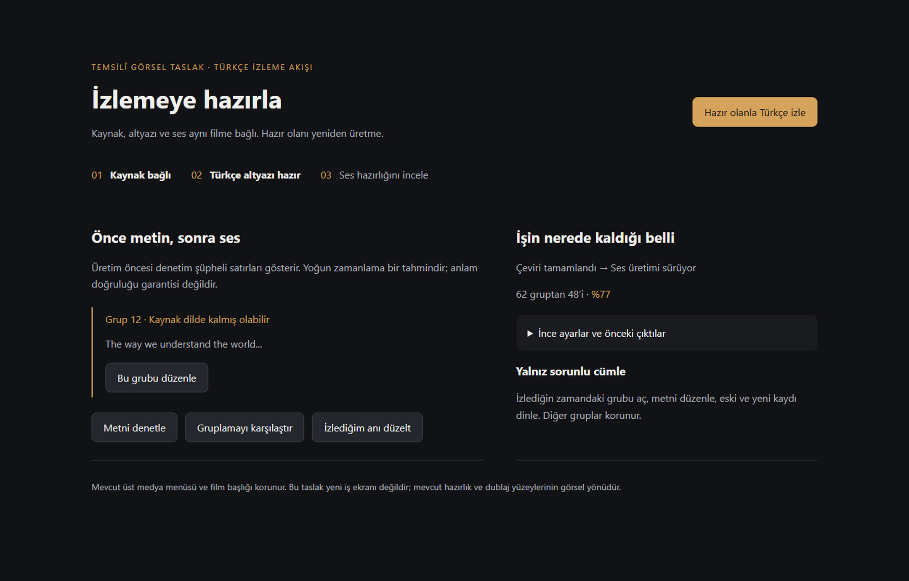
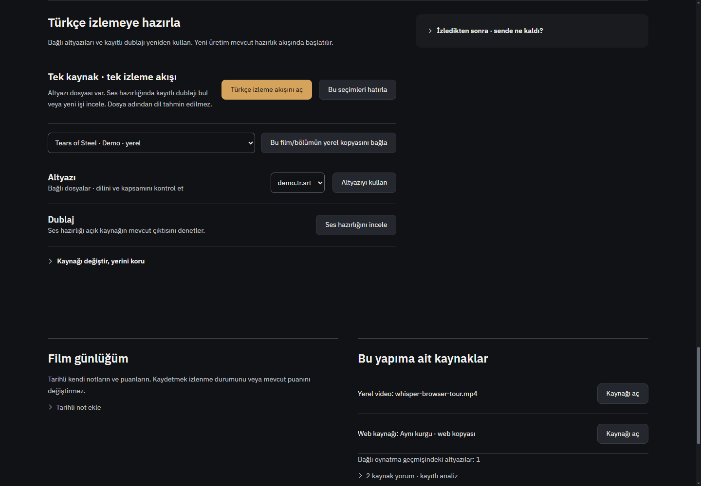
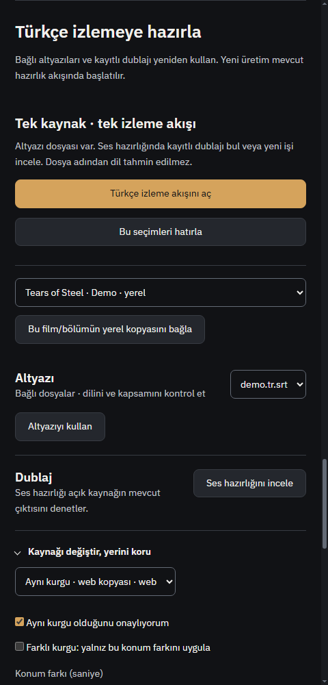
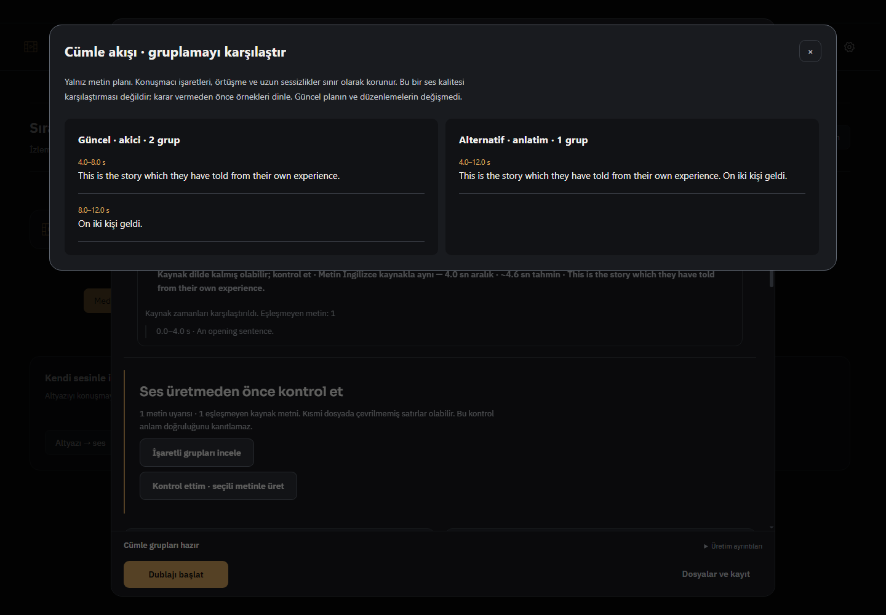
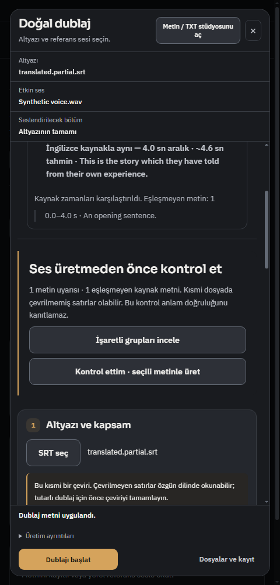

# Türkçe izleme akışı — 2 Kasım 2026

## Altı alanın teslimi

| Alan | Uygulanan davranış | Sınır |
|---|---|---|
| Tek izleme akışı | Film/bölümde kaynak ve hazır dosyalarla devam eden düğme; eksikse mevcut altyazı/ses hazırlığı; kaynak ve dosya seçimlerini açıkça kaydetme | Dosya adı Türkçe dil kanıtı sayılmaz. Keşfet kaydı önce gerçek oynatma kaynağıyla bağlanmalı. |
| Konuşma sürekliliği | Güncel gruplamayla anlatım/akıcı alternatifi aynı kaynak hash’i üzerinde karşılaştırma; güncel plan ve düzenlemeler korunur | Bu görünüm metin planıdır. Yeni GPU A/B sesleri üretilmedi; daha doğal varsayılan ilan edilmedi. Mevcut kayıt A/B araçları korundu. |
| Üretim öncesi çeviri | Gerçek bağlı kaynak altyazıyla zaman örtüşmesi, çevrilmeden kalan İngilizce metin, sayı ipuçları ve eksik başlangıç/bitiş; seçili zaman aralığını koruma; kısmi/şüpheli metinde açık kontrol noktası | Anlamın tamamını otomatik doğrulamaz; sayı biçimleri farklı olabilir. Kaynak kanıtı yoksa denetlendi denmez. |
| Asistan işi izleme | Doğrulanmış uzun iş sürerken devam bağlantısı eskimez; bitişten sonra 10 dakika inceleme süresi; 24 saat mutlak oturum sınırı; yanlış kaynak/sohbet, kayıp veya durmuş iş ilerletilmez | Uygulama yeniden açılışında yeni kalıcı ajan oturumu eklenmedi. |
| Sorunlu cümleyi onarma | İzlenen ana bağlı özgün/çeviri izinde ilk üretimden önce de tekil gruba gitme; yalnız seçili metni Türkçeye çevirme taslağı; mevcut kaydet/tek-grup-üret ve kayıt A/B araçları | Taslak açıkça uygulanmadan grubu/SRT’yi değiştirmez. Eksik kaynak metninden yeni grup uydurulmaz; tam çeviri hattında tamamlanmalıdır. |
| Kullanım ve tasarım | Film→oynatıcı ve dublaj denetim/onarım; asistanın gerçek dört iş durumu; geniş/dar Windows görüntüleri; gruplama penceresi içerik yüksekliğinde | Canlı YouTube, gerçek sağlayıcı ve GPU kalite değerlendirmesi bu teslimin kanıtı değildir. |

## Kök nedenler ve korumalar

- Asistan makbuzu yalnız sabit 10 dakikaya bağlıydı. Ana süreç ve renderer aynı ledger-temelli süre kuralını kullanır; sınırsız token birikimi yoktur.
- Aynı SRT birden fazla kaynağa bağlıysa ilk kaydın kaynak kimliğine indirgeniyordu. Kaynak başına ilişki korunur; seçimler gerçek güncel dosyalardan doğrulanır.
- Ön denetim yalnız hedef metindeki dil ipuçlarını görüyordu. Artık izinli ve gerçekten bağlı kaynak izinin kapsamı da karşılaştırılır; kaynak dosyasına/keyfi yola model erişimi eklenmez.
- Gruplama karşılaştırması ana planın yerini almaz; farklı/sonradan değişmiş dosya hash’inde karşılaştırma reddedilir.
- Seçili grup çevirisi mevcut çeviri sağlayıcısını ve güvenli endpoint/yanıt çözümleme yolunu kullanır. Yalnız kullanıcı tıklamasıyla istek gider; kaynak hash’i ve sağlayıcı kimliği yanıt sonrasında yeniden kontrol edilir. SRT okuması 4 MB ile sınırlıdır.

## Doğrulama

- 36 Node test sonucu geçti: assistant-flows, assistant-flow-state, dub-experience801, film-watch, dub-service ve dub-generator-ui. Son servis/film kenar düzeltmeleri ilgili dosyalarla ayrıca kontrol edildi.
- `backend/test_dub_flowing_groups.py`: 6 test geçti; tam düşünce sınırı, kaynak kimliği, konuşmacı/boşluk ve plan/üretim sözleşmesi korundu.
- 17 değişen/yeni JS dosyası `node --check`: geçti. `git diff --check`: ürün/test dosyalarında temiz.
- Gerçek Windows Electron: `tests/electron-film-watch.smoke.js` (1440/480, seçim kaydı/geri yükleme ve gerçek yerel demo SRT açma), `tests/electron-turkish-viewing.smoke.js` (1440/480, kaynak kapsamı, onaysız üretmeme, taslak/tek grup), `tests/electron-assistant-flow-state.smoke.js` (dört gerçek panel durumu).
- Motor ve sağlayıcı olayları kontrollüdür; görüntüler kişisel profilden alınmadı. Gerçek model/GPU doğallığı, anlam başarımı veya kullanıcı sesi hakkında başarı iddiası yoktur. Yeni bağımlılık eklenmedi. GitHub Actions başlatılmadı.

## Görseller

Önce hazırlanan temsilî taslak:

Windows film hazırlığı:

Windows gruplama karşılaştırması ve dar denetim:

