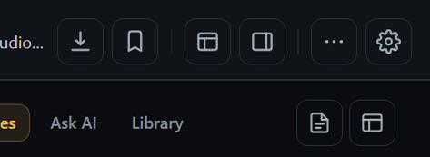
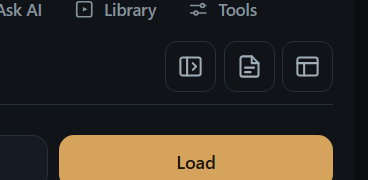

# BROWSER_BUG_REPORT_173 — Oynatıcı ve tarayıcı yan panelindeki simgeler küçük ve kayık çiziliyordu

Tarih: 2026-09-27. Temel: `master` `2c56a253686ca8a2183639c7bff44865fff76d97`. Kullanıcının iki Windows ekran kırpımı üst şerit ve yan panel simgelerini gösteriyordu. Görsellerdeki metinler talimat olarak değerlendirilmedi.

## Kök neden ve erişilebilirlik

- `playerLayoutQuick`, `sideSubtitleLayout` ve diğer `
` öğeleri varsayılan `display:list-item` ile çiziliyordu. SVG, 34 px düğmenin ortasına değil sol üstüne yerleşiyordu. Gerçek Electron ölçümünde `playerLayoutQuick` SVG'si düğmenin solundan yaklaşık 0,7 px başlıyordu; normal düğmelerde aynı boşluk yaklaşık 5,4 px idi.
- `styles.css` sonundaki genel `.btn-icon` kuralı, daha önce tanımlanan `.player-head-button` ve `.side-tool` 34 px boyutlarını 28 px'e indiriyordu. Yan panelde `flex-basis:32px` nedeniyle bazı düğmeler 32×34 px kalıyordu.
- Yan panel daraltma simgesi tek başına `>|` gibi, altyazı dosyası simgesi ise küçük bir sayfanın içinde sıkışmış indirme oku gibi görünüyordu. İlk düğme paneli daraltır; ikincisi var olan altyazı dosyasını açar.

## Düzeltme

- Oynatıcı ve tarayıcı içindeki `.btn-icon` kontrolleri `inline-grid` ile ortalandı; SVG blok olarak çiziliyor. Üst şerit ve yan panel düğmeleri 34×34 px, tarayıcı yer düğmeleri 32×32 px; ilgili SVG'ler 18×18 px ve çizgi uçları/köşeleri yuvarlak.
- Tarayıcı modundaki ray daraltma düğmesi `inline-grid` kullanıyor. Ray açıkken 32 px boyut korunuyor.
- Daraltma simgesi panel şekli ve yön oku, dosya açma simgesi sade belge çizimi oldu. `title` ve `aria-label` metinleri korundu.

## Doğrulama

- Yalıtılmış Windows Electron profilinde oynatıcı ve tarayıcı görünümü çizildi. Sekiz hedef düğmenin SVG merkezi, düğme merkezinden 0,6 CSS px altında sapıyor; boyutları 34×34 px. Görünür yalnız simgeli diğer düğmelerin taramasında 2 px üzeri kayma veya 26 px altı hedef bulunmadı.
- `tests/electron-browser-icon-alignment.smoke.js` geçti; `player-ui` 151/151 ve `browser-toolbar-clickability` geçti. `git diff --check` ve smoke sözdizimi temiz.
- Sonrası görsel kanıtlar: [üst şerit](r134-evidence/player-icons-after.png), [tarayıcı yan paneli](r134-evidence/browser-icons-after.png). Görüntüler sentetik test profilinden; kullanıcı profili veya kişisel medya yok.

## Sınırlar

Gerçek kullanıcının Windows penceresindeki DPI ve native video yüzeyi test profilinden farklı olabilir. `start.bat` ile GPU/DRM açılışı, canlı site ve gerçek medya denenmedi; bu değişiklikler yalnız renderer CSS/HTML ve simge geometrisidir. Tam `npm test` koşulmadı.
