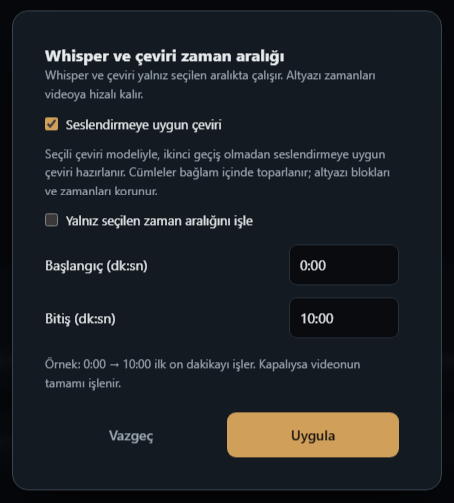
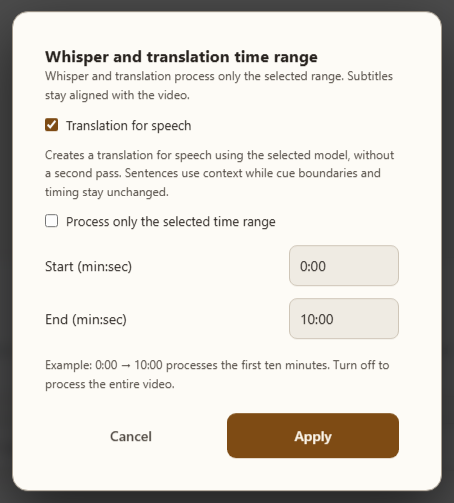

# BROWSER_BUG_REPORT_482 — Seslendirmeye uygun çeviriyi ana akışa geri alma

2026-10-19. Başlangıç HEAD: `566d9e522d135d9767d0cd06bb8ee530f769c9f3`.
Bitiş ürün kodu: `349b9df83c3f0087a838a89cb967691e5f52d639`.
Dal/PR: codex/browser-audit477 / #454. Master tabanı68775abb.

## Sorun ve kaynak

Kullanıcı ses üretiminden önce altyazı çevirisini doğrudan seslendirmeye
uygun yapma özelliğini soruyordu. Ana kopyada yoktu. Kaynak worktree'de
888a11ce75d938c86297eb5bc4500603443ca5c4 commit'inde bulunup ana sürüme
entegrasyonu yapılmamıştı. Önce verilen SRT→Ses / süreye kısalt cevapları
farklı özelliklere aitti. Bu tur bu özelliği geri getirir.

## İstenen konum ve davranış

Browser → Altyazı → Whisper + çeviri yanındaki ayar düğmesi →
**Seslendirmeye uygun çeviri**. Mevcut zaman aralığı kutusuna checkbox
eklendi; ikinci menü satırı/ayar düğmesi eklenmedi. Uygula ayarı kaydeder,
kendiliğinden üretim başlatmaz. Sonrasında Whisper + çeviri seçilen
aralıkta (kapalıysa tüm videoda) bu modla çalışır. Vazgeç taslağı uygulamaz;
video değişirse apply reddedilir. Ana çeviri ayarlarında da aynı tercih var.

Seçili çeviri modeli aynı çeviri geçişinde doğal konuşma dili talimatı alır.
İkinci refine/postprocess geçişi kapanır. Bilgi/ad/sayı/olumsuzluk korunması,
özetlememe ve ID/zaman sahipliği prompt sözleşmesindedir. Anlam kalitesi
gerçek sağlayıcıyla kanıtlanmadı. Normal hata kurtarmaları ek çağrı üretebilir;
sabit token maliyeti garantisi yok. Speech cache/TM normal moddan ayrıdır;
translation-only çıktısı speech soneki ve forSpeech metadata taşır.

## Entegrasyondaki ek onarımlar

- translateForSpeech renderer'da kalıcı listede olup settings-security
  whitelist'inde yoktu; artık yeniden açılış/import/export ile korunur.
- Genel speech tercihi açıkken yalnız kaynak Whisper eylemi kendi LLM
  düzeltme tercihini geri alır; speech modu kaynak-only ayarını bastırmaz.
- DOM ratchet eski dal satırları yerine mevcut kaynak satırlarına taşındı.
  İzin sayısı/ifadeleri genişletilmedi, değişmeyen kaynak satırları eşlendi.
- Önceki 477–481 düzeltmeleri korundu, eski rapor444/445 üzerine yazılmadı.

## Doğrulama

Geçti: backend/test_speech_translation.py5 (kontrollü gerçek llm_translate
hattı, cache, SRT zamanları/metadata), speech-translation-ui,
browser-youtube-whisper, main-args18, DOM ratchet2, ui-locale14,
ui-locale-dedupe5, settings-security23. Settings alt süreç testleri sandbox
engeli sonrası yetkili tekrar koşuda geçti; test/eşik değiştirilmedi.
Yanlış adla çağrılan browser-whisper-range testi depoda yok; aralık davranışı
speech-translation-ui ve browser-youtube-whisper tarafından doğrulandı.
JS syntax, Python py_compile ve diff temiz.

Gerçek renderer/CSS, ayrı headless Chrome profili ve sahte YouTube URL
bağlamıyla TR/EN × açık/koyu ×720/1400px:8 görünüm,0 kontrast ihlali.
Görüntüler elle incelendi; gerçek BrowserView/YouTube/GPU/ücretli sağlayıcı
ve üretim start.bat yeniden açılışı değildir. Kişisel profil kullanılmadı.

Yeni bağımlılık/kurulum yok. Yeni kalıcı boolean: translateForSpeech;
CLI: --translate-for-speech; translation-only metadata: forSpeech.
Kullanıcı bu tur açıkça ana sürüme alınmasını istedi; PR merge etmeme
varsayılanının yerine bu iş için açık merge yetkisi var. Windows CI sonucu
beklenir, ardından PR ve yerel master güncellenir; doğrulanmadan başarı yok.

## CI takibi

Windows run39220882413 yeni browserWhisperForSpeech ayna kontrolü sınıflandırılmadığı için settings-ui-persist-roundtrip testinde düştü. Test9ddc0b97: OTHER_STORE listesinde persist kaynağı açıklanarak sınıflandırıldı; kalıcılık5 ve speech UI testi geçti. Ürün kodu değişmedi. Ayrıntı docs/devir/2026-10-19-1119.md.
