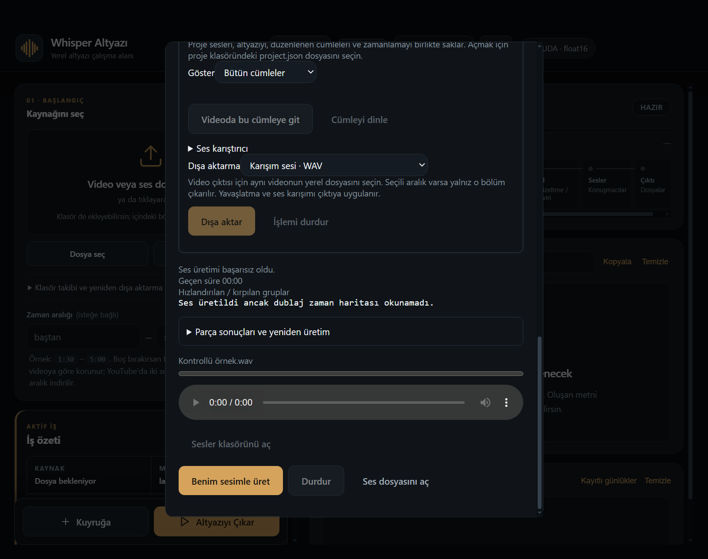

# BROWSER_BUG_REPORT_491 — Ses tarafında 13 doğrulanmış onarım

Repo: https://github.com/dorukakindev/whisper-browser · [PR463](https://github.com/dorukakindev/whisper-browser/pull/463)
Dal: `codex/audio-bugs491`.
Başlangıç: `6aea8203873f666e60853d302ef770c827587198`.
Bitiş ürün/test kodu: `42276d9a63e4ff787be8c7a189523d8e1fcb8f0d`.
Ana checkout ve origin/master: `957bbfe91edee709accb24624e9e945e7a7a2969`.

Kullanıcı 20 önemli bug istedi ve sayı doldurulmamasını açıkça belirtti.
Bu turda **13 ayrı hata** davranış kanıtıyla doğrulandı; 20 tamamlandı denmez.
İnceleme üretim, retry/cache, verifier, önizleme, proje/iptal, referans ve
AI konuşma metni yollarını kapsadı. Önceki raporlar yeniden sayılmadı.

| No | Gerçek tetik / etkisi | Düzeltme ve regresyon |
|---|---|---|
| 491-01 | Doğal konuşma düzenlemesi açıkken autoFit kapatılıp açılması aynı ses cache kimliğini kullanıyordu. Kapalı seçeneğe rağmen daha önce süre için değiştirilmiş konuşma gelebiliyordu. | autoFit ayarı ses kimliğine eklendi; protokol v6. Aynı doğal düzenleme ayarında true/false cache kimlikleri artık farklı. |
| 491-02 | İlk sentez kullanılabilir fakat akustik skoru kusurluysa sonraki retry timeout/normal hata verdiğinde eldeki en iyi ses de exception ile kayboluyordu. Grup sessiz fallback'e düşebiliyordu. | Geçerli best varsa sonraki normal retry hatası onu korur. Hiç best yoksa hata/retry davranışı sürer; CUDA/OOM ve iptal yutulmaz. |
| 491-03 | Birkaç paralel grup verifier lock'u beklerken ilk doğrulama aracı kullanılamaz hale gelse bile sıradakiler lock içine girip tekrar istek/120sn bekleyebiliyordu. | unavailable lock alındıktan sonra da kontrol edilir. İki eşzamanlı istekte bozuk verifier'a yalnız ilk istek yazılır. |
| 491-04 | Verifier kapanışındaki terminate sonrası sınırsız wait, takılan alt süreçte bütün üretimin kapanışını kilitliyordu. | 3sn terminate beklemesi, sonra kill ve 3sn son bekleme. Kontrol dışı sonsuz bekleme yok; subprocess kullanıcıya ait diğer süreçleri hedeflemez. |
| 491-05 | Karışım önizlemesi her 80ms tick'te henüz çözülmemiş aynı layer play() çağrısını tekrar yapabiliyordu; durdurulduktan sonra kuyruktaki çağrı yeniden sesi açabiliyordu. | Katman başına tek pending işlem, kaynak/intent kontrolü ve stale sonuç koruması. Çoklu tick tek play oluşturur; stop sonrası geç sonuç sessiz kalır. |
| 491-06 | Müzik/ortam dosya seçicisi açıkken çıktı değişirse geç gelen seçim yeni çıktıya ekleniyordu. | Seçimden ve asset hazırlığından sonra çıktı snapshot'ı doğrulanır. Eski seçimin yeni projeye katman eklemesi engellenir. |
| 491-07 | Save/export bitişiyle yarışan geç cancel yanıtı Kaydedildi durumunu kalıcı Durduruluyor mesajıyla ezebiliyordu. | İptal yanıtı ancak aynı aktif operation serial'ına aitse uygulanır. Başarı sonrası geç ok yanıtı başarıyı korur. |
| 491-08 | GPU üretimini başlatan renderer destroyed olduğunda dub-service işi sahipliğine bağlı bir durdurma yoktu; pahalı iş sahipsiz devam edebiliyordu. | Referans ve sentez işi sender destroyed olayına bağlanır; yalnız sahip olunan iş iptal edilir, terminalde listener temizlenir. Kontrollü child fixture'ında tek terminate ve kilit kapanışı doğrulandı. |
| 491-09 | Zaman haritası bozulunca WAV diskte korunuyordu ama medya yetkisi verilmemişti ve renderer kurtarma alanını hiç göstermiyordu; kullanıcı sadece başarısız mesajı görüyordu. | Korunan WAV yetkilendirilir, URL'si iletilir; ses önizlemesi ve Ses dosyasını aç gösterilir. Yanlış senkronla video bağlantısı sunulmaz. Backend ve renderer birlikte doğrulandı. |
| 491-10 | Konuşma kısaltmasındaki ad koruması substring kullanıyordu; Ali yerine Alim yazılması ad korunmuş sayılıyordu. | Unicode sözcük sınırıyla tam ad kanıtı gerekir. Yanlış kişi reddedilir, aynı adla güvenli kısaltma kabul edilir. |
| 491-11 | Sayı koruması işareti karşılaştırmıyordu; -5 derece → 5 derece önerisi kabul edilebiliyordu. | Sayısal işaretler de korunur; Unicode eksi eşdeğerliği tanınır. Anlamı tersine çeviren öneri reddedilir. Bu semantik doğruluğun tümünü kanıtlama iddiası değildir. |
| 491-12 | Seçili parçayı yeniden üret cache'i atlasa da aynı akustik seed ile aynı sesi talep ediyordu. Kullanıcının düzeltmeye çalıştığı telaffuz aynı kalabiliyordu. | Yalnız zorlanan parçaya üretim başına yeni seed varyasyonu uygulanır. Diğer parçaların normal seed/cache kimliği korunur; kontrollü üretimde 42 yerine 165, normal yolda 42 görülür. Gerçek model kalite artışı ölçülmedi. |
| 491-13 | SRT ses metni temizliği bütün süslü parantezleri ve <...> aralıklarını biçim etiketi sanıyordu. {Mars} ve a < b > c metni konuşmadan silinebiliyordu. | ASS override ve gerçek tag biçimi ayrılır. Gerçek metin korunur; {\\an8} ve <i> biçimi temizlenmeye devam eder. |

## Kanıtlar

Başlangıç kodu ignore `tmp/report491/before` kopyasında tutuldu. Yeni Node
regresyonlarının **7/7'si kırmızı**, yeni Python dosyasının **5/5'i kırmızı**,
kontrollü gerçek üretim orkestrasyonundaki force-seed regresyonu da kırmızıydı.
Python'daki iki error, beklenmeyen timeout exception'ının doğrudan dışarı çıkması
ve kapanışın testin timeout'una takılmasıdır; eksik import/bağımlılık değildir.
Son kodda bu **13 regresyonun tamamı geçti**.

Hedefli Node: yeni dosya + dub-service, dub-generator-ui, dub-workspace-ui,
browser-dub-audio, dub-text-guard ve ci-determinism-ratchet → runner 13/13.
Python: test_report491_audio 5, test_dub_plan_regressions 5, test_dub_timing 12,
test_dub_generation_quality 5, test_dub_finish 5 → 32/32.
Mevcut `D:/Whisper Local/backend/venv/Scripts/python.exe` kullanıldı; global
Python'a eksik bağımlılık yüklenmedi. Yeni paket/model indirilmedi.
JS syntax, Python py_compile ve git diff --check geçti.
İzole Windows Electron bridge geçti.

Gerçek Windows Electron'da mevcut HTML/CSS ve üretim generator script'iyle,
sentetik API/iş olayları üzerinden kurtarma görünümü incelendi:

Bu görüntü kişisel video/profil veya gerçek model sesi içermez. Ses kontrolü
sentetik URL ile görünüm kontrolüdür; 0:00 göstergesi gerçek ses kalitesi kanıtı
değildir. Kişisel uygulama penceresi değiştirilmedi.

## Sayılmayan şüpheler ve sınırlar

Proje settings alanının açılışta taşınmaması incelendi; mevcut kullanıcı
akışını bozduğu doğrulanmadığından bulguya eklenmedi. Kısa elle eklenen sesin
bitiminde orijinal sesin otomatik açılması beklentisi ürün kararıdır; otomatik
bug sayılmadı. Bilinmeyen/bozuk metadata türleriyle üretilen küçük sınır
örnekleri de 20'yi doldurmak için eklenmedi.

**7 ek önemli hata doğrulanmadı; bu turda kapsam 13 onarımdır.**
CI etkin bırakıldı ve arkada çalışır; sonucu beklenmedi, yeşil iddia edilmez.
Yerel tam npm test, gerçek YouTube, gerçek GPU/model/ASR kalite üretimi,
DRM ve üretim profilinde start.bat akışı çalıştırılmadı.
Cache protokol değişimi eski parçaları silmez; ilk yeni üretim cache'i
yeniden doldurabilir ve bu sefer daha uzun sürebilir. Kaynak SRT değişmez.
Önceki unmerged teslimler korunur; master'a otomatik merge yapılmadı.
