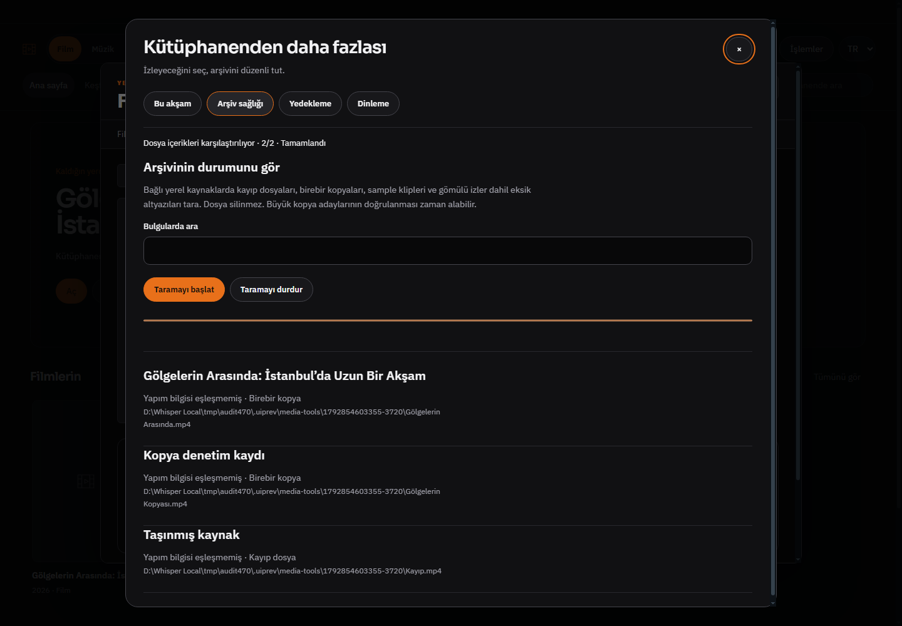

# BROWSER_BUG_REPORT_528 — medya araçlarında doğrulanmış kullanım hataları

24 Ekim 2026. Başlangıç b16ad37a433f94720c225da10aff4a287a7368e2; bitiş kod 46a7ad44d22728f09defcf5af522ed2e395140cd. Dal codex/luna-media-home532, PR482. Dar kapsamlı davranış/görsel düzeltme; bütün uygulama tarandı iddiası yok.

| Alan | Önceki sorun ve kanıt | Uygulanan onarım |
|---|---|---|
| İçe aktarılan kaynak | health() source.imported kontrolü olmadan stat/ffprobe/hash yapıyordu; oynatma hattının kullanıcı doğrulama kapısını tarama atlıyordu. | Böyle kayıtlar okunmadan unverified olarak raporlanır; kütüphane ayrıntısından doğrulama yönlendirmesi EN/TR. Sentetik onaysız bulunamayan dosya missing/probe yerine yalnız unverified döner. |
| Kopya okuma | Aynı dosya farklı katalog kayıtlarında tekrar hash ediliyordu; digest üzerindeki son alias önceki satırı görünmez bırakabiliyordu. | Eşit boyut adayları resolved path ile tekilleşir; aynı içerikli farklı dosyalar bulunduğunda tüm bağlı satırlara duplicate işlenir. 3 kayıt/2 dosya fixture'ı 2 hash ve 3 duplicate döndürür. Hardlink inode tekilleştirmesi iddiası yok. |
| Yanlış kayıp sonucu | stat/readdir/realpath hatalarının tamamı missing yazılıyordu; klasör/erişim/inceleme hatası da kayıp sayılıyordu. | Yalnız ENOENT/ENOTDIR missing; diğerleri probe-failed. Gerçek dizin fixture'ı probe-failed, bulunamayan dosya missing olarak doğrulandı. EACCES fiziksel ACL testi yapılmadı. |
| İlerleme | İlk inceleme sayacı dolduktan sonra büyük dosya hash'i sürerken UI yüzde100/sabit kalıyordu. | inspect/hash fazı, hashed/hashTotal sözleşmesi ve ayrı karşılaştırma sayacı. running durumu hash boyunca sürer; stop AbortSignal korunur. |
| Yedekleme sıklığı | Klasör seçici açıkken kapatılan sıklık, eski seçici geç döndüğünde tekrar etkinleşiyordu. Geleceğe yazılmış last değeri uzun süre yedeği durdurabiliyordu. | Her tercih değişikliği intent ile eski seçimi geçersiz kılar; yazım sürerken config değişimi reddedilir ve async doğrulama sonrasında tekrar kontrol edilir. Geçersiz/gelecek last sıfırlanır. Otomatik yedek isim eşleştirmesi gerçek üretilen biçimle sınırlandı. Deferred picker/off ve gelecek timestamp testleri geçti. |
| Pencere sırası ve odak | Araçlar zaten açıkken katalog ayrıntısı üstünde tekrar çağrılınca araç DOM'u değişse de native modal arkada kalıyordu. Önceki UI testi yalnız DOM'u ölçüyordu; ekran görüntüsünde katalog görünüyordu. | Mevcut araç penceresi gerektiğinde modal yığınının üstüne taşınır; yeniden açılmış dialog'un geç close olayı onu silmez. Yeniden çizimde erişilebilir odak hedefi korunur. UI smoke her görüntüde aktif dialog'un mediaToolsDialog olduğunu da doğrular. |

## Test ve görsel kanıt

- `node --test tests/media-tools.test.js`: **8 geçti**; mevcut yorum kanıt/iptal ve yedek korumaları dahil. İlk arşiv fixture'ı yeni unique physical-source ve imported kapısını doğrular; yeni schedule fixture eski picker sonucunun off'u ezemediğini doğrular.
- `electron tests/electron-media-tools.smoke.js`: gerçek Windows Electron/main/preload ayrı sentetik profille geçti. Katalog ayrıntısı → yorum/analiz; arşiv kopya/kayıp kontrolü; backup ve audio; 1440 koyu TR, 700 koyu TR, 940 açık EN; native asistan pinleri. Çıktı `.uiprev/media-tools/1792854603355-3720`.
- `node --check` değişen JS ve `git diff --check`: geçti. Tam paket/CI beklenmedi.

Görüntü sentetik kaynak/yorum profilidir; kişisel veri değildir. Luna tasarım yönergelerinin mevcut token, modal, odak ve gerçek ekran inceleme yaklaşımı sürdürüldü. Önceki görselde katalog üstte kaldığı açıkça saptandı; sadece DOM ölçüsünü başarı saymak yerine test güçlendirildi. Yeni bağımlılık/model/schema/launcher yok. Whisper, ses için çeviri, referans ses ve dublaj üretim motoru değiştirilmedi. Canlı site/AI semantik kalite, GPU/DRM, gerçek start.bat, uzun arşiv performansı ve gerçek Windows ACL denenmedi. Master/ana kopya değiştirilmedi.
