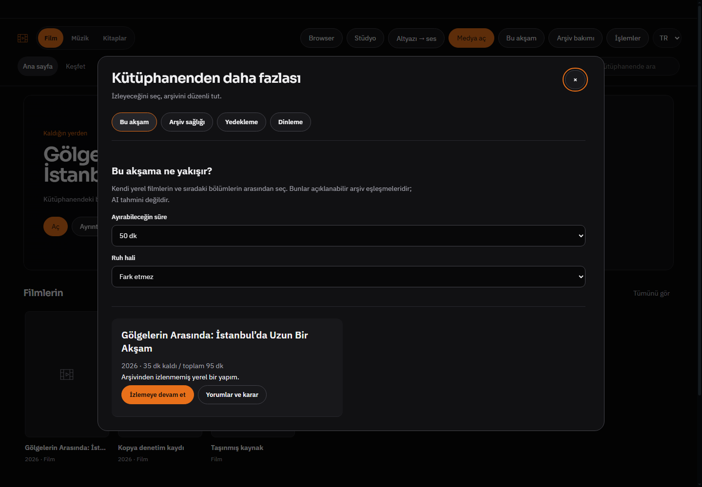

# BROWSER_BUG_REPORT_529 — kalan izleme süresi ve taslak koruması

24 Ekim 2026. Başlangıç HEAD 038481eace629512a4423b995fc39a13978ff4d7; bitiş ürün kodu 19e093a6d858d2e600c6acfda3808cb4bb86dee8. Dal codex/luna-media-home532, PR482. Kullanıcı faydalı ek geliştirmeleri uygulamamı istedi; bu tur yeni medya araçlarında dar davranış iyileştirmesi yapıldı.

## Doğrulanan sorunlar ve iyileştirmeler

1. **Süre seçimi toplam süreyi kullanıyordu.** Yarısı izlenmiş uzun bir film, kalan kısmı zaman bütçesine sığsa bile eleniyordu. Seçim artık geçmişte ölçülen gerçek süreyi (yoksa katalog tahminini) ve kayıtlı konumu kullanır; kalan saniye sınırla karşılaştırılır. Kart toplam/kalan süre ve devam düğmesini gösterir. Biten/sıfır kalan içerik ve süre sınırındaki bilinmeyen süreler dışlanır; sonlu olmayan sayılar kabul edilmez. Windows dosya anahtarlarında eğik çizgi/büyük-küçük harf farklılığı eşleştirilir; aynı anahtar için en güncel izleme kaydı seçilir. Salt string slash/case normalizasyonudur, disk realpath/hardlink çözümlemesi değildir.
2. **Araç sekmeleri kaydedilmemiş kişisel yorumu, yorum adresini ve spoiler seçimini sıfırlıyordu.** Önce yalnız yapıştırılan yorum metni taslağı tutuluyordu. Son on yapım için bellekte ayrı taslak (yorum örneği/adres/spoiler/kişisel değerlendirme/gerekçe) var. Sekme değişimi ve pencere yeniden açılması boyunca korunur; uygulama kapanınca taslak kaybolur, UI bu sınırı söyler. Kalıcı değerlendirme yalnız açık Kaydet eyleminde userData'ya yazılır. AI analizini kaydedip ekranı yenilemek kişisel yorum taslağını silmez.
3. **Gecikmiş async hata/analiz kaydı yeni sayfayı yeniden çizebiliyordu.** Düğme işlemleri owner/epoch ile kendi sayfasındaki hatayı gösterir; AI sonucunu kaydetme tamamlandığında yalnız aynı sonuç sayfası hâlâ açıksa yeniden çizilir. Kullanıcının başlattığı kayıt tamamlanır; sonraki sayfa eski işlem nedeniyle sıfırlanmaz. Bu koruma her eski renderer akışının genel denetimi değildir.
4. **Bu akşam filtreleri tekrar girişte sıfırlanıyordu.** Süre/ruh hali seçenekleri uygulama belleğinde tutulur. Yeni kalıcı kişisel tercih dosyası/anahtarı eklenmedi. Mevcut son altı seçimi düşük öncelikleme akışı değişmedi.

## Kanıt

- `node --test tests/media-tools.test.js`: **9 geçti**. Yeni regresyon hem backend hem renderer modeline aynı Windows anahtarlarıyla 120 dk ölçülen/70 dk izlenen film, 50 dk sınır, 49 dk ret, eski ters sıradaki history kaydı, bitmiş ve Infinity/NaN girdilerini uygular. Mevcut yorum kanıt/iptal, arşiv ve yedek testleri korunur.
- `electron tests/electron-media-tools.smoke.js`: gerçek Windows Electron/main/preload, ayrı sentetik profil. Gerçek katalog/play/updateWatchItem IPC yoluyla 95 dk/60 dk izleme kaydı yaratıldı. 50 dk seçiminde tek sonuç, **35 dk kaldı** ve devam düğmesi doğrulandı. Film oynatması başlatılmadı; bu süre verisi kontrollü test girdisidir.
- Aynı gerçek UI testinde kişisel yorum, yapıştırılmış örnek, URL ve spoiler seçimi doldurulup Bu akşam sekmesine ve geri geçildi; tümü korundu, önceki100 dk filtresi geri geldi. Kontrollü AI sonucu/alıntı kaydı, arşiv/backup/audio, dar700TR ve940açıkEN, native asistan pin kontrolü de geçti. Son çalıştırma `.uiprev/media-tools/1792855818984-14064`.
- JS syntax ve diff check geçti. Önceki görsel yönergelerinin mevcut tema/yerleşimi koruma yaklaşımı sürdürüldü; yeni CSS/font/dependency yok.

## Sınırlar

Whisper/transcribe/çeviri/VoxCPM/üretim modeli, launcher, mevcut kullanıcı profili ve master değiştirilmedi. Taslaklar RAM'de son10yapım; uygulama çökmesi/yeniden başlatma sonrası korunma iddiası yok. Kalan süre videonun normal1×süresidir; seçilen hız/dublaj zaman haritasına göre duvar saati hesabı değildir. Eksik/eski metadata veya gerçek dosyanın sonradan kısaltılması yalnız mevcut geçmiş verisi ölçüsünde bilinir. Canlı AI/Letterboxd/DRM/GPU, gerçek start.bat ve tam npm test koşulmadı. CI teslimde beklenmez.
