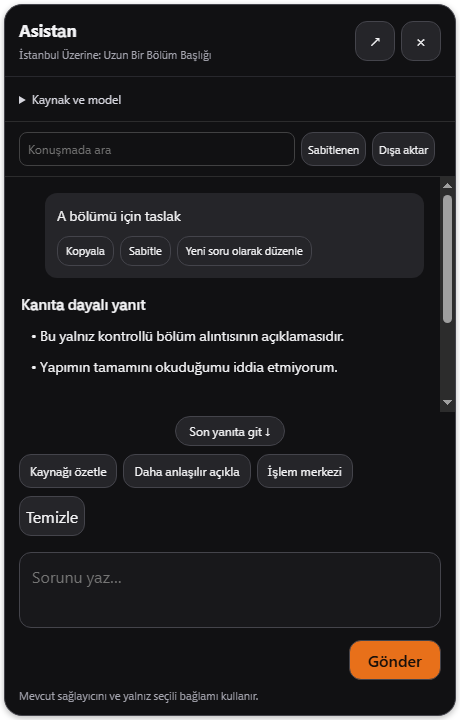
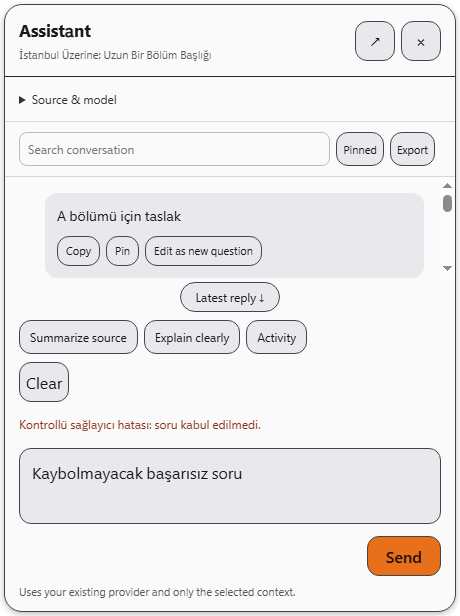

# BROWSER_BUG_REPORT_530 — bağlamlı asistanı güçlendirme

24 Ekim 2026. Kullanıcı özellikle asistanı geliştirmemi istedi. Başlangıç HEAD 4d0a07281f4f9ab7349b8678b96ea6c1504030cb; bitiş ürün kodu a3164a88f0edb3f16db97683f265e8cfeb0f0b0f. Dal codex/luna-media-home532, PR482. Mevcut sağlayıcı/Whisper/çeviri/TTS motoru değiştirilmedi.

## Somut sorunlar ve onarımlar

- **Yanlış başlık ve belirsiz kaynak:** media-selection ekranında yapım/bölüm adı yerine Altyazı stüdyosu yazabiliyordu. Artık seçili başlık, model adı ve açılır Kaynak ve model alanında eldeki alıntı/bilgi gösterilir. Kitap/yapım seçiminde video altyazı kapsamı kontrolü gizlenir; video tarafında mevcut nearby/watched/full aynen korunur. Bu panel görüntüden video analizi veya tam esere erişim iddiası üretmez.
- **Yanlış kaynağa komut yarışı:** native baloncuk daha önce son görünen kaynağı doğrulamadan send/clear/scope/citation gibi komutlar gönderiyordu. IPC zarfı sınırlı sourceToken/requestId taşır; parent gerçek aiSourceScope ile eşleştirir. Geç kalan eski kaynak sorusu gönderilmez. Cancel yalnız ilgili iş/ön hazırlık kaynağıyla eşleşirse çalışır. Frame/sender izolasyonu ve secret whitelist korunur.
- **Mesajların kaynakla karışması:** native panel aynı DOM'daki farklı kaynağa ait sohbet baloncuklarını yeni başlık altında aynalıyordu. aiChatAdd her baloncuğu kaynak scope'una bağlar; native snapshot yalnız eşleşen baloncukları taşır. Bu uygulama içi/son200DOM mesaj sınırındaki görünür kaynak ayrımıdır; yeni kalıcı sohbet arşivi veya kaynaklar arasında model geçmişini otomatik geri yükleme değildir.
- **Gönderim onayı ve metin kaybı:** eski view herhangi bir snapshot geldiğinde pending'i sıfırlıyor, aynı soru geçmişte bulunuyorsa input'u erkenden silebiliyordu. Yeni parent makbuzu yalnız o çağrı sırasında eklenen yeni kullanıcı baloncuğunu kabul sayar. View sadece eşleşen requestId/source ve hâlâ değişmemiş metni temizler. API ayarı/iş engeli/kabul hatasında soru taslakta kalır; gönderim sırasında yazılan yeni metin silinmez. Kabul, gerçek modelin başarıyla yanıt verdiği anlamına gelmez; mevcut hata/retry yolu sürer.
- **Tek soru taslağının kaynaklarla karışması:** kaynak başına son20taslak RAM'de tutulur. Video/sayfa/bölüm değiştirmek başka kaynağın sorusunu yeni kaynakta göstermez. Kapanış/çökme sonrası kalıcılık yok; API'ye otomatik taslak gönderilmez.
- **Sohbet temizleme:** açık kısa onayla yalnız mevcut scope'un mesajları ve varsa model-history/retry'si temizlenir; başka kaynağın DOM mesajı ve sabitlenen notlar korunur. Eski sidebar düğmesinin genel temizleme davranışı değiştirilmedi.

## Kullanım ve tasarım geliştirmeleri

- “Daha anlaşılır açıkla” ve video/sayfa bağlamında “Çeviriyi değerlendir” hızlı istemleri. Var olan kaynak/model inceleme adımı korunur; çeviri değerlendirmesi dosyayı otomatik değiştirmez ve eksik eşleşen kanıtı belirtmesini ister.
- Başlık/liste/kod bloklarını HTML çalıştırmadan DOM textContent ile çizme. HTML ve kod içerikleri uygulanmaz. Tam Markdown motoru/syntax highlighting eklenmedi. Kopya/kod kopyası, pinler ve zaman kaynak bağlantıları devam eder.
- Son yanıta git düğmesi; kullanıcı yukarıda okurken scroll konumunu koruma. Arama metni mesaj araçlarının etiketlerinden ayrı tutulur. Loading durumuna kopyalama/sabitleme düğmeleri konmaz.
- Başka iş çalışıyorsa gönderme kapısı, görünür kabul hatası, mevcut modele ait kaynak açıklaması. Yeni model/anahtar kurulumu veya canlı arama servisi eklenmedi.
- Luna plain CSS/Plex paleti, açık/koyu EN/TR, mevcut floating native bubble. Normal panel460×720üst sınırına çıkarıldı, pencereye/dock'a göre küçülür; büyük görünüm780×850üst sınırı. Kaynak ayrıntısı varsayılan kapalı; açılınca96px alıntı alanı kaydırılır. Tasarımda make-interfaces-feel-better ve önceki frontend/luna kuralları uygulandı; CDN/inline script/dependency eklenmedi.

## Kanıt

Geçti:
- `node --test tests/assistant-conversation.test.js tests/assistant-overlay.test.js`: 4 hedefli test; kaynak taslağı/başka snapshot ve eski kabul karışması/yazarken input koruma, safe metin/clear onayı, parent stale-source reddi/gerçek yeni baloncuk kabulü/diğer kaynak mesajını koruma, native sender/frame isolation.
- `node --test ... tests/browser-ai-context.test.js tests/player-ui.test.js`: mevcut AI bağlam regresyonu ve player-ui153/153 geçti. Test sayısı yeni ürün bug sayısı değildir.
- preload-sandbox ve preload-usage-ratchet; değişenJSsyntax/diff.
- `electron tests/electron-assistant-conversation.smoke.js`: gerçek Windows main/preload/native overlay, ayrı sentetik profil. A/B seçili kitap bölümü başlığı ve alıntısı, per-source taslak, eski sourceToken sorusunun gerçekten gönderilmemesi, kontrollü kabul ve red makbuzu, safe formatlı yanıt, clear onayı, dar720×680ana pencere ve açıkEN; gönder düğmesi erişimi ve yatay taşma kontrolü. Çıktı `.uiprev/assistant-conversation/1792856657056-8944`.
- `electron tests/electron-media-tools.smoke.js`: mevcut yorum analizi/AIsonucu, kaynak modal geçişleri, arşiv/yedek/ses/pin akışları ve dar/açık/koyu kontrolleri geçti. Çıktı `.uiprev/media-tools/1792856660072-22956`.

## Açık sınırlar

Gerçek AI sağlayıcısına istek atılmadı. Testler kontrollü kabul/red/cevap fixture'ıdır; doğruluk/zeka/çeviri semantik kalitesi kanıtı değildir. Yeni retrieval/web search/RAG, kalıcı çoklu sohbet deposu veya dosya-yazan otonom ajan eklenmedi. Modelin görebildiği kaynak mevcut bağlam hattıyla sınırlı. Sidebar sohbet görünümünün tüm eski düğmeleri yeniden tasarlanmadı; bu tur native ortak asistan odaklıdır. Gerçek canlıYouTube/DRM/GPU/CUDA, start.bat ve tam npm test/paketleme denenmedi. CI açık, sonucu beklenmedi. Master/ana kullanıcı kopyası değiştirilmedi. Yeniden açılmamış çalışan uygulama yeni kodu yüklemiş sayılmaz.
