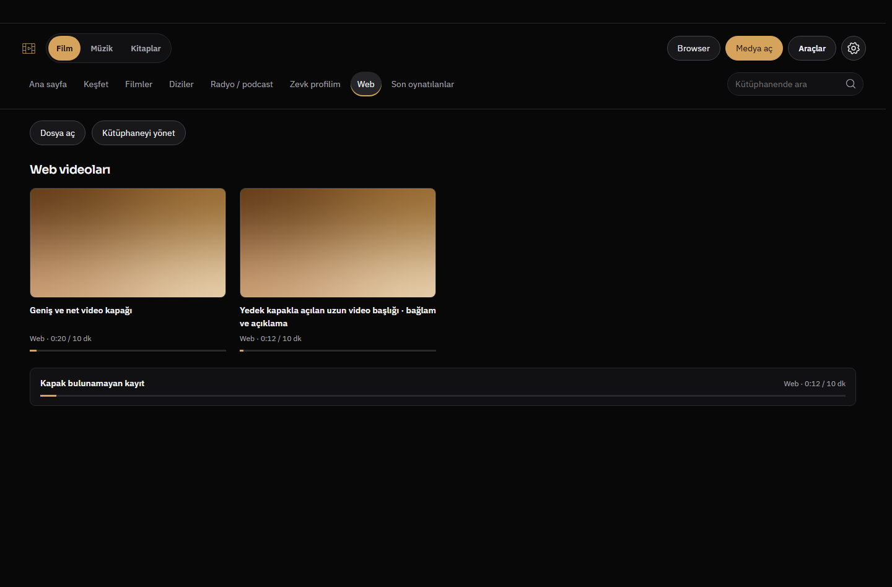
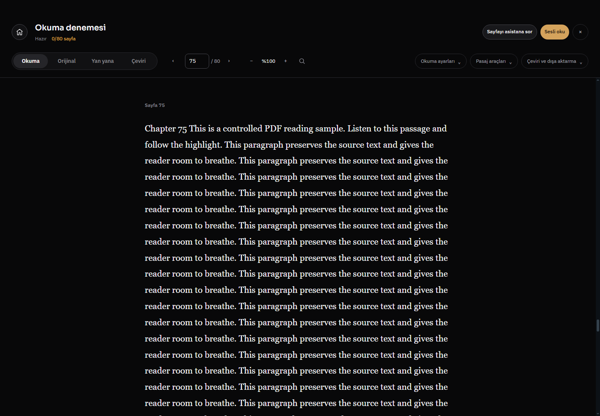
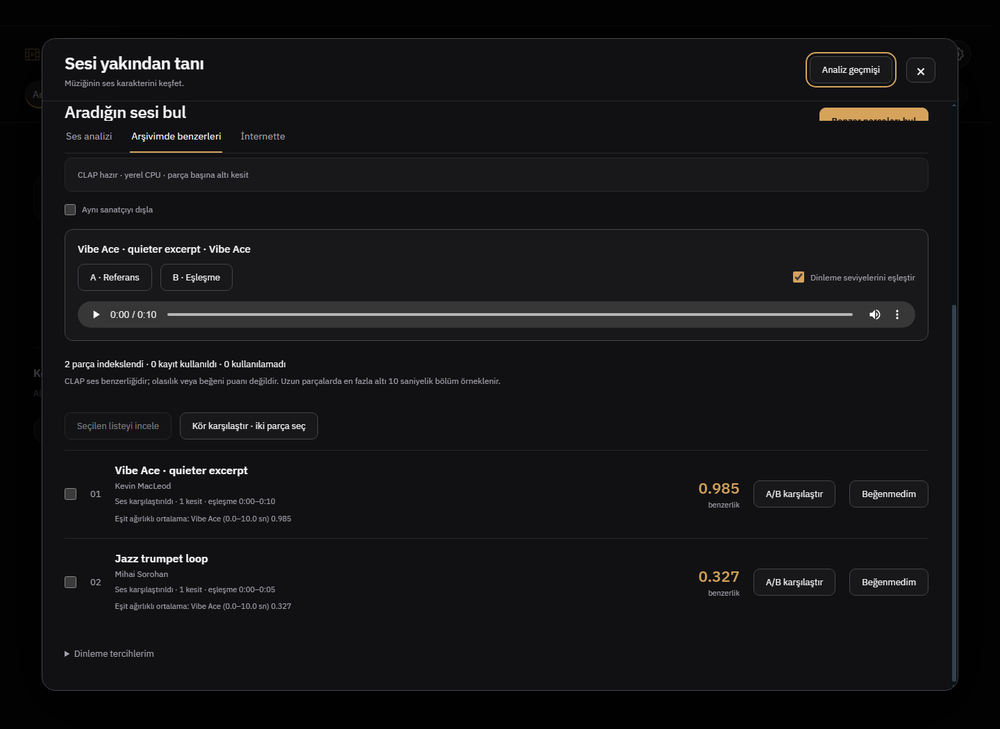
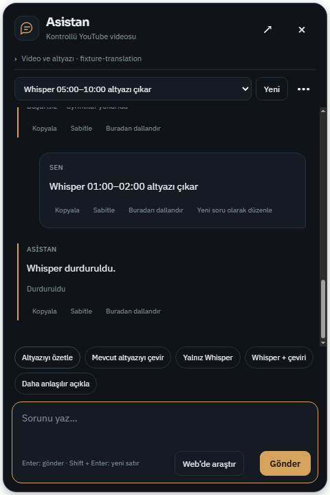

# Rapor 681 — Web, asistan, gerçek müzik ve uzun PDF kabulü

Başlangıç master `454f42e89fcb356b40b7657f4141a4e667fabc01`; ürün bitiş `e42a49d57463bba1416a4fc44f9df1746044a01f`. Dal `codex/workflow-acceptance681`. Dört alan birlikte incelendi; kişisel profil veya gerçek API anahtarı kullanılmadı.

## Doğrulanmış düzeltmeler

1. **Tek videonun tekrar kartları:** `snapshot` yalnız Windows dosya yollarını eşliyordu. `youtube:ID`, paylaşım, mobil watch ve shorts bağlantıları aynı video için ayrı karttı. Doğrulanmış video ID ile görünüm tekilleştirilir; en yeni oynatma anahtarı/konumu ve katalog kapak bağlantısı korunur. Disk geçmişi silinmez. Başka sitelerin hash rotaları veya farklı büyük/küçük harfli video ID'leri birleşmez.
2. **Geçici YouTube başlığı:** en yeni kayıt `YouTube`/`(11) YouTube` ise aynı ID'nin en yeni anlamlı başlığı, yoksa eşleşen katalog başlığı kullanılır. Kullanıcının anlamlı başlığı ezilmez; başka videodan metin alınmaz.
3. **Yanlış kapak kimliği:** `youtube.com/results?v=ID` ve `youtu.be/ID/extra` artık video kapağı üretmez. R680'deki ortalı16:9 ve kalite yedekleri korunur.
4. **Asistan tam video isteği:** 05:00–10:00 seçildikten sonra “Whisper ile videonun tamamını Türkçeye çevir” yine bu aralıkta başlayabiliyordu. Açık TR/EN tam-video niyeti eski aralığı temizler ve başlatıcıya `clipRange:null` geçirir. Aralıklı iş seçilen aralığı sabit geçirir. Hem tam video hem belirli aralık isteyen çelişkili komut başlamadan reddedilir.

## Dört alanın kabulü

| Alan | Son koşunun kanıtı | Sınır |
|---|---|---|
| Web | Ayrı Windows profilinde aynı ID'nin iki anahtarı → tek kart; anlamlı başlık; yüksek kalite/yedek/hatalı küçük görsel;800px ve açık tema; halka açık `jNQXAC9IVRw` kapağı gerçekten yüklendi | Diğer sitelerin tüm kapakları ve video oynatması doğrulanmadı |
| Asistan | Native panel → gerçek renderer adaptörü:300–600sn yalnız Whisper; mevcut altyazı çevirisi;3/8→8/8 ilerleme; tam video0–900sn; çelişki reddi; süreç kabulü+exit ile iptal;3 kaynak/3 çeviri sonucu;TR koyu/EN açık | Başlatma/çeviri olayları kontrollü; YouTube indirmesi veya canlı çeviri kalitesi kanıtı değil |
| Gerçek Whisper | `electron-assistant658`: Windows sentezli konuşma → gerçek tiny/faster-whisper CPU;1 cue; tam çıktı inceleme/yükleme ve gerçek süreç iptali | Browser kimliği/sağlayıcı araç cevapları kontrollü; çeviri kapalı;CUDA/TTS yok |
| Gerçek müzik | Sabit CLAP CPU; Vibe Ace kısık kesit0.98517, bağımsız trompet0.32726;A/B oynatma, seviye eşleme0.50003; sanatçı dışlama;3 önbellek; panel kapanıp açılınca son sıralama geri geldi | Ses yakınlığıdır; insan tercihi/öznel kalite değildir. İnternet kataloğu bu tur canlı sıralanmadı |
| Uzun PDF | Gerçek80 sayfalık üretilmiş PDF'de75.sayfa görünür; bağlam yalnız Chapter75/toplam80; atlamada18 raster sayfa; başa dönüş;2–3 sayfa ses projesi;WAV oynatma/vurgu/konum; dar pencere | Test belgesidir; bütün taranmış/çok sütunlu kitaplar değil. Ses fixture dalgasıdır;VoxCPM2 üretimi değil |

Önceki audit README ve registry imzaları incelendi. F34/N0661 PDF spoken-map vb. tarihsel problar yeni keşif sayılmadı. Müzik/PDF'de yeni ürün hatası doğrulanmadı; sayı doldurmak için değişiklik yapılmadı.

## Test düzeneği düzeltmeleri

Eski `electron-music661` testi gizli `saveNotice.ml-error` şablonunu görünür hata sanıyordu. Ayrıca `.ml-exclude input` ilk eşleşmesi artık sanatçı çeşitliliğiydi; yanlış checkbox sınanıyordu. Görünür hata ve doğru etiketli kontrol sınanıyor. `saveWarning` yokluğu ve kapanıp açılınca kalıcı sıralama da eklendi. İlk kırmızılar ürün A/B hatası sayılmadı.

Native asistan testinin eksik sahte çeviri anahtarı ve sahte süreç iptal kabulü tamamlandı; sahte anahtar gerçek servise gönderilmez. Tam-video beklentisi boş bitiş yerine gerçek0–900 saniyedir. Son koşu hepsini geçti.

## Yeniden çalıştırma

```powershell
node --test --test-isolation=none tests/assistant-video-intent.test.js tests/media-home-model.test.js tests/browser-youtube-whisper.test.js tests/browser-whisper-reuse641.test.js
$env:WHISPER_TEST_PYTHON='D:/Whisper Local/backend/venv/Scripts/python.exe'
# Kurulu Electron çalıştırıcısıyla, ayrı süreçlerde:
electron tests/electron-web680.smoke.js --live
electron tests/electron-assistant-video.smoke.js
electron tests/electron-music661.smoke.js
electron tests/electron-assistant658.smoke.js
electron tests/electron-pdf-reader-experience.smoke.js --long
```

19 hedefli Node kontrolü,10 dosya syntax ve diff PASS. Beş son Windows native koşusu PASS. Sandbox varsayılan Node test runner spawn EPERM üretti; desteklenen `--test-isolation=none` ile çalıştırıldı. Tam npm test/uzun CI beklenmedi. Mevcut11 `before-quit` listener uyarısı devam ediyor; eşiği artırılmadı. Kontrollü Whisper testinde dış ağ kapalı olduğundan reklam filtre indirmesi uyarısı var; bu reklam testi değil.

## Açık kaynak incelemesi

- [yt-dlp YouTube extractor](https://github.com/yt-dlp/yt-dlp/blob/master/yt_dlp/extractor/youtube/_base.py): kaynak/kimlik ayrımına referans; kod alınmadı.
- [PDF.js viewer](https://github.com/mozilla/pdf.js/blob/master/web/pdf_viewer.js),Apache-2.0: görünür sayfa/raster yaklaşımı incelendi; viewer veya bağımlılık eklenmedi.
- [Librosa örnek sicili](https://github.com/librosa/librosa/blob/main/librosa/util/example_data/registry.txt): mevcut fixture kaynağı. Kevin MacLeod Vibe Ace ve Mihai Sorohan trumpet yan metinlerinde CC-BY3.0 doğrulandı. Ses dosyaları Git'e konmadı.
- [OpenAI Agents JS run](https://github.com/openai/openai-agents-js/blob/main/packages/agents-core/src/run.ts),MIT: iptal/terminal sonuç ayrımı karşılaştırıldı;SDK/API eklenmedi, kod kopyalanmadı.

CLAP revizyonu `8fa0f1c6d0433df6e97c127f64b2a1d6c0dcda8a`. Yeni bağımlılık/IPC/disk şeması yok. `start.bat`/`install.bat` değişmedi; temiz start.bat açılışı denenmedi. Kişisel uygulama kapanmadı. Normal push/PR/merge ve ana kopya güncellemesi sürekli yetkiyle yapılır; uzak son hash finalde doğrulanır.

## Görüntüler

[Makine sonucu](WORKFLOW681_2026-10-28/result.json)





