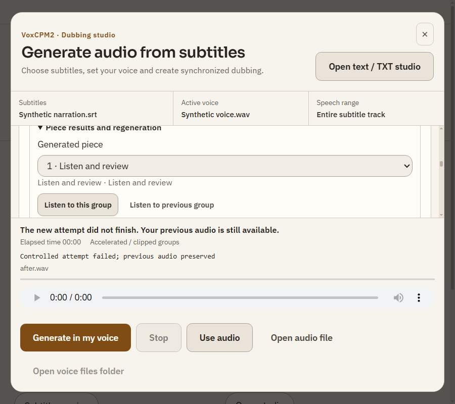

# Rapor686 — Başarısız yeni üretimde önceki hazır ses

Başlangıç c4240e66e33bd2bacea4443b86b10ae282e322fe; ürün fbd619b39bb292beaa839e2cf405170f5a4e581f; dal codex/dub-preflight686.

Dublaj başlangıç özeti mevcut refreshOverview ile kaynak/ses/aralık gösteriyor; tekrar eklenmedi. Gerçek eksik: start eski hazır output'u kaldırıyor, yeni istek başlangıçta reddedilse veya süreç hata verse önceki sesin disk dosyası korunmasına rağmen arayüz dinle/kullan alanını boş bırakıyordu. src/renderer/dub-generator-ui.js iş başlangıcında çıktı/kalite/scope/SRT ve örnek kullanım iznini snapshot eder. Başlatma hatası, terminal hata veya iptalde yalnız aynı mediaIdentity ve SRT için önceki çıktı/kalite geri yüklenir. Yeni süreç recoverable ses getirirse o öncelikli kalır; eski ses otomatik bağlanmaz. Farklı video/SRT, sample veya syncInvalid kullanım sınırlamaları korunur. Yeni durum EN/TR açıkça önceki sese dönüldüğünü söyler.

tests/dub-generator-ui.test.js: başlangıç reddi, terminal hata, önceki kalite satırları, otomatik attach olmaması ve kaynak değişiminde geri getirmeme PASS. tests/dub-source-restore-ui.test.js scoped ready audio/range/late-response PASS. Syntax/diff PASS. tests/electron-dub-runtime.smoke.js native Windows açıktema125ölçek: after.wav tekrar görünüyor; previous audio still available durumu PASS; ekran DUB686_2026-10-28/previous-output.png. Ses URL'leri fixture ve gerçek ses dosyası yok: görüntüde0:00beklenen, ses decode/duyulma kanıtı değil. Gerçek GPU kabulü R685'tedir. Mevcut before-quit11 listener uyarısı devam ediyor.

make-interfaces-feel-better rehberi okundu; mevcut plainCSS/token sistemi korunuyor, yeni CSS/görsel sistem eklenmedi. WaveSurfer BSD player.ts https://github.com/wavesurfer-js/wavesurfer.js/blob/main/src/player.ts kaynak sahipliği/medya reset yaklaşımı incelendi; dış kod/dependency alınmadı. Önceki audit F01 ve referans/çıktı restore testleri eski keşif diye sayılmadı.

Plan P029/P030/P049 çıktı korunmasına kısmi ilerleme; disk üzerinde alternatif sürüm seçimi/kalite dinlemesi hâlâ ayrı kapsam.100hedef tamamlanmadı. Şema/IPC/kurulum değişmedi. Windows start.bat/install.bat değişmedi, temiz başlangıç denenmedi. TamCI beklenmedi. Kişisel açık uygulama ve dosyalar korunarak normal PR/merge teslimi. Sonraki: grup yeniden üretiminde başarısız yeni sürümün eski metin/kaliteyle karışmaması ve eski/yeni grup seçimi.

