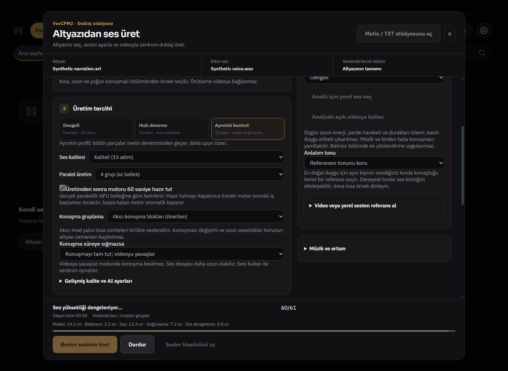

# Rapor687 — Ses dengeleme süresini kaybetmeme

Başlangıç ab2a784aef2fc6beae0abb5f8f81d3d102ef49f2; ürün e3147a09ef873cce21fdc278931f2dad342929e2; dal codex/dub-group687.

Grup seçiminde bekleyen metadata oynatımını durdurma zaten uygulanmış: dubQualityGroup change → stopGroupPreview. Yeniden bug sayılmadı. Dublaj aşama süresinde doğrulanmış eksik: altyazi_oku gerçek normalization_seconds üretmesine rağmen src/dub-service.js allowlist bu alanı siliyordu; renderer phaseSummary da göstermiyordu. Normalizasyon iki katmana eklendi; servis hâlâ bilinmeyen/negatif/sonsuz değerleri süzer. EN Loudness/TR Ses dengeleme.

tests/dub-service.test.js DUB_PHASES normalization_seconds0.8 aktarımı ve unknown/negatif reddi PASS. tests/dub-generator-ui.test.js mevcut grup/iptal/restore yolları PASS. tests/electron-dub-runtime.smoke.js gerçek WindowsTRkoyu/ENaçık125ölçek0.8sn etiketi PASS; ekran DUB687_2026-10-28/phases.png. Olaylar fixture; yeni gerçek GPU üretimi yapılmadı, R685 gerçek süreler tarihsel kanıt. Syntax/diff PASS. before-quit11 uyarısı açık. Yeni dependency/IPC/şema yok. start.bat/install.bat değişmedi; temiz açılış yok. TamCI beklenmedi. Kişisel dosyalar korunarak normalPR/merge.

P007/P041 kısmi ilerleme: üretim/yerleştirme/dosya/dengeleme süreleri arayüze ulaşır. Diğer100maddeler tamamlandı sayılmaz. R685/R686 mevcut kaynak ve kalite kanıtları referans. Dış yaklaşım önceki WaveSurferBSD olay ayrımı; yeni dış kod/dependency yok. Sonraki: PDF kitap üretiminde review grubunun tek başına onay/düzenle ve M4B dışa aktarımına etkisini gerçek dosya akışında incele; asistan veya motorun tamamını sıfırdan yazma.

