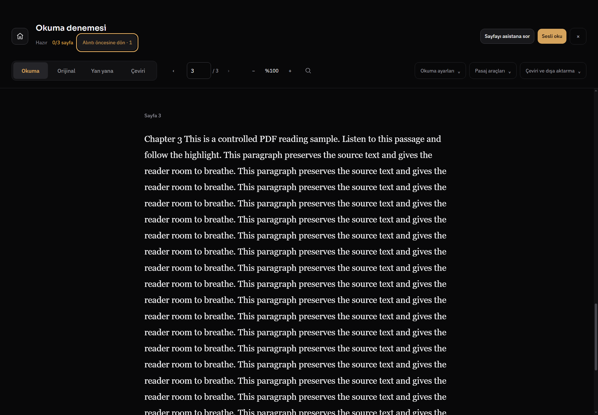
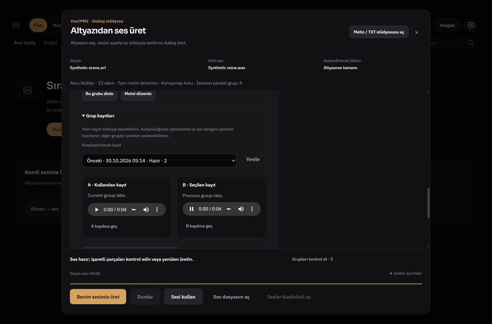
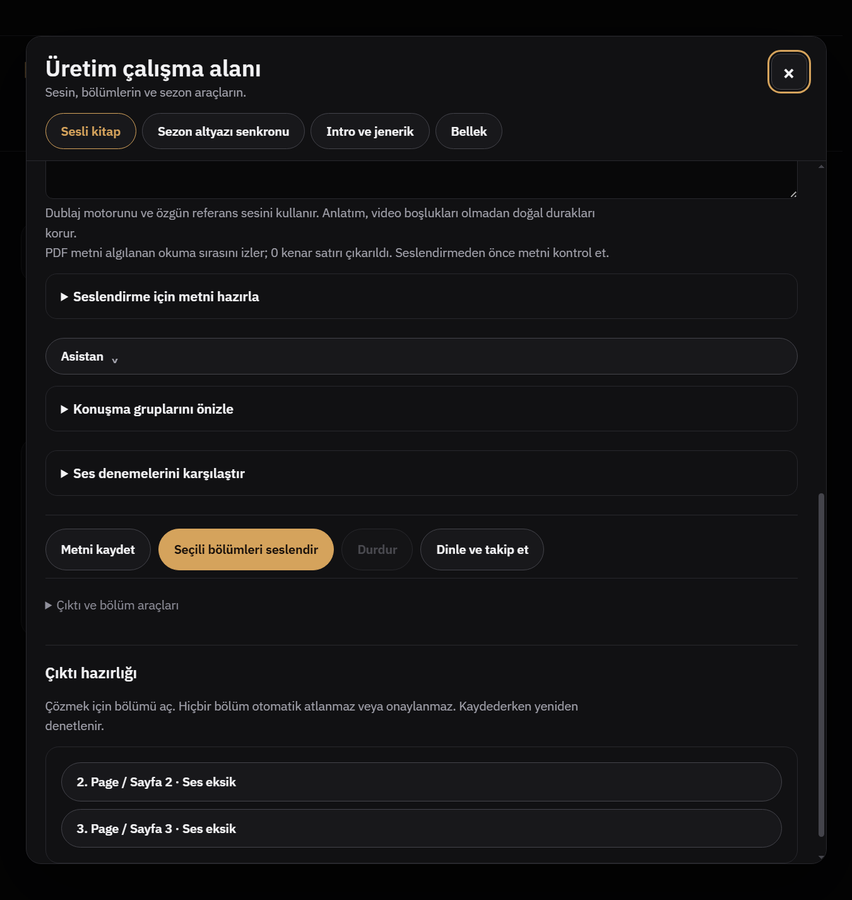

# Rapor 800 — Okuyucu alıntısı, zamanlama, dublaj karşılaştırması ve çıktı hazırlığı

2026-10-30. Başlangıç `9c9bc85d4086afa2f84e79564a89af84fc9f9ff4`; bitiş ürün kodu `8061a4bf13eb556d50fbafd312eb43465250a4bf`. Dal `codex/reader-production800`, hedef `master`.

## Uygulanan davranışlar

1. **Gerçek PDF alıntısı:** `search_book` eşleşmeleri kayıtlı okuyucudan kaynak kimliği/sayfa taşır. Ana süreç yalnız bu sonuçlardan tıklanabilir alıntı üretir; modelin tahmin ettiği sayfa yazısını bağlantıya dönüştürmez. Alıntılar sohbet kaydında korunur. Asistanın kaynak kartına tıklama doğru PDF sayfasına gider; başlık altındaki dönüş düğmesi önceki sayfayı açar. Başka/kapalı belge reddedilir, geç gelen gezinme sonucu yeni sayfanın dönüşünü değiştiremez.
2. **Manuel zaman koruması:** sürükleme, kaydırma, bölme/birleştirme ile değiştirilen bloklara `timingLocked` eklenir. Otomatik sahne ve sessizlik önerileri bu blokları atlar. Seçili zaman kilidini kaldırma, geri alma/yineleme desteklenir. Kurtarma kaydı bu isteğe bağlı alanı korur; SRT formatına özel etiket yazılmaz. Kilit, zaman çizelgesi düzenleme durumudur; harici bir SRT'nin geçmişte hangi satırlarının elle değiştirildiği tahmin edilmez.
3. **Ses sessizliğine hizalama:** zaman çizelgesinde seçili yerel ses/video aralığını **İncele**, sonra **Ses sessizliğine hizalamayı önizle**. Mevcut 50 ms genlik zarfı kullanılır. En az 160 ms, en fazla 0.025 genlikli sessizlikler; sınır başına en çok 250 ms dışa uzatma. Konuşma aralığı kısaltılmaz, komşu blok üzerine taşınmaz. Çok kaba (>150 ms/örnek) dalga biçiminden öneri üretilmez. Kaynak/dönüşüm/metin/kilit değiştiğinde bayat önizleme uygulanamaz. Geri al mevcuttur. Bu bir konuşma tanıma/otomatik dudak eşleştirme sistemi değildir; müzikli/gürültülü seste öneri bulunmayabilir. En çok ilk 200 değişiklik çizilir; daha fazla varsa toplam ve uygulanacak kapsam açıkça gösterilir.
4. **Grup A/B:** dublaj sonuçlarında **Grup kayıtları**. A güncel, B seçilen eski ham kayıttır; metinleri yan yana görünür. Tek düğmeyle aynı dinleme konumuna geçilir, diğer ses durur. Aynı kaynak/altyazı/aralık/grup yuvasındaki farklı metin veya ses ayarlı kayıtlar da dinlenebilir; bunlar `compareOnly` ve sunucu tarafında uygulanamaz. Kaynak/grup değişimi, kapanış ve üretim başladığında eski ses durur. Diğer gruplar yeniden üretilmez.
5. **Küçülen çeviri kurtarma:** bütünüyle yapısal olarak bozuk büyük paketler 6 → 2 → 1 cümle grubuna iner. Zaten tamamlanmış gruplar çıkarılır; cümle içindeki cue'lar ayrılmaz. Yalnız bazı gruplar eksikse doğrudan tek grup kurtarma devam eder. Ağ/kimlik hatası, süre bütçesi ve mevcut altı yapısal hata kesicisi kaldırılmadı. Bu, her sağlayıcı yanıtının mutlaka kurtulacağı iddiası değildir.
6. **Üretim/dışa aktarma:** sesli kitapta **Çıktı ve bölüm araçları → Seçili bölümleri denetle**. Seçilen her bölüm için eksik/değişmiş ses, güncelliğini yitirmiş metin ve review ayrı gösterilir. Satıra tıklama ilgili düzenleyiciyi açar. Yeni, hiç üretilmemiş bölüm yanlışlıkla “metin değişti” sayılmaz. Asistanın `preview_book_export` aracı da aynı bölüm bazlı engelleri görür. Bu salt okunur ön kontroldür; M4B yazarken gerçek dosya/digest/onay kontrolleri yeniden çalışır, review otomatik onaylanmaz, bölüm sessizce dışlanmaz.
7. **Görünüm:** ortak grafit/amber kartlar, dar ekranda alt alta A/B, metin kaydırma, görünür alıntı dönüşü ve sonuca kaydıran çıktı listesi. Bütün programın yeniden tasarlandığı iddia edilmez.

## Kaynak incelemesi

[WaveSubs](https://github.com/jason-jm/wavesubs/blob/main/src/main/core/translate/translateCues.ts) gerçek kodunda 20/6/tek cue kurtarma incelendi. [SubtitleEdit](https://github.com/SubtitleEdit/subtitleedit/blob/main/src/ui/Features/Shared/WaveformSeekSilence/WaveformSeekSilenceViewModel.cs) gerçek kodunda süre/genlik eşikleri incelendi. İki MIT lisansı okundu. Dış kod kopyalanmadı; mevcut Whisper modüllerinin bağımsız genişletmesi yapıldı, yeni bağımlılık/yerel LLM yok. Ağaç kimlikleri ve okunan dosya SHA256'ları [kaynak kaydında](evidence800/upstream-review.json); ağaç SHA'sı commit SHA'sı diye sunulmaz.

## Doğrulama

- Hedefli Node paketi **45/45**: `reader-production800`, `assistant-agent-service`, `assistant-threads`, `media-workflows`, `dub-group-takes`, `product609`, `ui-locale`.
- `backend/test_reader_production800.py` + `backend/test_translation_recovery_budget.py`: **5/5**. Gerçek `llm_translate` hattına boyuta duyarlı kontrollü sağlayıcı bağlandı; 6/2/1 istekleri, tamamlanmış grubun yeniden gönderilmemesi ve süre sınırları doğrulandı. İlk probe yerel payload indekslerini küresel cue ID sanıyordu; beklenti kaynak metindeki sabit numaraya bağlanarak düzeltildi. Ürün eşiği gevşetilmedi.
- Gerçek Windows Electron: `electron-pdf-reader-experience.smoke.js --citations800` (asistan overlay kaynak düğmesinden 3. sayfaya geçiş, 1'e dönüş, yanlış belge reddi, manuel kilit/uygulama/undo/unlock/undo); `electron-dub-experience795.smoke.js --ab800` (TR koyu ve EN açık, 1440 px ve 900 px/125% zoom, gerçek kontrollü WAV oynatma ve karşılıklı durdurma, konum koruma, compareOnly engeli); `electron-media-workflows.smoke.js --readiness800` (eksik ses, asistan blocked, bölüm geçişi, dar/geniş ekran).
- Değişen JS `node --check`, Python `py_compile`, `git diff --check` geçti. İlk yerelleştirme kontrolü yeni kilit etiketinin statik kopyasını yakaladı; mevcut `data-en/data-tr` + dil değişimi düzenine geçirildi, test geçti.
- Başlangıç sandbox'ında Node runner `spawn EPERM` verdi; gerekli Windows alt süreç izniyle aynı hedefli testler geçti.
- Gerçek GPU/model kalitesi, yeni canlı DeepSeek isteği, gerçek YouTube/DRM, yeniden `start.bat` açılışı, tam `npm test` çalıştırılmadı. `start.bat`/`install.bat` değişmedi. CI açık kalır; sonucu beklenmez.
- Önceden kayıtlı `11 before-quit listeners` uyarısı test açılışlarında görüldü; bu teslimde giderildi iddia edilmez. İzole A/B testinde ağ kapalı olduğundan reklam filtreleri indirilmedi.

[Kontrollü Windows kanıtı ve sınırlar](evidence800/acceptance.json)

