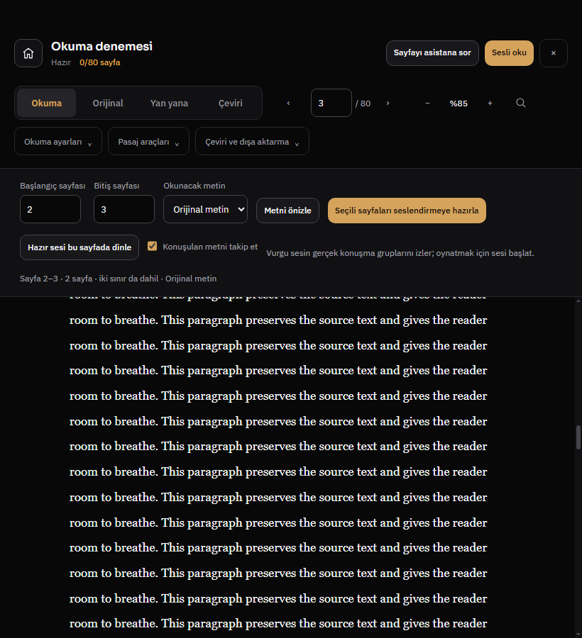
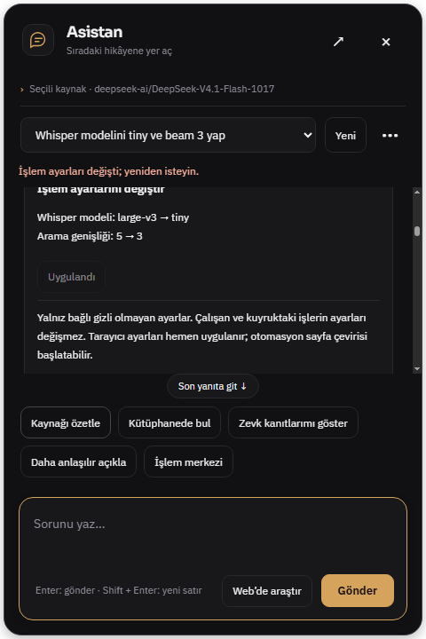
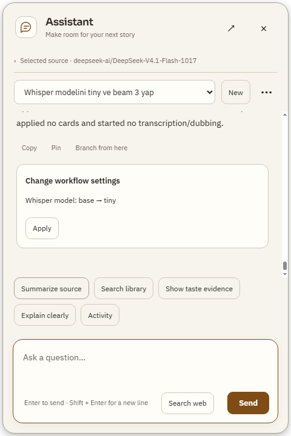
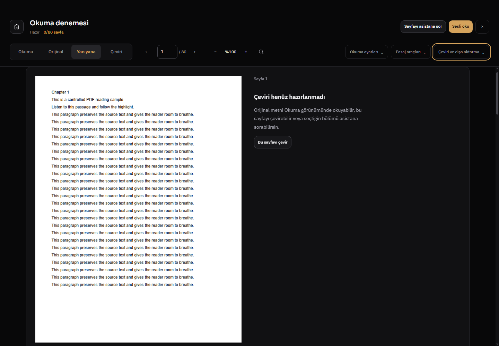

# Rapor814 — CI sözleşmeleri, gerçek asistan zinciri ve uzun ses kabulü

Başlangıç `e146b34490e2b14be7cbe6a643474e2532e6fb06`; dal `codex/ci-workflow814`; bitiş ürün kodu **`98202b3e09fa6f4ab843dfe7499d634cec4cb251`**. [Beş hedef](FOLLOWUP5_2026-10-30.md), [makinece okunur kanıt](evidence814/acceptance.json). Önceki denetim1000 senaryosu yeni keşif diye sayılmadı. Bu teslimdeki test/fixture düzeltmeleri47 yeni ürün bugı değildir.

## Doğrulanan düzeltmeler

| Alan | Kök neden ve son davranış | Kanıt |
|---|---|---|
| Konuşma çevirisi retry | Model reddin nedenini görmeden aynı kaybı tekrarlıyordu. Eksik tam cümle/parçalar, modal/olumsuzluk/sayı kaybı için uygulamanın yazdığı sınırlı geri bildirim gönderilir. Sağlayıcı metni talimat yapılmaz; kapılar ve bütçeler gevşetilmedi. |32 konuşma testi; gerçek istek/yanıt incelemesi.|
| Doğru İngilizce konuşma parçaları | “Did I…”, “Because… She was”, “We all do” özel ad sanılıyordu. Yardımcı fiil/zamir ve dar işlev sözcüğü bağlamı düzeltildi. Tişört, L.A., Nativity play ve eğitim derecesi için sınırlı anlam koruyan karşılıklar eklendi. |Kayıtlı471 cue çiftinde anchor retleri28→15;13 yanlış-pozitif adayı kalktı. Bu taze model başarısı değildir. Lawson→Larson, Can→Cem, MA/BA derece değişimi negatifleri hâlâ reddedilir.|
| Alıntılı düşünce | “Neden ben?” diye düşünürler / “Ne iş yapıyorsunuz?” derler, iki cümle sayılıp doğru çeviri reddediliyordu. Bilinen bildirme/düşünme fiili alıntıyı tamamlar; sonradan eklenen gerçek cümle hâlâ sayılır. |4 alıntı testi; son gerçek2dk zincir16/16 geçti.|
| Browser konuşma protokolü | Backend ilerlerken browser v8 track reuse koşulu eskimişti. Artık iki katman aynı `speech-v14-quoted-thought-feedback` sürümünü kullanır; eski track güncel anlam kontrolünü atlamaz. |Browser Whisper regresyonu; eski v8 track tekrar çevrilir.|
| Hazır yerel referans | Yerel WAV hazır olsa bile kayıtlı referans listesi boşsa model sesi yok sanıyordu. Salt okuma sözleşmesi hazır yapılandırılmış referansı kayıtlı liste kimliğinden ayırır; tam yol/anahtar modele gönderilmez. |9 voice-action testi; gerçek asistan yeni referans seçmeden üretime geçti.|
|10bin kayıt araması | Her tuşta tüm metadata imzaları yeniden oluşturuluyordu. Alanlar ve koleksiyon değerlerinin kopyası karşılaştırılır; yerinde değişiklik ilgili cache kaydını yeniler. |Eşik değişmeden yük altı hedefli p95≈4.986ms; başlık/yol/koleksiyon değişimi negatifleri. Önceki ölçümler aynı kontrollü A/B değildir.|
| Tema ve ilk erişilebilir adlar | Eski sabit renkler ortak tokenlara taşındı; yedi lazy etiketli düğmeye başlangıç erişilebilir adı sağlandı, EN/TR korunur. |Sabit renk ratchet419'a indirildi; gerçek Windows dar/PDF/asistan ekranları.|
| Test altyapısı | VM fixture'ları gerçek terminal/job/IO yardımcılarını kullanmıyordu; require yanlış klasöre göre çözülüyordu. Sahte beklemeler uygun olay/drain ile değiştirildi; tekil header mux, launcher AST, provider, persistence ve negatif sözleşmeler güncellendi. |9fd3 sürümünde840 test dosyası,0 başarısız. Test kapatma veya performans eşiği yükseltme yok.|

R498'in eski “episode renumber seçili dosyayı silsin” beklentisi uygulanmadı: R629'daki stable-ID sözleşmesi daha yeni ve doğru. Aynı episode ID seçili dosyayı korur; farklı yeni ID eski dosyayı miras alamaz. Bu bulgu ürün bugı diye sayılmadı.

## Gerçek çalışma sonuçları

- **Bütünleşik2dk:** anonim TED YouTube sekmesinde gerçek model kararları ve4 onay kartı → CUDA `large-v3-turbo` → standart DeepSeek16/16 Türkçe konuşma çevirisi → VoxCPM2 CUDA10/10 ready → yeni çıktı kimliğiyle aynı açık videoya bağlandı.12 asistan,3 çeviri isteği. Kaynak2–122sn ve ses aralığı eşit. Sentetik referans kullanıldı. Yeni indirme bir denemede403 verdiği için son kabul yalnız indirme sınırını aynı videonun önceki gerçek indirmesine uyarladı; taze indirmenin çalıştığı iddia edilmez. Bu zincir ayrıca pause/range playback ölçmedi.
- **Uzun motor:** gerçek20dk İngilizce Whisper kaynağı,15 adım,4 paralel,159 grup. Son grup tamamlandı,153 ready/6 review;81 grup hızlandırıldı,0 kırpma/taşma. Duvar1202.687sn; WAV1235.844sn ve159 parçalı zaman haritası üretim doğrulayıcısından geçti. Model30.344sn, referans6.75sn, toplam sentez işi2967.482sn, doğrulama825.144sn: paralel iş süreleri duvara toplanmaz. Bu tam Türkçe dublaj veya insan doğallığı kanıtı değildir.
- **Uzun Türkçe:** ilk361 satırın323'ü, v13 ile yeni tam kaynak denemesinde335'i kabul edildi; **26 satır hâlâ eksik**,84 gerçek API isteği. İki çalıştırma kontrollü kalite A/B değildir. Son v14 alıntı düzeltmesi kısa gerçek zincirde doğrulandı;20dk tekrar edilmedi. Eksik sonucu tam diye gösterme veya zorla dublaja geçirme yok.
- **Windows UI:** standart canlı DeepSeek14 çağrı,3 gerçek ayar kartı; bayat kart reddedildi. Ayrı80 sayfalık PDF: okuma/orijinal/yan yana, TR/EN, açık/koyu, dar ekran, sayfa75, alıntı bağlamı ve kontrollü inline ses vurgusu geçti. GPU kitap üretimi değildir. Görseller aşağıda. Browser native video yüzeyi ana pencere capture'ında siyah kalabilir; bu görüntü video karesi kanıtı sayılmaz.
- **A/B:** önceki dinleme paketi korundu. Kullanıcı henüz dinlemedi; “en doğal” kazanan seçilmedi ve bu gerekçeyle varsayılan değiştirilmedi.

## Kontroller ve yeniden üretme

Tam yerel suite `npm test`: **840 dosya (680 Node +160 Python),0 başarısız**, ürün9fd3. Koşula bağlı canlı/ortam atlamaları ve ayrı Electron smoke kapsamı korunur. Son v14 değişimi sonrası32 speech,4 quoted speech,224 transcribe,1 roundtrip fuzz; browser Whisper ve `npm run test:electron-bridge` geçti. Daha önce hedefli26 generation (son parça cache/iptal),48 dağıtım ve17 audit kontrolleri de geçti; örtüşen sayılar benzersiz toplam diye toplanmaz. `node --check` değişen JS + main/preload/renderer, `py_compile`, `git diff --check` geçti. GitHub CI açık; sonucu beklenmedi, yeni yeşil iddiası yok.

```powershell
npm test
npm run test:electron-bridge
node tests/browser-youtube-whisper.test.js
node --test tests/assistant-provider.test.js tests/assistant-voice-actions.test.js tests/watch-library-performance.test.js
& backend/venv/Scripts/python.exe -m unittest discover -s backend -p test_speech_translation.py
& backend/venv/Scripts/python.exe -m unittest discover -s backend -p test_speech_quality813.py
& backend/venv/Scripts/python.exe backend/test_transcribe.py
```

Canlı kabul araçları açık opt-in gerektirir: `tools/assistant-video-live.cjs --run-real-pipeline`, `tools/video-live-pipeline.cjs --run-real-pipeline --long-acceptance`, `tools/translation-deepseek-live.cjs --run-live-speech-translation --long-acceptance --source <srt>`. Her aracın gerçek flag/başlatma koruması kaynakta kontrol edilmelidir; Electron `ELECTRON_RUN_AS_NODE` temizlenerek çalıştırılır. Ayrı profiller, bellekte anahtar broker'ı, sınırlı çağrı/süre ve sentetik referans kullanılır. Varsayılan test komutları ücretli testi açmaz. Ham istek/konuşma/profil/ses logları Git'e konmadı.

## Açık sınırlar

26 uzun çeviri reddi ve6 ses review grubu sonraki kalite çalışmasıdır; saklanmadı. Son uzun gerçek üretimde iptal denenmedi; iptal/cache doğrulaması kontrollü motor testidir. Fiziksel hoparlör, kullanıcının sesine benzerlik, DRM/hesap, tüm siteler ve yeni `start.bat` yeniden başlatma doğrulanmadı. Normal açılış hâlâ `start.bat`; launcher/kurulum/CUDA bağımlılıkları değiştirilmedi. Mevcut11 before-quit listener uyarısı açık; eşik artırılmadı. Kişisel çalışan uygulama kapatılmadı.

Yeni bağımlılık/şema/harici kod kopyası yok. Mevcut Node createRequire/olay sözleşmeleri, proje kabul araçları ve mevcut OpenBMB/VoxCPM2 motoru kullanıldı; README yeni kalite kanıtı sayılmadı. Müzik/yerel LLM kapsamı genişletilmedi.





