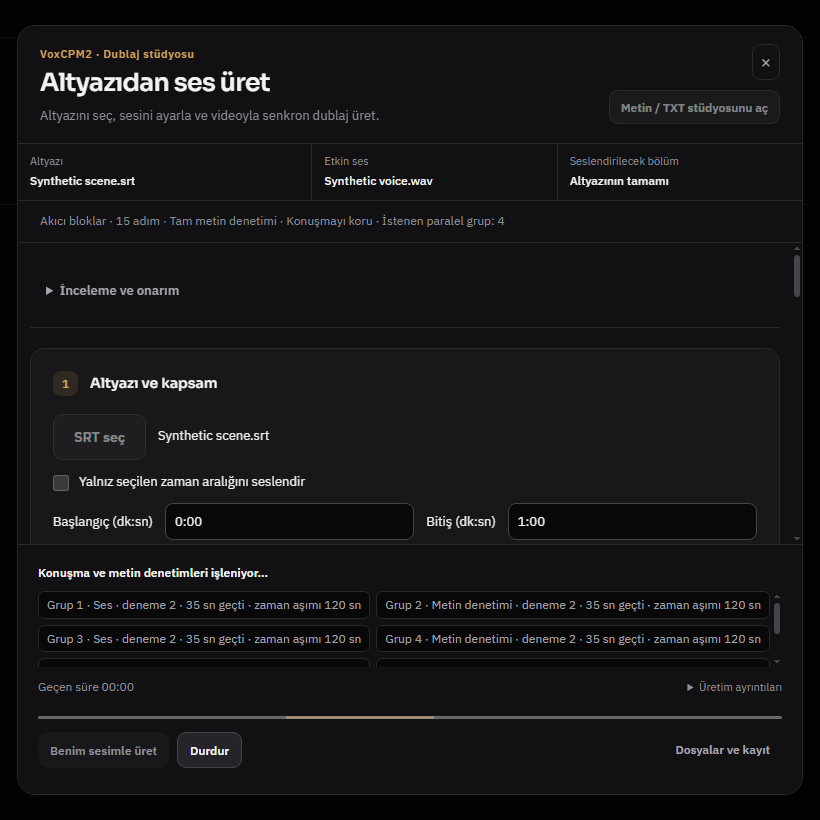
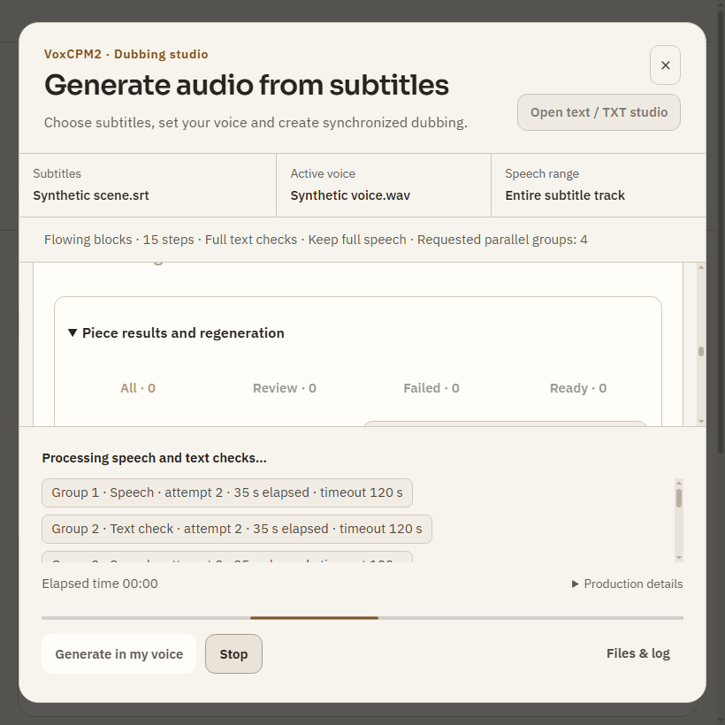

# Rapor816 — Eksik çeviri tamamlama, uzun Türkçe ses ve kapanış kaynakları

Başlangıç `00a01f92f109f11183b02bc55dd1dfed25ed3e9f`; dal `codex/speech-quality816`; bitiş ürün **`0da16b42c3e38bdb93e9b1526fa48e5d8de79957`**. [Kanıt](evidence816/acceptance.json). R814'te açık kalan beş hedefin devamıdır. Gece1000 kapsamı okundu; aynı testler yeni keşif diye sayılmadı. Çalışırken başka oturum R815'i yayımladı; onun54 bulgusu/kanıtı silinmeden, yalnız belge commitleri55bfcca5 ile entegre edildi. R815'in salt-okunur denetimi bu düzeltmelerin yerine veya uygulanmış sayılmaz.

## Düzeltmeler

- **Konuşma çevirisi:** “Neden olmasın?”, “göze alamayız”, “değer görmeseydi”, “çoğu zaman”, “gördüğünüz gibi”; hopeless/uncontrollably karşılıkları için dar bağlam/biçim kuralları. Bağımsız olumsuzluk ve zorunluluk kaybı negatifleri korunur. “Birkaç dakika” birim niceliği tanınır; birkaç saate çevirmek hâlâ reddedilir. Tam İngilizce “if allowed to.” cümlesi kesilmiş edat sanılmaz; “went to.” ve açık üç nokta için genel kapı korunur.
- **Adlar:** I'm/He's/Isn't gibi dilbilgisel kısaltmalar kişi adı sanılmaz. Actually/If dolgu/koşul sözcükleri, ADHD→DEHB, sınırlı kurum ve açık Joseph rolü karşılığı desteklenir. Kişi değiştirme, kurumun School/Company bileşenini düşürme ve sıradan Joseph→Yusuf hâlâ reddedilir. Kaynak adın Lynn→Lynne gibi bilgiden sessiz düzeltilmemesi açık yanıt sözleşmesidir.
- **Retry:** Sınır, açık bağlaç ve ad/sayı/birim demirleme reddi artık ayrı authored feedback alır. Kaynak/sağlayıcı metni talimat hâline getirilmez. Backend ve browser protokolü aynı v15'tir; eski track reuse güncel kontrolü atlamaz. Tamamlama test aracına `--existing` eklenir; üretimin gerçek metadata/locked-cue yolunu kullanır.
- **Sayı ses kontrolü:** `2065'te` iki tarafta aynı atomik yılken, başka bir ASR sözcüğü farklıysa sahte missing+added üretilebiliyordu. Yalnız aynı dört haneli ve çekimli literal yıl iki akışta ispatlanınca eşleşir; kayıp/değişen/tekrarlanan yıl ve işaret/sayı kontrolleri korunur. Gerçek kaydın ASR replay'inde bu yanlış review kalktı; kayıt dosyasının etiketi otomatik değiştirilmedi.
- **Üretim görünümü:** `35 / 120` oranı yerine “35 sn geçti · zaman aşımı120 sn” yazılır; süre limiti ilerleme yüzdesi gibi görünmez. Ortak grafit/amber düzeninde TR/EN gerçek820px ekranlar kontrol edildi.
- **Kapanış:** Üç salt abort servisi bir ortak listener kullanır; stateful/asenkron kapanış sahiplerinin sırası ve preventDefault davranışı değiştirilmez. Toplam before-quit11→9; limit yükseltilmez. Dispose/yeniden kayıt, hata izolasyonu ve başka app sahibi negatifleri test edilir. Bu, kanıtlanmış genel bir bellek sızıntısını düzelttik demek değildir. Yaklaşım mevcut Node EventEmitter/on/off sözleşmesidir: [resmî doküman](https://nodejs.org/api/events.html#eventsdefaultmaxlisteners). Harici kod/bağımlılık kopyalanmadı.

## Gerçek sonuçlar

**Çeviri361/361:** yeni tam kaynak denemesi350/361 (62 standart DeepSeek çağrısı); eksikler tamamlama ile355/361 (13), sonra361/361 (6). Başarılı ilk350 satırın metni ve zamanları byte değil parse edilmiş tuple olarak tam korundu. Bu tur toplam81 çeviri çağrısı; tam dosya üç kez yeniden çevrilmedi. Sonraki dar contraction düzeltmesi hedefli testlerle doğrulandı; taze bir361 satırlık tam çağrı daha yapılmadı.

**20dk gerçek Türkçe GPU:**15 adım/4 paralel/akıcı gruplama,158 grup sonuna kadar tamamlandı. Duvar1037.109sn≈17.3dk, WAV1294.736sn≈21.6dk; konuşma için zaman haritası vardır.127 ready/31 review. Sentetik İngilizce SAPI referansı kullanıldı: kullanıcının sesi/benzerlik veya insan doğallık testi değildir. Önceki İngilizce stres testindeki6 review ile birebir kalite kıyası yapılamaz; orada Türkçe sayı hazırlama ve dil seçimi de sonucu etkiler.

**Seçili onarım:** ASR benzerliği en düşük6 güncel review grubu yeniden sentezlendi; diğer152 grubun synthesis faaliyeti yok. İlk WAV korundu, ayrı onarılmış WAV yazıldı. Duvar82.781sn.2/6 ready oldu,4/6 review kaldı; final **129 ready/29 review**. İkinci158 parçalı harita da üretim validator'ünden geçti ve WAV başlığındaki süreyle eşleşti. Önceden seçilmiş6 İngilizce grubu “düzelttik” iddiası yoktur.

**Yerel oynatma:** aynı gerçek indirilmiş TED videosu ve uzun onarılmış WAV gerçek native dosya seçici/katalog üzerinden bağlandı; oynarken video mute/ses play, pause yayılımı ve1190sn sona yakın seek geçti. Bu test yeni browser streaming, tam dudak senkronu veya fiziksel hoparlör testi değildir; önceki gerçek asistan zinciri R814'te ayrıca kayıtlıdır.

**Kaynak ölçümü:** gerçek820px native testte20 modal aç/kapat döngüsü. before-quit9→9; ana süreç RSS168083456→168849408byte; süreçlerin working set toplamı647696→690804KiB. Kısa örnek ve allocator etkisi vardır: bellek platosu/sızıntı yokluğu sonucu çıkarılmaz. Başlangıçtaki11-listener uyarısı yeni native koşuda görülmedi. İlk narrow testin sonradan pencereyi büyüttüğü fark edildi; döngü boyutu düzeltilip gerçek820px görüntü alındı.

## Hedefli kontroller

29 Node (cleanup/web/voice/media/process/browser),32 speech translation,7 speech quality,224 transcribe,13 dub quality ve26 generation testleri geçti. Sayılar örtüşür; benzersiz toplam değildir. Adaptive rescue fixture, son iki grupluk gerçek batch'i rescue sanıyordu; sayıya göre tahmin yerine retry-feedback amacıyla sınıflandı. Aynı tamlık, paralellik, çağrı sayısı ve süre koşulları korunur. Native stüdyo her koşuda6 ekran, TR/EN ve son20 döngü kontrolü geçti. Değişen JS+main/preload/renderer syntax, Python compile ve diff/indeks/JSON kontrolleri yapıldı. Tam npm test tekrar edilmedi; GitHub CI açık ve beklenmedi.

```powershell
node --test tests/quit-cleanup.test.js tests/assistant-web-research.test.js tests/media-tools.test.js tests/signal-desk-ui.test.js tests/process-lifecycle.test.js tests/assistant-voice-actions.test.js tests/browser-youtube-whisper.test.js
& backend/venv/Scripts/python.exe -m unittest discover -s backend -p test_speech_quality813.py
& backend/venv/Scripts/python.exe -m unittest discover -s backend -p test_speech_translation.py
& backend/venv/Scripts/python.exe backend/test_transcribe.py
& backend/venv/Scripts/python.exe tests/test_dub_quality.py
& backend/venv/Scripts/python.exe tests/test_dub_generation_quality.py
# Ayrı test profili; production start.bat kabulü değildir:
node_modules/electron/dist/electron.exe tests/electron-dub-experience795.smoke.js --narrow815 --soak815
```

Canlı çeviri aracı açık `--run-live-speech-translation --long-acceptance --source <source.srt> --existing <partial.srt>` ister; gerçek anahtar yalnız broker/relay belleğindedir. GPU benchmark/onarım ve playback sürücüleri bu çalışma kopyasının tmp dizinindedir; ham log/profil/sesler yayımlanmadı. Manuel playback tekrarı: test videosunu aç, Ses ekle ile üretilen WAV'ı seç, ortada oynat/duraklat ve sona yakın atla; kalite ve sync yan dosyalarını birlikte koru.

## Açık sınırlar

**29 ses grubu hâlâ inceleme istiyor.** Bu kaliteyi mükemmel ilan etmez; inceleme eşiği düşürülmedi ve çıktı engellenmedi. CPU small ASR, kısa filler ve referans dili etkileri ayrıca ayrıştırılmalı; insan dinlemesi yok. Gerçek uzun üretimde iptal bu tur yapılmadı;26 kontrollü generation/cache/iptal testi ayrı kanıttır. Yeni YouTube indirme, DRM/hesap, start.bat yeniden açılışı, bütün sayfalar veya gece boyu bellek doğrulanmadı. Kişisel uygulama kapatılmadı. Yeni kurulum/bağımlılık/kişisel ayar şeması yok; müzik ve yerel LLM kapsamı açılmadı.



