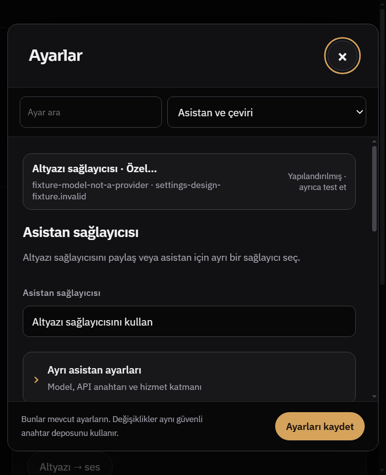
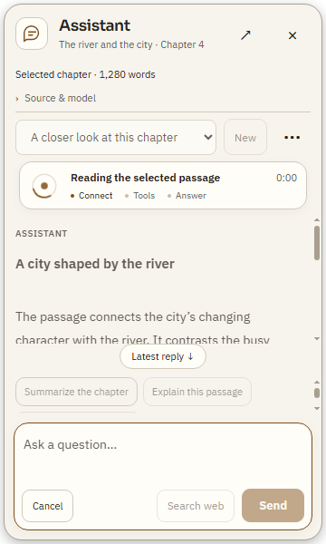
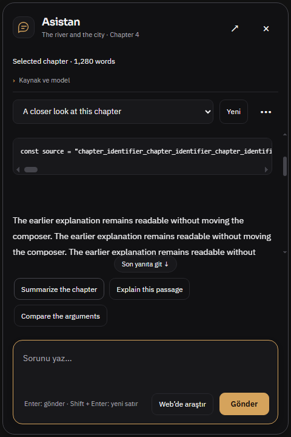
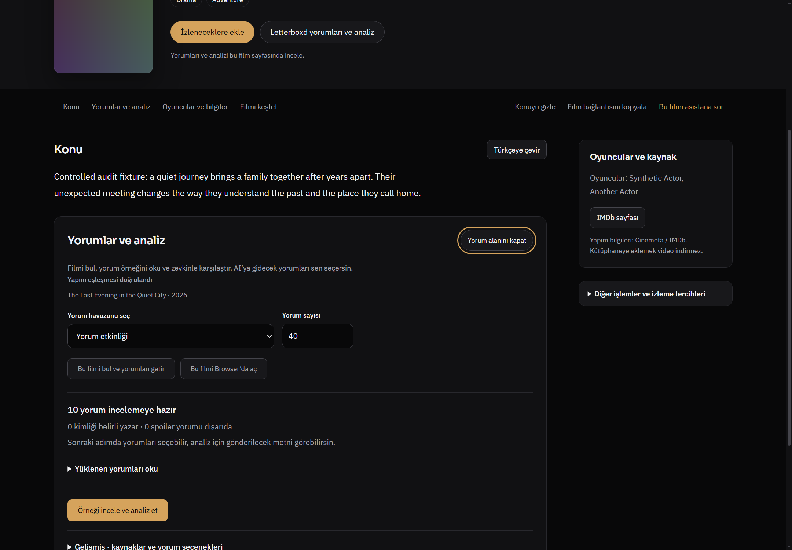
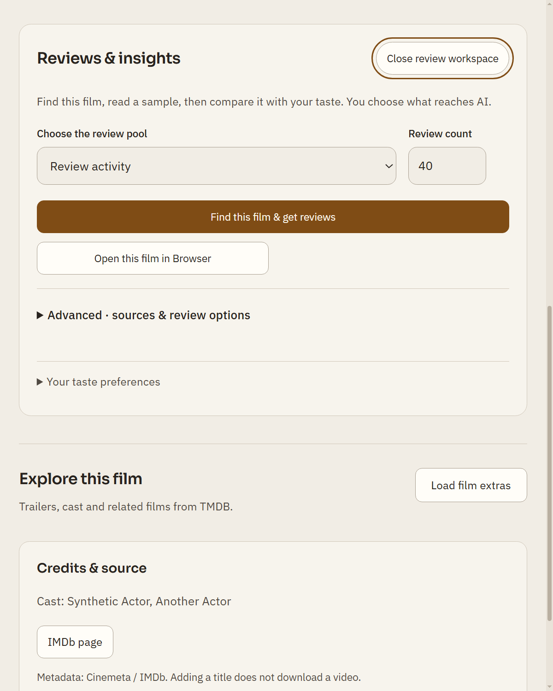
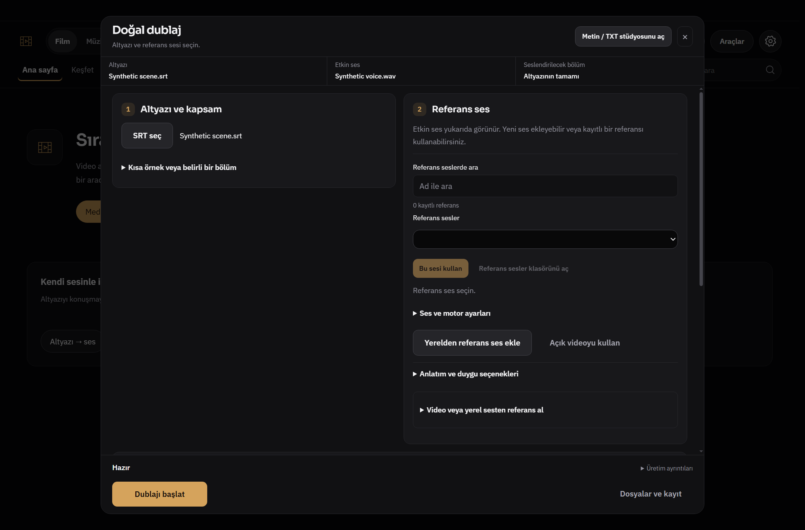
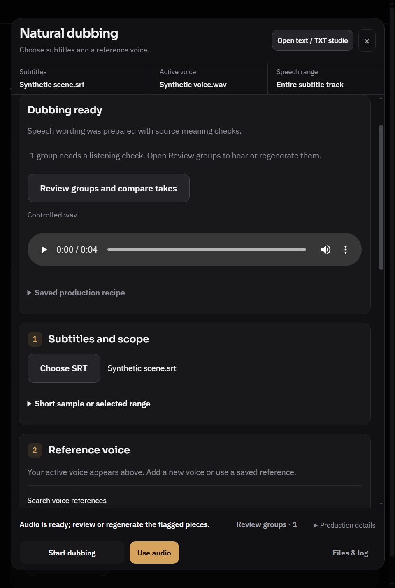
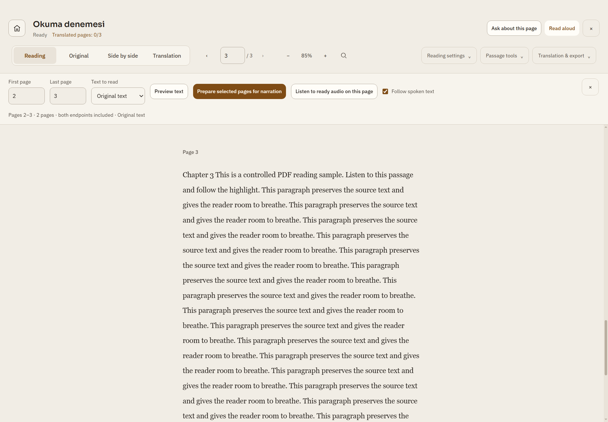
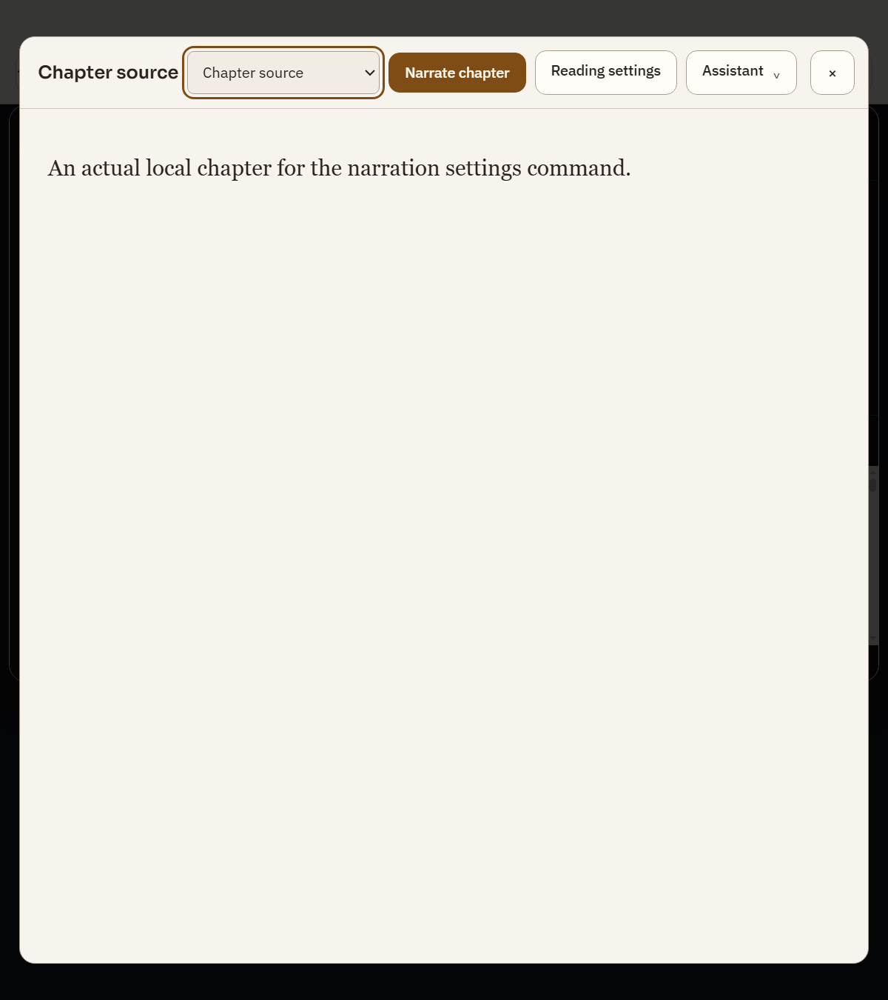

# R825 — Yeni plugin ölçütleriyle görüntülü tasarım denetimi

**Uygulama eki (1 Kasım):** Aşağıdaki özgün denetim tarihsel kayıttır. Beş UX önerisi ve LOW semantik hata, önceki onarımlar korunarak [ürün ve görüntülü kabul paketinde](plugin-design-audit825/implementation/README.md) uygulandı; ürün commit'i `20c8dc0998c6bc2f4bbd93dac7479d964d30726f`. Özgün bulgular ve önce görüntüleri değiştirilmedi.

1 Kasım 2026. Taban `fe0e3fe0d040ccd4b6b18d6a32c96cfc686d65d8`. **Ürün kodu değişmedi. Bir düşük önemde semantik uyumsuzluk ve beş görsel/UX geliştirme yönü var; bunlar altı kritik bug değildir.** Önceki R824'ün onarımlarını yeni keşif diye saymıyoruz. Genel estetik kabulü verilmedi.

Kullanıcının “yeni pluginlerle de tarat” talebi kapsamında Redesign'ın teşhis kontrol listesi ve Designly Visual QA'nın hiyerarşi, kompozisyon, tipografi, işlevsiz süs ve kimlik ölçütleri uygulandı. Product Design audit çerçevesi ve context preflight okundu; kayıtlı context yoktu. Yakalama gerçek Windows Electron'da yapıldı; **Product Design'ın IAB tabanlı tam akışı çalıştırılmış değildir.** Ayrıntılı plugin kullanım/erişim kaydı [SNAPSHOT.json](plugin-design-audit825/SNAPSHOT.json) içinde.

MotionDesign 2.0.0'ın zorunlu GSAP/AIDA üretim akışı bu yoğun masaüstü denetimine uygun değil; uygulamaya pazarlama sayfası düzeni dayatılmadı. Superdesign canvas/CLI üretimi ve Design Arc setup/home süreci başlatılmadı. Themely'de metadata var, çağırılabilir araç/skill yok; HorizonX'in bu tur yerel paketi ve MCP aracı görünmüyor. Plugin kurulu/etiketli olması, harici servisin çağrıldığı anlamına gelmez. Yeni ücretli servis, model çağrısı, framework, font veya animasyon bağımlılığı yok.

## Kapsam ve kanıtın sınırı

Beş yüzey: ayarlar → asistan → film/Letterboxd yorum alanı → dublaj → PDF/kitap okuyucu. Geniş/dar Windows pencereleri, EN/TR, açık/koyu tema ve seçili %125 uygulama zoomları incelendi. Native ekranlardan **13 seçilmiş görüntü** aşağıdaki notlarla saklandı; görüntü sayısı bug/test sayısı değildir. Gerçek uygulama renderer/preload/main kullanıldı; içerik, kapaklar, yorumlar, hata yanıtları ve sesler kontrollü fixture. Sentetik kapak gerçek afiş kalitesi veya Luna ile görsel eşdeğerlik kanıtı değildir.

Mevcut native akışlara eklenen axe-core 4.13.0 incelemesi beş ayar, dört film, beş asistan, iki dublaj ve üç kararlı PDF örneğinde yapıldı. Erişilebilirlik tarayıcısı sadece bu görünür DOM durumlarını gördü; bütün uygulamanın WCAG uygunluğu veya ekran okuyucu konuşması doğrulanmadı. Kaydırma/odak uyarıları gerçek tuşlarla karşı kontrol edildi. Kaynak betikler, ölçümler ve hashler [kanıt dizininde](plugin-design-audit825/).

## 1. Ayarlar — işler durumda; ilk ekranın bilgi sırası ağır

**U825-01 · Tasarım/UX önerisi, yeni işlevsel bug değil.** Dar görünümün ilk ekranında özet kartı, iki açıklama ve ayrı asistan açılır alanı yer alıyor; kullanıcı varsayılan altyazı modeline/anahtarına ulaşmak için kaydırıyor. Geniş görünümde de aynı kaynak bilgisi birden fazla yerde tekrarlanıyor. Bu sayfada model ayarı kaybolmuş veya kaydedilemiyor denmiyor: arama, bölüm geçişi, manuel model girişi ve hata sonrası kontrol devamlılığı geçti.

**Yapılacak:** etkin sağlayıcıyı tek kompakt özet satırında göster; hemen altında sağlayıcı/model/anahtar görev grubunu kur. Ayrı asistan sağlayıcısını mevcut paylaşım seçiminden sonra aç. Yardım metinlerini ilgili alanın yanına kısalt; uzman seçeneklerini kaldırmadan ayrıntıda tut. Kaydet ve kapatma aynı yerde kalmalı.

**Kabul:** 520×640 ve 640×720 CSS px'te temel sağlayıcı görevi en az bir kaydırma adımı azalmalı; arama ve odak geri dönüşü, maskeli anahtar ve gerçek kontrol kimlikleri korunmalı. Bu hedef henüz uygulanmadı.

## 2. Asistan — çakışma kabulü geçti; kısa panelde içerik bütçesi hâlâ zayıf

**U825-02 · Tasarım/UX önerisi.** 360×600 örneğinde yanıt alanı yaklaşık142px, öneriler ise40px yüksekliğe karşı78px içerik taşıyor. Üst kaynak/oturum/ilerleme, alttaki öneriler ve giriş bir araya gelince asıl yanıt küçük bir pencerede okunuyor; üçüncü öneri ayrı kaydırma istiyor. Gönder/İptal örtülmüyor, uzun yanıt girişin üstüne taşmıyor; önceki A-02 onarımını geri açılmış saymıyoruz.

**Yapılacak:** kısa panelde kaynak özetini tek satıra indir; isteğe bağlı önerileri tek yatay satır veya “Diğer öneriler” menüsünde tut. Üretim sırasında kullanılamayan öneriler alanını küçült. Yanıt okuma alanına öncelik ver; ilerleme/İptal ve mesaj taslağı korunmalı. Giriş metni uzadığında büyüme sınırı aynı testte görülmeli.

**Karşı kontrol:** axe `scrollable-region-focusable` uyarısını `#log`, `#suggestions` ve `pre` için verdi. Chromium'un native Tab sırası `log` ve `suggestions` alanlarına ulaşıyor. Native aşağı ok log'u0→36.67px, sağ ok kodu0→36.67px kaydırdı. `tabIndex:-1` tek başına erişilemezlik kanıtı değil. Bu uyarılar bu runtime için bug sayılmadı; [native kanıt](plugin-design-audit825/assets/keyboard-native-keys.json), [Tab sırası](plugin-design-audit825/assets/assistant-busy-native-keyboard.json). Farklı runtime ve ekran okuyucu kabulü ayrıca gerekir.

**Hareket kabulü:** mevcut ilerleme yörüngesi %10 hızda ilerledi; `prefers-reduced-motion:reduce` altında çalışan animasyon listesi boşaldı. Süreli UI geçişiyle sürekli iş göstergesi aynı bütçe diye değerlendirilmedi. FPS/GPU performansı ölçülmedi.

## 3. Film/yorum — akış çalışıyor; form görünümü baskın

**U825-03 · R824 F2–F4 sonrası ince işçilik önerisi.** Hazır örnekte yorum havuzu, sayı, yeniden getirme, Browser'da açma ve açıklamalar okunabilir örneğin önünde uzun bir form oluşturuyor. Dar görünümde ikinci tarayıcı eylemi ayrı büyük buton olarak kalıyor. İşlev kaybı yok; on hazır yorum sayısı, okuma bağlantısı, analiz öncesi seçim ve hata sonrası örnek korunması geçti.

**Yapılacak:** örnek hazır olduğunda “10 yorum hazır · Oku” satırını bölümün girişine al. Havuz/sayı/yenileme ayarlarını tek kompakt “Örneği değiştir” ayrıntısında grupla; Browser eylemini metin/ikincil eylem yap. Üretim yüklenirken ana eylem ve açıklama değişimi yerleşimi sarsmamalı. Kullanıcı isterse bütün kaynak/spoiler seçeneklerine ulaşabilmeli. Bu, önceki onarımların uygulanmadığı iddiası değil; daha sakin bir son düzen önerisidir.

**D825-01 · LOW · Doğrulanmış semantik uyumsuzluk.** `src/renderer/media-home.js:404`, `.mh-brand` için rolü olmayan `div` üzerine `aria-label="Whisper Browser"` koyuyor. Dört film durumunda axe `aria-prohibited-attr` verdi. Marka görseli için `role="img"` + ad veya dekoratif ise gizli/adsız ikon yaklaşımı seçilmeli. Bu düğme çalışmaması veya ana akış engeli değildir; ekran okuyucu ses çıktısı test edilmedi. [Ham kanıt](plugin-design-audit825/assets/film-film-empty-1440-tr-dark-audit.json).

## 4. Dublaj — görev sırası düzeldi; iki sütunun yükü dengelenmemiş

**U825-04 · R824 RD-04 devam tasarım önerisi.** Soldaki altyazı kartı kısa, sağdaki referans kartı çok uzun; ilk görünümde sol tarafta büyük bir işlevsiz boşluk var. Kayıtlı referans sayısı0 iken arama, boş select ve devre dışı kullanma eylemi yine geniş yer kaplıyor. Üstte etkin ses varken altta “Referans ses seçin” metni, değiştirme işlemiyle etkin sesi ayırmayı zorlaştırıyor. Fixture'da etkin ses var fakat kayıtlı liste boş; bu üretimin referanssız çalıştığını kanıtlamaz.

**Yapılacak:** boş referans kitaplığında arama/select yerine “Etkin ses” kartı ve yerelden ekle eylemi göster. Kayıtlı ses varsa kompakt değiştirme alanı aç. Motor/kaliteyi referans kimliğinden ayırarak üçüncü üretim grubu altında tut. Sol/sağ sütunun içerik yüküne göre akmasını sağla; gereksiz eşit yükseklik veya dikey dolgu ekleme.

**İyi kalanlar:** hazır sesin `Use audio` eylemi baskın, yeniden üretim ikincil; inceleme uyarısı ve grup bağlantısı görünür. Dar pencerede footer gövdenin üstüne binmiyor. Native ses kontrolü platform bileşenidir; sırf özel görünüm için erişilebilir oynatmayı kaldırma. Sinüs fixture'u gerçek VoxCPM2 kalitesi değildir.

## 5. PDF/kitap — araç tutarlılığı için bir tur daha gerekli

**U825-05 · Görsel tutarlılık önerisi.** PDF'de tam genişlikte iki araç satırı ve ayrı ses hazırlama şeridi, metin kitapta ise modal üstünde tek sıkışık bölüm/eylem satırı var. Aynı “oku/sor/dinle” işi farklı alan hiyerarşileriyle sunuluyor. Okuyucu prose serifini ve özgün PDF görünümünü koru; bütün araçları aynı hizalama/yoğunluk ailesinde topla, başlıkla bölüm select'inin baskınlık yarışını azalt. Bölüm adı tek kez baskın olsun; alt ses hazırlığı ihtiyaçta açılsın. Bu eski RD-03 font kontrolünün yeni bug diye tekrarı değildir.

**Elenen uyarı:** ilk PDF axe örneği tema değişiminden hemen sonra alınınca2.74/2.09 ve bir düğmede1.36 kontrast verdi. Font/rAF/350ms kararlılık beklemesi sonrasına taşınan ölçümde bu kontrast ihlalleri çıkmadı. Rapor kalıcı kontrast bugı iddia etmez. Bu nedenle hem yakalama sırası hem kontrol zamanı önemlidir. Kararlı [açık tema kanıtı](plugin-design-audit825/assets/reader-reading-en-light-audit.json) saklandı. PDF scroll-region uyarısı tek başına doğrulanmış erişim kusuru sayılmadı; PDF için ayrıca native tuş/AT testi gerekir.

## Test sonuçları ve izlenecek yön

- Ayarlar native turu `ok:true`;5 durumun axe WCAG2/2.1 A/AA taramasında ihlal yok. Bu bütün ayarlar için uygunluk sertifikası değildir.
- Asistan native turu24durum, menü/Escape, stream sırasında okuma konumu, yavaş hareket/reduced-motion kabulü `ok:true`; ek Tab/ok tuşu karşı kanıtı mevcut.
- Film native12görüntü ve ek breakpoint kontrolleri tamamlandı; tek axe kökü `.mh-brand`. Canlı Letterboxd veya AI testi değildir.
- Dublaj mevcut13düzen kaydı; footer/overflow/geçerli seçeneklerin korunması kabulü tamamlandı. İki hazırlık durumunda axe ihlali yok; bütün hazır/inceleme durumlarına axe uygulanmadı.
- PDF native sonuç `ok:true`;3kararlı axe örneği ve29kontrollü akış görüntüsü üretildi, yalnız seçili görüntüler yayımlandı.
- Ayarlar backdrop'unda native wheel denemesi üç ölçekte root scrollTop'u0'da bıraktı. Görüntüde arka sayfanın kaydırıcısının görünmesi, arka sayfanın kaydığı kanıtı olmadı: [geometri](plugin-design-audit825/assets/modal-geometry.json).
- İlk sandbox'lı deneme Mojo/cache erişim hatası ve pencere timeout'u verdi; başarı sayılmadı. Normal yetkili tekrar ayrı profillerle tamamlandı. Kişisel uygulama kapatılmadı, ayarlar/anahtarlar kullanılmadı.

**Öncelik:** önce dublaj referans seçiminin boş/hazır düzenini ve asistanın kısa panel alan bütçesini tasarla; sonra ayarların temel görev sırası ve film yorum örneğinin önceliği; kitap/PDF araç ailesini bu dilde birleştir. Hepsi bu raporda öneridir, uygulanmış gibi sunulmaz. Gösterişli GSAP/WebGL/partikül, yeni font ya da tema değişimi bu sorunları çözmez.

Tam npm test, start.bat, gerçek GPU/model, ücretli sağlayıcı, canlı site/hesap/DRM, gerçek Luna karşılaştırması, uzun oturum/FPS ve ekran okuyucu sesi bu tur yapılmadı. Önceki589Premium/220Impeccable statik kaydı tekrar yeni bug sayılmadı. Ürün dosyası ve test eşiği değiştirilmedi.
