# R826 — Dublaj, asistan, film ve browser gerçek kullanım paketi

1 Kasım 2026. Başlangıç `2f5d68bd3182fd6e66a622df52840fac5b96aff8`; ürün `51dc2149636315ce2eab2825918b19c50ee5dcb6`; dal `codex/real-workflow826`. Kullanıcı beş önerinin tamamını uygulamamızı istedi. Önceki R825 ve master onarımları korundu. Bu rapor eski raporlardaki bütün açık işlerin kapandığı iddiası değildir.

| İstenen hedef | Sonuç | Sınır |
|---|---|---|
| Whisper → ses için çeviri → VoxCPM2 → oynatma | Kısa gerçek videoda yeni üretim, canlı DeepSeek standart istekleri, gerçek GPU ve yerel senkron oynatma kabulü tamamlandı. | Kaynak ASR'de anlam sapması görüldü. Doğal insan dublajı veya doğru özgün anlam garantisi verilmedi. |
| Asistan aşama/başarısız adım takibi | Başarılı önceki aşamalar korunarak yalnız başarısız aynı adım/argüman için yeni onay kartı hazırlanabilir. | Otomatik yeniden çalıştırma yok. Durdurulan iş ve doğrulanamayan iş kapalı kalır. |
| Uzun içerikle görünüm | Gerçek IPC ile saklanan uzun film başlığı, yorum, analiz/alıntı, profil değişimi ve örnek önizlemesi %125/%150 native ekranda denendi. | Yorum/analiz metni kontrollüdür; tüm programın estetik veya erişilebilirlik onayı değildir. |
| Film analizi/zevk profili/kayıtlı örnek | Kayıtlı sonucun profil güncelliği film okuma sayfasında görünür; eski örnek kaynak/model çağrısı olmadan yeniden kullanılabilir. Bayat sonuç kontrolleri temizlenir. | Yeni modelin analiz kalitesi bu film fixture'ından çıkarılmaz. |
| Browser → Home/ayarlar → dönüş | Dublaj bağlantısı, mix/offset, kaynak kimliği, konum ve arka plandaki çeviri korunur; yalnız açık Play ile devam eder. | Yerel HTTP video ve kontrollü çeviri; canlı YouTube hesabı/DRM doğrulaması değildir. |

## 1. Home'da dublaj kaybı — doğrulanmış hata, düzeltildi

Elle dosyadan eklenen WAV'ın Browser → Home geçişinde attachment'ı siliniyordu. İki bağlı neden vardı: Home snapshot+stop çağırıyordu; snapshot yalnız kayıtlı üretim playbackAsset'ini geri getirebiliyordu. Controller ayrıca görünmez aynı kaynağı farklı kaynak gibi değerlendirip sonraki tick'te remove ediyordu. Yalnız birini değiştirmek yeterli değildi. İki başarısız native kanıt yerelde korunur: `.uiprev/browser-continuity826/1793513464348-16216/failure.json` ve `1793513491833-32692/failure.json`.

Kaynak sahipliği (tab/media/generation) görünür oynatma uygunluğundan ayrıldı. `suspend()` sesi duraklatır, eski telemetry'yi temizler, owned mute/hızı bırakır; decoded WAV, katmanlar, mix, offset ve doğrulanmış zaman haritası kalır. Home bunu kullanır. Gerçek kaynak değişimi yine remove eder. Gecikmiş play promise'i Home'da ses başlatamaz; dönüş kendi başına oynatmaz.

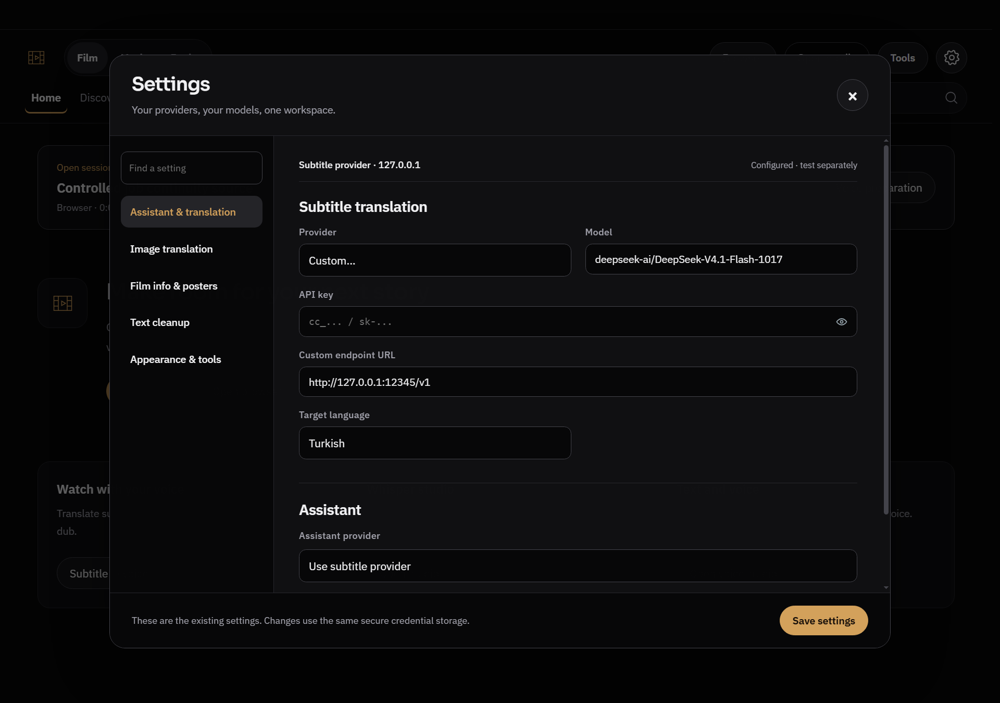

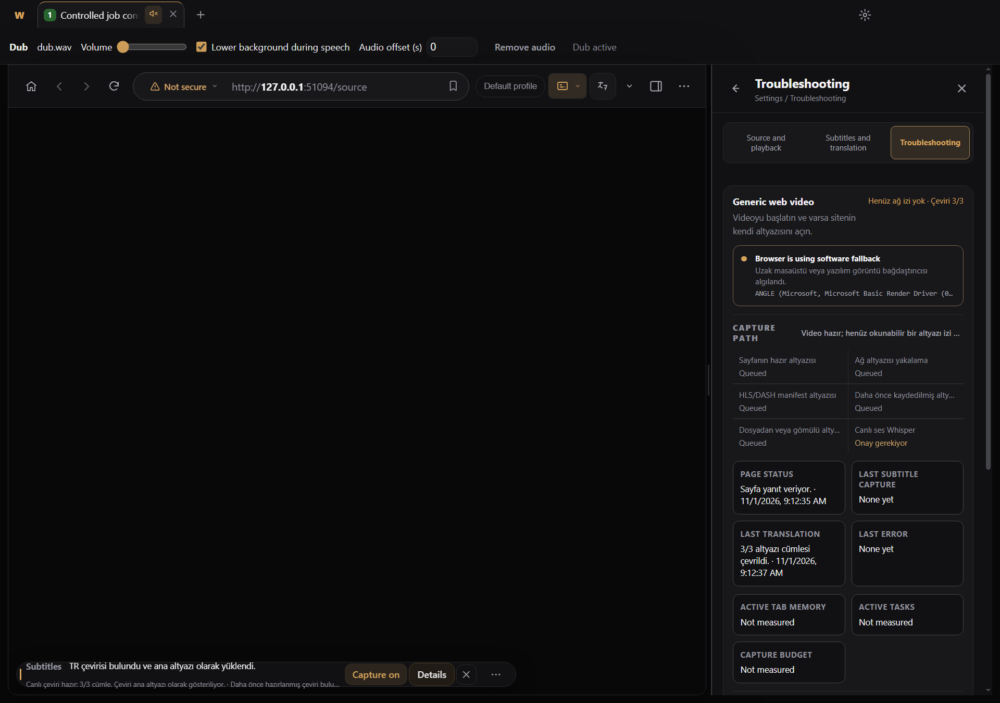

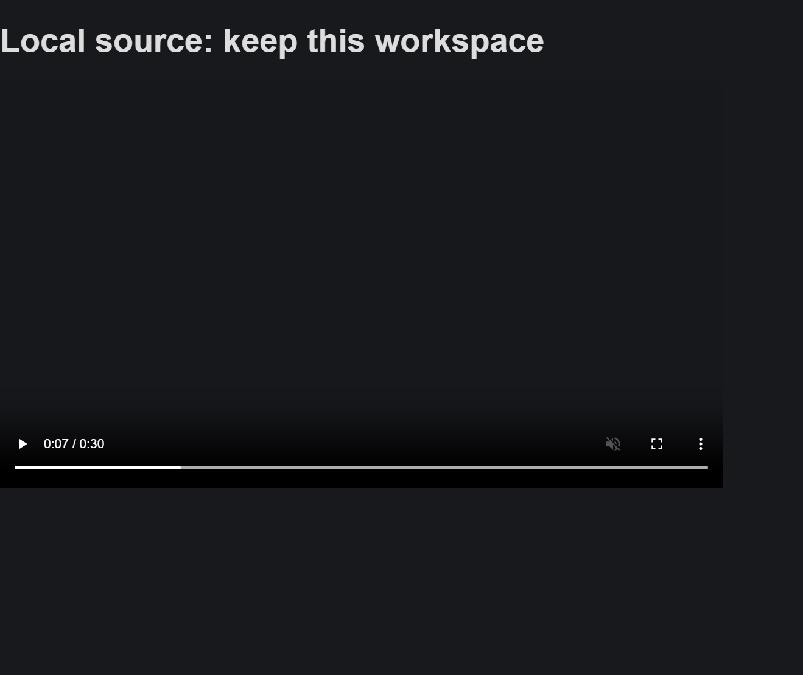

Son kabul: 30s native video7s konumu, gerçek manuel SRT import, gerçek WAV decode/attach, browser ayarları, Home+ana ayarlar, iki dönüş. Home'da önce kısmi sonra tam çeviri ilerledi; odağı çalmadı; toplam3 kontrollü provider çağrısı/0abort. Sonuç mevcut davranışla Türkçe SRT'yi yükler; özgün SRT dosyası değişmez. Explicit Play aynı attachment'ı senkron sürdürür. Başka generation eski sesi bırakır. Ek browser-dub-mute native regresyonu da geçti.

Ana pencere capture'ı native çocuk video yüzeyini siyah yakalayabilir; ayrı native-source görüntüsü bu nedenle saklandı. Görseldeki Troubleshooting alanının eski karma EN/TR tanı metinleri bu tur düzeltilmiş sayılmadı.

## 2. Başarısız asistan aşamasından devam — doğrulanmış boşluk, tamamlandı

Mevcut genel devam zinciri zaten Whisper → belirli çeviri çıktısını yükleme → ses üretimi → tamamlanan sesi bağlama adımlarını destekliyordu. Yeni ikinci runner yazılmadı. Ancak kabul edilmiş iş sonradan failed olduğunda continuation siliniyor, başarılı aşamalarla güvenli devam yolu kayboluyordu. Ses/yükleme/bağlama adları da genel uygulama kontrolü etiketiyle görünüyordu.

Main ledger'daki tam job ID başarısızlığı doğrularsa eski başarılı aşamalar ve hata kanıtı korunur. “Adımı yeniden denemeyi incele” yalnız aynı araç ve aynı argümanlarla **yeni onay kartı** isteyebilir. Ana süreç önceki Whisper'ı yeniden başlatmayı, başka ayarlarla retry'ı veya kısmi sesi bağlamayı reddeder. Model çağrısı ve Devam düğmesi işi kendiliğinden çalıştırmaz; Apply onayı yine gerekir. Stopped iş, kaynak/sohbet değişimi, süre sınırı ve doğrulanamayan job otomatik devam etmez. Mevcut sekiz adımlı sınır korunur.

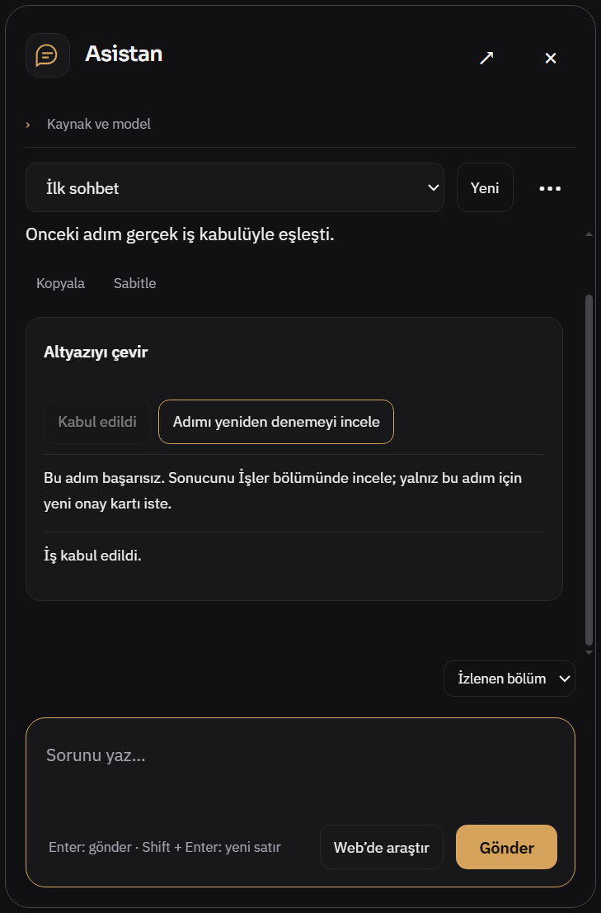

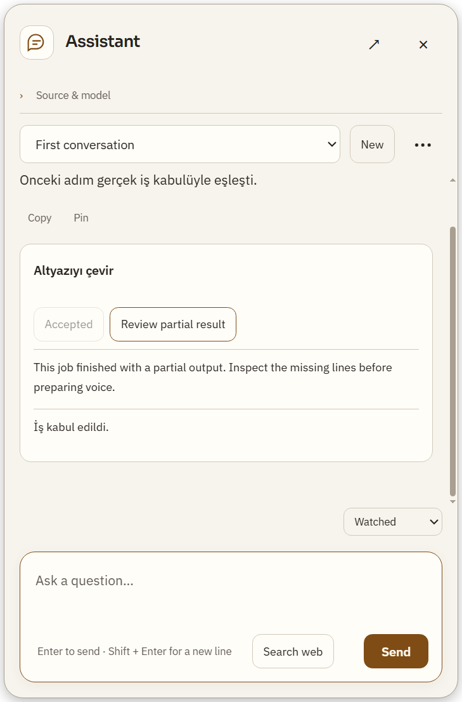

Main overlay allowlist'i retryable ile mevcut partial bayraklarını düşürüyordu; ikisi de güvenli boolean olarak geçirilir. Yükleme, ses üretimi ve ses bağlama aşamaları EN/TR açık adlarla gösterilir. Kontrollü bütün zincir testi başarılı Whisper/load aşamalarını, başarısız dub'ı, saldırgan önceki-aşama replay/argüman değiştirme/kısmi bağlama girişimlerini, yeni onayı ve yalnız tamamlanan çıktının bağlanmasını denetler.

Native helper4durum, kısmi sonuç EN/TR, odak dönüşü, dar öneri menüsü ve kaynak uzunluğu kontrolünü geçti. Bunlar canlı DeepSeek'in her komutta doğru araç seçeceği garantisi değildir.

## 3. Filmde kayıtlı analiz ve profil güncelliği

Film ana okuma alanı eski kaydın güncel zevk profiliyle eşleşmesini denetlemiyordu; yalnız genel bir açıklama vardı. Şimdi mevcut `decisionFreshness` modeliyle current/stale/unknown durumu gösterilir. Profil okunamazsa kayıtlı doğrulanmış sonuç erişilebilir kalır, güncelmiş gibi sunulmaz. Eski profil farkı yorumu yeniden çekmeyi veya AI çağrısını kendiliğinden başlatmaz.

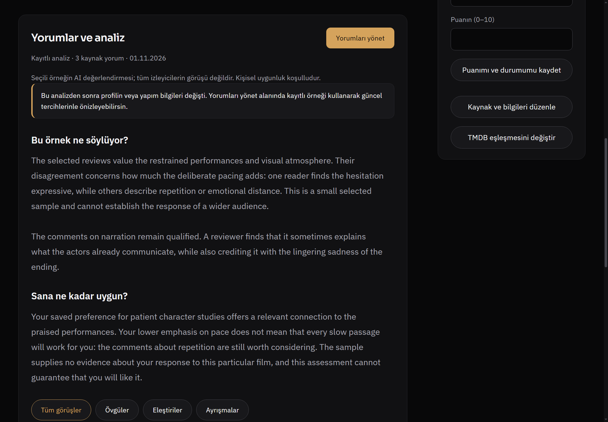

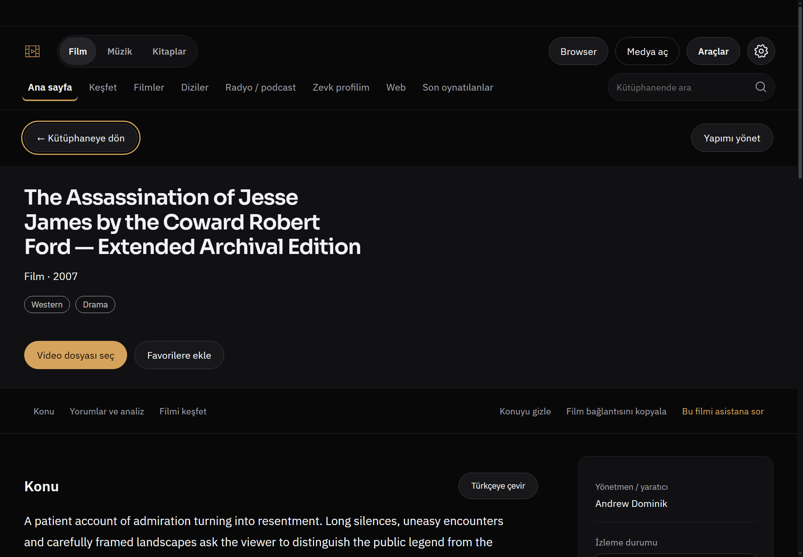

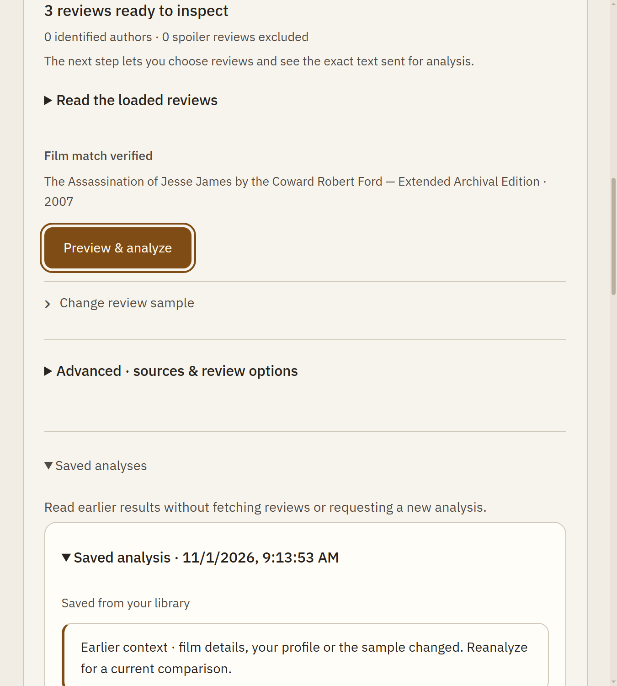

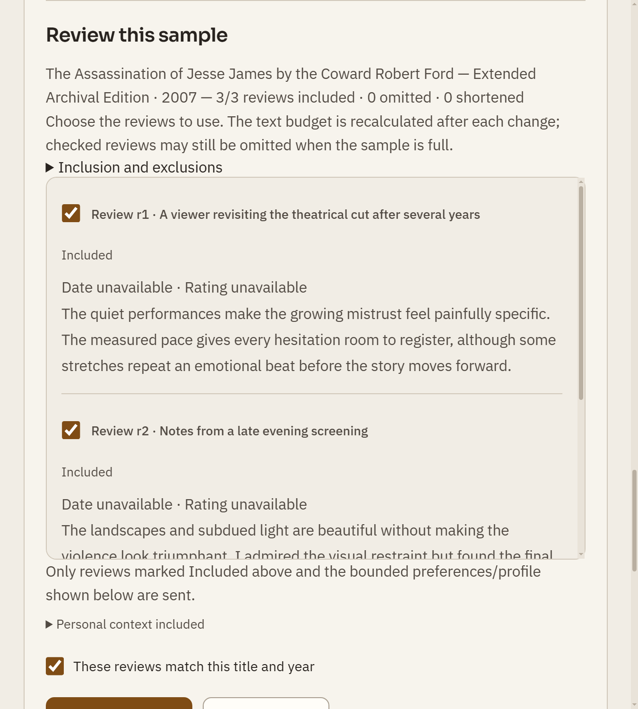

İkinci somut hata: örnek değiştirilince `draft.result` siliniyor ama eski kaydedilmemiş sonucun Save kontrolleri ve önizleme DOM'da kalıyordu. Bunlar örnekle birlikte temizlenir; kayıtlı tarihçe silinmez. Kaynak/kimlik/spoiler korumaları, R825 hazır-örnek-önce düzeni ve gelişmiş seçenekler korunur.

Native kontrol gerçek catalog/taste-preference/decision-save/get IPC kullanır. Uzun makul içerikle12ekran; TR/koyu1440px%125 ve EN/açık900px%150 (600CSSpx). Sayfa, uzun başlık/alıntı/metin/düğmelerde yatay taşma ölçülmedi. Kayıtlı analiz okunması ve örnek yeniden kullanımında0yorum okuma/model isteği. Bu akışta CSS değişikliği gerektiren yeni taşma bulunmadı; sırf farklı görünsün diye tema değiştirilmedi.

## 4. Gerçek ses için çeviri ve GPU kabulü

Önceki indirmeden kalan kamuya açık19.014s video kullanıldı. Kişisel ses yerine mevcut kontrollü İngilizce sentetik referans, ayrı profil/çıktılar ve güvenli RAM credential broker kullanıldı. Anahtar sohbete, rapora, argv'ye veya commit'e yazılmadı. DeepSeek modeli `deepseek-ai/DeepSeek-V4.1-Flash-1017`, **standart katman**, Flex yok.

| Deneme | Sonuç |
|---|---|
| İlk pilot: small CPU,2→19s | Whisper/çeviri/TTS/oynatma zinciri geçti;2DeepSeek çağrısı;3ses grubu:2ready/1review/0failed. İlk kısa grupta ASR benzerliği0, dil algısı en. Bu inceleme uyarısı başarıya çevrilmedi. |
| İkinci pilot: large-v3-turbo GPU,0→19s | Yeni Whisper,1/1tam çeviri,3DeepSeek standart çağrısı (biri gerçek konuşma editörü);1akıcı ses bloğu ready,0review/failed. Editörün sonucu unchanged; metin keyfi değiştirilmedi. |
| Ses üretimi |15adım;0cache/1yeni grup; yükleme15.766s, referans2.14s, üretim36.813s, işin geçen süresi60.389s. Bu bir model hız sıralaması değildir. |
| Nihai WAV denetimi |19.0s,48kHz,912000frame; finite=true,peak≈0.79437,dijital kırpılma oranı0. Son dosya metin ASR kontrolü geçti (benzerlik0.8814). Ham gruba bakmakla yetinilmedi. |
| Oynatma ve kapsam | Seçili aralık SRT→dublaj UI'ına taşındı; orijinal videoya bağlı WAV, aralık içi mute/ses ve pause kabulü geçti. İlk pilot dış-aralık kontrolünü de kapsar;0başlangıçlı son denemede dış-aralık iddiası yapılmaz. |

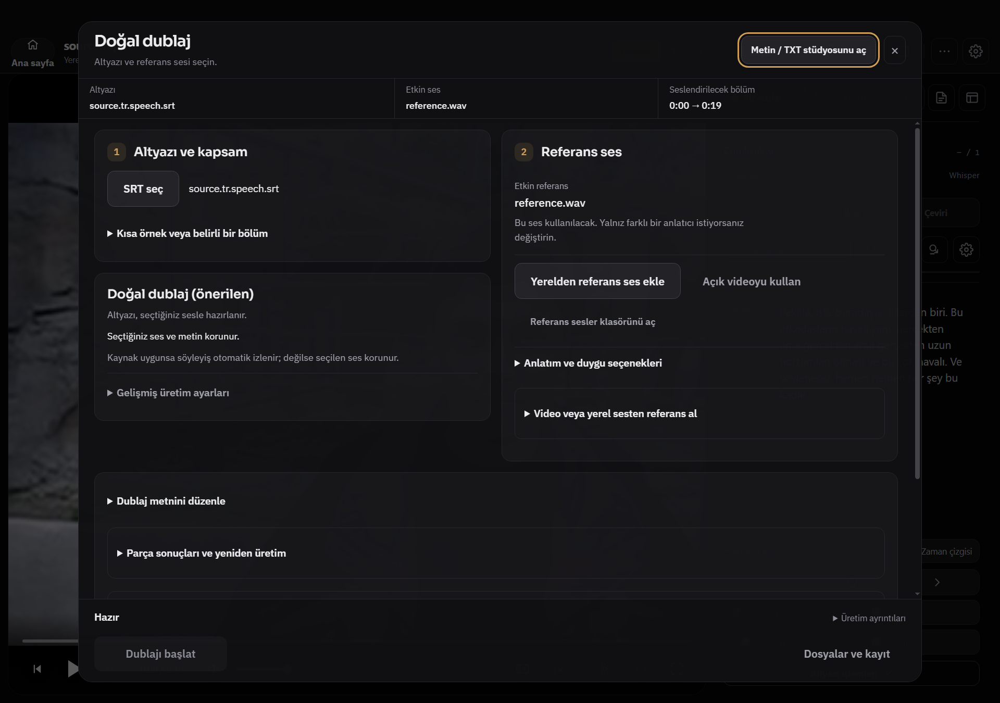

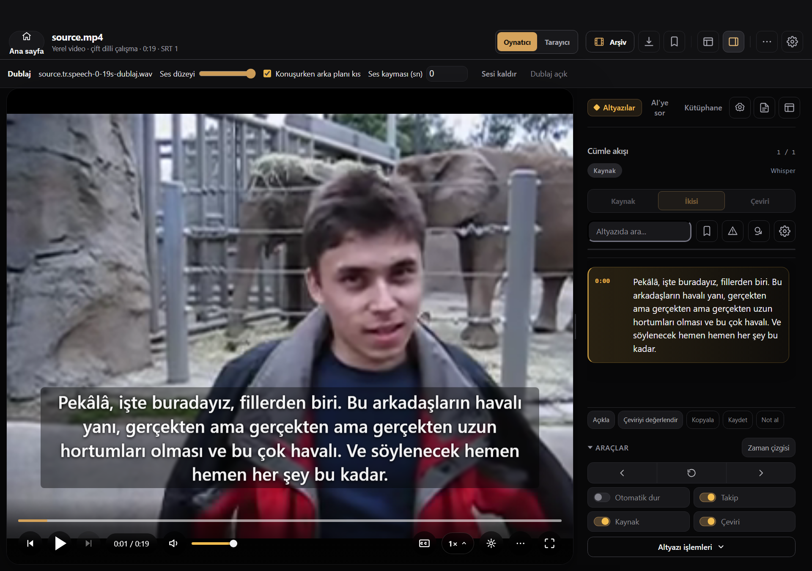

### Kritik kalite sınırı: doğru okuma ≠ doğru kaynak

Önceki kamu indirmesinin manuel İngilizce altyazısı ile karşılaştırmada iki sapma var: **“in front of” → “one of”** ve **“trunks” → “fronts”**. Kaynak metin yanlışsa sonraki çeviri ve sesin metni başarıyla okuması özgün anlamı doğrulamaz. Türkçe çıktının tamamı kusursuz diye sunulmadı, SRT sessizce elle düzeltilmedi. Bu nedenle UI'daki geçmiş hazır sonucu da açıklayan metin, denetimin **verilen altyazıya göre** olduğunu ve özgün ASR doğruluğunu kanıtlamadığını söyler. Doğallık hâlâ dinleme gerektirir.

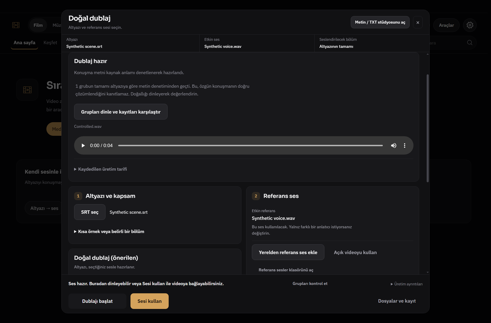

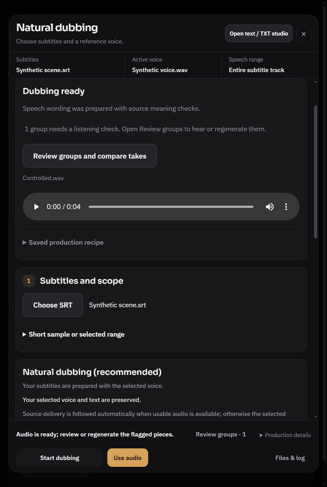

İlk gruptaki Onlar'ın özel ad sayılması incelendi. Denenen dar isim sezgisi bir eksik özneyi kabul ettirebileceğinden **ürüne alınmadı**. İsim/özne, sayı, olumsuzluk, dil ve benzerlik eşikleri korunur. ASR'nin en seçmesi tek başına İngilizce üretildiğini veya sadece yanlış alarmı kanıtlamaz. Bu gerçek kalite kaydı kapatılmış bug gibi sunulmaz.

Yerel karşılaştırmalı dinleme sayfası: `D:\Whisper Local\tmp\assistant618\tmp\workflow826\listen.html`. Özgün video, yeni ses ve kaynak/Türkçe metin birlikte dinlenebilir. Ham ses/video/anahtarlı profil/sağlayıcı kayıtları Git'e eklenmedi. İnsan kulağıyla doğallık/duygu kazananı seçilmedi; ilk ve ikinci pilotta hem kaynak başlangıcı hem ASR modeli değiştiği için kontrollü A/B sıralaması yapılamaz.

### Kabul aracının düzeltilen kapsamı

`tools/video-live-pipeline.cjs` artık açık `--range-start` alır. Eski0:02kesmesi ilk cümleyi eksiltiyordu; tam kaynakla test yapılabilir. İzole profilde mevcut UI ayarları kaydedilir; gerçek konuşma editörü yalnız izinli yerel relay'e ulaşabilir. Önceki araç main fetch'i tamamen kapattığı için editör bu testte editor_failed dönüyordu; bu test ağ izolasyonu hatası düzeltildi, yabancı ağ istekleri yine reddedilir. Relay gerçek sağlayıcıya yalnız bellek anahtarıyla gider. İlk pilotun editor_failed kaydı saklıdır; ürünün tüm editörlerinin bozukluğu iddia edilmez.

```powershell
& 'D:\Whisper Local\node_modules\electron\dist\electron.exe' tools/video-live-pipeline.cjs --run-real-pipeline --fixture tmp/workflow826/fixture --media tmp/workflow826/fixture/source.mp4 --range-start 0 --range-end 19 --asr-model large-v3-turbo --asr-device cuda
```

Bu komut mevcut açık izin, kurulu model/venv, uygun boş GPU, güvenli sağlayıcı broker'ı ve yerel fixture dosyalarını gerektirir; normal test paketinde kendiliğinden çalışmaz. GPU preflight9500MiB ister, başka süreci durdurmaz. Başlangıçta10799MiB boştu. cuDNN/torch DLL yolu test sürecine sağlandı; bu doğrudan Electron kabulü normal start.bat akışının sınanması değildir.

## Hedefli testler ve kanıt

Son birleşik Node koşumu **130/130**, ayrı i18n1/1; mevcut standalone browser-dub-audio geçti. Değişmeyen kalite/dil korumaları için20Python testi geçti. Görüntü/ölçüm sayısı test veya bug sayısına eklenmedi.26JS syntax, UTF-8 ve diff kontrolü geçti. Komutlar:

```powershell
node --test --test-isolation=none tests/assistant-flows.test.js tests/assistant-flow-state.test.js tests/assistant-resilience-ui.test.js tests/assistant-agent-service.test.js tests/assistant-overlay.test.js tests/assistant-provider.test.js tests/film-review-inline.test.js tests/film-review-editor.test.js tests/review-workflow.test.js tests/browser-dub-home-continuity826.test.js tests/browser-dub-mute-ownership.test.js tests/media-home-model.test.js tests/dub-natural-result.test.js
node tests/browser-dub-audio.test.js
node --test --test-isolation=none tests/i18n-coverage.test.js
# Backend venv Python ile:
python -m unittest discover -s backend -p test_dub_grouped_numbers.py
python -m unittest discover -s backend -p test_verification_language750.py
python -m unittest discover -s tests -p test_dub_quality.py
```

Native tekrar üretme: `tests/electron-assistant-flow-state.smoke.js --partial813`, `tests/electron-film-workflow826.smoke.js`, `tests/electron-browser-continuity826.smoke.js`, `tests/electron-browser-dub-mute.smoke.js`, `tests/electron-dub-natural.smoke.js`. Electron.exe Windows kurulumu ve FFmpeg yolu gerekir; her biri ayrı profil kullanır. Browser helper `WHISPER_TEST_FFMPEG` kabul eder. Dublaj son tur17geometri kaydı/14görüntü; footer/overflow ve mevcut kontroller korundu. Son görüntüler gözle incelendi. [ACCEPTANCE.json](workflow826/ACCEPTANCE.json) seçili ölçümler, [MANIFEST.json](workflow826/MANIFEST.json)13görüntünün hash kaydıdır.

Ara başarısızlıklar gizlenmedi: sandbox spawn/Mojo/FFmpeg engelleri aynı güvenli komutların izinli çalıştırılmasıyla aşıldı; Node no-subprocess isolation kullanıldı. İlk gerçek pipeline Windows Start-Process boşluklu yolu Me noktasında kesti; yalnız ona ait PID30824 komut kimliğiyle doğrulanıp kapatıldı, aynı kamu dosyasının boşluksuz test kopyasıyla tekrarlandı. Film ilk karelerinde loading frame yakalanması rAF/arka plan throttling kontrollü son görüntülerle giderildi. Bir native beklenti tamamlanan Türkçe SRT'nin otomatik yüklenmesini eski kaynak dosyasıyla aynı sanıyordu; eski dosyanın byte koruması ve yeni çıktının içerik kabulü ayrıldı, ürün o beklenti için değiştirilmedi.

İmpeccable context/harden/craft-floor ve mevcut DESIGN Operate/Read dili kullanıldı; yeni tema, font, animasyon kütüphanesi veya ücretli tasarım servisi eklenmedi. gpt-6.1-sol/medium yardımcıları ayrı alanlarda çalıştı; teslimleri ana ajan inceleyip birleştirdi. Ürün tasarımı yeniden icat edilmedi, mevcut davranış/odak/gelişmiş seçenekler korundu.

Tam npm test, start.bat ile kişisel uygulamayı yeniden açma, canlı YouTube browser hesabı/reklam/DRM, ekran okuyucu, uzun video/soak/FPS ve CI sonucu doğrulanmadı. CI açık kalır ve beklenmez. Gerçek ses denemesi kısa yerel kamu videosudur; kontrollü browser/film/asistan kabulünü gerçek dış site veya insan doğallığı diye sunmuyoruz. Kişisel uygulama kapatılmadı; profil, anahtar ve kişisel dosyalar değiştirilmedi.
