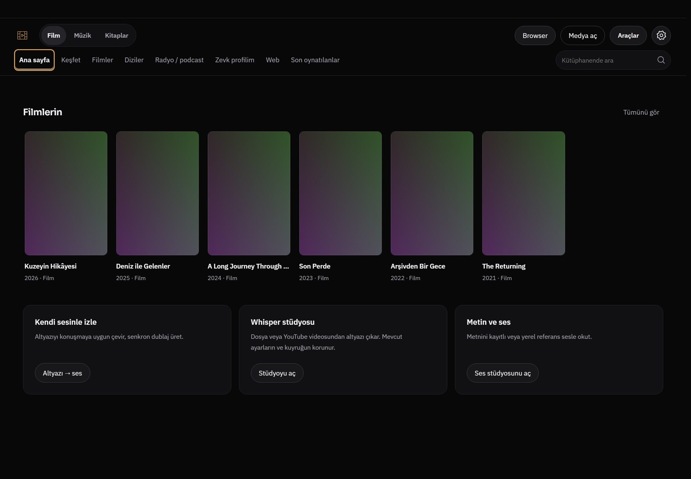
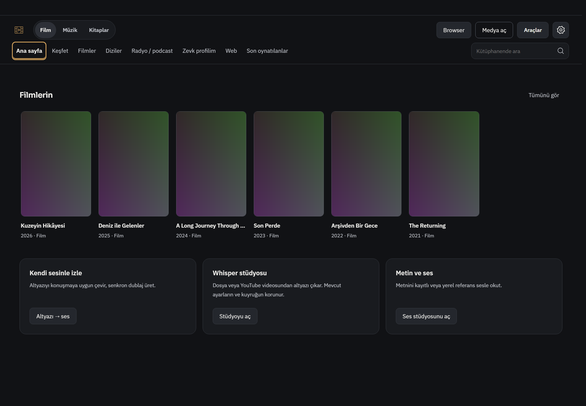
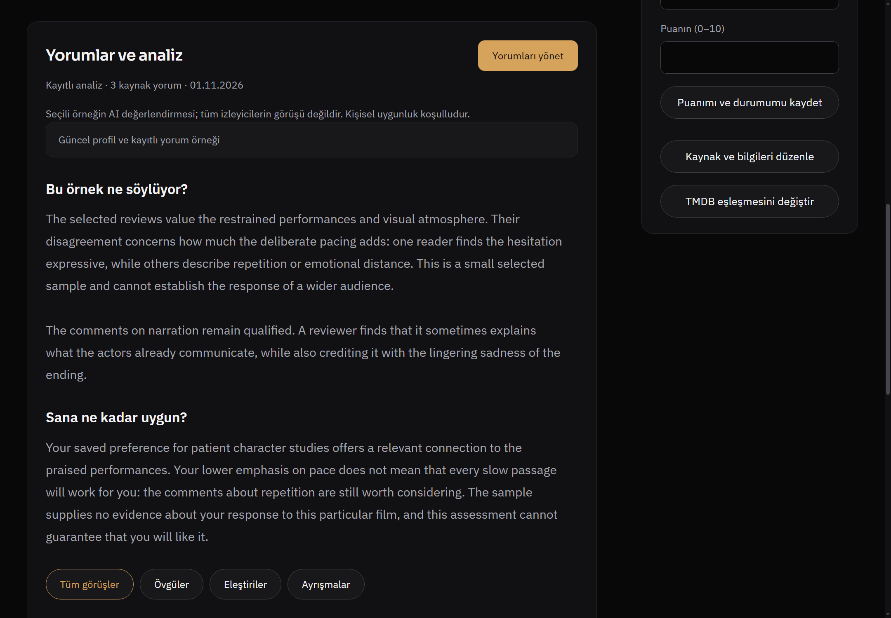
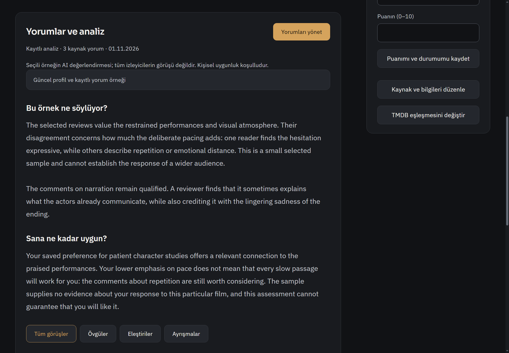
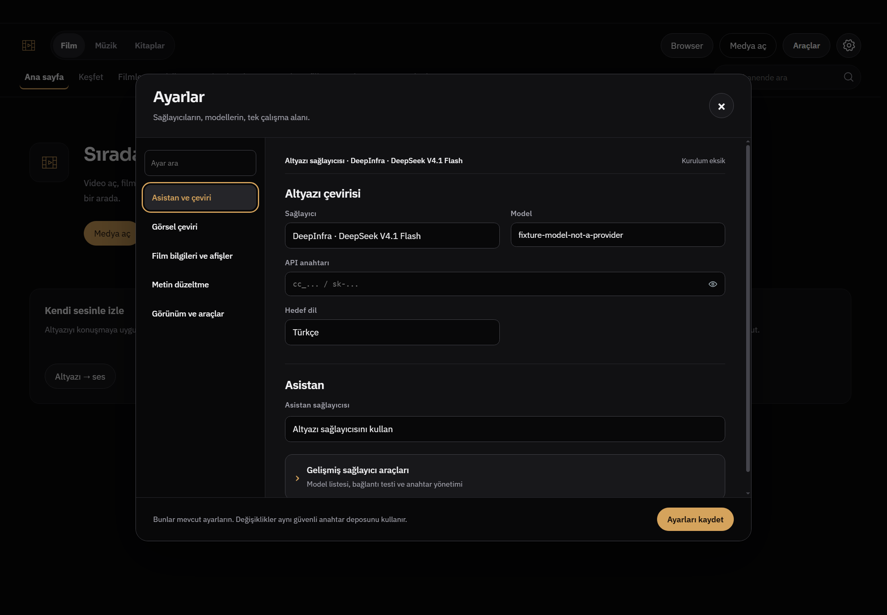
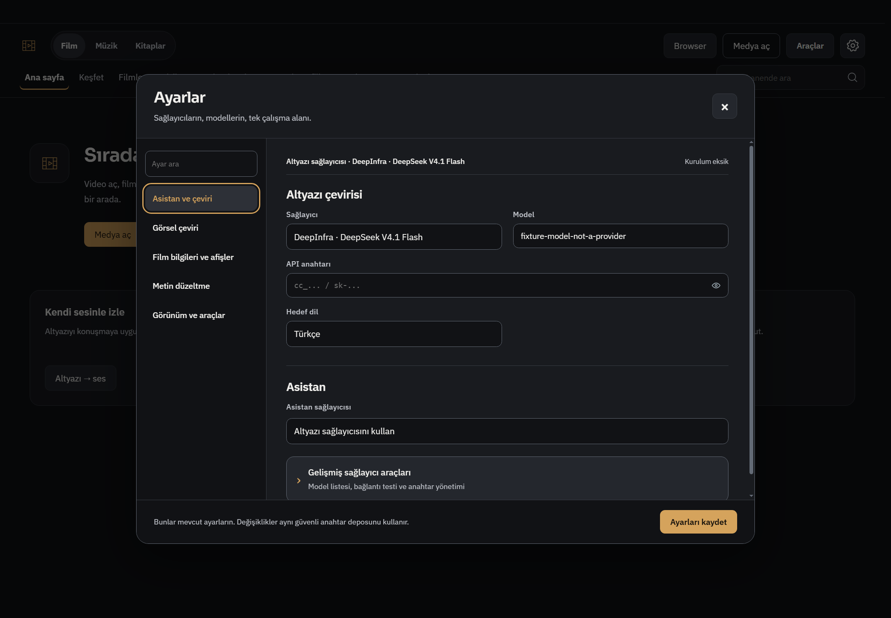
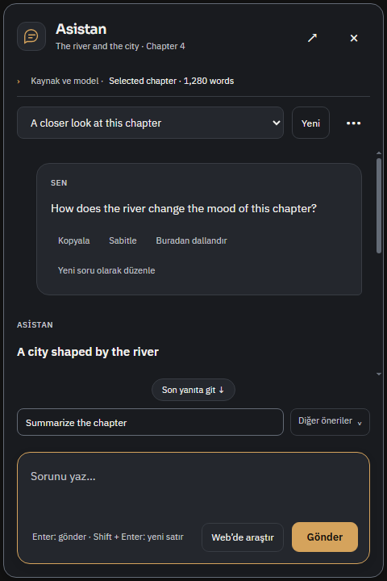
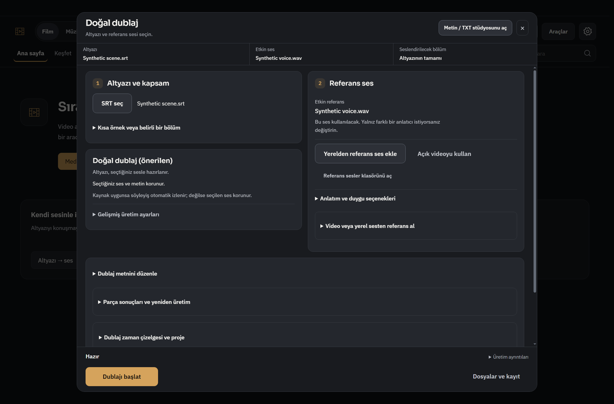
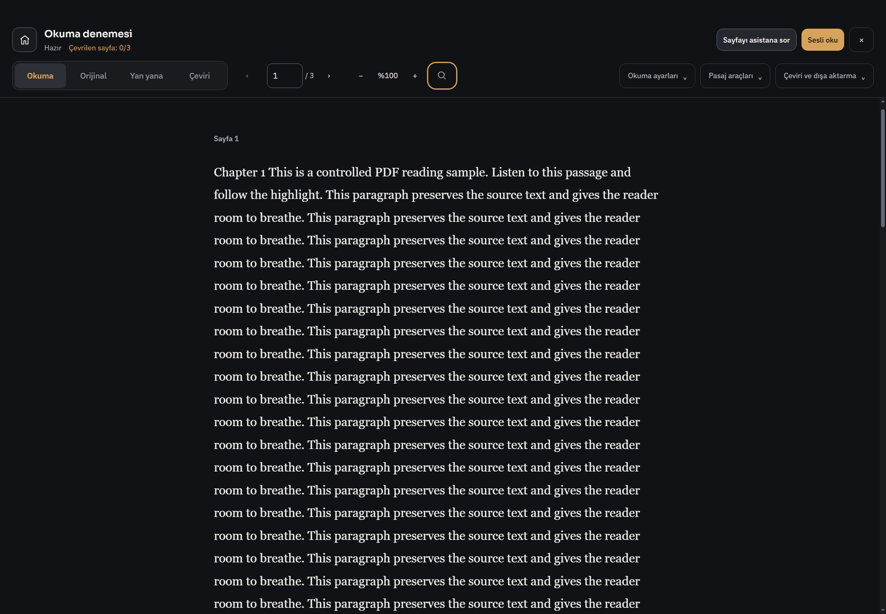

# R827 — Hesapsız ortak tema ve hareket düzeni

Başlangıç master: `49bdecdb201511ea9a690d61cf1e3aebf1245504`. Ürün commit'i: `82c8d1048cc9b34227200c3ac3bbd0b3b1da6589`. Dal: `codex/cohesive-theme827`.

Kapsam kullanıcının yeni tasarım pluginlerini kullanarak mevcut temayı geliştirme talebi; dış hesap gerektirmeyen, kullanıcıca kabul edilmiş otomatik tasarım geçidi. Yeni marka/pazarlama sitesi veya özellik azaltma işi değil. Kişisel açık uygulama kapatılmadı; fixture profilleri kullanıldı.

## Sonuç ve kaynak sahipliği

Ana pencere, medya yüzeyleri, browser ve ayrı asistan renderer'ı farklı sayfa paletleri taşıyordu. Yeni `theme-palette.css` ana ve asistan HTML girişlerinden önce yüklenir. `styles.css` ve asistanın mevcut değişkenleri ortak rollere bağlanır; medya/browser kopyaları kaldırılır. Sora/IBM Plex Sans, kitap serifi ve mevcut tüm kontrol/IPC sahipleri korunur. Yeni font, paket, CDN, hesap veya ayar şeması yoktur. Video üstü açık-tema kontrol yüzeyi ve TV/up-next kontrast istisnaları korunur.

Grafit katmanlar111215/191b1f/24272d/2d3037, metin f1f0ed, ikincil c1c4cb/pasif b0b4bd; amber d5a35c. Ana pencerenin mevcut sıcak açık paleti aynen taşındı; asistan açık varyantı da ortak rolleri kullanır. Portable v1.1 `design-system/whisper-local-theme.css` çalışma zamanı değildir ve bu turda değiştirilmedi.

İkincil medya düğmeleri hap yerine8px kontrol ailesidir; hover sınırı nötrdür. Arama10px, asistan panel16px; mod grubu ve konuşma mesajlarının bağlama özgü şekilleri korunur. Kapalı asistan balonu nötrdür. Hero örtüsü güncel sayfa zeminini kullanır; sabit eski siyah temayı dayatmaz. Bu tema turu bütün sayfaların içeriğini veya geometri düzenini yeniden tasarladığı iddiasında değildir.

## Doğrulanmış iki okunabilirlik sorunu

Yeni yüzeyde native kontrast kontrolü ilk kez10ihlal verdi: dört kicker4.39:1 ve altı altyazı alan etiketi4.27:1. Bunlar iki stil köküdür;10yeni bug sayılmaz. `.signal-kicker` okunabilir amber, `.settings-drawer` etiket/ipucu ortak ikincil metin rolüne taşındı. Eşik düşürülmedi, test atlanmadı. Son koyu/açık koşum0metin ihlali/0odak ihlali/0muted uyarısıdır. Kapsam testin görünür chrome bölgeleridir; tüm ürünün WCAG sertifikası değildir.

[İlk başarısız ölçüm](theme827/contrast-initial.txt), [son ölçüm](theme827/contrast-final.txt).

## Pluginler gerçekte nasıl kullanıldı?

| Kaynak | Bu turdaki katkı ve sınırı |
|---|---|
| Design Arc | Hesapsız guideline-only kurulum, amaç/kapsam, üç yön, otomatik geçit, statik öneri ve iki düzeltme; son native kabul ayrı. Eksik graph standart iş akışını engellemedi; graph kanıtı yok. |
| Themely | Gerçek araç çağrısıyla “Whisper · Sessiz sinema” token önizlemesi gösterildi; native ürün kanıtı değildir. Sistem-font önizlemesi üretimin mevcut fontlarını değiştirmedi. |
| Frontend Design Premium + upstream | DESIGN.md güncel sahiplik/renk/yoğunluk/durum kaydı, tema ve kontrol tutarlılığı. |
| Impeccable | Mevcut tasarımı iyileştirme bağlamı, harden/craft-floor ve kaynak/görev durumlarını koruma. |
| Redesign | Audit-first, görünür önce/sonra, işlev sahiplerini koruyan sade kontrol hiyerarşisi. |
| MotionDesign | Giriş/routing ve hareket ölçütleri okundu. Pazarlama AIDA/GSAP/scroll-pinning yönü bu yoğun Electron ürününe uygulanmadı; tam GSAP workflow tamamlandı denmiyor. |
| Product Design | Akış/bağlam/kanıt ölçütleri okundu. IAB tabanlı tam audit çalıştırılmadı; terminalden native Windows kanıtı tercih edildi. |
| Designly | İkinci ajan gerçek10PNG'yi bağımsız inceledi; sınırlı “meets”, doğrulanmış engelleyici sorun yok. [Tam QA](theme827/visual-qa.md). |

Plugin sayısı kalite kanıtı sayılmadı. Hesap gerektiren hizmetler açılmadı. Üretilmiş tasarım panosunda iki yanlış iş akışı düzeltildi: asistanın icat edilmiş sol menüsü kaldırıldı; dublajda hazır-ses eylemi üretim durumundan ayrıldı. Son pano yalnız yön onayıdır; gerçek UI aşağıdaki native görüntülerdir. Resim üretimi ürünün afiş/veri kaynağına eklenmedi.

Resmî dayanaklar: [Fluent renk](https://fluent2.microsoft.design/color), [semantic token](https://fluent2.microsoft.design/design-tokens), [tipografi](https://fluent2.microsoft.design/typography), [işlevsel hareket](https://fluent2.microsoft.design/motion), [W3C reflow](https://www.w3.org/WAI/WCAG22/Understanding/reflow.html), [focus not obscured](https://www.w3.org/WAI/WCAG22/Understanding/focus-not-obscured-minimum.html). Luna/Arc vb. dış benchmark'a canlı eşdeğerlik iddiası yok; evidence modu guideline-only.

## Görüntülü kayıt

Statik [tasarım önerisi](theme827/proposal-final.png) — çalışan uygulama değildir. [Yön/karar/hareket sözleşmesi](theme827/direction.json).

### Ana sayfa — önce / sonra

Daha okunur katmanlar ve kısa ikincil kontrol ailesi. Afişler kontrollü fixture görselidir; gerçek TMDB kalitesinin kanıtı değil. Görünen amber odak klavye odağıdır, fare seçimi değildir.

### Film analizi — önce / sonra

Uzun kayıtlı AI metni ve kişisel durum aynı kontrol dilindedir; analiz içeriği kontrollüdür, gerçek model değerlendirmesi değil.

### Ayarlar — önce / sonra

Maskeli anahtar, mevcut ayarlar ve gelişmiş alanlar korunur. [Dar ayarlar](theme827/after/settings-narrow.png), [açık tema Keşfet](theme827/after/discovery-light.png).

### Diğer gerçek native yüzeyler

[360px streaming/uzun taslak](theme827/after/assistant-narrow.png): konuşma ve taslak ayrı kayar, İptal erişilir; bu hâl yoğun bir durumdur, tüm içerik aynı anda görünür diye sunulmaz.

[640px dublaj](theme827/after/dub-narrow.png): footer görünür, içerik üzerinde ayrı kaydırma vardır. Bağımsız QA'nın sağ kenar şüphesi Range satır ölçümüyle doğrulanmadı; tüm satırlar kart iç sınırındaydı. Test artık bunu ayrıca assert eder. Spekülatif bug sayılmadı.

[Dar okuyucu](theme827/after/reader-narrow.png): mevcut serif ve ses hazırlığı korunur. [Browser chrome](theme827/after/browser.png) ana pencere yakalamasıdır; native child video bu PNG'de görünmez. [Ayrı native video](theme827/after/native-video.png), gerçek currentTime>0.1 ilerlemesi olan fixture video/fullscreen dönüşü browser kabulüyle doğrulandı; canlı YouTube/DRM değil.

## Hareket ve etkileşim

Kontrol basışı .96→.985, fine-pointer kapak yükselişi3→2px, bölüm seyahati6→4px. Panel160ms, bölüm180ms, renk150ms/press100ms. JS artık CSS süre/easing/offset rollerini bounded doğrulama ve fallback ile okur. Hızlı yeniden giriş mevcut görünümden devam eder; eski animasyon iptal edilir; reduced-motion değişimi ve pagehide iptal eder. Navigasyon veya native view görünürlüğü animasyon beklemez. Bunlar hedefli davranış testleriyle doğrulandı; animasyonun görsel akıcılığına dair FPS/soak ölçümü yapılmadı.

## Çalıştırılan kabul

- `node --test --test-isolation=none tests/design-system.test.js tests/ui-motion.test.js tests/browser-reading-design.test.js`:7runner sonucu,0hata. İki legacy dosyanın iç assertion sayısı ayrıca bug sayısına katılmadı. Motion5davranış testi içerir.
- `node --check` değişen motion JS ve dublaj native helper: geçti. `git diff --check`: geçti.
- Electron `electron-home-discovery-design.smoke.js`:21durum; `electron-film-workflow826.smoke.js`:12ekran,0yorum/model isteği; `electron-settings-design-tour.smoke.js`:30durum; `electron-assistant-design-tour.smoke.js`:24durum,0sağlayıcı çağrısı. İngilizce/açık, Türkçe/koyu ve dar ekranlar kapsanır.
- `electron-dub-natural.smoke.js`:17geometri durumu; son koşum metin satırlarının kart içinde kalmasını da assert eder. `electron-pdf-reader-experience.smoke.js`: gerçek native okuma/ses fixture kabulü geçti. `electron-browser-chrome-design.smoke.js`: native child video, araç çubuğu matrisi, fullscreen dönüşü geçti. `electron-ui-theme-contrast.smoke.js`: son koyu/açık0ihlal.
- Tüm native koşumlar ayrı profildedir; reklam filtreleri için dış ağ bilinçli kapatıldığından fixture stderr'de beklenen ağ mesajı vardır. Bu mesaj gerçek reklam engelleme başarısı değildir. Önceki sandbox spawn/Mojo sınırlaması gerçek native helper'lar izinli çalıştırılarak aşıldı. İlk Themely boş-eyebrow şema hatası düzeltilerek tek başarılı önizleme yapıldı.

Tam npm test/CI sonucu, gerçek kişisel start.bat yeniden açılışı, GPU/model/ses kalitesi, canlı site/hesap/DRM, Windows yüksek kontrast modu, ekran okuyucu ve bütün sayfaların bütün DPI boyutları doğrulanmadı. CI açık kalır, sonuç beklenmez. Kişisel dosyalar ve açık uygulama korunarak normal PR/master teslim döngüsü kullanılır. Yeni global ücretli servis/hesap kurulmadı; statik tasarım aracı kullanımı native UI başarısına eşit tutulmadı.
