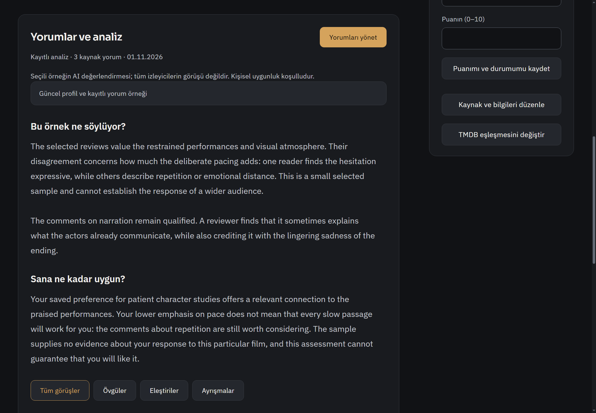
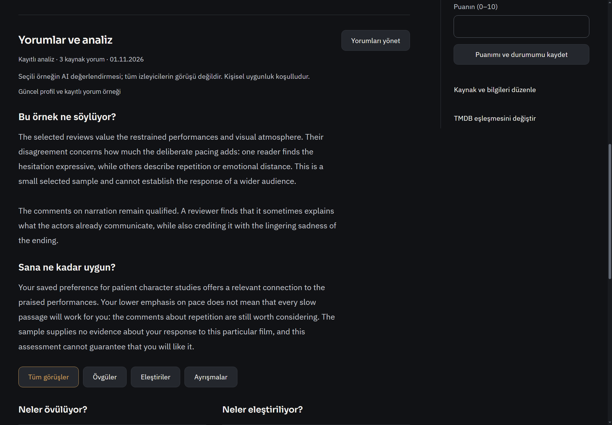
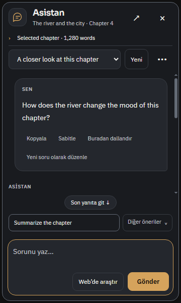
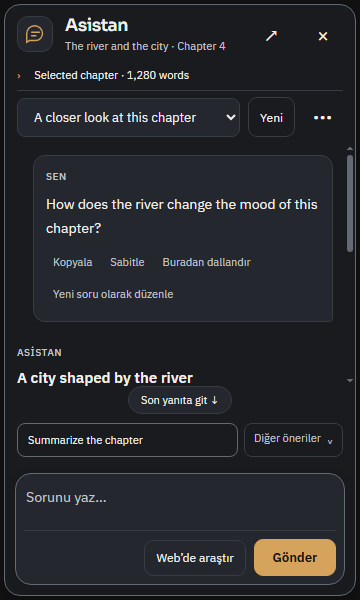
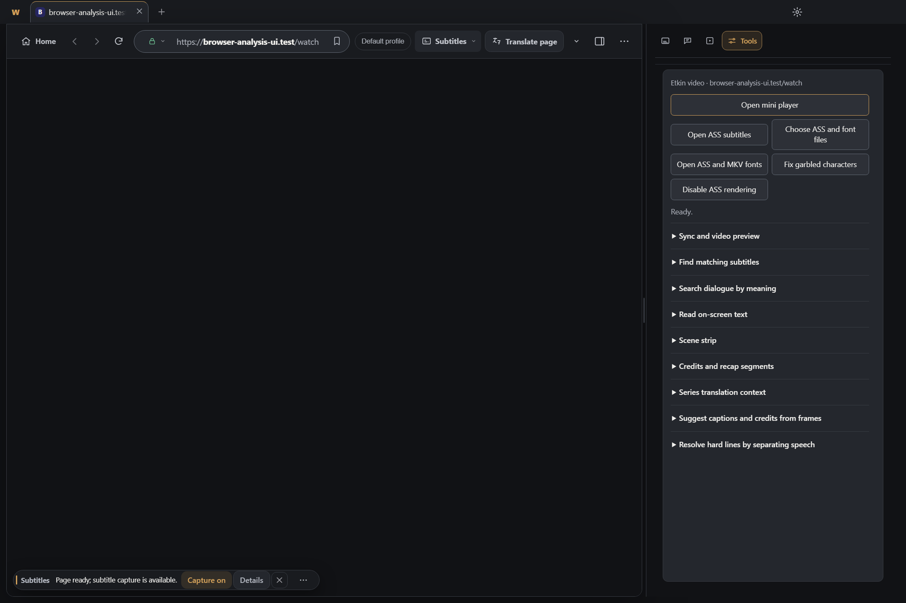
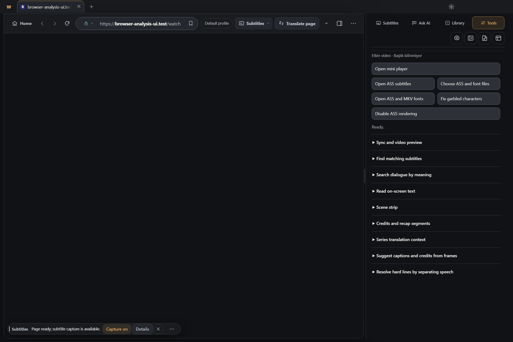
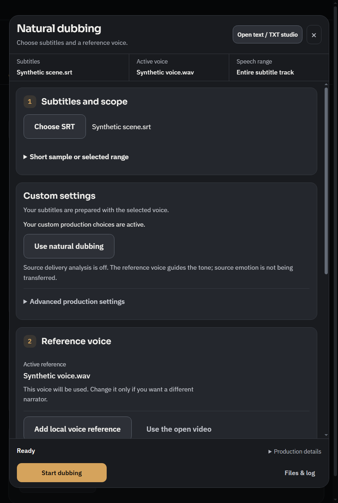
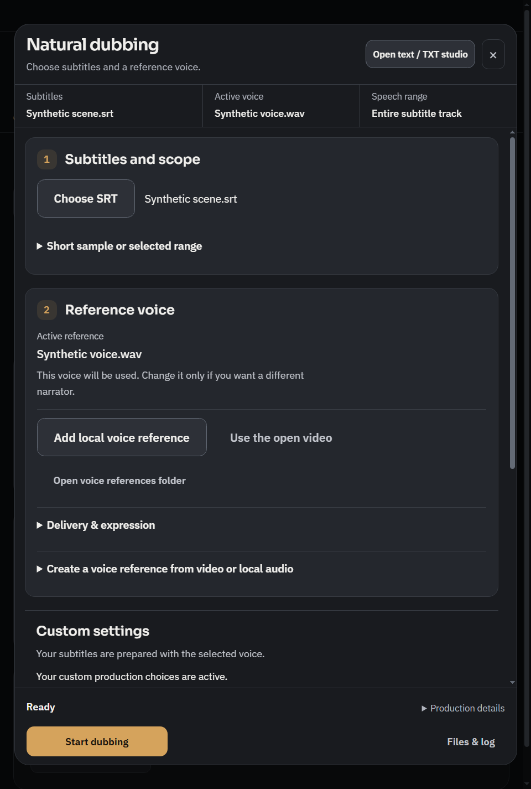
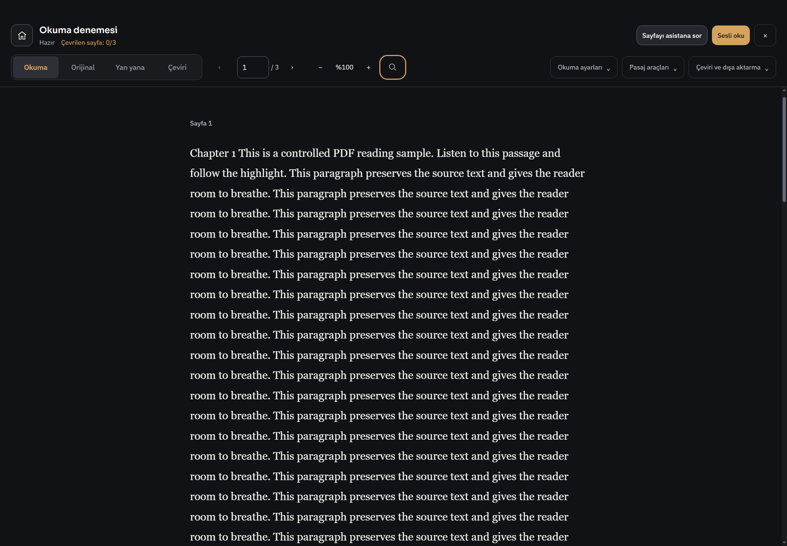
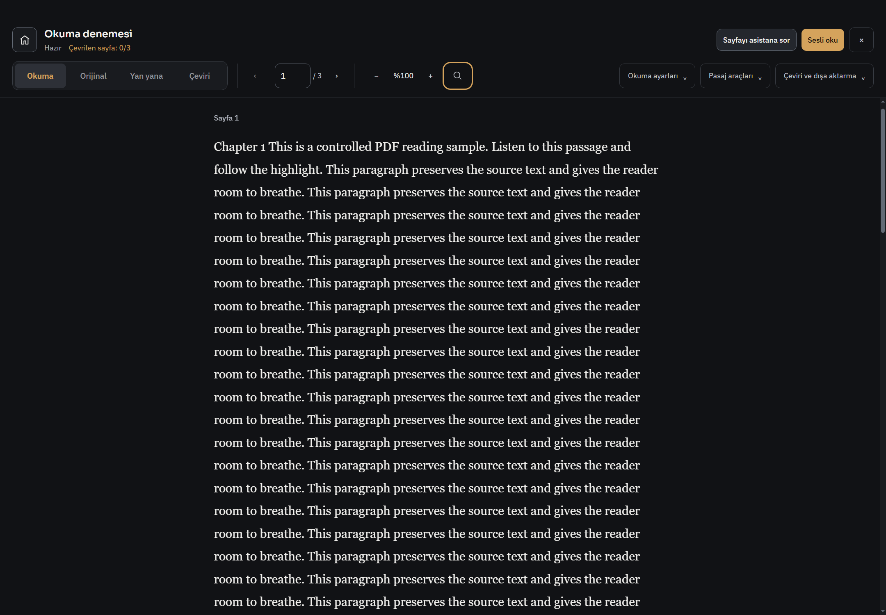

# R828 — Beş yüzeyde yerleşim ve günlük kullanım turu

Başlangıç master `12ace3e57fe440491d6dbcb371b4b06e33cc99d7`; ürün `2ff778c5cb49b39404e3e7fba462b4a22b6019d4`; dal `codex/surface-craft828`.

Kullanıcının onayladığı beş alanın tamamı işlendi: film, asistan, browser, dublaj, PDF/kitap. R827 paleti yeniden değiştirilmedi; bu tur içerik hiyerarşisi, alan kullanımı, kontrol sırası ve okunabilirliktir. Özellikler ve gelişmiş alanlar kaldırılmadı. Yeni hesap, bağımlılık, font, dış repo kodu, ücretli servis veya ayar şeması eklenmedi. Önceki ortak tema/DOM/scroll sahipleri kullanıldı; bu dar iyileştirmeler için yeni framework gerekmiyordu.

## Film sayfaları

**Sorun:** kayıtlı AI sentezi büyük bir dış kart, dolu yönetim eylemi ve ayrı güncellik kutusuyla bölünüyordu. Sağdaki düzenleme eylemleri okuma içeriğiyle aynı ağırlıktaydı. **Yapılan:** dış çerçeve yerine tek bölüm ayıracı;68ch ölçülü15px/1.85 okuma metni; kaydedilmiş analizde nötr Yönet; güncel bağlam kısa metin, stale/unknown açıklaması belirgin kalır. Sağda metadata/kişisel form ile yönetim eylemleri ayrılır; dar ekranda alt satıra geçer. Konu çevirisi, kaynak düzenleme, zevk profili, örnek/analiz/kanıt ve karşılaştırma korunur. Native disclosures'ın varsayılan üçgeni mevcut davranış korunarak CSS chevron ile çizilir. Filmdeki eski .96 transform basışı kaldırılır; ortak motion sahibi kullanılır.

[Koyu güncelliği değişmiş profil](surface828/after/film-stale.png), [açık/dar kayıtlı sonuç](surface828/after/film-analysis-light.png), [boş yorum alanı](surface828/after/film-empty.png), [dar yorum çalışma alanı](surface828/after/film-editor-narrow.png). Güncel/boş/hata halleri ayrı korunur. Generic home fixture'ın identity doğrulama hatası başarı diye sunulmadı; gerçek controlled decision-get boş/editor halleri ayrı824helper'dan gelir.

Bağımsız yardımcı ajan eşleşen önce/sonra ile14Keşfet görüntüsünü ve afişsiz yerel başlığı inceledi: görülen kapsamda engelleyici görsel regresyon yok. [QA](surface828/film-independent-qa.md). Kaydedilmiş kaynak/model isteği olmadan okuma, profil stale/current, örnek reuse ve güncel preview gerçek yerel IPC ile sınandı; gerçek Letterboxd/model kalitesi bu turda sınanmadı.

## Asistan

**Sorun:** markdown boş satırı için eklenen br ile paragraf marjı birlikte gereksiz dikey boşluk üretiyordu. Dar panelde ilk cevap paragrafı aşağı itiliyordu; uzun araç/kaynak içeriğiyle karar düğmeleri aynı görsel ağırlıktaydı. **Yapılan:** yalnız message'ın doğrudan blank-line br'leri gizlendi; içerik p/pre içinde kalır. Kullanıcı mesajı içeriğe göre ölçülür; mesaj eylemleri daha yakın gruplanır. Araç başlığı, sınırlı kanıt kaydırıcısı ve sarılabilir karar düğmeleri ayrı gruptur. Kaynak metni/metadata uzunluğu sınırlıdır; composer komut satırı ince bir ayraçla ayrılır. İptal, retry, kaynak/model, sohbet menüsü ve öneriler korunur.

[Uzun taslak/streaming](surface828/after/assistant-stream.png), [araç kararı](surface828/after/assistant-tool.png).360px panelde cevap hâlâ kendi kaydırıcısında okunur; bütün metnin aynı anda görünmesi iddia edilmez. Başlık ve kart sonu farklı scroll konumlarında ayrıca kontrol edildi. Tour yeni uzun soru/kanıt ve gerçek uzun streaming fixture'ı kullanır; aynı follow-tail eşiğinin altında kalan eski kısa fixture yanlış pozitif üretmesin diye içerik uzatıldı, üretim scroll eşiği değiştirilmedi. [Ajan notu](surface828/assistant-note.md).

## Browser

**Sorun:** etkin olmayan hedeflerin adları geniş panelde bile gizleniyordu; Araçlar modunda ayarlar eylem satırı kayboluyordu. İkinci iç panel ve sıkışık form kolları alan tüketiyordu. **Yapılan:** dört etiketli bölüm bir satır, mevcut ayarlar/daraltma/dosya/düzen ayrı satır; dar ray modu korunur. Araçlar formu sidebar genişliğini kullanır; mini oynatıcı nötr yardımcı eylem, ASS eşleri dengeli kolon, uzun yapım/sürüm/bağlam alanları tam genişlik. Dokuz grup, mevcut tek kaydırıcı ve native seçiciler korunur. Durum popover'ı browser container'ına sığar.

[Dar takeover](surface828/after/browser-tools-narrow.png), [ayrı native video](surface828/after/native-video.png). Ana pencere capture'ındaki boş video alanı child WebContentsView capture sınırıdır; video ayrıca yakalandı, currentTime>0.1/fullscreen/native bounds dönüşü test edildi. Canlı YouTube/reklam/DRM doğrulaması değildir. [Ajan notu](surface828/browser-note.md).

## Dublaj

**Sorun:** başlangıç JS'i üretim bölümünü altyazıyla aynı wrapper'a taşıyor, dar ekranda referans sesten önce üretim seçenekleri geliyordu. **Yapılan:** wrapper yalnız altyazıyı alır; gerçek DOM ve Tab sırası altyazı→referans ses→üretim olur. Genişte kaynak/ses üst sırada, üretim tam genişlikte altta. Yalnız CSS order kullanılarak klavye sırası bozulmadı. İç içe sonuç/proje/metin çerçeveleri yerine mevcut ayrıntı grupları sade ayraç kullanır. Footer görünür kalır, kapsam/ayar/özel tercih ve etkin ses korunur.

[Geniş](surface828/after/dub-wide.png), [açık/dar](surface828/after/dub-light.png). Referans seçimi ve üretim, varsayılan ayarları sıfırlamadan kullanılabilir.20native durum: görsel/DOM sıra, gerçek Tab reference recorder→advanced, footer, hazır/aktif/review ve telaffuz ayrımı.

## PDF ve kitap okuyucu

**Sorun:** sayfa etiketi ve ilk prose satırından önce gereksiz padding birikiyordu; gezinme ile zoom grupları sıkışıktı. **Yapılan:** yalnız dikey boşluk azaltıldı; yatay okuma ölçüsü/serif ve sesli takip davranışı korunur. Gezinme mevcut kontrol ailesinde hafif ayraçla gruplanır; metin alanı daha erken başlar. Dar menüler ve ses hazırlığı/yerel hazır ses aynı sahipleri kullanır.

[Dar açık/125% okuyucu](surface828/after/reader-light-narrow.png). Tam PDF fixture akışı: sayfa/view, seçili pasaj/asistan bağlamı, ses aralığı, inline audio follow ve zoom koruması; ayrı kompakt toolbar/klavye kabulü geçti. Yeni GPU üretimi yok. Dublaj/okuyucu ayrıntıları: [not](surface828/read-dub-note.md).

## Testte yakalanan eski fixture sorunu

`tests/dub-generator-ui.test.js` kaynak sözlüğü varsayılanında SRT seçmeden devre dışı Kaydet'e tıklıyor ve array-only API stub kullanıyordu. savedDictionary[0] TypeError verdi. Yalnız test sürecinde eski DOM satırı geri yüklenerek aynı hata tekrarlandı; yeni sıralama regresyonu olmadığı kanıtlandı. Fixture mevcut global-array/source-object sözleşmesine getirildi; global save eski assertion'ı korunarak açıkça seçildi. Kaynak save SRT bekler; iki sözlük bağımsız ve scope dönüşü kaydı korur assertion'ları eklendi. Eski ve yeni DOM varyantlarıyla exit0. Eşik gevşetilmedi. [Kanıt](surface828/dub-unit-followup.md).

## Doğrulama ve sınırlar

- Birleşik kısa Node koşumu18runner sonucu/0hata/exit0: film-review-inline, film-review-editor, film-page-enhancements, dub-generator-ui, design-system, browser-reading-design. Asistanın ayrı9testi de geçti. Legacy async IIFE'de erken runner PASS yerine son süreç çıkış kodu kontrol edildi. [Çıktı](surface828/unit-results.txt).
- Native Windows: asistan32durum+5onay/iptal; browser chrome ve9grup tools, gerçek native occlusion/restore; dublaj20; PDF tam deneyim+kompakt toolbar; film yerel12ekran ve Keşfet14ekran; home/library/discovery21durum. Bunlar bug sayısı değildir.
- Koyu/açık chrome kontrast ve focus0ihlal. [Ölçüm](surface828/contrast.txt). Impeccable layout taramaları `[]`; görsel/etkileşim doğrulamasının yerine kullanılmadı. Beş değişen test/JS syntax ve diff geçti.
- Frontend Design Premium/upstream ile Impeccable layout/craft-floor kullanıldı. Ürün Operate/Read; mevcut grafit/amber, Sora/Plex/serif korunur. gpt-6.1-sol medium yardımcılar ayrı sahiplikte çalıştı; ana ajan kodu ve seçili native görüntüleri ayrıca inceledi. Film QA bağımsızdır.
- Premium strict statik tarama birkaç dakika çıktı üretmeyince durduruldu: tamamlanmadı. Tam npm/CI sonucu, gerçek kişisel start.bat açılışı, canlı model/GPU/site/hesap/DRM, tüm DPI/200%/ekran okuyucu/uzun performans ölçümü doğrulanmadı. CI açık kalır/beklenmez.
- Ayrı test profilleri ve kontrollü katalog/afiş/yanıt/ses kullanıldı. Sentetik görseller/analizler gerçek TMDB/Letterboxd/AI kalite iddiası değildir. Sandbox spawn/Mojo/ffmpeg engelinden sonra izinli native yardımcılar çalıştırıldı; kullanıcı uygulaması kapatılmadı. Tüm uygulama kusursuzdur iddiası yok.

Kişisel OFFLINE-MANIFEST, INDEX516 düzeltmesi, silinmiş start.sh ve mevcut untracked dosyalar korunarak PR/master/ana kopya güncellemesi yapılır. Başka eski GitHub bug raporları bu tura yeniden dahil edilmedi.
