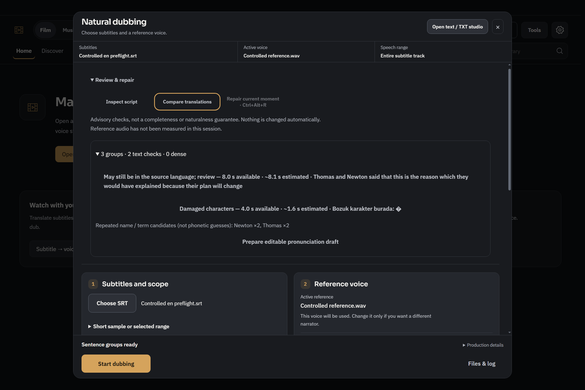
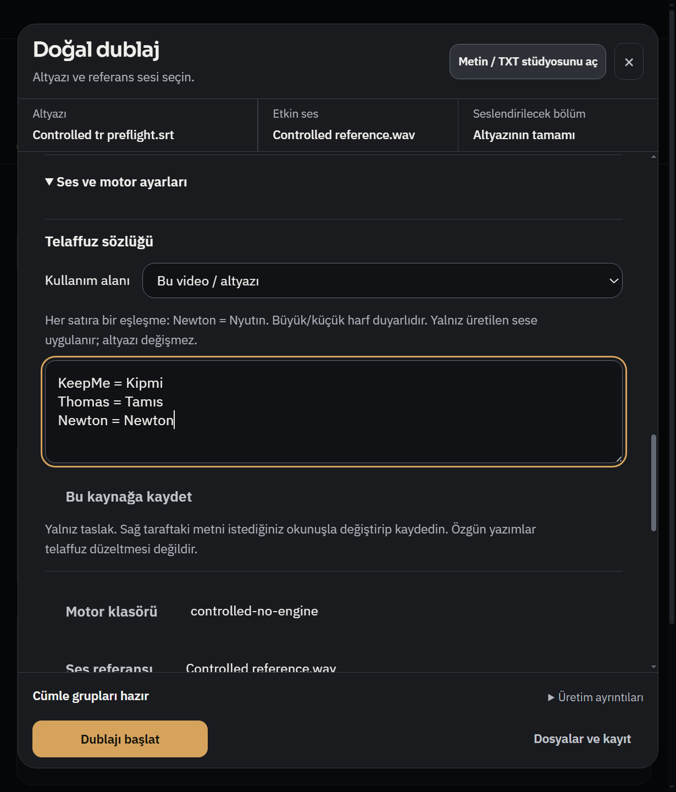
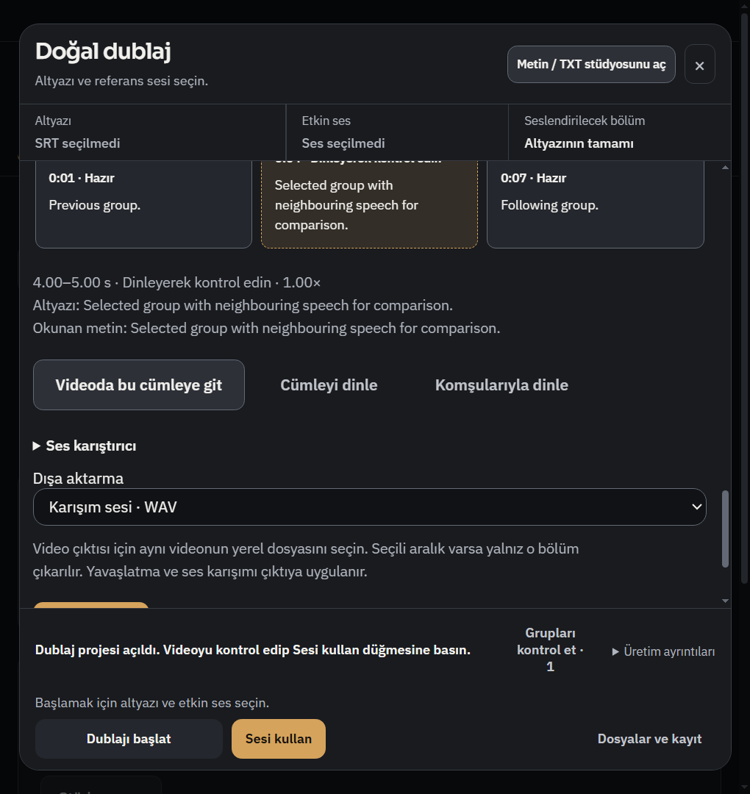
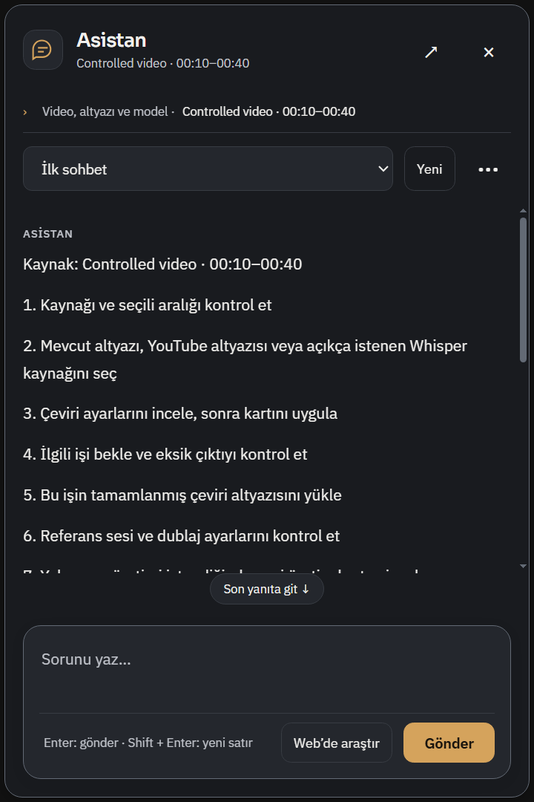
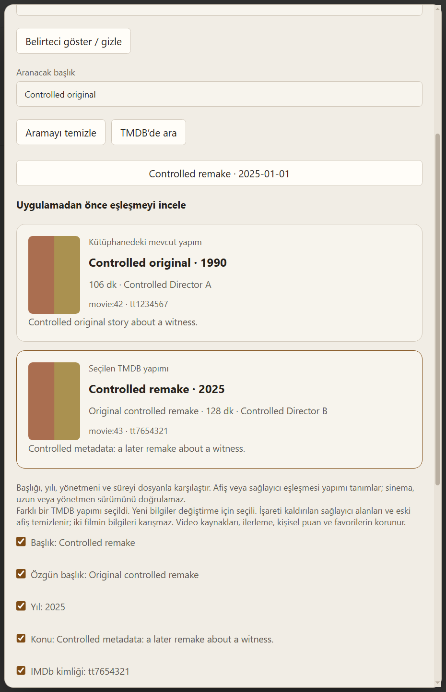
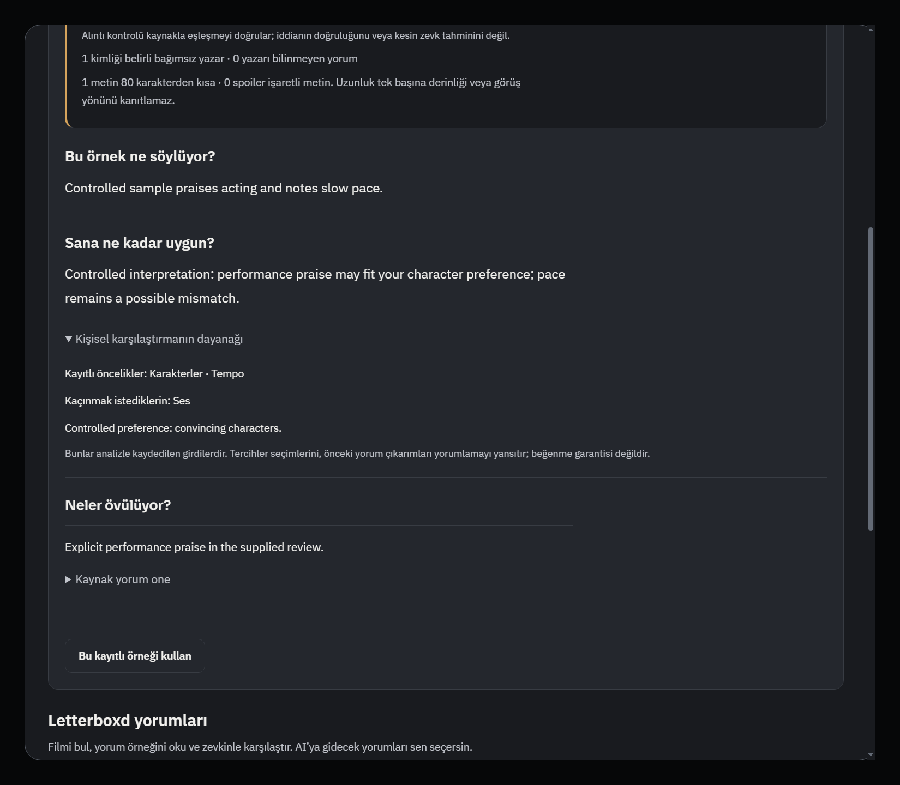

# R829 — Dublaj, ses çevirisi, asistan ve film karar kanıtı

Repo https://github.com/dorukakindev/whisper-browser; dal `codex/dub-assistant-quality829`. Başlangıç `d78242ead655c3257b2139d3b5690d7d15c63e26`; ürün **`ba04414f9289e6e61a51070bcf15e8e693e64b6c`**. Kullanıcının onayladığı30hedefin tamamı [nihai tabloda](quality829/PLAN.md) tek tek işlendi:19 hedefte değişiklik, 6 mevcut korumanın doğrulanması, 1 mevcut toplu ayar akışında açıklama ve 4 kabul alanı. Bu sayı yeni bug sayısı değildir.

## Kullanımda değişenler

- **Dublajı başlatmadan metni denetle:** SRT seçildikten sonra İnceleme ve onarım → Metni denetle görünür. Boş manuel edit, bozuk karakter/hata işareti ve yeterince belirgin İngilizce kalıntısı birer inceleme ipucudur; kesin anlam veya eksiksizlik hükmü verilmez. İşaretli grup doğrudan editöre açılır. İlk20uyarı gösterilir, tüm gruplar editörde kalır. Kaynak değişince eski rapor ve gecikmiş callback etkisizdir.
- **Telaffuz taslağı:** Tekrarlanan ad/terim adaylarını mevcut sözlüğe taslak olarak ekleyebilirsin. Önceki taslak ve scope korunur; uygulama okunuş uydurmaz. Sağ tarafı düzenleyip açık Kaydet eylemi gerekir. Altyazı dosyası değişmez.
- **Ses:** Seviye/tempo karşılaştırması sahneler arasında karışmaz; uzun boşluk veya açık konuşmacı değişimi komşuluğu sıfırlar. Unicode üç nokta/tırnak durağı iyileşti. Referans stereo kanalında clipping/mono faz iptali görünür. Seçili grupta Komşularıyla dinle tam WAV'dan en fazla±1,25sn ekler. Native playback eski pause olayının yeni aralığı durdurduğu gerçek yarışı gösterdi; düzeltildi.
- **Ses için çeviri:** İngilizce birden çok kişi gönderimi bağımsız rol incelemesine girer. Ayrı paketler arasındaki özgün sahne bağlamı korunur; draft/özet kaynak gerçekliği diye kullanılmaz. `speech-v18-pronoun-context-review` eski sonuçların yeni incelemeyi atlamasını önler. İlk yeni üretim ek istek/cache miss yapabilir; normal çeviri modu aynı kalır.
- **Asistan:** Salt-okunur kaynak/aralık bağlı çok adımlı plan, açık kaynak seçimi, ayarların gerçek önce/sonra etkisi, başka sayfadan özgün iş kaynağı ve araştırma kanıtı ayrımı. Planlar iş başlatmaz. Tam belirsiz “bunu çevir” çok kaynaklı videoda sessizce Whisper/sayfa/altyazı seçemez. Sağlayıcı sentezi boş pasaj yüzünden kaybolmaz; kanıtsız araştırma tamamlandı olamaz. Mevcut onay/iptal/source/ledger sınırları korunur.
- **Film:** Konu metni artık analiz bağlamına ayrı metadata olarak girer; yorum kanıtı sayılmaz. Kişisel uygunlukla birlikte analiz anındaki zevk dayanakları açılabilir. Spoiler-first kopya temiz yorumu bastıramaz. TMDB yeniden eşleştirmede mevcut/seçili afiş ve ayrıntılar karşılaştırılır; kurgu sürümü ile yapım kimliği ayrımı açık kalır.

## Kanıtlar ve sınırlar

Parent birleşik kısa Node koşumu **84geçti/0hata**, process exit0; ek çeviri/browser/film hedefli koşumu exit0. Agent alanları:asistan94,film57(final bağlam38); bunlar örtüşür, toplanıp benzersiz test sayısı diye sunulmaz. Parent Python7komut **102test/0hata** (6+5+14+33+3+24+17).28sözdizimi kontrolü/0hata; scoped diffcheck geçti. [Python](quality829/parent-python.json), [syntax](quality829/syntax.json), her alanın tekrar komutları ve sonuçları alt raporlarda.

Gerçek Windows native profillerinde plan/kart, ön denetim/taslak, komşu ses ve film eşleşme/karar ekranları çalıştı. Save öncesi0mutasyon; açık Save1; yanlış sahip/SRT ve gecikmiş plan reddi doğrulandı. Dar/highDPI görünüm, Tab/Space/Escape/odak/containment ve footer erişimi seçili akışlarda geçti. Bunlar tüm DPI/ekran okuyucu/tüm sayfalar için garanti değildir.

**Gerçek ses/model kabulü:** aynı kontrollü Türkçe cümle için satır2grup ve akıcı1grup GPU A/B; iki nihai14snWAV finite/clipping0/bütünlükgeçti. A soğuk36,921sn, B sıcak9,672sn: kontrollü hız kıyası değildir. ASR eşleşmeleri0,8571/1,0 doğallık puanı değildir; insan kazananı yok. Ayrı yeni public “Me at the zoo”13sn aralıkta Whisper tinyCPU +DeepSeek standard3istek+VoxCPM2GPU çalıştı:çeviri1/1,1hazırgrup,13sn48kHzWAV,kırpılma0; doğru aralık/attach/pause geçti. **Home/dönüş**, ayrı gerçek native scheduler ve kontrollü ertelenen sağlayıcıyla geçti; bu iki koşum tek canlı YouTube uzun soak gibi sunulmaz. [Sanitize edilmiş canlı sonuç](quality829/live-summary.json), [Home kabulü](quality829/home-continuity.json), [ayrıntı ve yerel A/B yolları](quality829/live.md).

Ücretli çağrı iki subagent denemesinde güvenilir kullanıcı izin kanıtı yok diye çalıştırılmadan reddedildi; orijinal kullanıcı iznini doğrudan gören ana ajan aynı yetkili/bütçesi sınırlı harness'i normal onay incelemesinden geçirerek başarıyla çalıştırdı. Engel kalmadı; reddedilen denemeler API çağrısı yapmadı. Anahtarlar yalnız broker belleğinde; ham profil/credential/private acceptance dosyaları Git'te yok.

## Görüntülü kullanım kanıtı

Ön denetim; EN1440, gerçek Windows font/DPI. Bozuk karakter kontrollü fixture'ın kasıtlı girdisidir.

TR820CSSviewport125%; sözlük taslağı önceki satırları korur. Bu kullanıcı girdileri kontrollüdür.

Komşu dinleme; TR680. Dosya açılması/oynatım/native Tab/Space/Escape ayrıca ölçüldü.

Asistan480TR; görünen plan native contract fixture'ıdır, canlı modelin plan uyumu iddia edilmez.

Film yeniden eşleme620light; iki geometrik afiş kontrollü fixture, aynı gerçek film afişi değildir.

Kaydedilmiş kişisel karşılaştırmanın dayanağı; örnek analiz metni kontrollüdür.

## Kod, araştırma ve teslim

40kaynak/test dosyasının tam listesi [burada](quality829/code-files.json); ses[raporu](quality829/audio.md),çeviri[raporu](quality829/speech.md),asistan[raporu](quality829/assistant.md),film[raporu](quality829/media.md),komşu[raporu](quality829/neighbour-preview.md),ön denetim[raporu](quality829/preflight-native.md). Ham tmp yolları yerel kanıt konumudur; kalıcı seçili PNG/JSON bu klasördedir.

Mevcut motorun/resmi [OpenBMB/VoxCPM](https://github.com/OpenBMB/VoxCPM) referans+doğru döküm yaklaşımı korundu. [Jellyfin metadata](https://jellyfin.org/docs/general/server/metadata/) yapım/sürüm ayrımı ve [TMDB görsel](https://developer.themoviedb.org/docs/image-basics) sözleşmesi incelenerek mevcut güvenli loader kullanıldı. [Electron dar contextIsolation köprüsü](https://www.electronjs.org/docs/latest/tutorial/context-isolation) korundu. Harici kod/SDK/paket/font/kullanıcı hesabı eklenmedi; yerel LLM/müzik analizi kapsamı açılmadı. Frontend Design Premium/upstream+Impeccable mevcut tema içinde kullanıldı; yardımcılar gpt-6.1-sol medium. Ana ajan kodu/seçili gerçekPNG'leri ayrıca inceledi.

Tam npm/uzunCI sonucu,kişisel start.bat yeniden açılışı,tüm siteler/DRM,gerçek kişisel referans/müzik,uzun video/GPUsoak ve insan doğallık tercihi bu turun başarı iddiası değildir. Kaynak/anlam incelemesi hâlâ model tabanlıdır; kusursuz çeviri garantisi verilmez. CI kapatılmadı/beklenmez. Sürekli yetkiyle normalPR→master→ana kopya ff güncellemesi; kişisel OFFLINE/INDEX/start.sh/untracked korunur; açık kişisel uygulama kapatılmaz.
