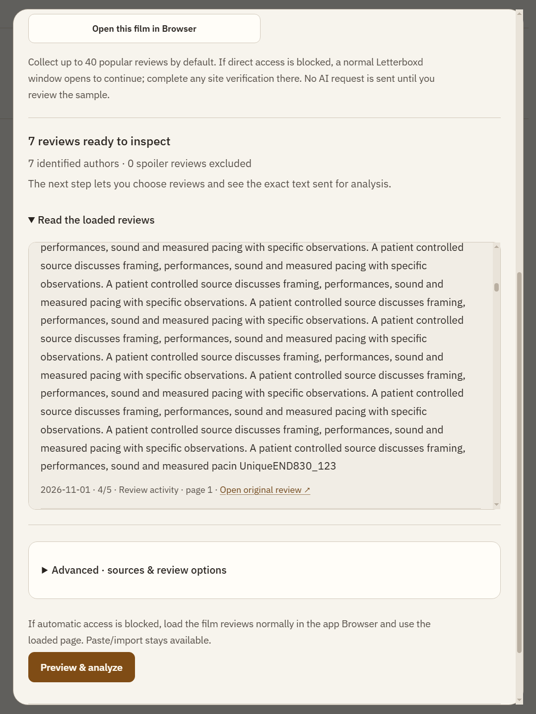
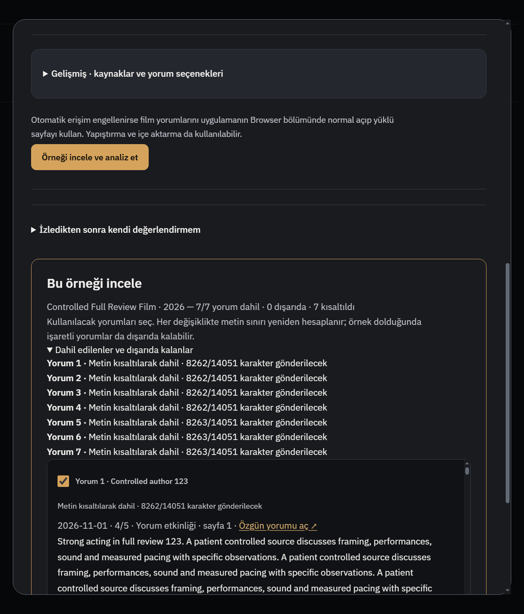

# R831 — Letterboxd More: tam yorum ve DeepInfra e-postası

Başlangıç master `6d4c2d661257263f0f9414b2bdf8ba53f84513c9`; ürün `5ca05b8dfc89a07b2fcda3483400b5da12972c66`; dal `codex/letterboxd-full830`. Kişisel kullanıcı dosyaları değiştirilmedi. Tam kaynak metniyle AI'ye seçilip gönderilen örnek farklı aşamalardır.

## Doğrulanan hata ve düzeltme

Gerçek Before Sunrise popüler yorumlar sayfa2 HTML'sinde `collapsed-text`, `data-js-trigger="collapsible.expand"` More bağlantısı ve `/s/full-text/viewing:ID/` vardı. Önceki kod görünen teaser'ı yorum sayıyor, More'un devamını istemiyordu. Ayrıca parser/renderer normalizasyonu kaynak yorumunu4000karakterde kesiyordu. Bu iki neden doğrulandı.

- `letterboxd-reviews.js`: yalnız tam eşleşen HTTPS Letterboxd full-text/viewing sayısal uç noktası; en fazla2eşzamanlı ve50sınırlı devam. Script/style/template/comment içerikleri istek kaynağı olamaz; fragment çalıştırılmaz, metne çevrilip escape edilerek yalnız kendi yorum gövdesine yerleştirilir. Görünen başlangıçla eşleşmeyen cevap/boş cevap/challenge/yanlışköken/yönlendirme kabul edilmez. Genel İngilizce more sözcüğü silinmez.
- `letterboxd-auto.js`, `letterboxd-browser-reader.js`: doğrudanHTTP ve normal sandbox BrowserWindow yolları devamı okur. Otomatik eşleştirmenin metadata-only film açılışında gereksiz tekrar istekleri yapılmaz; yorum listesinde devam yüklenir. Açık Browser film sayfasından elle okuma ve public fetch yolu da tam metni alır.
- `media-tools-service.js`, main'deki yalnız adapter satırı: açık Browser'dan okuma artık süre sınırlı/iptal edilebilir iş; kaynak film asenkron işlemden sonra yeniden doğrulanır. Eski id'siz API çağrıları sunucu kimliğiyle uyumludur. Kullanıcının Durdur'u devam yüklemesini de iptal eder.
- `media-tools-model.js`: tam kaynak/normalizasyon üst sınırı20000karakter; daha büyük doğrudan içe aktarma sessiz kırpılmaz, açık hata verir. Kaynak parser sınırı aşan veya tamamı alınamayan yorumu tam yorum diye analize sokmaz; `incomplete` sayısıyla dışlar. Aggregate120000 editör/64000 analiz sözleşmesi korunur. Çok uzun çok yorum AI örnek bütçesine sığmazsa mevcut önizleme kaç karakterin gönderileceğini ve kısaltılmayı açıkça gösterir; tam kaynak metni okuma alanında korunur.
- `review-decision-ui.js`: tamamı alınamayan yorum gerekçesi ve kısmi sonuç EN/TR. Kaynak More arayüzü yorumun kendi metni sayılmaz. Mevcut tema/disclosure/klavye korunur; yeni stil veya paket eklenmedi.

Başarısız tam metin sessizce kısa teaser'a çevrilmez. Spoiler/kimlik/author/permalink/tarih/puan ve örneklem sırası korunur. Film değişimi, iptal ve geç gelen callback kaynak korumaları vardır. Gelen sayfa formatı yine değişebilir; tüm yorumların sonsuz büyüklükte okunacağı iddia edilmez. Yeni çekim yapılmalı; eskiden kaydedilmiş kısa örnekler kendiliğinden yeniden indirilmez.

## Kabul ve görüntüler

[Hedefli9testdosyası](letterboxd831/targeted.log): **131geçti/0hata**, gerçek process exit0.10JSsözdizimi ve diffcheck0. Yeni regresyonlar:4000sonrası kuyruk, tam parser→normalizasyon→analiz taşıması/snapshot, yanlış uç nokta/prefix/challenge/sınır, iptal, eşzamanlı ters tamamlanmanın sırası, normal more kelimesi, açık browser işstop/stalefilm. Eski keşif bridge testinin resolver sayısı yeni gerekli son-kimlik kontrolü nedeniyle1→2oldu; diğer güvenlik assertionları korundu. İlk testteki yeni syntax hatası ve genişleyen tanı alanı uyumsuzluğu teslimden önce giderildi; tanı sözleşmesi eski dar alanlarda tutuldu.

[Native Windows](letterboxd831/native.md): ayrı fixture profili, gerçek ana renderer/IPC/sandbox BrowserWindow ve aynı full-text fetch scripti.7yorumun her biri **14051karakter**, uç marker ve tam metin kaynak editor/okuyucuda korundu;7devamisteği,1bilinçliHTTP403fallback, kişiseloturum/ücretliAPI yok. Kaynak toplamı120kaltında; önizlemede7/7kısaltma ve gönderilen/orijinal oranı açık, bağlam64kaltında. EN720light/TR820dark, Enter, taşma ve kaynak sonuna gerçek kaydırma kabulü. Ana ajan iki PNG'yi ayrıca inceledi.

**Gerçek site:** [sayfa](https://letterboxd.com/film/before-sunrise/reviews/by/activity/page/2/) üzerindeki iki gerçek yorum462→1409ve436→678karaktere tamamlandı;12kaynak satırı korundu, kalan collapsed/reveal işareti0, kendi full-text endpoint200. [Yalnız sayısal kanıt](letterboxd831/live.json). Ham yorumlar/profil/cookie Git'e konmadı. Önceki üçüncü taraf reklam alt kaynakları açık deneme45snzaman aşımına uğradı; son izole probe yalnız kendi oturumunda üçüncü taraf reklam kaynaklarını durdurdu. Letterboxd/normalCloudflare kaynakları açık kaldı; doğrulama atlatılmadı. Bu tek sayfa başarısı her site/tümhesaplar veya sonrakihız garantisi değildir.

## DeepInfra e-postası

Kullanıcının verdiği metin hoş geldin/kullanım önerileri dizisi; tek başına API hata bildirimi değil. Tam gönderim tetikleyicisi ve e-postanın teknik gerçekliği başlıklar/hesap verisi okunmadan iddia edilmez. [Salt-okunur kod/resmî belge incelemesi](letterboxd831/deepinfra.md): `/v1/openai` baseURL, `deepseek-ai/DeepSeek-V4.1-Flash-1017` model adı ve asistanın SSE tüketimi uyumlu. [1017resmîAPI](https://deepinfra.com/deepseek-ai/DeepSeek-V4.1-Flash-1017/api) ile [unsuffixedresmîAPI](https://deepinfra.com/deepseek-ai/DeepSeek-V4.1-Flash/api) ayrı mevcut; maildeki örnek modeli değiştirme gerekçesi değildir. [Prompt caching](https://docs.deepinfra.com/chat/prompt-caching) otomatik desteklenir; buradan ek ücretli retention ayarı eklenmedi. Erken değişen kaynak manifestinin cacheprefixe etkisi ölçülebilecek fırsattır, fatura/bağlantı bugı diye sunulmadı. Hiçbir anahtar, kişisel ayar veya e-posta hesabı okunmadı; model/flex varsayılanları değişmedi.

Yeni bağımlılık/lisans ithali, kurulum, font, hesap yok. Mevcut dar köprü ve örneklem bütçesi korundu. gpt-6.1-sol medium yardımcıları yalnız salt-okunur API incelemesi ve bağımsız native testte kullanıldı. Tam npm/uzunCI sonucu/kişiselstart.bat yeniden açılışı/canlıAIanalizkalitesi/uzunsoak bu turun iddiası değil. CIaçık/arkada; sürekli yetkiylePR→master→D:\Whisper Local ff; kişiselOFFLINE/INDEX516/start.sh/430untracked korunur, kişisel uygulama kapatılmaz.

Entegrasyon notu: Çalışma sırasında bağımsız salt-okunur R830 raporu `34b5747b5181db819443cf708185b5eebce754f9` ile master'a alındı. Özgün raporu korumak için bu teslim R831 olarak numaralandırıldı. İki değişiklik kümesi ürün kodunda çakışmıyor; test/probe dosyalarının830kimliği tarihsel kalır.
