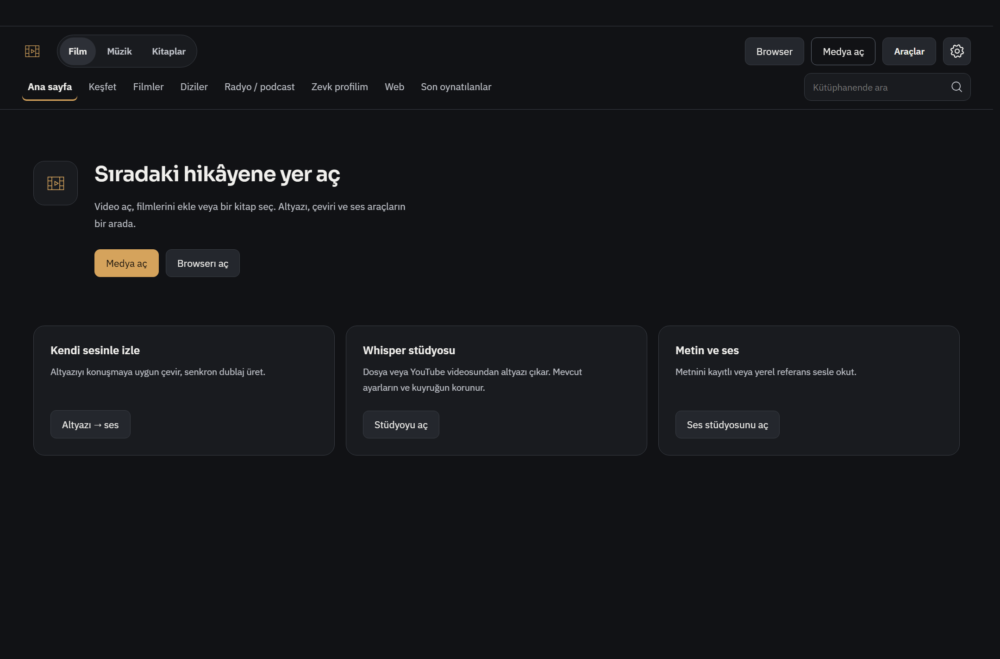
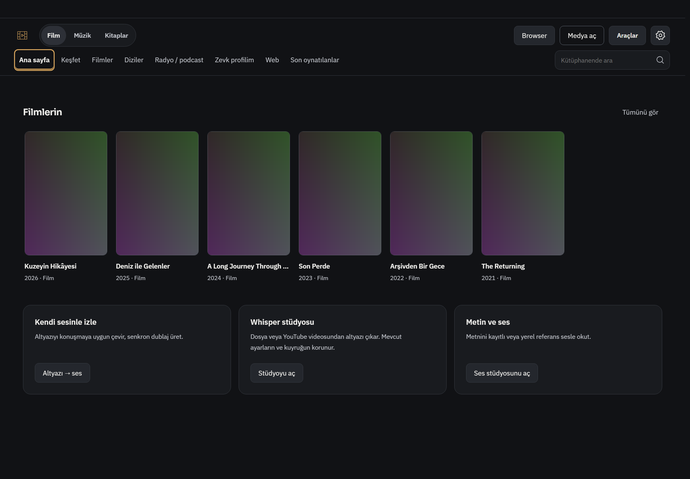
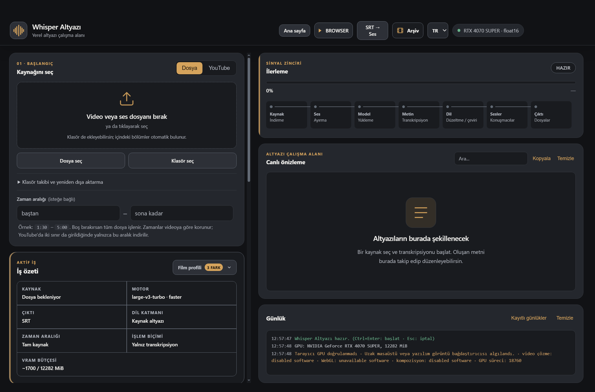
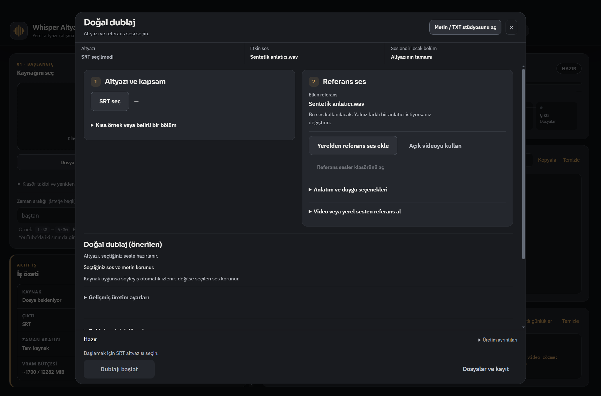
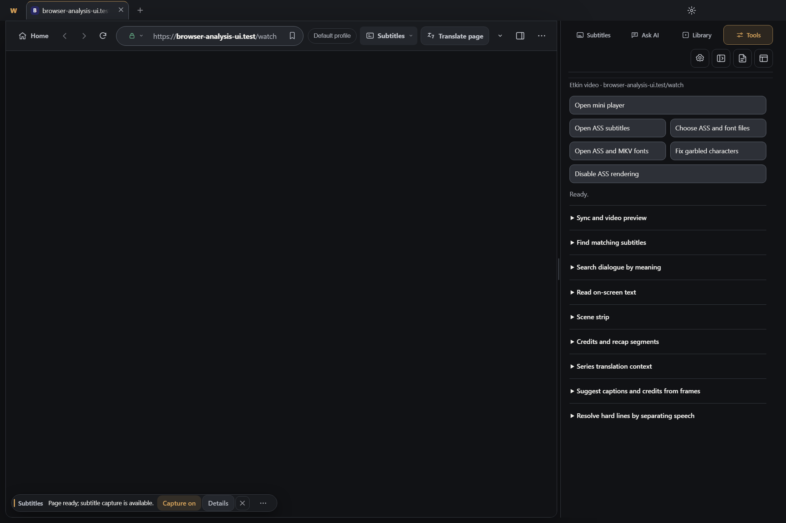
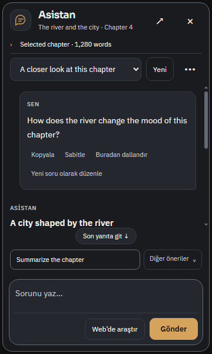
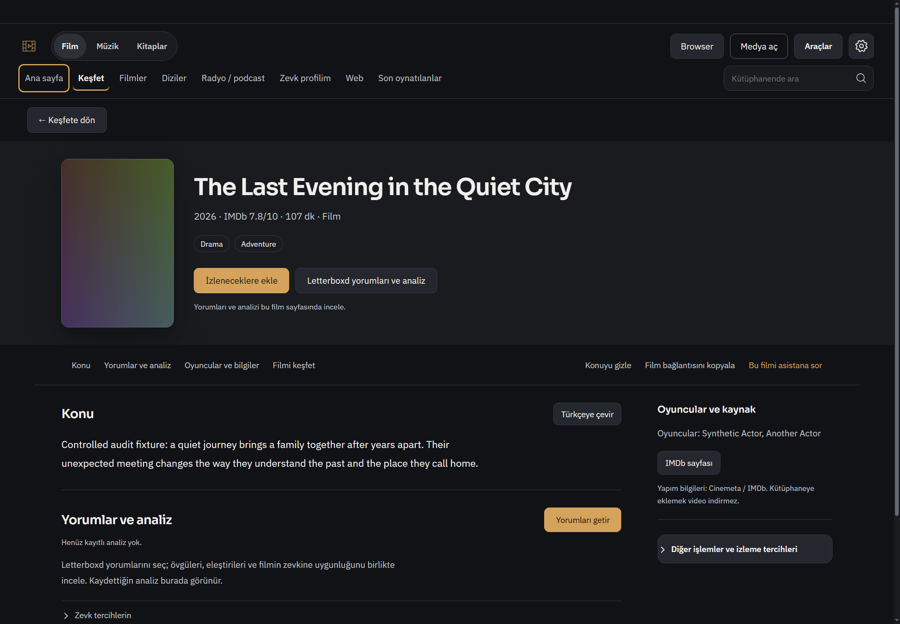
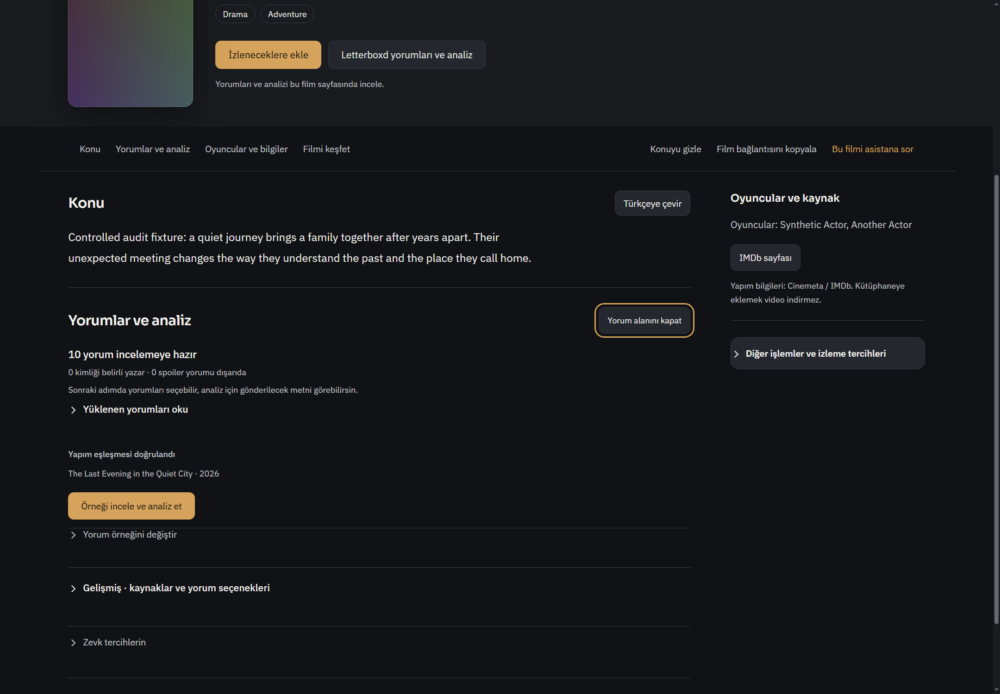
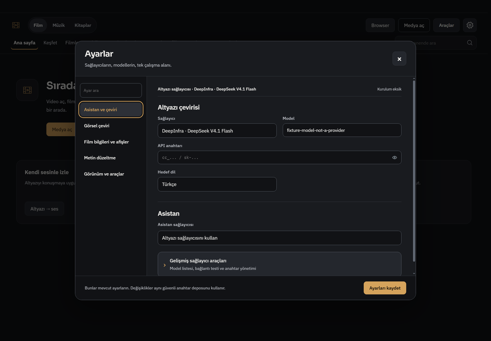
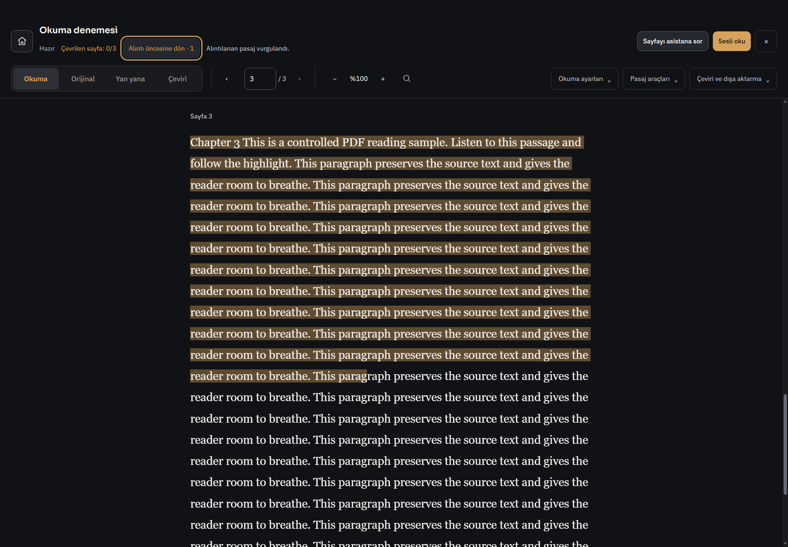

# R834 — Görsel tasarım eleştirisi ve yeniden tasarım yönü

1 Kasım 2026. İncelenen HEAD: `8892c44b4e647e839b38eeb3ad99114901b036b3`. **Yalnız rapor: ürün kodu, tema, ayarlar veya testler değiştirilmedi.** Bu belge 20 tasarım kararı önerir; 20 yeni doğrulanmış yazılım bugı iddia etmez. Değerlendirme tasarım yargısıdır; kullanıcı araştırmasıyla ölçülmüş memnuniyet sonucu değildir.

## Açık değerlendirmem

Uygulamanın zayıf tarafı renk seçimi değil, ekranlar arasındaki tasarım disiplini. Grafit/amber paleti, okunabilir temel metin ve yer yer iyi içerik düzeni var. Fakat ana sayfadan stüdyoya, oradan dublaja geçtiğimde aynı ürünün farklı görevlerine geçtiğim hissi zayıflıyor. Her bölüm kendi başlığını, düğme yoğunluğunu, kart biçimini ve gezinmesini yeniden kuruyor. Bu da güçlü bir uygulamanın üzerine zaman içinde araçlar eklenmiş hissini veriyor.

En çok yeniden tasarlayacağım üç alan **ortak uygulama kabuğu, Whisper stüdyosu ve dublaj çalışma alanı**. Asistanı ciddi biçimde sadeleştiririm. Film sayfası, ayarlar ve okuyucuda mevcut iyi temeli koruyup içerik önceliğini güçlendiririm. Yeni gradient, cam efekt, dev afiş veya yeni font eklemek öncelikli çözüm değil.

Hedeflediğim görünüm: **sakin bir video ve dil çalışma istasyonu**. Medya veya metin ekranın ana nesnesi; araçlar onun etrafında, görev gerektiğinde görünür. Amber bir sonraki anlamlı eylemi gösterir. İçerik alanı ferah; ayar ve araç satırları ölçülü biçimde yoğun olur. Kullanıcı her ekranda başka bir kontrol düzeni öğrenmez.

## Kapsam ve kanıtın sınırı

Bu turda güncel Windows Electron render'ları alındı ve aşağıdaki 14 görüntü tek tek açılarak incelendi. Eski rapor görüntüleri bugünkü ekran diye kullanılmadı. Ana sayfa/kütüphane, stüdyo, dublaj, browser araçları, asistan, film/yorumlar, ayarlar ve PDF okuma olmak üzere sekiz yüzey ele alındı. Koyu/geniş ağırlıklı incelemeye dar stüdyo, dar dublaj, 360×600 asistan, dar ayarlar ve açık temalı dar ana ekran dahil.

Veriler kontrollü: afişler test görseli, film ve kitap metinleri sentetik, asistan yanıtı fixture, film yorumları kontrollü kaynak yanıtı, yayımlanan dublaj sesi adı sentetik. Bunların güzelliği, gerçek film kataloğu veya model kalitesi değerlendirilmedi. Ekran görüntüsünün piksel boyutu CSS pencere boyutu değildir; Windows ölçeklemesi hesaba katılmalıdır. Örneğin 1440 CSS genişlikte bazı yakalamalar 2160 fiziksel pikseldir.

Browser ana pencere yakalamasında native video yüzeyi görünmez. Siyah/boş görünen büyük alanı video kaybı veya tasarım kusuru saymıyorum. Odak halkaları bazı otomasyon adımlarından kalır: amber dış çizgiyi ikinci seçili sekme veya kaldırılması gereken süs saymıyorum. İngilizce sentetik başlık/yanıt/kaynak metni Türkçe arayüzde görülebilir; bu, arayüzün çeviri bugı değildir.

R824–R828'in eski sorunları, R832'nin tam yorum düzeltmeleri ve R833'ün işlevsel bugları yeni sayılmadı. Bu rapor önceki tasarım yönlerinin **güncel görüntüler üzerinden daha kapsamlı eleştirisi**; geçmiş önerilerin tümünden bağımsız 20 yeni keşif değildir. R825'teki kısa asistan alanı ve R828'deki panel hiyerarşisiyle örtüşen öneriler aşağıda belirtilir. Night1000 kapsam kaydı incelendi; geçmiş 1000 senaryo tekrar çalıştırılmadı veya yeni test sayısı yapılmadı.

## Öncelik ve müdahale ölçeği

| Sıra | Yüzey | Kararım | Beklenen kazanç |
|---|---|---|---|
| 1 | Ortak kabuk ve gezinme | Yapısal yeniden tasarım | Aynı ürün hissi; daha az yön seçme yükü |
| 2 | Whisper stüdyosu | Yapısal yeniden tasarım | Başlangıçta kaynak ve sonuç hedefi; çalışırken çıktı önceliği |
| 3 | Dublaj | Ayrı çalışma alanı olarak yeniden tasarım | Modal içinde uzun form yerine tutarlı hazırlık/inceleme |
| 4 | Asistan | Alan bütçesi ve mesaj işlemlerini yeniden düzenleme | Cevap daha erken görünür, daha az kontrol kalabalığı |
| 5 | Browser araçları | Göreve göre gruplama | Dokuz teknik başlık arasından arama yükünün azalması |
| 6 | Film ve yorumlar | Hedefli sadeleştirme | Film içeriği ve yorumların daha hızlı okunması |
| 7 | Ayarlar | Hedefli sadeleştirme | Kurulum durumunu ve değişikliğin etkisini anlamak |
| 8 | Okuyucu | İsteğe bağlı odak görünümü | Uzun okumada arayüzün geri çekilmesi |

Bu sıralama geliştirme önceliğidir; güvenlik veya veri kaybı önem derecesi değildir.

## 1. Ana ekran ve ortak kabuk — çalışıyor, fakat ürün kimliği parçalı

**T01 — Gezinme düzenini tek bir görev haritasına oturt. Öncelik A.** Üstte Film/Müzik/Kitaplar; ikinci satırda Ana sayfa/Keşfet/Filmler/Diziler/Radyo-podcast/Zevk profilim/Web/Son oynatılanlar; sağda Browser/Medya aç/Araçlar var. İçerik türleri, kullanım yerleri ve eylemler farklı düzeylerde üst üste geliyor. Browser ile Web'in görsel olarak neden ayrı yerlerde olduğu da ilk bakışta açıklanmıyor. Önerim: sabit bir uygulama gezinmesiyle Ana sayfa, Kütüphane, Keşfet, Tarayıcı ve Stüdyo görevlerini ayırmak; film/kitap türlerini ilgili içerik alanının filtresi yapmak. Bu öneri bilgi mimarisi hipotezidir, henüz kullanıcı testiyle doğrulanmış değil. Dar pencerede tek açılan gezinme; video/okuma odağında kapanabilir kompakt biçim. Özellikleri silme veya müzik analizi kapsamını büyütme önerisi değildir.

**Kabul:** ana ekran→film→tarayıcı→stüdyo geçişinde aynı uygulama yön bulma noktası korunmalı. 900×750 ve 125% ölçekte menü isimlerini satır satır ezmeden çalışmalı. Uzman kullanıcının mevcut kısayolları ve dönüş bağlamı korunmalı.

**T02 — Ana ekranı sürekli özellik tanıtımından görev başlangıcına geçir. Öncelik B.** Boş ekrandaki tek Medya aç eylemi iyi. Fakat üç büyük açıklama kartı hem boş hem dolu kütüphanede kalıyor; üstteki Araçlar da aynı alanlara giriş sağlıyor. Dolu kütüphanede bu kartlar içerik rafının altında geniş yer tutuyor. İlk kullanımda kısa görev açıklamaları; daha sonra kompakt görev kısayolları kullanırım. Devam edilecek gerçek bir medya varsa onun mevcut devam bilgisini öne alırım; olmayan ilerleme veya içerik uydurmam.

**Kabul:** yeni kullanıcı için dosya açma açık kalmalı; dolu profilde tanıtım metni kütüphane içeriğinin önüne geçmemeli. Kartları küçültmek, görevleri belirsiz ikonlara saklamak anlamına gelmemeli.

**T03 — Aynı kavramın farklı ekranlardaki adını ve görünüşünü birleştir. Öncelik B.** Ana ekranda Browser, stüdyoda BROWSER, bir başka girişte Web; dublaj için Altyazı → ses, SRT → Ses ve Doğal dublaj ifadeleri var. Bir kısmı farklı kapsamları anlatabilir; fakat bu fark görsel olarak açıklanmıyor. Türkçe arayüzde ana görev adları Tarayıcı, Altyazı stüdyosu, Dublaj gibi sabit olsun; SRT dosya biçimi seçim etiketinde kalsın. Aynı görev başlığı aynı bileşenle ve aynı harf düzeniyle gösterilsin. Kaynak başlıkları veya kullanıcı metni çevrilmesin.

[Dar/açık tema karşılığı](design834/03-home-narrow-light.png). Afişlerdeki düz renkler test fixture'ıdır; bozuk gerçek afiş iddiası değildir. Yatay rafın bir sonraki afişi kısmen göstermesi de tek başına taşma bugı değildir.

## 2. Whisper stüdyosu — en fazla görsel yeniden tasarım isteyen ekran

**T04 — Boş, hazırlanan ve çalışan iş için farklı içerik önceliği kur. Öncelik A.** Dosya seçilmemişken sağ tarafta yedi aşamalı ilerleme, büyük boş önizleme ve günlük; solda kaynak, iş özeti ve aşağıya devam eden ayarlar var. İş henüz yokken çıktı alanları ekranın büyük bölümünü kullanıyor. Başlangıç düzeni kaynak→çıktı dili/biçimi→profil özeti→başlat olsun. İş başlayınca aynı alan, ilerleme ve canlı altyazıya yer açsın. Geçiş sırasında kullanıcı alanları beklenmedik biçimde zıplamasın, klavye odağı taşınmasın.

**Kabul:** yeni kullanıcı kaynak seçtikten sonra işin ne üreteceğini ve başlatma eylemini birlikte görebilmeli. Aktif iş sırasında mevcut kuyruk, iptal ve çıktı erişimi korunmalı; yalnız boş durumun alan bütçesi değişmeli.

**T05 — Kart, iç kart, çerçeve ve amber şerit katmanlarını azalt. Öncelik A.** Büyük gri kartlar, içte koyu kutular, kesikli yükleme alanı, tablo hücre çizgileri ve amber yan şeritler aynı anda görünür. Teknik güç hissi yerine bütün panellerin dikkat istediği bir kontrol masası oluşuyor. Ana bölümleri boşluk ve tek bölüm ayıracıyla ayırırım; çerçeveyi giriş, seçilebilir nesne ve gerçekten bağımsız yüzeylere saklarım. R828 bazı alanlarda bunu yaptı; stüdyo hâlâ daha eski yoğun görsel dili taşıyor.

**Kabul:** ilk bakışta kaynak ve ana işlem belirgin olmalı. Çerçeveler azaldığında form etiketleri, bölümlerin sınırı ve klavye odağı kaybolmamalı.

**T06 — İlerlemeyi tek anlamlı durumdan başlayarak aç. Öncelik B.** Kaynak/Ses/Model/Metin/Dil/Sesler/Çıktı kutuları iş yokken de tam görünür. Kullanıcı için öncelikli bilgi “şimdi ne oluyor, ne kadar kaldı, durdurabilir miyim?” olmalı. Tek durum satırı ve ilerleme çubuğu; ayrıntıda mevcut aşamalar. Süre bilinmiyorsa kesin tahmin uydurulmasın. Günlük, hata veya kullanıcı açması halinde genişlesin; tanı ayrıntıları korunmalı.

**Kabul:** bekleme, indirme, üretim, iptal ve başarısızlık birbirinden açıkça ayrılmalı. Günlüğü gizlemek hata bilgisini gizlememeli. Görüntüdeki yazılımsal GPU tanısı bu testin `disable-gpu` kipinden kaynaklanır; yeni donanım bugı değildir.

**T07 — Dar stüdyo başlığını yeniden yerleştir. Öncelik A.** [900×750 yakalamada](design834/05-studio-narrow.png) Whisper Altyazı adı, Ana sayfa ve SRT→Ses düğmeleri çok satırlı hale geliyor; GPU/float16 rozeti hâlâ geniş yer tutuyor. Düğme metnini daha da küçültmem. Başlık ve uygulama dönüşü tek kısa satır; görev eylemleri ikinci kontrollü satır veya etiketli menü; donanım tanısı ayrıntıda olsun.

**Kabul:** desteklenen dar genişlikte görev adı ve ana gezinme okunabilir kalmalı; SRT→Ses üç satırlı dar sütuna dönüşmemeli. Bu görsel kırılma erişilemeyen düğme iddiası değildir.

## 3. Dublaj — uzun bir çalışma akışı için modal ölçeği zayıf

**T08 — Dublajı kalıcı çalışma alanı yap. Öncelik A.** Büyük modalın içinde başlık, özet şeridi, iki form kolonu, üretim seçenekleri, sonuçlar ve sabit alt alan var. Arka stüdyo da karartılarak görünmeye devam ediyor. Bu iş, kısa bir onay penceresinden uzun: kaynak, ses, üretim ve inceleme arasında tekrar tekrar gidiliyor. Kendi sayfası olan bir dublaj çalışma alanı öneriyorum; aynı kaynağa dönüş, devam eden iş ve taslak durumu korunmalı. Modal sadece referans seçme veya tek işlem onayı gibi kısa alt görevlerde kalsın.

**Kabul:** sayfadan ayrılmak işi silmemeli, otomatik üretim başlatmamalı veya mevcut mute/offset sahipliğini bozmamalı. R826/R829 süreklilik davranışları korunarak aynı görev yeniden açılabilmeli.

**T09 — İki eşit kolon yerine içerik yüküne göre yerleşim kur. Öncelik A.** Kaynak seçimi kısa bir kartken referans ses kartı uzun. Solda geniş boş alan oluşuyor, üretim seçenekleri iki kolonun en uzununun altına iniyor. [Dar yakalamada](design834/07-dub-narrow.png) bu fark daha belirgin. Kaynak ve kapsamı kompakt üst satır; etkin sesi kısa kimlik alanı; ses değiştirme/kütüphane işlemlerini isteğe bağlı ayrı bölme yaparım. R825/R828'in referans sadeleştirmesini geri almam; bu onun kalan alan dengesine ilişkin devam önerisidir.

**Kabul:** kısa kaynak bilgisi yüzünden yarım ekran boş kalmamalı. Okuma ve Tab sırası kaynak→ses→üretim olarak korunmalı; CSS ile yalnız görüntü sırası değiştirilmemeli.

**T10 — Özeti çoğaltma, işi eksik adıma yönlendir. Öncelik B.** Ses adı üst özet şeridinde ve referans kartında tekrar ediyor; SRT seçilmedi bilgisi, karttaki çizgi ve alt açıklama aynı eksikliği tekrar ediyor. Alt alanda Hazır yazarken başlamak için SRT istenmesi teknik olarak motorun hazır olmasını anlatabilir; görev açısından daha net durum “Altyazı seçilmesini bekliyor” olur. Tek güçlü görev durumu ve eksik adımı açan eylem; diğer bilgiler düzenlenebilir özet olarak kalsın. Motor hazır/iş hazır ayrımı dilde açık olsun.

**Kabul:** seçilmemiş kaynak, üretime hazır, üretiyor ve çıktı incelemeye hazır durumları ayrı metin/eylem taşımalı. Pasif Başlat düğmesini çalışırmış gibi göstermek önerilmiyor.

## 4. Browser araçları — tema tutarlı, görev sırası hâlâ teknik

**T11 — Araç listesini kullanıcı amacıyla grupla. Öncelik A.** Mini oynatıcı, ASS aç/font seç, bozuk karakter, render kapat ve dokuz açılır grup aynı panelde. Kullanıcının “altyazı geriden geliyor” hedefi, uygulamanın teknik yetenek adları arasında çevrilmek zorunda kalıyor. Üç başlangıç grubu öneriyorum: Altyazıyı düzelt, Videodan bilgi al, Oynatma araçları. Mevcut gelişmiş araçlar altlarında kalsın; sık kullanılanlar sabitlenebilsin. R828'in dört etiketli sekmesi ve tek kaydırıcısı korunmalı.

**Kabul:** senkron düzeltme, altyazı bulma ve ekrandaki yazıyı okuma görevlerine açıklama okumadan ulaşılabilmeli. Bu hedef için görev denemesi gerekir; mevcut screenshot bunu doğrulamaz.

**T12 — Düğme ağırlıklarını görev önemine göre dağıt. Öncelik B.** Üstte tam genişlikte Mini player ve ASS rendering kapatma; ortada eşit büyüklükte dosya/font işlemleri var. Bu düzen her komutu benzer önemle sunuyor. Kaynak seçimi bir kontrol grubu; gelişmiş ASS/font işlemleri açılan alt bölüm; mini oynatıcı kompakt ikincil eylem olsun. Dosya seçme erişimini ve native seçici davranışını koru.

**Kabul:** panel açıkken birincil görev açık olmalı; bütün komutlar aynı büyük buton biçimine girmemeli. Geniş/dar panel ve native video üst üste binme ayrıca sınanmalı.

## 5. Asistan — cevap alanı hâlâ kontrollerden yeterince pay alamıyor

**T13 — Mesaj yönetimini mesajın önüne geçirme. Öncelik A.** Kısa bir sorunun altında Kopyala, Sabitle, Buradan dallandır ve Yeni soru olarak düzenle sürekli görünüyor. Soru kartının yüksekliği artıyor; bu karede cevap başlığı görülürken asıl paragraf aşağıda kalıyor. Kopyala ve etiketli Diğer işlemler yeterli; tam işlem listesi menüde, klavye ve dokunma erişimi korunarak açılmalı. Salt hover ile erişilen kontrol yapmam.

**T14 — Küçük panel için ayrı alan bütçesi tasarla. Öncelik A.** Başlık, kaynak satırı, sohbet seçimi, öneriler ve composer alt alta sabit alan kullanıyor. R825/R828 bunu iyileştirdi; düzeltilmiş kısa panel bugını yeniden saymıyorum. Buna rağmen güncel 360×600 konuşma görüntüsü hâlâ soruya ve kontrollere öncelik veriyor. Kaynak+sohbet kimliğini kompakt başlık; önerileri boş durumda veya çağrılınca görünür; boş composer'ı kısa, yazdıkça büyüyen biçim öneriyorum. Kullanıcının yukarı kaydırarak okumasını bozan otomatik son yanıta atlama yapılmamalı.

**Kabul:** aynı kısa soru ve cevap fixture'ında soru ile cevabın ilk anlamlı paragrafı birlikte okunabilmeli. Uzun taslak, uzun kanıt, iptal, hata ve araç onayı ayrıca korunmalı. Bu ekranın bugünkü kaydırması çalışıyor; iddiam erişim kaybı değil, kötü alan önceliği.

## 6. Film ve yorumlar — iyi temel, fazla katmanlı giriş

**T15 — Film içeriğine ulaşmadan geçilen yatay katmanları azalt. Öncelik B.** Genel iki satırlı gezinme, ayrı geri satırı, yüksek afiş/başlık alanı, film içi bağlantı şeridi ve ancak sonra konu geliyor. Geniş ekranda güzel bir başlık var; fakat günlük kullanımda başlığın etrafındaki katmanlar okuma başlangıcını aşağı itiyor. Geri eylemini başlığa alır, film içi gezinmeyi daha kısa tutar, sayfa kaydırıldığında başlığı kompakt görev satırına dönüştürürüm. Afişi veya film adını büyütmek için yeni sinematik hero eklemem.

**Kabul:** uzun film adı, afişsiz kayıt ve dar görünümde konu/yorum başlangıcı daha erken görünmeli; izleneceklere ekleme ve kaynak bağlantıları kaybolmamalı. R824'te düzeltilmiş dev afiş problemi yeniden bug diye sayılmıyor.

**T16 — Yorum hazır olduğunda önce küçük bir içerik örneği göster. Öncelik B.** On yorum hazır bilgisi, açıklamalar, yapım eşleşmesi ve analiz eylemi görünür; yorum metinleri “Yüklenen yorumları oku” içinde kapalı. Bir sonraki anlamlı karar için bir veya iki kısa kaynak alıntısı, yazar/kaynak ve açık Tamamını oku eylemi öneriyorum. Spoiler gizleme varsayılanı korunmalı; AI değerlendirmesi kaynak yorummuş gibi gösterilmemeli. R832'nin tam yorum/More desteği yerinde kalmalı.

**Kabul:** örnek hazır durumda kullanıcı en az bir yorumun içeriğini ayrı analiz başlatmadan görebilmeli. Alıntı kısaltması açık olmalı; tam kaynak erişimi ve kullanıcı seçimi korunmalı. Fixture'daki yazar sayısı gerçek Letterboxd doğrulaması değildir.

## 7. Ayarlar — kullanılabilir, fakat durum yerine form ağırlıklı

**T17 — Sağlayıcı formunun önüne kullanım sonucunu koy. Öncelik B.** Sağlayıcı/model/anahtar sırası artık düzgün; bunu yeniden bozmak istemem. Üst özet ise uzun sağlayıcı adı ve Kurulum eksik gibi genel bir durum taşıyor. “Altyazı çevirisi: anahtar gerekiyor” ve “Asistan: aynı sağlayıcıyı kullanıyor” gibi görev bazlı kısa durum; yalnız ilgili sorunu çözen eylem daha anlaşılır. Bağlantı testi gizli gelişmiş bilgi değil, kurulum eksik olduğunda görünür bir sonraki adım olabilir; ücretli istek otomatik gönderilmemeli.

**T18 — Dar pencerede açıklama maliyetini azalt. Öncelik B.** [Dar ayarlarda](design834/13-settings-narrow.png) başlık, arama/bölüm satırı, sağlayıcı özeti ve sabit alt açıklama form yüksekliğinden pay alıyor. “Değişiklikler aynı güvenli anahtar deposunu kullanır” teknik açıklamasını yardım ayrıntısına alır; alt alanda değişiklik durumu ve Kaydet bırakırım. Güvenlik davranışını değiştirmez; uygulama iç ayrıntısının sürekli görünmesini azaltır.

**Kabul:** 520 CSS genişlikte birincil sağlayıcı/model/anahtar alanları daha az kaydırmayla anlaşılmalı. Maskeleme, görünür alan etiketi, Kaydet erişimi ve odak geri dönüşü korunmalı. Görüntüdeki maske sentetik fixture anahtarına aittir; gerçek anahtar yayımlanmadı.

## 8. PDF okuyucu — korunacak iyi temel, isteğe bağlı daha sakin görünüm

**T19 — Uzun okuma için açıkça seçilen odak görünümü ekle. Öncelik B.** Serif gövde ve sınırlı satır genişliği iyi. Üstte belge/durum/alıntı dönüşü, dört görünüm modu, sayfa/zoom, üç araç menüsü ve ses/asistan eylemleri birlikte kalıyor. Okuma sırasında başlık+sayfa+tek araç açıcıya inen isteğe bağlı odak görünümü öneriyorum. Araçlar klavyeyle veya açık bir düğmeyle geri gelmeli; mouse hareketsizken kendiliğinden kaybolup kullanıcıyı şaşırtmamalı.

**Kabul:** kaynak/çeviri/yan yana kipleri, seçili pasaj ve alıntı dönüşü korunmalı; sesli okuma aktifken kontrol ve konum görünür kalmalı. Geniş highlight sentetik seçili pasajın sonucudur; yanlış alıntı bugı veya zorunlu tasarım kusuru sayılmadı. R828'in azaltılmış okuma padding'i korunur.

## Bütün ekranları bağlayan son karar

**T20 — Yeni bir tema yerine ortak bileşen ölçülerini gerçekten uygula. Öncelik A.** Ana ekranın kapsül kontrolleri, stüdyonun kalın panel/table yapısı, dublajın büyük modalı, asistanın konuşma kartı ve ayarların formu aynı renkleri kullansa da farklı yoğunluk ve köşe dillerine sahip. Tek görev başlığı, ana/ikincil/metin düğmesi, alan etiketi, açıklama, bölüm ayıracı, durum satırı, açılır grup ve boş durum ailesi tanımlanmalı. Bütün ekranlar aynı yerleşime zorlanmamalı: video, editör ve uzun metnin farklı ihtiyaçları var.

Başlangıç ölçü önerim: mevcut Plex gövde/Sora başlık/okuyucu serifini koru; normal gövde 14–16 CSS px, metadata 12–13, görev başlığı 20–24; normal kontroller 36–40, yoğun toolbar 30–32; ilişkili kontroller 8, grup içi 12–16, ana bölüm 24 px aralık. Bunlar önerilen prototip değerleri; ölçülmüş evrensel eşikler değil. Mevcut 6–8 px kontrol köşelerini temel al; sadece gerçek yüzen yüzeylerde daha büyük yarıçap. Büyük alanların her birine bağımsız gri kart yapma. İnce odak halkasını silme; seçim, odak ve işlem vurgusunu ayrı tut.

**Kabul:** ana sayfa, stüdyo, dublaj, browser, asistan ve okuyucudan altı ekran yan yana konduğunda aynı düğme ve başlık ailesi görülmeli. Açık/koyu tema, Türkçe uzun etiket, 125/150/200% ölçek, klavye odağı ve reduced-motion sonradan gerçek Windows'ta kontrol edilmeli. Bu tur bütün bu kabul matrisi çalıştırılmış değildir.

## Uygulama sırası ve yapılmaması gerekenler

İlk teslim ortak gezinme + stüdyonun boş/aktif düzeni + ortak kontrol ailesi olmalı (T01, T04–T07, T20). İkinci teslim dublajın kalıcı çalışma alanı ve asistan alan bütçesi (T08–T10, T13–T14). Üçüncü teslim browser görev grupları, film/ayar/okuyucu iyileştirmeleri. Her teslimde aynı veri ve viewport ile önce/sonra karşılaştırılmalı; “test geçti” görsel kabulün yerine geçmemeli.

Özellikleri silerek sade görünüm yaratma; gelişmiş ayarları erişilebilir ayrıntıya taşı. Her şeyi ikona çevirme. Focus çizgisini güzellik için kaldırma. Tek seferde bütün fontları, paleti ve bileşenleri değiştirip davranış regresyonlarını görünmez kılma. Her sayfaya ayrı tema veya yeni animasyon sistemi ekleme. Panel sığmadığında taşmayı kesmek yerine gerçek erişimi koru. Hiçbir öneri bu rapor kapsamında uygulanmadı.

## Yöntem, kaynaklar ve doğrulama

Product Design audit yöntemi ekran→gözlem→öneri→kabul sırası için kullanıldı. Paket context preflight çalıştı, kayıtlı kullanıcı context'i yoktu; depo AGENTS/DESIGN ve güncel devir kullanıldı. Hedef Electron masaüstü olduğu için IAB web sayfası yerine projenin native Electron yakalama yardımcıları kullanıldı; IAB veya kapsamlı manuel Computer Use turu yapılmış gibi sunulmaz. Luna skill dosyası okundu fakat farklı ürün/repo talimatları olduğu için uygulanmadı. Impeccable dosyası değerlendirildi; onun iki bağımsız ajanlı critique/detector iş akışı çalıştırılmadı ve sonucu iddia edilmedi. Bu tur değerlendirme ana ajan tarafından yapıldı.

Windows'ta ana gezinme ile içerik hiyerarşisini ayırma yaklaşımı [Microsoft Navigation basics](https://learn.microsoft.com/en-us/windows/apps/design/basics/navigation-basics), dar alana uyarlama düşüncesi [NavigationView rehberi](https://learn.microsoft.com/en-us/windows/apps/design/controls/navigationview), tutarlı boşluk/bileşen düzeni [Fluent 2 Layout](https://fluent2.microsoft.design/layout) ile karşılaştırıldı. Buradan ürünün WinUI'ye taşınması sonucu çıkarılmadı. Bu kaynaklar genel örüntü rehberidir; önerdiğim özel menü düzeninin kullanıcı testiyle doğrulandığını göstermez. Harici kod/asset/bağımlılık alınmadı; lisanslı kod aktarımı yok.

Yakalamalar ve sınırlar:

- `electron-home-discovery-design.smoke.js`: güncel 21 kayıt içeren acceptance.json üretildi; seçilen geniş/dar ana ekranlar incelendi. İlk GUI çağrısı süreçten erken döndüğü için onun shell exit0'ı test sonucu diye kullanılmadı.
- `electron-settings-design-tour.smoke.js`: güncel result.json `ok:true`; seçilen geniş/dar sağlayıcı ekranları incelendi. Aynı GUI çıkış sınırı geçerli.
- `electron-assistant-design-tour.smoke.js`: güncel result.json `ok:true`, 32 durum; seçilen konuşma ekranı incelendi. Bütün 32 görüntü tek tek görsel kabul edildi denmiyor.
- `electron-browser-tools-design.smoke.js`: süreç çıkışı 0; dokuz araç grubu ve dar takeover ölçümü başarılı. Ana pencere screenshot'u native videoyu göstermez.
- `electron-pdf-reader-experience.smoke.js --experience801`: süreç çıkışı 0; kontrollü pasaj okuma görüntüsü incelendi. Canlı ses/model kalitesi değil.
- `electron-film-design824.smoke.js`: süreç çıkışı 0; 14 ekran üretildi, yayımlanan başlık ve hazır yorum ekranları incelendi. Gerçek Letterboxd/model testi değil.
- [Ek yakalama](design834/capture-extra.cjs): süreç çıkışı 0; boş ana ekran, geniş/dar stüdyo ve geniş/dar dublaj. Dublaj config/reference/latest taşıması sentetik; üretim başlatılmadı. Ayrı userData kişisel ayarları değiştirmez. İlk yerel referans adını gösteren dublaj yakalaması yayına alınmadı; sentetik referansla tekrar yakalandı.
- Eski `electron-dub-layout788.smoke.js` **çıkış 1** verdi: eski assertion ses seçicisinin hiçbir details altında olmamasını bekliyor, güncel R825 tasarımı seçiciyi isteğe bağlı ayrıntıda tutuyor. Bu test değiştirilmedi, gizlenmedi ve yeni ürün bugı sayılmadı. Mevcut tasarım ile eski test beklentisinin uzlaştırılması ayrı açık test bakımıdır.
- Ürün kodunda değişiklik olmadığı için tam npm testi/CI beklenmedi. CI kapatılmadı. Normal `start.bat`, temiz kurulum, gerçek GPU/DRM/site/hesap, tüm DPI, ekran okuyucu, canlı sağlayıcı ve uzun performans kabulü yapılmadı. Görüntülerden WCAG uygunluk sertifikası veya sayısal kontrast ihlali çıkarılmadı.

[Manifest](design834/manifest.json) 14 özgün PNG hash'ini, yakalama kaynağını, piksel boyutunu ve 15 kaynak/test dosyasının canonical LF SHA256 değerini içerir. Ham profil, medya, kişisel log ve anahtarlar rapora alınmadı. Son belge denetimi link, JSON, hash ve yalnız belge diff'i üzerinden yapılır.
