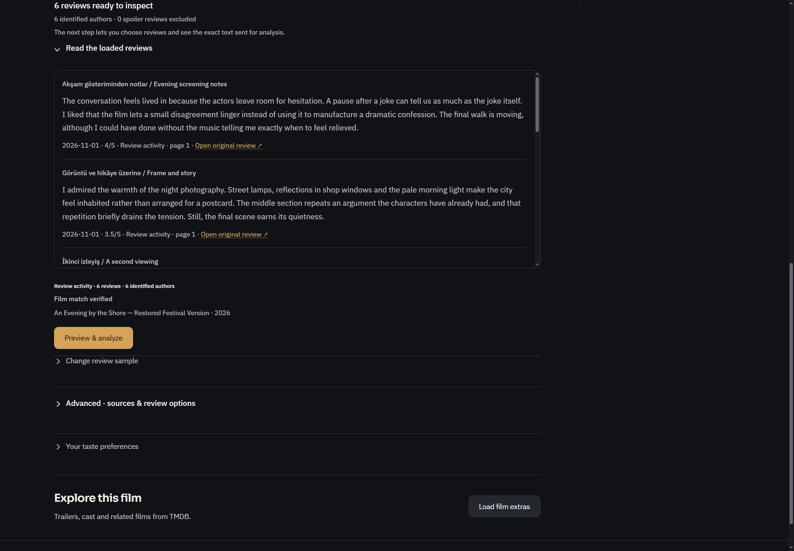
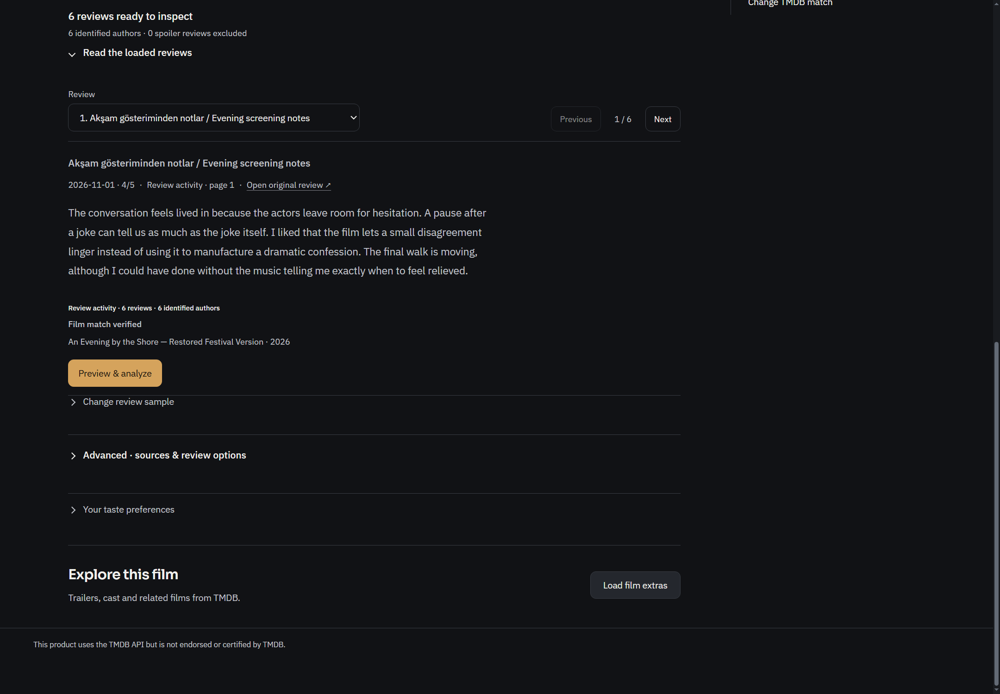
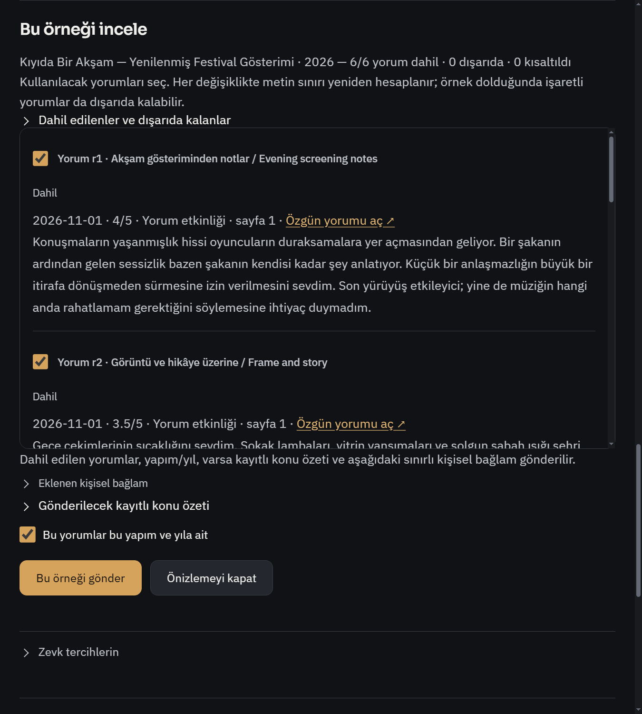
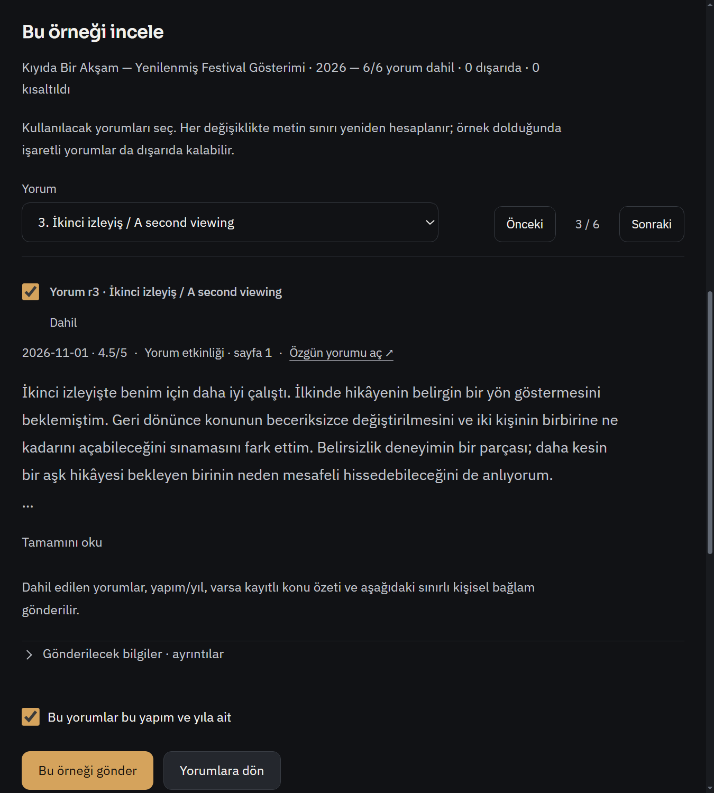
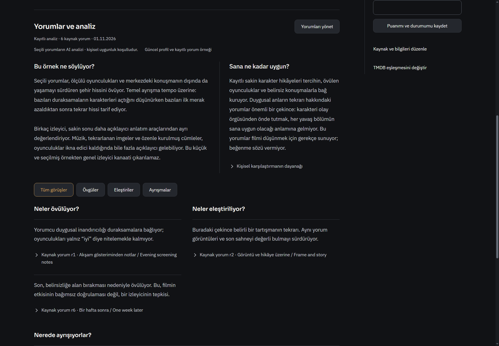
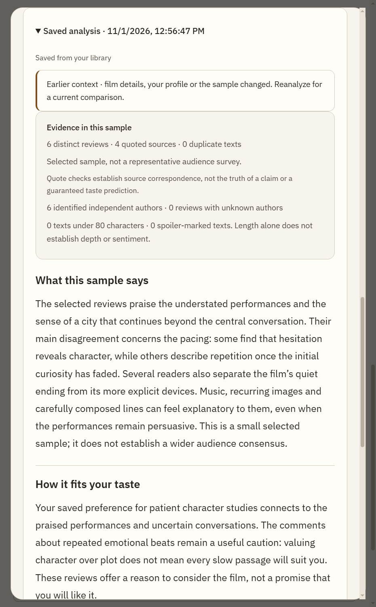
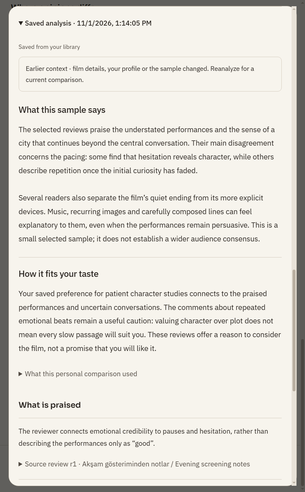

# R836 — Yorum okuma, örnek seçimi ve analiz düzeni

1 Kasım 2026. Başlangıç `8892c44b4e647e839b38eeb3ad99114901b036b3`; ürün commit'i `0096aa6db86453f055c7622938134755aa1a38c5`. Dal `codex/review-reading833`; çalışma kimliğindeki833, bağımsız işlevsel R833 raporunun numarası değildir. Eşzamanlı R834 yalnız belge teslimi değişmeden birleştirildi.

Kullanıcı yorum/analiz alanının görünümünü yeniden tasarlamamı istedi. Bu teslim yalnız o akışı yeniler. R834'ün T16 önerisi karşılandı, T20 ortak kontrol disiplini yorum yüzeyinde uygulandı. R834'teki genel gezinme, Whisper stüdyosu, kalıcı dublaj sayfası, asistan alan bütçesi, browser görev grupları ve okuyucu odak modu bu paketle tamamlandı diye sunulmaz. R830/831/833 işlevsel denetimleri de bu tasarım tesliminin düzelttiği bug listesi değildir; mevcut kayıtlar korunur.

## Eşzamanlı numara çakışması

İlk yayımdan sonra ana kopya güncellemesi, başka sohbetin yerelde yeni oluşturduğu farklı içerikli `BROWSER_BUG_REPORT_835.md` dosyasına dokunmadan Git tarafından durduruldu. O dosya **asistan/browser/dublaj denetimi**; bu tasarım raporu değildir. Yerel yabancı rapor değiştirilmedi, taşınmadı veya commit'e alınmadı. Yalnız bu tasarım raporu ve kendi görsel klasörü836 olarak yeniden adlandırıldı. Önceki835 adı Git geçmişinde kalır; kanonik tasarım raporu R836'dır. Ürün kodu ve kabul sonuçları değişmedi.

## Tasarım kararı ve uygulama

**Kaynak yorum → örnek seçimi → analiz → isteğe bağlı kanıt** sırası. Özet ve kişisel değerlendirme önce; kaynak/bütçe denetimi ikinci katmanda. Kayıtlı analiz, film içi yönetim ve bağımsız yorum penceresi aynı render sahibini kullanır. Yeni paket, hesap, font, CDN veya ayrı animasyon motoru yok; grafit/amber paleti, Plex/Sora, ortak hareket süreleri ve reduced-motion sistemi korunur.

| Görülen sorun | Yapılan değişiklik | Korunan davranış |
|---|---|---|
| Uzun yorumlarda dış sayfa +300/360px iç liste ayrı kayıyor; yazar görünümden çıkıyor | Tek seçili yorum, native yazar seçicisi, Önceki/Sonraki ve konum; metin65–70ch ölçüsünde | Tüm kaynak metni ve metadata saklanır; değişen yalnız görünüm |
| Hazır örnekte yorumlar kapalı | Kaynak okuyucu ilk kez açık; kullanıcı kapatırsa seçimi korunur | Spoiler işaretli metin açık izin olmadan gösterilmez |
| Önizleme, kaynak formu ve kendi değerlendirmesinin en altına ekleniyor | Ayrı önizleme adımı; önceki edinim/geribildirim o adımda geri çekilir | Yorumlara dön, taslak seçimini ve kaynakJSON'u korur; kendiliğinden AI isteği yok |
| Büyük kanıt kartı analiz özetinden önce | Özet + kişisel uygunluk genişte iki kolon, darda sıralı; örnek denetimi kapalı ayrıntı | Küçük örnek sınırı ve koşullu uygunluk anlaşılır; stale/unknown uyarısı görünür |
| Find/Preview/Send aynı anda ana eylem | Aşamaya göre tek etkin amber eylem; diğerleri nötr | Kaynak değiştirme, manuel metin, dosya, yorum adedi/sıra/spoiler/append erişilir |
| Yorum ve teknik bilgi aynı ağırlıkta | Gövde15px/1.85; metadata12–13px; alıntı kanıtı sakin disclosure | Özgün alıntı, AI Türkçe açıklama etiketi, güvenli permalink ve profil snapshot ayrımı |

Uzun metindeki **Tamamını oku** yalnız CSS satır daraltmasını kaldırır. Kaynağı tekrar indirmez, özgün metni veya analiz sınırlarını değiştirmez. Kısa metinler doğrudan okunur;550karakter altına gereksiz açma eylemi eklenmez. Analize giden örneğin kısaltılmış/dışarıda/dahil durumu ve karakter bütçesi aynen korunur.

Aşamalı düzende bir doğrulama hatasının gizlenen kaynak alanında kalmaması için önizlemeye yerel `role=alert` eklendi. Yanlış yapım/yıl onayı, değişen örnek veya profil hatası aktif adımda görünür; AI başlatılmaz. Yeni kaynak yüklenince önizleme aşaması kapanır ve kaynak alanı geri gelir. Bölgenin programatik odak çerçevesi dekoratif amber kutu yapmaz; **bütün interaktif kontrollerin klavye halkası korunur**.

## Gerçek önce / sonra

Aynı kontrollü metinler, native Windows Electron, EN/TR. Ekran pikseli Windows ölçeklemesi nedeniyle CSS boyutundan farklıdır. Bunlar kişisel yorumlar veya gerçek film kalitesi kanıtı değil, tasarım/etkileşim fixture'larıdır.

### Kaynak okuma

Önce:


Sonra:


### Türkçe önizleme,900CSS ve125% uygulama zoom

Önce:


Sonra:


### Analiz



Dar/açık tema eski kanıt kartı:


Dar/açık tema yeni anlatı sırası; eski profil uyarısı bilerek görünür:


[Tamamı açılmış uzun kaynak](review836/long-source.png) · [Yerinde doğrulama hatası](review836/validation.png)

## Kabul ve yeniden çalıştırma

- **10 hedefli Node dosyası: 90 PASS / 0 FAIL**, exit0: review-workflow, film-review-editor/inline, review-analysis-contract/context/response-contract, review-discovery-handoff, letterboxd-full-text, design-system, ui-motion. [Gerçek günlük](review836/targeted-tests.log).
- **41 final native görüntü**: EN1440 koyu, TR1440 koyu, TR900/125% koyu, EN620 açık. Öncesi 25 görüntü; 41 görüntü bağımsız bug sayısı değildir. [Metrikler ve etkileşimler](review836/native-evidence.json).
- Her kipte 6 kaynak DOM'da; sadece 1 görünür. Native seçici/r3→önceki/sonraki, uzun metni açma, sayfa içinde kesintisiz okuma, kaynak ve önizleme seçiminin yeniden açılışı, checkbox bütçesi/odak, gelişmiş kontroller, Tab/Escape, inline aç/kapat odak dönüşü denetlendi.
- Dört kipte yapım onayı kaldırılıp Send: görünür yerelalert, edinim alanı kapalı, özgünJSON aynı ve **assistant:agentRun çağrısı0**.
- Root/text overflow 0; her aktif yorum adımında en fazla 1 etkin primary. Geometri tek başına estetik başarı sayılmadı; son geniş/koyu, dar/açık, uzun metin ve Türkçe125% görüntüleri açılarak incelendi.
- Önceki tam yorum regresyonu final kaynakta native exit0:7×14051 karakter, özgün son işaretleri, metadata/spoiler/120keditör/64kanaliz bütçesi ve no-provider korundu. Eski test yalnız sunum değişimine uyarlandı: yeni Tamamını oku eylemi ve gerçek kaynak paragrafına kaydırma. [Kanıt](review836/full-source-evidence.json).
- 4 JS syntax ve scoped diffcheck0. Impeccable layout detector `[]` exit0; bu sonuç görsel kalite kanıtı yerine kullanılmadı.

Komutlar (proje kökünde):

```powershell
node --test --test-isolation=none tests/review-workflow.test.js tests/film-review-editor.test.js tests/film-review-inline.test.js tests/review-analysis-contract.test.js tests/review-analysis-context.test.js tests/review-analysis-response-contract.test.js tests/review-discovery-handoff.test.js tests/letterboxd-full-text.test.js tests/design-system.test.js tests/ui-motion.test.js
& 'D:\Whisper Local\node_modules\electron\dist\electron.exe' tests/electron-review-reading833.smoke.js --after
& 'D:\Whisper Local\node_modules\electron\dist\electron.exe' tests/electron-letterboxd-full830.smoke.js
```

İlk Node çağrısının varsayılan child-isolation yolu sandbox EPERM verdi; desteklenen `--test-isolation=none` ile gerçek kontroller çalıştırıldı. Geliştirmede Close preview etiketinin Back'e dönüşmesi ve okuyucunun varsayılan açık oluşuna ait iki eski sunum beklentisi güncellendi; seçim/kanıt/onay assertionları kaldırılmadı. Son koşum temizdir.

## Yöntem ve sınırlar

Impeccable layout + craft-floor + polish ve Frontend Design Premium/upstream frontend-design yönergeleri, DESIGN/UX sözleşmesi kullanıldı. İlk bağımsız salt-okunur yerleşim eleştirisi sonra mekanik tarama; ayrı Sol6.1 medium native QA ile aynıfixture öncesi/sonrası. Ürünü ana ajan değiştirdi; QA yalnız kendi native helper'ını ve yetkili eski sunum adımını değiştirdi. Hesap veya harici plugin servisi gerekmedi. Luna'nın yeni kaynaklarını bu tur yeniden çekmedik; birebir Luna uyumu veya mükemmel estetik iddiası yok.

Bu tur gerçek Letterboxd erişimi/Cloudflare, ücretli AI yorumu, GPU/CUDA veya kişisel `start.bat` akışı çalıştırılmadı. Mock metin başarıları canlı kaynak/model kalitesi değildir; önceki R832 canlı kaynak kabulü tarihsel kayıt olarak kalır. UzunCI/npm tam paket/soak beklenmedi; CI kapatılmadı. Ana uygulama kapatılmadan kaynak güncellenir; yeni pencere/uygulama yeniden açılınca görünüm yüklenir. Kişisel OFFLINE/INDEX516/silinmişstart.sh ve untracked dosyalar kapsam dışıdır.
