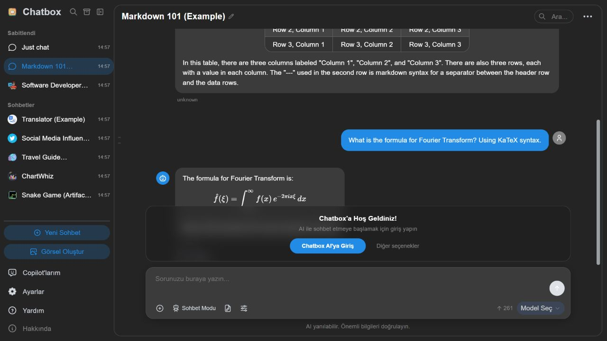
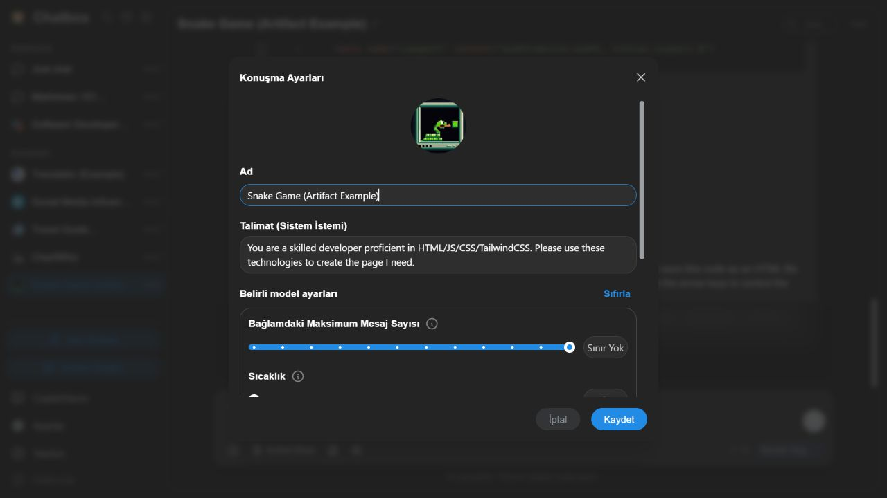
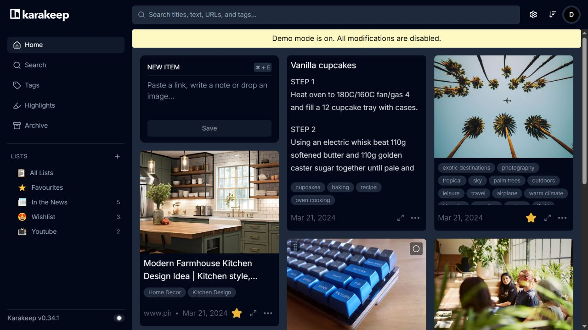
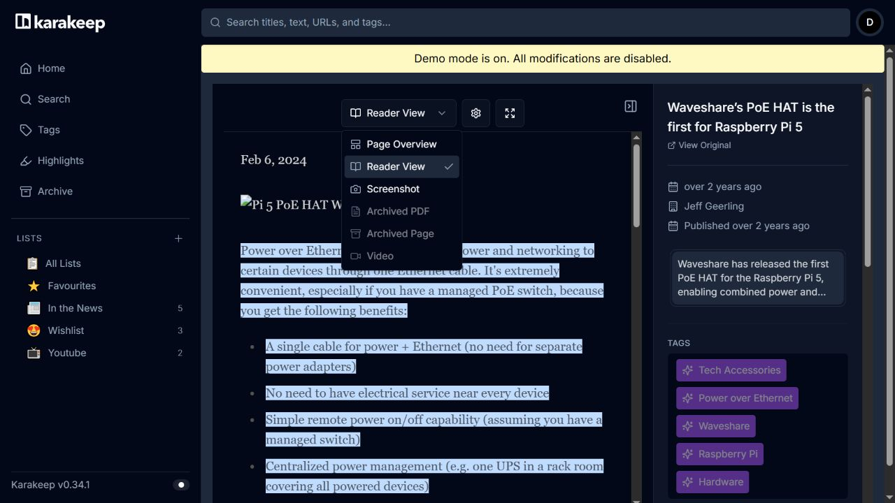
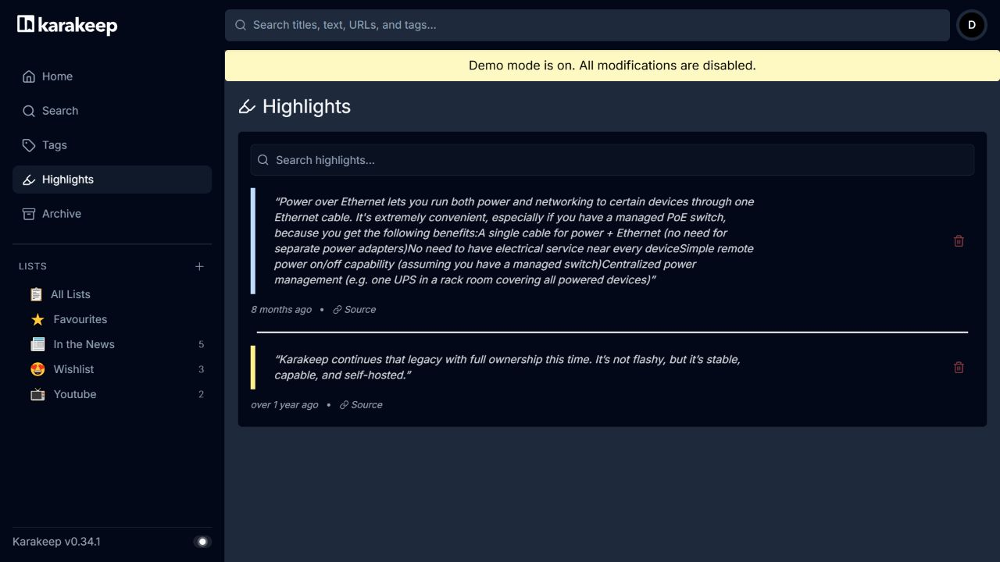

# R841 — Asistan, Browser ve Keşfet için geniş GitHub kaynak araştırması

**1 Kasım 2026 · yalnız araştırma ve rapor · ürün kodu değiştirilmedi.** İncelenen yerel taban: `e66228403b6d0ce11c26a3e7c3d61c77c650d375`. R838, R839 ve R840 korunmuştur.

Bu araştırmadan çıkardığım ana karar: **asistanı daha fazla düğmeyle değil, daha iyi araç seçimi, kaynak kullanımı, iş sürekliliği ve düzenlenebilir çıktılarla güçlendirmek; Browser'ı bu asistanın araştırma alanına, Keşfet'i de açıklanabilir film kararına dönüştürmek.** Bunun için başka bir uygulamanın bütün backend'ini taşımak gerekmiyor. MIT/Apache modüllerde küçük kod portları; GPL/AGPL projelerde koşulları korunmuş entegrasyon veya davranışın bağımsız uygulanması gerçek seçeneklerdir.

Araştırma **29 depo kaydı**, **208 indirilen ve byte hash'i doğrulanan kaynak/lisans/paket dosyası**, **42 farklı yerel ürün dosyası** ve iki çalışan web arayüzünden **5 gerçek ekran görüntüsü** içerir. Depo kayıtlarının biri Letta'nın tarihsel yönlendirmesi, biri yeniden kullanım izni vermeyen eleme adayıdır; 29 hazır bağımlılık önerilmiyor. Min'in kaynak deposu ayrıca tam olarak indirildi; kurulmadı/çalıştırılmadı. GitHub varsayılan dal HEAD'leri kararlı release seçimi değildir.

## Sayım ve ayrıntılı raporlar

| Alan | Ayrıntılı kart | Yeni mekanizma adayı | Önceki fikrin somut derinleştirmesi | Ayrıntılar |
|---|---:|---:|---:|---|
| Asistan | 25 | 17 | 8 | [Tam asistan raporu](research841/assistant/README.md) |
| Browser/araştırma | 24 | 17 | 7 | [Tam Browser raporu](research841/browser/findings.md) |
| Keşfet/Letterboxd | 24 | 12 | 12 | [Tam Keşfet raporu](research841/discovery/cards.md) |
| **Toplam** | **73** | **46** | **27** | [Makine okunur kart indeksi](research841/card-index.json) |

**Bunlar 73 bug veya 73 bağımsız büyük özellik değildir.** Aynı kullanıcı akışının seçilebilir parçaları ayrı kartlarda açıklanıyor. Örneğin bellek kapsamı/kapatma/çakışma, tek bellek ailesidir. `NEW` yalnız R838–R840 ve ilgili yakın tarihli araştırmalarla karşılaştırılan yeni farkı ifade eder; yüzlerce tarihsel raporda hiç anılmadığı garantisi değildir. A841-04 ilk elemede yeni görünse de R839-F12 ile çakıştığı için son kontrolde derinleştirme olarak değiştirildi. Yalnız yerel sözleşmeyi geliştiren D841-21/22, dış depodan yeni algoritma keşfi sayılmadı.

Her ayrıntılı kartta şu bilgiler bulunur: **bugünkü kodun davranışı → upstream'de görülen dosya/fonksiyon → alınabilecek parça veya yeni ürün sentezi → kullanıcı akışı → efor/önkoşul → ilerideki kabul örneği → Windows/CSP sınırı.** Kabul örnekleri bu tur yapılmış testler değildir. Kaynakta bir UI veya protokol parçasının bulunması, bütün backend'in veya model kalitesinin doğrulandığı anlamına gelmez.

## Önce mevcut olanı doğru kabul etmek

Bugünkü asistan zaten kaynak kimliği, kalıcı/dallanan sohbet, araç doğrulaması, eylem önerisi, main-owned job ledger, stream/fallback ve büyük araç sonucunu tur içinde sayfalama içeriyor. Bunları yeniden özellik diye önermiyorum. Açık farklar: bütün uygun araç şemalarının her turda gönderilmesi, sabit geçmiş/output sınırları, kalıcı artifact sürümü ve tamamlanmadan ayrı sonuç teslim durumunun bulunmaması. Ayrıntılar [asistan yerel tabanı](research841/assistant/local-baseline.json) ile sabitlenmiştir.

Browser'da birleşik yerel arama, SQLite FTS, koleksiyonlar, çoklu metin ankrajı, MHTML, sekme/grup kurtarma ve medya sekmelerini koruma zaten var. Araştırma hattı bugün motorları sırayla dener, dört URL toplar, ilk üçünü okuyup her birinin ilk 6000 karakterini bağlama alır. Dolayısıyla kazanç “arama eklemek” değil, **doğru üç sayfayı ve doğru pasajları seçmek, kısıtı gerçekten uygulamak, kaynağın tarihini korumak** olacaktır. [Mevcut araştırma kodu](https://github.com/dorukakindev/whisper-browser/blob/e66228403b6d0ce11c26a3e7c3d61c77c650d375/src/assistant-browser-research.js).

Keşfet'te Cinemeta sorgusu, tür/favori temelli kişisel öneri ve feedback var. TMDB ülkesel izleme sağlayıcıları, TR ve erişim türleri; kişi biyografisi/filmografisi; Letterboxd içe aktarımı da zaten mevcut. Yeni değer bunları tekrar çizmek değil: kaynakları aynı aramada birleştirmek, izleme boşluklarını bulmak, öneri girdisini ölçmek ve kullanıcının günlüğünü geri dışa aktarabilmektir. [Keşfet yerel tabanı](research841/discovery/local-baseline.json).

## Benim önce seçeceğim 12 geliştirme paketi

Efor etiketleri göreli büyüklüktür: S küçük uyarlama, M birkaç modüllü özellik, L veri modeli/yardımcı süreç/görsel kabul gerektiren çalışma. Gün veya maliyet taahhüdü değildir. Bir paketin uygulanması bu raporla başlatılmadı.

| Öncelik | Paket ve kaynak | Üründe somut sonuç | Kartlar / bağımlılık |
|---|---|---|---|
| 1 | **Asistan araç keşfi ve bütçesi** — Cherry, AnythingLLM, Chatbox | Film sorusunda ilgisiz onlarca araç şeması taşınmaz. Kullanıcı hangi geçmiş/kaynağın gönderilmediğini görür. | A07/08/10/11. Önce ölçülen mevcut istek, sonra lexical seçim/deferred keşif; yerel reranker sonradan. M |
| 2 | **İşin bitmesi ile sonucun teslimini ayır** — LibreChat, Mastra non-ee | Dublaj biterken bağlantı koparsa üretim yeniden başlatılmaz; yalnız mevcut sonuç asistana yeniden bildirilir. | A15–19. Mevcut job ledger genişler; ikinci iş sistemi kurulmaz. M–L |
| 3 | **Sohbete bağlı model/görev profili** — LibreChat, LettaCode, NextChat | “Film analisti v2” ile başlanan dalın modeli ve talimat revizyonu görünür kalır. Genel ayar değişikliği eski sohbeti sessizce değiştirmez. | A01/02/14; görünür snapshot ve geri dönüş. M |
| 4 | **Soruya göre kaynak pasajı** — Crawl4AI, Firecrawl | Röportajın sonunda duran ilgili açıklama, ilk 6000 karakter kesimi yüzünden dışarıda kalmaz; tablo başlığı alıntıdan kopmaz. | B16/19/20/22. Mevcut Defuddle korunur; seçme/alıntı katmanı eklenir. M |
| 5 | **Düzenlenebilir araştırma çıktısı** — LibreChat, AionUi, Chatbox | Uzun yanıt yerine karşılaştırma belgesi v1/v2, değişiklik önizlemesi ve indirilebilir güncel çıktı oluşur. | A09/20/21/22; tek artifact ailesi. Kimlik/saklama sözleşmesi önce. M–L |
| 6 | **Birleşik film araması** — Streamyfin, Stremio | Kütüphanedeki film hemen, dış katalog sonucu geldikçe görünür. Aynı film tek kartta kaynak izleriyle birleşir; remake ayrı kalır. | D01/02/24. Sağlayıcı kimliği ve kısmi hata ayrımı şart. M |
| 7 | **Akıllı kaynak koleksiyonları** — Karakeep, Linkwarden | “Bu ay kaydettiğim, okunmamış röportajlar” otomatik güncellenir; alanlı sorgu çiplere dönüşür; alıntılar kaynağa geri götürür. | B06/07/08/09; tek organizasyon ailesi. M |
| 8 | **Keşfet sürekliliği** — MoviePilot, Gorse | İnternet yokken son başarılı liste tarihiyle açılır; gizle→geri al aynı öneri turuna döner. | D09/11/19; ortak sürümlü sonuç snapshot'ı. M |
| 9 | **Gerçek film keşif yolları** — Streamyfin, Movary, Ryot | “Bu serinin eksikleri”, “bu yönetmenden izlemediklerim”, “iki sevdiğim filmin ortak ekibi” karar yolları oluşur. | D04/06/07/08. Tamamlanmış hazır upstream motoru değil, kimlikli veri birleşimi. M–L |
| 10 | **Doğru tercih verisi ve ölçüm** — Gorse, Microsoft Recommenders, RecBole | Kartı geçmek beğenmemek sayılmaz; bu akşamki niyet kalıcı zevki bozmaz. Yeni ranker tarih kesimli geçmişte mevcut basit yöntemle karşılaştırılır. | D10/12/15/16/24. Modelden önce olay ve değerlendirme. M |
| 11 | **Kullanıcının yönettiği kapsamlı bellek** — AnythingLLM, LibreChat, Khoj, LettaCode | Film karakteri notu başka filme taşınmaz; genel cevap tercihi ayrı; bellek bu tur kapatılabilir, düzeltme/silme görülebilir. | A04/05/06/25. Opt-in kapsam ve kontrollü çakışma. M–L |
| 12 | **Taşınabilir günlük ve arşiv** — Movary, SingleFile, Linkwarden | Letterboxd'a uygun günlük exportu; kaynak için metin/görüntü/PDF durumu; gerekirse tek HTML pilotu. | D23, B10–15. Export önce; büyük arşiv entegrasyonu kontrollü pilot. M–L |

Asistanı güçlendirmek için ilk beşi, Keşfet'i gerçekten iyileştirmek için 6/8/9/10'u seçerdim. Bütün kaynakları kurmak veya aynı anda 73 kartı yapmak odak kaybettirir. En değerli birleşim: **film bul → izinli kaynakları oku → soruyla ilgili kanıtı seç → gerekçeli karşılaştırma belgesi üret → kullanıcının kararını doğru türde kaydet.** Bu akışta mevcut altyazı, video ve kaynak doğruluğu korunur.

## Depolardan pratikte ne alınır?

Aşağıdaki kısa tablo yön seçimi içindir. Tam HEAD, dosya sembolleri ve lisans kanıtı alan raporlarında yer alır. Kod kopyalamak, paket bağımlılığı eklemek, opsiyonel servis kullanmak ve davranışı bağımsız uygulamak farklı edinme yollarıdır.

| Kaynak deposu | En değerli incelenmiş parça | Benim edinme tercihim |
|---|---|---|
| [LibreChat](https://github.com/LibreChat-AI/LibreChat) | Prompt sürüm seçimi, bellek denetimleri, task delivery görünümü, artifact seçici | MIT küçük state/UI portu; Mongo/React uygulamasını taşıma. A01/06/17/20 |
| [AnythingLLM](https://github.com/Mintplex-Labs/anything-llm) | Slash preset modeli, workspace/global bellek, araç reranker/fallback | MIT Node model/helper portu. Reranker'ı mevcut basit seçimle kıyasla. A02/04/05/08 |
| [Cherry Studio](https://github.com/CherryHQ/cherry-studio) | Deferred tool sözleşmesi, gerçek bağlam bütçesi, medya wire dönüşümü, içerik adresli çıktı | AGPL koşullarıyla seçilmiş kod veya bağımsız adapter. A07/09/10/11/12 |
| [AionUi](https://github.com/iOfficeAI/AionUi) | Conversation workspace, model capability ayarı, file/diff preview, artifact olayları | Apache-2.0 seçilmiş IPC/state portu. Terminal ajanının tamamı gerekmiyor. A03/11/20/21/22 |
| [Mastra](https://github.com/mastra-ai/mastra) | Background operation adoption, exact ownership, resume/restart, scorer, scope revalidation | İncelenen non-ee Apache core davranış portu; framework ilk bağımlılık değil. A15/16/18/23/24 |
| [LettaCode](https://github.com/letta-ai/letta-code) | Yerel model keşfi, model carryover, CAS bellek onarımı | Apache küçük normalizasyon/sahiplik modeli. A13/14/25 |
| [LobeHub](https://github.com/lobehub/lobehub) | Gecikmiş tool sonucunda özgün kontrol/hook kurma | Community lisansı koşullarıyla alım veya bağımsız yaşam döngüsü. A19 |
| [Khoj](https://github.com/khoj-ai/khoj) | Kullanıcı belleğini satır düzeyinde düzenleme/silme | AGPL kod portu koşullarıyla veya UI davranış referansı. A04 |
| [Chatbox](https://github.com/chatboxai/chatbox) | Model capability loading/error ayrımı, uzun sohbet gezinmesi, artifact saklama | GPL koşullarıyla seçilmiş uyarlama veya bağımsız davranış. Ek karşılaştırma aşağıda |
| [NextChat](https://github.com/ChatGPTNextWeb/NextChat) | Mask/preset ve global config senkronizasyon sınırı | MIT küçük preset modeli; Cloudflare artifact paylaşımı yerel dosya deposu değildir |
| [Open WebUI](https://github.com/open-webui/open-webui) | Model yeteneği/varsayılan özelliği ayırma, sesli görüşmede kesme ve cleanup | Davranış/protokol referansı; güncel özel lisans ve LICENSE_HISTORY incelendi. Bütün Svelte/backend taşınmaz |
| [Min](https://github.com/minbrowser/min) | Task alanları, tüm task'larda arama, restore politikası, yerel relevance/tag önerisi | Apache küçük algoritma/state portu. IndexedDB/global renderer mutasyonu taşınmaz. B01–05 |
| [Karakeep](https://github.com/karakeep-app/karakeep) | Smart list, kayıt kuralları, ayrı alıntı kaynağı | AGPL şema/router portu veya mevcut store üzerine bağımsız evaluator. B06/07/09 |
| [Linkwarden](https://github.com/linkwarden/linkwarden) | Alanlı sorgu, çok biçimli arşiv, alt kaynak sınırı, archive-ID çözümü | AGPL seçilmiş parser/contract uyarlaması; bütün sunucu worker'ı şart değil. B08/13/14/15 |
| [SingleFile](https://github.com/gildas-lormeau/SingleFile) | Seçim/lazy/frame yakalama ve iptal aşamaları | AGPL-3.0-or-later koşulları korunmuş pilot; değişmemiş dosya ek izni modifiye portu otomatik muaf yapmaz. B10–12 |
| [Crawl4AI](https://github.com/unclecode/crawl4ai) | BFS kota/graph, link skorları, BM25 pasaj, cache validator, host backoff | Apache algoritmalarını Node'a seçilmiş port; ikinci browser/Python servisi zorunlu değil. B17/18/19/22/23 |
| [Firecrawl](https://github.com/firecrawl/firecrawl) | Sonuç üstü sorgu operatörü, yapı koruyan alıntı, niyet/sorgu fingerprint | AGPL seçilmiş TS modülü veya bağımsız parser; yönetilen servis alınmış sayılmaz. B16/20/21 |
| [Page Assist](https://github.com/n4ze3m/page-assist) | SearXNG JSON/HTML adapter ayrımı | MIT beyanı var fakat güncel tree'de kök LICENSE yok; notice kaynağı tamamlanınca seçilmiş port. B24 |
| [Streamyfin](https://github.com/streamyfin/streamyfin) | Kaynak kümeli arama, koleksiyon/kişi görünümü, iki aşamalı öneri yükleme | MPL-2.0 dosya yükümlülükleriyle küçük port veya UI/contract referansı; React Native/Jellyfin komple taşınmaz. D01/04/07/24 |
| [Movary](https://github.com/leepeuker/movary) | Watch-provider DTO, kişi izleme kümeleri, Letterboxd exporter | **MIT** Node algoritma/CSV portu güçlü aday. PHP server kurulmaz. D03/07/23 |
| [Ryot](https://github.com/IgnisDa/ryot) | Koleksiyona dayalı adaylar, üyelik sırası, takipli takvim | GPL koşullarıyla seçilmiş uyarlama/bağımsız Node model. User recommendation yolunda server-key gate var. D04/05/06 |
| [Stremio Web](https://github.com/Stremio/stremio-web) | Discover capability modeli, local-search/calendar hook sınırı | GPL-2.0 UI/model referansı. Hook asıl core algoritması değildir; Cinemeta zaten mevcut. D01/02/06 |
| [Gorse](https://github.com/gorse-io/gorse) | Positive/read/negative olayları, TTL, sıralama ve digest | Apache olay/pipeline portu önce; Go sidecar ancak ölçümden sonra. Bu HEAD Go1.27 ister. D10/11/12/17/19 |
| [LightFM](https://github.com/lyst/lightfm) | Metadata özellikleri, partial eşleme, predict | Apache araştırma pilotu; Windows C/Cython/OpenMP, eski HEAD ve feature boyutu sınırını önce doğrula. D13/14/18/20 |
| [RecBole](https://github.com/RUCAIBox/RecBole) | Dataset split, sıralama/coverage metrikleri, config | MIT küçük evaluator/split portu veya ayrı deney ortamı; bütün model koleksiyonu gerekmez. D14/15/16/19 |
| [Microsoft Recommenders](https://github.com/microsoft/recommenders) | Chronological split, serendipity/coverage ölçümü | MIT seçilmiş ölçüm kodu; Spark/Azure ve bütün Python stack'i ürün bağımlılığı olmaz. D15/16/17 |
| [MoviePilot](https://github.com/jxxghp/MoviePilot) | Metadata kaynak normalizasyonu, son sorgu/sonuç state'i | GPL koşullarıyla dar adapter/cache portu veya bağımsız uygulama; indirme/tracker/müzik otomasyonu kapsam dışı. D02/08/09/19 |

Ek iki kayıt: `letta-ai/letta` güncel esas uygulama kodu diye sayılmadı, resmî LettaCode yönlendirmesi takip edildi. `DevMatze/VidSelector` gerçek kod içeriyor fakat LICENSE “All rights reserved”, package UNLICENSED; doğrudan kod alımına önerilmedi. Bu son durum GPL/AGPL'den farklıdır. [Ayrıntılı eleme ve olgunluk notları](research841/discovery/notes.md).

## Asistanı güçlendirme: kaynak mekanizmasını ürün sonucuna bağlamak

**Araç sayısını artırmak yerine araç erişimini akıllandırmak.** A07'deki namespace → search → inspect → invoke sırası, araç şemalarını yalnız gerektiğinde modele sunar. A08'deki reranker farklı bir katmandır: mevcut adayları sıralar; execution yetkisi vermez. İlk pilotta ölçülecekler yalnız token azalması değildir: gereken aracın seçim dışında kalması, ek keşif turu/gecikme ve kaynak dışı eylem denemesi de ölçülmelidir. Uygun araç bulunamazsa mevcut güvenilir yol korunmalıdır. Cherry'de okunan deferred prompt bütün handler'ların kabul kanıtı olarak sunulmadı.

**Asistan “başlattım” ile “tamamladım” arasını güvenilir yönetmeli.** A15/16/17 birlikte düşünülür: tek gerçek medya operation'ı; ilk toolCall/run/thread/source kimliğine bağlı sahiplik; iş terminal durumu ve ayrı teslim durumu. Kullanıcı iki ayrı yüzeyden iptal edebilir fakat alttaki işlem tek kez iptal olur. Çıktı hazırken bağlantı koparsa “Sonucu tekrar bildir” gelir. Bu, ücretli üretimi yeniden denemekten farklıdır. LibreChat'te görülen delivery projection hazır bir yeniden teslim endpoint'i değildir; endpoint/saklama uyarlaması bize aittir.

**Konuşmanın ürünü konuşma balonundan çıkmalı.** A20/21/22 ile film karşılaştırması, kaynaklı rapor veya çeviri kontrol notu ayrı belge olur. Kullanıcı v1'i koruyup v2'deki farkı görür. Chatbox'ın `persistSandboxArtifact` kodu aynı adlı farklı kaynak dosyalarını ayrı köklerde tutmayı ve geçici dosyadan kalıcı kopyayı gösterir; bu kod kendi başına immutable sürüm geçmişi sağlamaz. Bizim artifact-ID/revision/source manifest sözleşmemiz ayrıca tasarlanmalıdır. Genel keyfi HTML/komut yürütme yetkisi gerekmiyor.

**Belleğin miktarı kadar kapsamı önemli.** Kullanıcı bir filmde karakter adını düzelttiğinde bu başka filmin gerçeği olmaz. A05 workspace/global ayrımı; A06 kullanım anahtarı/makbuz; A25 eşzamanlı düzeltme sahipliği bu yüzden aynı ailede. Sessizce her konuşmadan kalıcı kişisel olgu çıkarmak ilk adım olmamalı. Genel cevap tercihi, kaynak notu ve bu akşamki film isteği üç ayrı kapsamdır.

**Modelin daha güçlü görünmesi ile doğru serialize edilmesi ayrı.** A11 sağlayıcı/model/API modu; A12 geçmişteki desteklenmeyen medya parçasının açıkça dönüştürülmesi; A14 konuşma dalının model snapshot'ı birlikte gerekir. Text-only modele geçen kullanıcı eski ekran görüntüsünün hâlâ görüldüğünü sanmamalı. Yerel model keşfi A13 isteğe bağlıdır; güçlü GPU Türkçe ve araç seçimi kalitesinin garantisi değildir.

## Browser: araştırma için değerli farklar

İlk pratik kazanım, mevcut Defuddle çıktısına BM25 benzeri soruyla ilgili pasaj seçimi eklemektir. B19'un sonunda doğru alıntı kaynak bloğuna dönmelidir; B20 tablo başlığını/satır ilişkisini korur. B16 alan adı/başlık/yol kısıtını sağlayıcının yorumuna bırakmadan sonuç üzerinde uygular. B22 de eski kaynağı bugünkü içerik gibi sunmayı önleyen “değişti/değişmedi/bilinmiyor” durumunu ekler. HEAD/ETag tek başına içerik doğruluğu kanıtı değildir.

İkinci kazanım, kayıtları tekrar bulmaktır: B06 smart koleksiyon + B08 alanlı sorgu + B09 alıntı görünümü. Bunlar mevcut not/ankraj store'una dayanabilir. Her arşiv için yeni bir Elasticsearch/Meilisearch sunucusu kurmak gerekmiyor. Min'den alınabilecek task ve relevance desenleri de mevcut sekme/grup/SQLite mimarisine uyarlanmalıdır; upstream global renderer state'i kopyalanmamalıdır.

Derin araştırmada B17/18/23 beraber gerekir: sayfa derinliği ile kaynak sayısı ayrı kota, ziyaret grafiği, gerekçeli link sırası, host başına backoff ve iptal. Kullanıcının açık sekmelerinde sessiz dolaşmak yerine ayrı araştırma kapsamı kullanılmalıdır. B24 SearXNG, kendi arama adresini seçmek isteyenler için adapter adayıdır; kurulum ve servis kalitesi bu tur denenmedi.

SingleFile/Linkwarden en başta alınacak dev platformlar değil, arşiv hattını olgunlaştıracak güçlü adaylardır. B10 tek HTML ancak mevcut MHTML ile aynı sayfalar üzerinde çevrimdışı kıyaslanınca anlamlıdır. B12 kısmi yakalama bilgisi; B14 alt kaynak ağ sınırı; B15 ID/revision üzerinden açma, aynı arşiv paketinin birlikte tasarlanacak parçalarıdır. DRM/video byte'larının arşivlendiği varsayılmamalıdır.

## Keşfet: yeni modelden önce daha doğru karar girdisi

D01 birleşik arama, D04 seri tamamlama ve D07 izleme boşlukları hemen anlaşılır kullanıcı sonuçlarıdır. Koleksiyon metin etiketini dış kaynaktaki film serisi gerçeğiyle karıştırmadan, doğrulanmış sağlayıcı ID'leriyle kurulur. “Tam filmografi” yerine incelenen kapsam açık kalır. D06 takvim yalnız kullanıcının takip ettiklerinden oluşturulur; yeni tarih metadata'sı otomatik bildirim izni değildir.

D10–D12 olay/oturum modeli düzelmeden daha karmaşık öneri motoru anlamlı ölçülemez. İzledi, gördü, detay açtı, bu akşam istemedi ve kalıcı gizledi aynı olay değildir. D24 zaten bulunan metadataMatched sayısını kullanıcıya karar verdiren açıklamaya taşır: örneğin sevdiği 30 filmin yalnız 18'inin tür bilgisi kullanılabildiyse neden önerilerin dar kaldığı görünür olur.

Gorse, LightFM, RecBole ve Microsoft deposu birbirinin yerine geçen “dört hazır AI öneri motoru” değildir. Gorse gerçek sunucu/pipeline; LightFM hibrit model kütüphanesi; RecBole deney/model/evaluator koleksiyonu; Microsoft'ta seçtiğimiz parçalar ölçüm ve veri bölmedir. Önce D15 tarih kesimli değerlendirme, D16 coverage/diversity, D19 tekrar üretilebilir öneri snapshot'ı. Yeni model basit tür tabanını geçmiyorsa ürün bağımlılığı yapmanın yararı yoktur.

Letterboxd için D23 somut bir kod alım adayıdır: Movary'nin MIT exporter'ını Node'a taşımak. Rewatch tarihleri, kişisel puan ölçeği, Türkçe CSV ve dosya seçicisi kabulü gerekir. D21/22 spoiler ve görüş ayrışması ise hazır dış sınıflandırıcı değil, önceki R839-F08 ve mevcut kaynak sözleşmesinin devamıdır. Seçilmiş 12 yorum bütün Letterboxd kitlesinin anketi diye sunulamaz.

## Gerçek ekranlarda ne gördüm; tasarımdan ne alırdım?

Görseller resmî web adreslerinden bu tur alınmıştır; pazarlama mockup'ı değildir. Chatbox'ta taze örnek konuşmalar, Karakeep'te resmî salt okunur demo verisi kullanıldı. Kullanıcı hesabı/profili, API anahtarı, kişisel medya ve özel sohbet kullanılmadı. **Hosted build commit'i bilinmiyor; ekranlar pinned GitHub HEAD'in runtime kanıtı değildir.** Karakeep footer v0.34.1 gösterir. Chatbox'taki Kaydet/İptal modalı ile HEAD'deki draft/Done kodu arasındaki fark da bu sınırı somut gösterir.

### 1. Chatbox: asistanın kendi çalışma alanı belli

Solda konuşma seçimi, ortada cevap, altta sabit composer; model ve bağlam bilgisi girişin yakınında. Alınacak düzen: **tek güçlü soru alanı, seçili kaynakların hemen yanında model/bütçe, uzun konuşmada sorulara geri dönüş.** Bizde kaynak türü/video zamanı da bu alana eklenir. Mavi balonlar, yoğun örnek-persona listesi ve girişe zorlayan büyük promosyon katmanı tema olarak kopyalanmamalı; mevcut grafit/amber, okunaklı metin ve ürüne ait kısa profil listesi korunmalı. Bu ekrandaki örnek cevap canlı model kalitesi ölçümü değildir.

Konuşmaya ait talimat/model ayarlarını tek yerde bulmak iyi. Buna karşılık geniş modal içinde çok sayıda düşük seviyeli parametreyi art arda sunmak her kullanıcıya uygun değil. Bizde önce “Görev profili · Model · Bağlama alınanlar”; temperature/top-p gibi ayrıntılar açılır bölüm olmalı. Dar panelde uygulanacak eylem görünür kalmalı, genel ayar ile bu konuşmanın ayarı karışmamalı. Yalnız görüntülendi, değişiklik kaydedilmedi.

### 2. Karakeep: kaynak, okuma biçimi ve alıntı ayrı nesneler

Kaynağın görüntü/metin/etiket/tarih olarak tanınması iyi. Ancak farklı yükseklikteki masonry kartlar film karşılaştırmasına aynı şekilde taşınmamalı: bizim film satırında poster oranı ve karar metni sabit, araştırma panosunda ise kaynak tipine göre esnek kart olabilir. Kartı etiketlerle doldurmak yerine ilk iki etiket ve “+3” yeterli olur. Global arama uygulamanın görünür omurgası olarak korunabilir.

Aynı kaynak için overview/reader/screenshot seçimi ile yan tarafta kimlik/tarih/not bilgisi değerli. Bizde bunlar “Canlı sayfa / Kaydedilmiş metin / Görüntü” olarak anlaşılır sunulabilir. Bu demo öğesinde PDF, archived page ve video seçenekleri **disabled**; bunların başarıyla üretildiğini veya açıldığını iddia etmiyorum. Ayrıca görülen eksik görsel, web arşivinin kusursuz yakalama garantisi olmadığını hatırlatır; B12 kapsam bilgisinin önemi burada açık.

Alıntının kendi araması ve kaynağa dönüşü var. B09 için alınacak esas düzen bu: söz, kaynak, tarih, kullanıcının notu ve geri dönüş. Bizde medya alıntısına zaman kodu; web alıntısına sayfa/arşiv revizyonu eklenir. Ayrı bir “AI sonuçları çöplüğü” yerine mevcut not ekranının filtrelenebilir görünümü olmalı. Demo alıntıları yalnız gözlendi, düzenlenmedi/silinmedi.

### 3. Üç ek kaynak karşılaştırması; ikisinde canlı UI kabulü yok

[Ek kaynak karşılaştırması](research841/comparison/README.md), Chatbox/Open WebUI/NextChat'te okunan 30 dosyayı ve somut kararları içerir. NextChat'in resmî web adresi bu ortamda QUIC bağlantı hatası verdi; UI kabulü yok. Open WebUI'nin canlı hesap/voice/model akışı çalıştırılmadı. Bunların README görsellerine bakıp “gerçek kullanım testi geçti” denmedi.

## Uygulama sırası ve ölçülebilir eşikler

1. **Kimlik ve ölçüm:** mevcut araç seçimi/istek bütçesi tabanı; öneri olay türleri; metadata kapsamı; source/artifact/job revizyon sözleşmesi. Yeni model kurmadan önce.
2. **Küçük doğrudan kazanımlar:** slash/görev profili, model snapshot, alanlı kaynak araması, alıntılar, offline Keşfet snapshot ve Letterboxd export. Mevcut main/renderer sınırıyla.
3. **Asıl zekâ farkı:** araç keşfi, soru odaklı pasaj, kaynak filtreleri/tazeliği, güvenilir task delivery, birleşik film araması ve kişisel keşif yolları.
4. **Ölçümden sonra daha ağır pilotlar:** yerel reranker/model, hibrit film ranker, SingleFile capture ve derin gezinme. Ayrı deney ortamı ve iptal/bellek bütçesiyle.

İleride değerlendirmede kullanacağım ortak örnekler: ilgili araç korunurken gereksiz şema maliyeti; uzun belgenin sonunda bilinen kanıtın bulunması; tablonun başlığıyla alıntılanması; bağlantı kopunca ikinci üretim olmadan sonuç teslimi; remake'in yanlış birleştirilmemesi; gösterim/ertelemenin kalıcı dislike olmaması; tarih kesiminden sonraki puanın modele sızmaması. Hiçbiri bu araştırmada ürüne uygulanmış/passed kabul edilmedi.

## Lisans ve bağımlılık yaklaşımı

GPL/AGPL adayları peşinen elenmedi. Alınacak dosya ve dağıtım biçimi seçilince bildirim, kaynak ve ilgili koşullar korunarak gerçek entegrasyon planlanır; ayrı süreç kullanmak tek başına otomatik lisans muafiyeti değildir. Özel lisanslar MIT sanılmadı: LobeHub Community, Open WebUI branding/istisna ve LICENSE_HISTORY; Mastra non-ee/ee ayrımı kayıtlıdır. Page Assist notice boşluğu ve VidSelector açık izin yokluğu ayrıca işaretlidir. Bunlar kod seçimine ait edinim notlarıdır; bütün transitive paket/model/dataset/medya/servis haklarının tamamlandığı iddiası yoktur.

En düşük işletim maliyeti çoğu kartta küçük Node portudur. LightFM/RecBole/Recommenders deneyi Whisper GPU venv'ine toplu bağımlılık ekleyerek yapılmamalı. Gorse Go1.27 HEAD'i Windows release garantisi değildir. Python/Go yardımcı servis ancak ölçülen kalite farkı ve kapanış/paketleme kabulü sonrası opsiyonel düşünülür. Kullanıcının güçlü bilgisayarı daha çok eşzamanlı araştırmayı kolaylaştırır; gereksiz karmaşıklığı kendiliğinden haklı çıkarmaz.

## Kanıt, yapılan kontroller ve sınırlar

- Üç bağımsız **GPT‑6.1 Sol / medium** ajanı: asistan, Browser, Keşfet. Ana ajan alanlar arası tekrar, yerel davranış, ek kaynaklar, canlı web görüntüleri ve nihai kararları kontrol etti. Paralel yöntem için [Superpowers dispatching-parallel-agents](https://github.com/obra/superpowers/blob/main/skills/dispatching-parallel-agents/SKILL.md) kullanıldı; dış metinler talimat sayılmadı.
- [Birleşik doğrulama](research841/verification.json): 73 tekil ID; 46/27 ayrımı; 208 indirilmiş kaynak byte hash'i; 42 yerel dosyanın canonical-LF hash'i; yerel bağlantı/JSON/görsel hash kontrolleri. [Sabit kaynak indeksi](research841/verified-source-index.json), [görsel manifesti](research841/visual/manifest.json), alanların kendi kaynak/lisans listeleri korunur.
- Kaynak gövdeleri ignored `.tmp/research841` altında; public rapora tam upstream kaynak/dataset/cache/profil kopyalanmadı. Min checkout'u da ignored. Yeni ürün bağımlılığı kurulmadı. İncelenen default HEAD'ler farklı projelerin kendi revizyonlarıdır.
- **Ürün testi yapılmadı:** ürün kodu değişmedi. `npm test`, bridge, Python compile, `start.bat/install.bat`, native Windows/DPI/GPU/DRM, gerçek Letterboxd import hesabı, canlı model/TTS, reranker/öneri kalitesi ve uzun soak bu turun kabulü değildir. Yalnız resmî iki web arayüzünün belirtilen salt okunur/örnek ekranları gözlendi. CI açık; sonucu beklenmedi ve yeşil iddiası yok.
- Eski raporlar silinmedi. Mevcut ilgisiz OFFLINE-MANIFEST/INDEX değişiklikleri, start.sh silinmesi ve kişisel untracked dosyalar teslim dışı bırakılır. Bu rapor yeni bug doğrulaması veya eski bug düzeltmesi iddiası taşımaz.

**Karar:** önce araç/bağlam seçimi + güvenilir sonuç teslimi + sürümlü çıktı; bunları Browser'ın kanıt seçimi ve Keşfet'in kimlikli birleşik aramasıyla bağlamak. En büyük ürün farkını bu ortak akış sağlar. 73 kartın detayları yukarıdaki üç alan raporunda tek tek erişilebilirdir.
