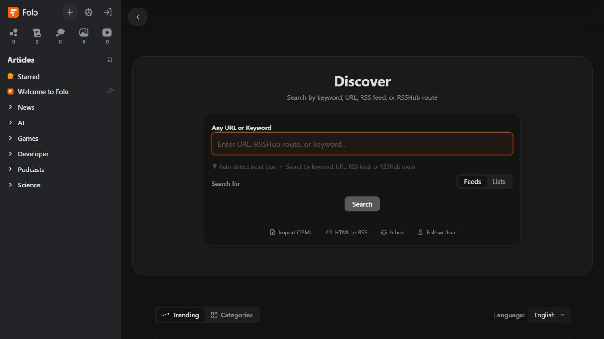
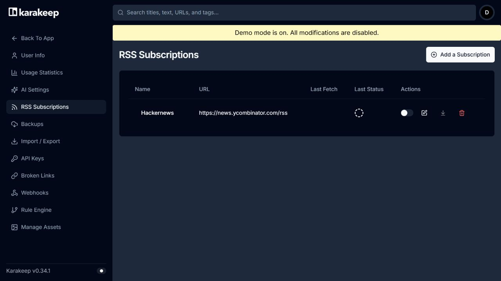

# R842 — Medya kütüphanesini geliştirecek yeni kaynaklar ve RSS sayfası tasarımı

**1 Kasım 2026 · yalnız araştırma/rapor · ürün kodu değişmedi.** Yerel taban: `df972383ab5a9b736b832ba64401b206beb6dedc`. R838/R839/R840/R841 ve önceki araştırmalar korunur. Kullanıcının vurgusu esas alındı: **bu bir medya kütüphanesi; amaç genel chatbot veya haber portalı yapmak değil.**

Bu turda asıl önerim üç parçayı birleştirmek: **eserin kendisini doğru yönetmek → onun etrafındaki kaynakları toplamak → asistana bu kütüphanenin kanıtları üzerinden soru sormak.** RSS sayfası bu akışın gelen kutusudur. Bir yazıda adı geçen film, bir fragman, bir podcast bölümü ve yerel film dosyası aynı kayıt türüne zorlanmamalı.

## Neyi teslim ettim?

| Paket | Ayrıntı | Yeni fark | Öncekinin derinleştirmesi |
|---|---:|---:|---:|
| [Medya kütüphanesi / Keşfet](research842/library/cards.md) | 20 kart | 13 | 7 |
| [Kütüphaneyi bilen asistan](research842/assistant/cards.md) | 22 kart | 15 | 7 |
| [Browser → medya kütüphanesi](research842/browser/cards.md) | 18 kart | 9 | 9 |
| **Araştırma kartları toplamı** | **60** | **37** | **23** |
| [RSS / Akışlar uygulama dosyası](research842/rss/RSS_MEDIA_LIBRARY_BLUEPRINT.md) | **26 sayfa/ürün kararı +3 kod örneği** | Ayrı tasarım paketi | 26 bağımsız yeni özellik diye sayılmadı |

**26 incelenen repo kaydı, 259 indirilen kaynak/lisans/paket dosyası, 6 gerçek web ekranı, 2 resmî sinema RSS beslemesinde gerçek fetch/parse**. Dosyaların tamamının hash'i kontrol edilebilir; asistan paketindeki37 dosya yalnız context indirmesidir, okunmuş çekirdek kod diye sayılmadı. Kodla görülen mekanizma, önerilen ürün sentezi ve README iddiası ayrıdır. [Kaynak indeksi](research842/source-index.json), [kart indeksi](research842/card-index.json), [doğrulama](research842/verification.json).

Bu 60 kart 60 büyük bağımsız özellik/bug değildir. Asistanın22 kartı 6 kullanıcı sonucu ailesinde; sürüm/bonus/parçalı dosya tek eser ailesinde; import preview/checkpoint tek ithal ailesinde gruplanır. Aynı kaynağı farklı ekranda yeniden anlatmak yeni keşif yapılmadı: Browser açık sayfa kaydı ve Jellyfin trickplay kartları son kontrolde derinleştirmeye alındı. `NEW`, R75/R76, R838/R839/R841 ve ilgili yakın araştırmalarla karşılaştırılan mekanizma farkıdır; bütün tarihsel metinlerde hiç anılmadığı garantisi değildir.

Karakeep kullanıcı tarafından özellikle yeniden istendiği için bu tur **RSS worker/parser/settings** kodu incelendi. Karakeep, rss-parser, Jellyfin server, Stagehand ve browser-use yeni repo diye sunulmuyor. Wallabag/ArchiveBox R76'da adlandırılmıştı; bu tur ilk ayrıntılı kaynak okumaları yapıldı. Perplexica'nın güncel Vane kaydı ve Seerr önceki araştırmada bulunduğundan yeni kaynak listesine eklenmedi.

## En çok fark yaratacak yeni geliştirmeler

### 1. Tek film kaydı; birden fazla kesim ve dosya

Bugünkü katalog `localPath/webUrl` taşıyor. Jellyfin'in `Video.LocalAlternateVersions`, `LinkedAlternateVersions` ve resolver modeli, eserin kimliği ile oynatılacak dosyanın ayrı tutulmasına gerçek örnek. **Director's Cut / sinema kesimi / 1080p / HDR sürümü** aynı eser altında seçilebilir; izleme kaydı esere, oynatma konumu gerekiyorsa o kesime bağlanır. Aynı başlıklı remake aynı eser değildir. Boyut/codec otomatik “en iyi sürüm” kararı için yeterli değildir. **L842-01**, M–L. [Sabit Video modeli](https://github.com/jellyfin/jellyfin/blob/5b385862fb97201d954a6ac7c9c745d791a738fa/MediaBrowser.Controller/Entities/Video.cs).

Bonus videoları da bu modelin ayrı ilişkisidir: fragman, kamera arkası, silinmiş sahne, röportaj, commentary. Bunlar ana film izlenmiş sayısını değiştirmez. CD1/CD2 parçalı eski arşiv ise alternatif kesim değil, sıralı aynı içerik parçalarıdır. **L842-02/03**. Bunları ayırmak uygulamanın gerçek medya kütüphanesi hissini poster düzeninden daha fazla güçlendirir.

### 2. Dizi kimliği ile gösterim/izleme sırasını ayır

Özel bölümün sağlayıcıdaki season 0 kimliği ile hangi iki bölüm arasında izleneceği farklı olabilir. Jellyfin `EpisodeXmlReader` NFO'dan `displayseason/displayepisode` alanlarını ayrı okuyor. Bizim bölüm kartı “önerilen izleme sırası” ile kaynak sezon/bölüm kimliğini ayrı tutabilir. Her sağlayıcıda absolute/DVD order hazır bulunduğu iddia edilmiyor. **L842-04**, M. Aynı eser/bonus modeline sezon ve bölüm koleksiyonu da bağlanabilir: **L842-13**. Mevcut next-up/franchise fikri ise L842-05'te derinleştirme olarak kalır.

### 3. Yerel arşivdeki NFO ve yan dosyaları değerlendir

MediaElch/Jellyfin'de gerçek Kodi NFO okuma, sağlayıcı ID'si ve UTF-8 XML alanları var. Kullanıcının klasöründe yıllardır duran doğru bilgiler tekrar çevrimiçi aranmadan önizlenebilir. **NFO → alan farkı → kullanıcı seçimi**; bulunmayan alanlar tahminle doldurulmaz, yanlış filme sessiz eşleme yapılmaz. İlk adım salt okunur import; NFO yazma/yeniden adlandırma aynı iş değildir. **L842-06**, M. [NFO ve metadata kaynak ayrıntıları](research842/library/cards.md).

### 4. Elle düzeltilen bilgi bir sonraki yenilemede kaybolmasın

Jellyfin web metadata editörü `LockedFields` gönderiyor. Mevcut metadata preview'imizi tekrar önermiyorum: fark, **“bu alanı ben belirledim; sağlayıcı yenilemesi değiştirmesin”** politikasını kalıcılaştırmak. Kullanıcı başlık, tarih, poster veya kimlik kaynağını ayrı seçebilir. Toplu editte de her eser için alan farkı ve geri alma makbuzu görünür. **L842-07/12**, M. Bu asistanın “şu beş filmin koleksiyon etiketini düzelt” önerisine de kontrollü zemin sağlar.

### 5. Klasör taraması bir değişiklik gelen kutusu olsun

Jellyfin `LibraryMonitor` watcher yaşam döngüsü/ignore/generation; MediaElch rename-preview yolları pratik referans. Kullanıcı seçtiği klasörde **yeni dosya / kayıp dosya / değişen yan dosya / olası taşınma** farkını görür. Otomatik silme veya ilk isim benzerliğini aynı film sanma yok. Seçimle katalog güncellenir; kullanıcı notları kaybolmaz. **L842-08**, M–L. Dosya düzenleme sonradan **L842-11** ayrı önizlemeli plan olur. Windows case-only rename, kilitli dosya, UNC/uzun yol ve dış disk kopması gerçekten denenmeden kabul edilmez.

### 6. İzleme durumları gündelik kullanıma uysun

Yamtrack/MediaTracker'da ara verme/bırakma ve bölüm notu veri modelleri var. Bizde `planned/watching/completed/unspecified` mevcut; ara verilen dizi “izleniyor” rafını sonsuza kadar doldurmayabilir. “Bıraktım” içeriği silmek veya her şeyi dislike yapmak değildir. Bölüme bağlı kısa not “en son burada ne oluyordu?” sorusunun kullanıcı yazdığı dayanağı olur. **L842-14/16**. Eklenme tarihi de yayın tarihi ve izleme tarihinden ayrı filtrelenir: **L842-20**. Rewatch export ve spoiler görseli eski ailelerdir, yeni sayılmadı.

### 7. Asistan Türkçe adı, orijinal adı ve kütüphane kimliğini birlikte kullansın

Haystack query expansion ve reciprocal-rank fusion gerçek koddan alınabilir yapı taşları. “Esaretin Bedeli üzerine kaydettiğim yazılar” sorgusu doğrulanmış orijinal başlıktan ikinci aday listesi üretebilir; tam ifade, varsa semantik pasaj ve başlık eşleşmesi birleşir. Bu yeni bir film öneri modeli değil, **kullanıcının zaten seçtiği medya kaynaklarını bulma** deneyimidir. **A842-04/05**, M. Alias katalogdan gelir; LLM'nin hayal ettiği alternatif ad yanlış filme genişleme gerekçesi olmaz.

### 8. Kopuk pasajlar yerine bölüm ve yapım düzeninde kanıt

Haystack `AutoMergingRetriever`, yeterli komşu çocuk isabetinde parent bölümünü getirebilir; grouping ranker belgeleri metadata alanlarına göre düzenler. “Bu iki film yalnızlığı nasıl anlatıyor?” sorusunda film→kaynak→video zamanı/sayfa düzeni korunabilir. Bütün röportajı her soruda göndermek de tek cümleyle bağlamı kaybetmek de gerekmeyebilir. **A842-06/08**, M. Eşit film kotası, spoiler/zaman sınırı ve gerçek Türkçe alaka kalitesi bize ait ayrıca ölçülecek davranışlardır. [Asistan kod/fonksiyon kartları](research842/assistant/cards.md).

### 9. Film temalarını kaynaklarıyla bağla; grafı gerçek diye sunma

LightRAG entity/relation ve local/global/hybrid bağlam; kaynak belge silinince destekleri yeniden kurma mekanizmaları içeriyor. Kullanıcı seçtiği kaynaklarda “göç, aidiyet ve eve dönme temasını hangi filmler bağlıyor?” diye sorabilir. Bir eleştirmenin yorumu, filmin metadata gerçeği ve kullanıcının notu ayrı ilişki türleri olmalı. **A842-09/10/11/12**, L ve opt-in. Kaynak silinince yalnız o kaynağa dayanan çıkarımlar geri çekilmeli. Bütün kişisel arşivi otomatik cloud modele indekslemek önerilmiyor; küçük seçili paketle kalite ölçülür.

### 10. Kaynak tarihi, anlatılan olay tarihi ve kayıt tarihi ayrı

Onyx filtre modeli ve Memvid temporal anchor/mention modelleri ilginç gerçek parçalar. 2025'te yayımlanan röportaj 2010 çekimini anlatabilir; 2018 yazısındaki “geçen yıl” bugüne göre çözülemez. “Film çıktığında eleştiriler ne diyordu?” sorusunda kaynağın ilk yayın/güncelleme tarihi görünür kalmalı. **A842-17–20**, tek tarihli bilgi ailesi. Memvid'deki frame video karesi değildir; İngilizce tarih regex'i Türkçe NLP kabulü değildir. Kaynak tarihinin gerçekten çıkarılması ve belirsizlik arayüzü bizim uyarlamamızdır.

### 11. PDF/presskit/JSON boş sayfa gibi okunmasın

Steel scrape yolu content-type'a göre PDF/JSON/HTML ayırıyor; RAG-Anything görsele caption/footnote ve çevre metni ekleyebiliyor. Film basın PDF'inde kostüm görseli hakkında sorulan soruda sayfa açıklaması ve tasarımcı yazısı beraber kullanılabilir. **B842-03/17 +A842-15**. Görsel betimleme kaynak alıntısı değildir; bu bir hazır oyuncu/film tanıma modeli veya CLIP indeksi değildir. Yerel PDF/kitap araçları korunur. PDF rasterizer lisansı ve model maliyeti ayrıca seçilir; Steel'in MuPDF bağımlılığı kör taşınmaz.

### 12. Browser'dan gelen medya, kütüphaneye onaylı taslak olarak girsin

WXT küçük Chrome/Edge companion extension'ın lifecycle/stil izolasyonu; browser-use gerçek tamamlanan download attachment; ArchiveBox preview/checkpoint import yolları için referans. Kullanıcı açık makaleyi veya indirilmiş medya dosyasını **kaynak URL + dosya + önerilen yapım bağlantısı** ile görür. **B842-02/04/05/06**. Mevcut native download/pause/resume/open-player yeteneği yok sayılmadı. Yeni değer kaynak ilişkili ithal ve kaldığı öğeden devamdır; genel browser automation'ın tekrar sayımı değildir.

### 13. Biriktirilmiş sinema yazılarını taşı ve okunabilir paket üret

Wallabag `OmnivoreImport/PocketCsvImport` title/tarih/tag/read-state alanlarını, `EntriesExport.produceEpub` çoklu makaleyi chapter/meta bölümlerine dönüştürüyor. Kullanıcı film kaynaklarını yalnız URL yığını olarak değil **taşınabilir, kaynaklı okuma antolojisi** olarak alabilir. **B842-07/08**, M. Omnivore cloud devam ediyor sanılmıyor; mevcut kullanıcı exportuyla yerel göç. Tam annotation taşınması ve EPUB'un her reader'da görünümü bu kaynak okumasıyla doğrulanmadı.

### 14. “20 dakikam var” yalnız film süresi demek olmasın

Wallabag okuma hızıyla ölçeklenen reading-time filter, kütüphanede8dakikalık video ile12dakikalık röportajı aynı zaman bütçesinde seçmek için kullanılabilir. **B842-09**, M. Süre tahmini açık kalır; en ileri okunan yer ve son cursor aynı şey değildir. Eski okuma ilerleme önerisi B842-16'da ayrıca derinleştirme olarak tutulur. Asistan seçeneği kullanıcının gerçekten sahip olduğu metin/video kapsamında sunar.

## Yeni RSS sayfasını nasıl kurardım?

**[Tam RSS uygulama dosyası: 26 karar, kaynak akışları, tasarım örnekleri ve kod](research842/rss/RSS_MEDIA_LIBRARY_BLUEPRINT.md)**

RSS için tek cümlelik yön: **yazı/fragman/podcast gelen kutusu → kaynak veya yapımla onaylı ilişki → ilgili kaynaklarla asistan**. Kütüphanenin ana eser rafını otomatik haber girdileriyle doldurmam. Kullanıcının ileride ana sohbete taşıması için ayrıca [aktarılabilir geliştirme özeti](research842/ANA_SOHBETE_AKTAR.md) hazırladım.

Bugün YouTube Atom, YouTube OPML ve podcast RSS/enclosure/progress zaten var. Yeni sayfa bunları bozmayacak genel feed modelidir. RSS dosyasında Karakeep'in gerçek worker/parser/import tablosu; Miniflux'in autodiscovery/format/conditional HTTP; Folo'nun çoklu medya görünümü; RSSHub'ın siteye özel adapter/cache yaklaşımı tek tek açıklanır. **Folo istemci kodunun remote API çağrısı, yerel RSS backend'i yerine geçmez.**

İlk kapsam: URL/site keşfi ve abonelik önizlemesi; ilk ithal miktarı; makale/video/podcast ayrımı; okunma/kaydetme/izleme durumlarının ayrılması; kısmi hata ve son içerik; OPML; ID/cursor sınırında toplu okundu; mevcut oynatıcı. İkinci kapsam: yapımla eşleme önerisi, kütüphanedeki filmlere dair yeni kaynaklar, seçili kaynaklar üzerinde asistan. Sonraki kapsam: RSSHub seçimi, bütçeli digest ve isteğe bağlı kendi koleksiyonundan feed yayımlama.

### Gerçek ekranlara dayanan tasarım yönü

Folo'nun tek URL/keyword/route girişini örnek alırım. Fakat bütün backend/account/AI özelliklerini yerel kabul etmem. Bu ekran yalnız logged-out onboarding gözlemidir; başarılı feed import/model çağrısı yapılmadı. Medya kütüphanemizde normal RSS hesabı zorunlu olmadan öne çıkar; tek amber vurgu mevcut tema ile sürer.

Karakeep'in ad/URL/son fetch/son status tablosu yönetim için iyi. Ana RSS sayfasını ise bunun gibi yalnız ayar tablosu yapmam: solda kaynaklar, ortada medya türüne göre liste, sağda isteğe bağlı reader/asistan. Dar pencerede üçüncü sütun sıkıştırılmaz; Liste/İçerik geçişi olur. RSS dosyası geniş/dar yerleşim, boş/hatalı/özet/partial durumlar ve3 özgün kod örneği içerir.

FreshRSS'nin gerçek kamu demosu da kompakt liste/reader açısından incelendi. Altı görüntü yeni alındı; eski R841 görüntülerini yeni ekran kanıtı diye saymadım. [Görsel manifesti](research842/visual/manifest.json). Hosted build commit'leri bilinmiyor; screenshot, pinned GitHub HEAD'in runtime kabulü değildir.

**Canlı kaynak kontrolü:** Criterion'ın kendi RSS duyurusundan bulunan Current ve The Daily URL'leri HTTP 200 ile indirildi; XML'de20'şer item görüldü. Bu yalnız anlık fetch/parse; bütün görseller/tam metin/gelecek erişim/medya playback kabulü değil. Letterboxd Journal RSS footer linki doğrulandı; aynı HTTP/parser seviyesinde test edilmiş sayılmadı. [Gözlemler](research842/rss/live-feed-observations.json), [resmî Criterion duyurusu](https://www.criterion.com/current/posts/8138-history-lessons), [Letterboxd Journal](https://letterboxd.com/journal/).

## Hangi repo hangi parçaya değer?

| Yeni ayrıntılı kaynak grubu | Asıl alınacak parça | Edinme tercihi |
|---|---|---|
| Jellyfin web/server, MediaElch | Sürüm/parça/bonus modeli; NFO; kilitli alan; watcher; rename preview | Küçük model/algoritma uyarlaması veya belgeli servis API'si; bütün .NET/Qt uygulaması gömülmez |
| Kometa | Koleksiyon üyelik politikası ve güncelleme farkı | Seçilmiş MIT davranış portu; Plex/otomasyon sistemi zorunlu değil |
| Yamtrack / MediaTracker | İzleme durumu, bölüm notu ve farklı tarih alanları | Küçük yerel model/UI portu; yeni server hesabı gerekmez |
| Haystack | Query expansion, RRF, parent merge, grouping, citation parser | Apache seçilmiş algoritma/model portu; her retriever birlikte kurulmaz |
| GPT Researcher | Soru-hedef bağlantısı ve açık kalan bilgi ihtiyacını takip | Apache sınırlı araştırma policy portu; her derin dal ayrı ücret/model çağrısıdır |
| Onyx non-ee | Kaynak kapsamı ve tarih filtreleri | İncelenen MIT non-ee parça; enterprise ağ/arama platformu taşınmaz |
| LightRAG | Kaynaklı tema/ilişki, kanıt context'i, kaynak silmede yeniden kurma | MIT opt-in pilot; film ontolojisi ve Türkçe kalite hazır değildir |
| RAG-Anything | Görsel/video+ses yan kaynak birleştirme ve çevre açıklama | MIT seçilmiş adapter veya izole deney; var olan Whisper çıktısı yeniden kullanılmalı |
| Memvid | Belge tarihi/olay mention/relative anchor modeli | Apache seçilmiş zaman modeli; Rust store ve frame kavramı olduğu gibi video modeline çevrilmez |
| Wallabag / Omnivore / ArchiveBox | Tarihli export göçü, EPUB, preview ve checkpoint import | Dar port veya export-adapter; Omnivore cloud kapalı, ArchiveBox dev Python>=3.13 |
| WXT / Steel | Companion extension lifecycle; PDF/JSON/HTML içerik yönlendirme | Küçük bağımsız eklenti/adapter; Steel session extraction her oturumu taşımıyor |
| Miniflux / rss-parser | Feed keşfi/format/conditional-fetch desenleri ve XML parser | Apache/MIT küçük Node portu/adapter; Go sunucusu ilk gereklilik değil |
| FreshRSS / Folo / RSSHub / RSSGuard | Akış durumu, medya görünümü, kaynak adapter'ları ve player olayları | Koşullarıyla seçilmiş model/UX portu; PHP/Qt/cloud backend göçü değil |
| Karakeep | RSS worker → parser → source:RSS bookmark → import kaydı; feed yönetimi | Özellikle istenen RSS mekanizması; mevcut yerel store ve main kuyruğa uyarlama |

Tam HEAD, dosya, sembol ve lisanslar alanların `repositories.json/source-manifest.json` dosyalarındadır. Kullanıcının isteğiyle copyleft kaynaklar peşinen elenmedi; GPL/AGPL koşullarıyla gerçek kod alımı da seçenek. Folo ikon istisnası, FreshRSS tek dosyada CC BY-SA başlığı, Onyx ee, MuPDF/PSPDFKit gibi transitif sınırlar açık. Bu notlar raporu lisans korkusuyla kısıtlamak için değil, seçilen kodun gerçekten alınabilir yolunu belirtmek içindir. Yeni dependency kurulmadı veya ürün lisansı değiştirilmedi.

## İlk geliştirme paketini ben nasıl seçerdim?

1. **Medya temeli:** eser/sürüm/bonus ayrımı +NFO preview +alan kilidi. Sonra watcher gelen kutusu. Bu yapı RSS'den gelen yazı ile film dosyasının karışmasını da önler.
2. **Çalışan Akışlar:** genel feed servisi, bounded fetch/store, okunma, türler, reader, podcast geçişi ve OPML. Kullanıcının istediği yeni sayfanın ilk somut teslimi budur.
3. **Asistan farkı:** alias/RRF → bölüm bağlamı → film/kaynak düzenli kanıt; RSS ve mevcut kaynaklar aynı scope sözleşmesinde kullanılır.
4. **Kütüphaneye giriş:** dış tarayıcı gönderimi +indirme taslağı +eski read-later export göçü. İzinsiz arka plan toplama veya otomatik dosya taşıma değil.
5. **Ölçümden sonra:** LightRAG tema ağı, multimodal video/presskit, temporal olay modeli, RSS digest. Büyük paketler seçili veriyle pilot kalır; sadece makine güçlü diye varsayılan GPU/index yükü oluşturulmaz.

Bu sıralama uygulanmış plan veya kullanıcının feature onayı değildir. Raporu ana sohbete aktarınca seçilen ilk paketin mevcut kod ve gerçek Windows ekranıyla doğrulanması gerekir. Yeni müzik analizi veya öğrenme ürünü hedefi eklenmedi.

## Yapılan doğrulama ve sınırlar

Üç GPT‑6.1 Sol medium ajanı alanları bağımsız araştırdı; ana ajan RSS kaynaklarını, canlı web ekranlarını, iki feed'i, alanlar arası tekrarları ve kanıt paketini kontrol etti. Superpowers paralel görev yöntemi kullanıldı. Kaynaklar yalnız ignored cache'e indirildi; upstream installer/build veya tam kaynak gövdeleri public rapora alınmadı.

Yerel/indirilen hash, pinned40 SHA, kart ID/sayım/bağlantı, JSON,6 görsel ve3 kod örneğinin sözdizimi kontrolü yapılır; sonuç [verification.json](research842/verification.json) içindedir. Bunlar canlı model kalitesi, öneri memnuniyeti veya ürün regresyon testi değildir. [Yeniden kontrol yöntemi](research842/REPRODUCE.md).

**Çalıştırılmayanlar:** ürün npm/bridge/backend testleri, start.bat/install.bat, gerçek Windows native RSS sayfası/DPI/GPU/DRM, upstream uygulama build'leri, kişisel Letterboxd/özel feed, canlı LLM/embedding/graph, podcast playback, uzun feed-soak. CI kapatılmadı, sonucu beklenmedi ve yeşil kabul edilmedi. Kanıtlanan az şey ile tasarlanan gelecek davranış ayrıdır.

Ürün kodu, ayar, bağımlılık ve kişisel dosyalara dokunulmadı. Eski raporlar ve mevcut ilgisiz OFFLINE-MANIFEST/INDEX/start.sh değişiklikleri korunur. Buradaki önerilerin hiçbiri uygulanmadı; ana sohbet için araştırma ve uygulanabilir kaynak seçimi teslimidir.
