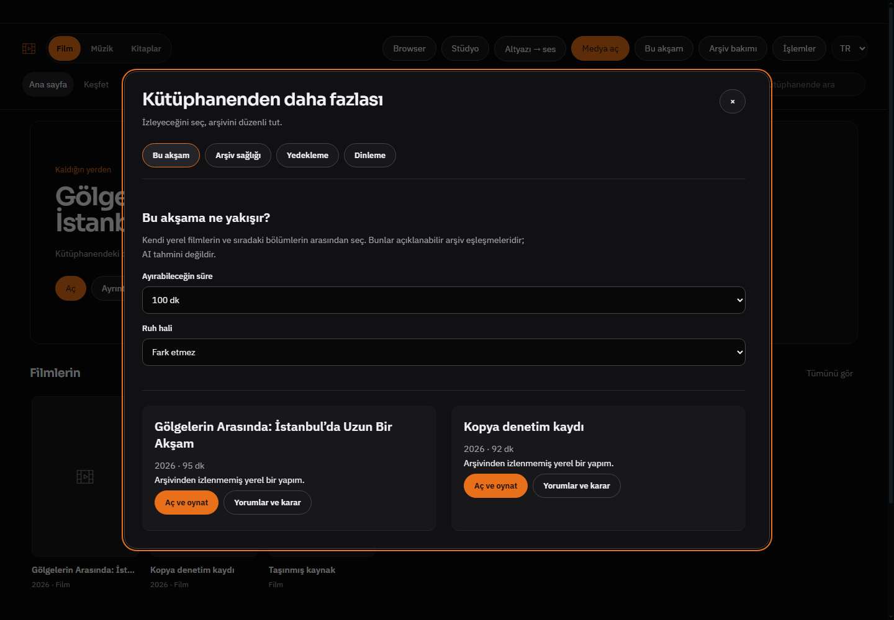
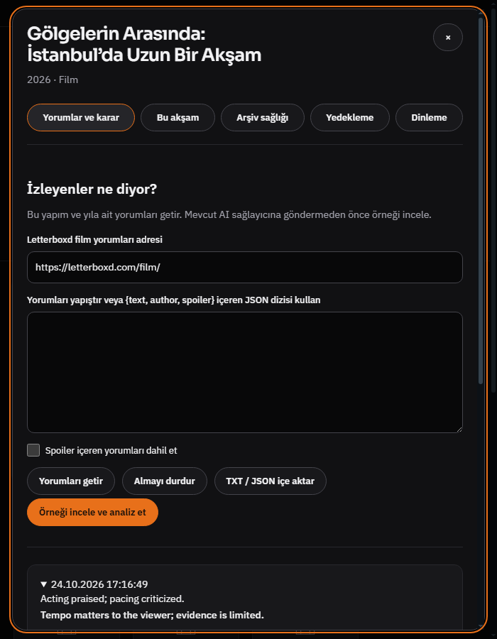
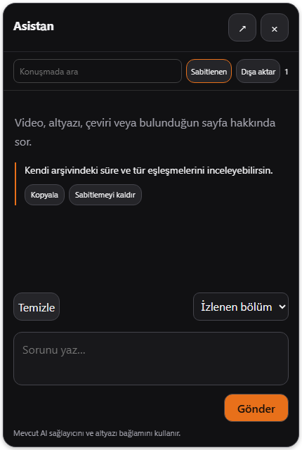

# Luna medya araçları — uygulama ve Windows kanıtı

24 Ekim 2026. Önceki [kaynak karşılaştırmasının](LUNA_NEXT_FEATURES_2026-10-24.md) altı önceliği bağımsız Whisper koduyla uygulandı. Luna kaynak kodu kopyalanmadı; yeni bağımlılık yok. Başlangıç HEAD 7f6f223f98808bcc4959550905b3970a3489555f; bitiş ürün kodu edae7995446ecf082bba2049a56d9c03e1d2d1b6. Dal codex/luna-media-home532, PR482. Ana master kopyası değiştirilmedi/birleştirilmedi.

## Kullanım ve gerçek kapsam

- **Yapım yorumları:** Kütüphane ayrıntısı → Yorumlar ve bana uygunluğu. Seçilen yapım/yıl için açık Letterboxd film yorum adresi, TXT/JSON içe aktarma veya yapıştırma. En fazla 100 yerel yorum/120 bin karakter; siteden tek sayfanın en fazla 50 görünür yorumu. Site erişimi/biçimi değişirse açıklamalı hata ve dosya/yapıştırma alternatifi. Otomatik film araması veya uzun yorumların bütün sayfalarını okuma iddiası yok. Spoiler filtresi ve indirmeyi durdurma var. Kullanıcı örneği gördükten sonra mevcut AI sağlayıcısına sınırlı yorum örneği ve açık zevk tercihleri gider. Her analiz maddesi tam kaynak alıntısıyla doğrulanır, kullanıcı kaydetmeden geçmişe yazılmaz; en son sekiz analiz tutulur. İzledikten sonra beğeni, altı gerekçe ve kişisel yorum ayrıca saklanır. Beğenme olasılığı uydurulmaz.
- **Bu akşam:** Ana sayfa düğmesi veya Medya aç. Yerel, izlenmemiş film/sıradaki bölüm; süre ve ruh hali/tür eşleşmesi, açıklama, afiş, doğrudan oynatma/yorum bağlantısı. Son seçilen altı yapımın önceliği düşürülür. Süre sınırında bilinmeyen süreler dışlanır. Henüz doğrulanmamış içe aktarım kaynakları önerilmez. Bu deterministik yerel eşleştirme; AI sonucu değildir.
- **Arşiv sağlığı:** Ana sayfa Arşiv bakımı. Bağlı yerel katalog kaynakları için kayıp dosya, metadata eşleşmemesi, sample adı, eşit boyut adaylarında tam SHA-256 ile birebir kopya, yan dosya ve ffprobe ile gömülü altyazı kontrolü. İptal, ilerleme, arama, 100 bulguluk görünür sınır; kaynak silme yok. Altyazısız kaydı mevcut Whisper stüdyosuna hazırlar; kullanıcı incelemeden iş başlatmaz. Diskteki bütün klasörlerin bağımsız taraması değildir; klasör ekleme mevcut medya merkezinde.
- **Yedekleme:** Arşiv bakımı → Yedekleme veya Medya aç içindeki kısayol. Mevcut .wbp sözleşmesine media-shelf, media-enrichment, takip klasörleri ve torrent indeksi eklendi. Paket önizlemesi yeni/farklı/aynı dosya sayılarını ve yeni kayıt gruplarını gösterir. Mevcut güvenlik kopyası/rollback/yeniden başlatma korunur; dublaj işi açıkken geri yükleme engellenir. Klasör takipleri ve torrent kayıtları duraklatılmış geri yüklenir; klasörü yeniden taramak takibi etkinleştirir. Seçili klasöre günlük/haftalık otomatik yerel paket ve son yedi kendi dosyasını tutma var. Farklı adlı dosyalar silinmez. Program açıkken kontrol edilir; kapalı uygulama için Windows görevi kurulmadı. Ayar/hesap anahtarları, medya dosyaları, modeller ve dış referans/üretilmiş WAV dosyaları dahil değildir; ekran bunu belirtir. Yedek başka bilgisayara fiziksel medya taşıma garantisi değildir. Asistan pinleri ayrı native partition'da, bu pakete dahil değil.
- **Asistan:** Yerel baloncuk aynı sohbeti kullanır. Ctrl+F/arama, kaynağa bağlı kalıcı sabitleme, konuşma temizlense bile sabitlenen notu okuma, kopyalama/kod kopyalama, eski soruyu yeni soru olarak düzenleme, Markdown/TXT dosyasına dışa aktarma. Geçmiş yanıtı sessizce yeniden yazmaz. Canlı iş scope/generation güvenliği korunur; salt okunur pin kimliğinde değişken generation kullanılmaz. Sabitlenen notlar sağlayıcıya otomatik bağlam olarak gönderilmez.
- **Dinleme:** Arşiv bakımı → Dinleme. Film, müzik ve dublaj için özgün/gece/konuşma/tepe koruması. Film/müzik profilleri native mpv'de sabit izinli lavfi acompressor ayarları; dublaj ve önizlemesi yerel WebAudio ile. Browser mevcut site profiline devam eder. Normal Chromium videosunu WebAudio'ya kalıcı yönlendirip ileride CORS'suz akışları sessiz bırakmamak için o ses yolu korunur. Dolayısıyla bütün motorlarda aynı DSP uygulanmış iddiası yok; arayüz bu farkı anlatır. Üretilmiş WAV/pitch/TTS modeli değiştirilmez. Yeni on bant EQ eklenmedi.

## Tasarım ve görsel doğrulama

frontend-design, luna-ui-design ve web-design-guidelines yönergeleri kullanıldı. Mevcut Luna/Whisper yüzey, Sora/Plex, vurgu ve açık tema token'ları korundu. Merkezli, kaydırılabilir tek araç penceresi; görünür odak, etiketli kontroller, durum/ilerleme, dar pencerede tek sütun. Yeni dış font/CDN/inline script yok.

Ekranlar gerçek Windows Electron/main/preload ile ayrı sentetik profilde açıldı. 1440 koyu TR, 700 koyu TR ve 940 açık EN kontrol edildi; yeni pencere yatay taşmadı, alt içerik kaydırılabilir. Görsellerdeki film/yorum/yanıtlar gerçek kullanıcı verisi veya gerçek model kalite kanıtı değil. İlk görsel turda saptanan sol üste yaslanma merkezleme ile düzeltildi. Eski dialog'un geç kapanışının yeni dialog'u silmesi ve katalog ayrıntısı açıkken paket kısayolunun no-op olması etkileşimle düzeltilip tekrar doğrulandı.

## Kontroller ve sınırlar

Geçti:
- node --test tests/media-tools.test.js: 6 anlamlı davranış testi; sahte alıntı/tekrarlı kimlik, süre/izleme kapısı, yetki, yeni paket kapsamı/anahtar dışlama, bozuk şema/kapalı klasör, birer bayta bölünmüş Türkçe UTF-8 ve iptal, yedi otomatik yedek/ilgisiz dosyayı koruma.
- tests/media-hub.test.js, media-taste.test.js, assistant-overlay.test.js, workspace-privacy.test.js, workspace-restore-regressions.test.js hedefli koşuları.
- preload-sandbox ve preload-usage-ratchet (284 export, 0 kullanılmayan).
- electron-media-tools.smoke: gerçek katalog ayrıntısından giriş; kontrollü AI örneği/alıntı doğrulayıp kaydetme; kopya/kayıp tarama; yedek yazma ve mevcut açık katalogdan geri yükleme ekranına geçiş; dinleme formları; dar/açık tema; native asistan pininin sohbet temizlendiğinde erişilebilirliği.
- WHISPER_NATIVE_TEST=1 ve kurulu mpv ile electron-media-home.smoke: mevcut altyazı/dublaj descriptor/offset, Home/return, native geçiş/geri dönüş; yeni gece filtresinin gerçek mpv'de kabulü ve keyfi filtre reddi.
- Değişen JS sözdizimi ve git diff --check.

Windows test çıkışları .uiprev/media-tools/1792851408231-24704 ve .uiprev/media-home-smoke/1792851107393-24824. İlk Node test runner spawn EPERM ortam sınırı, yükseltilmiş aynı hedefli koşuyla çözüldü. İlk UI fixture normal save API ile kaynak/runtime göndermeye çalışıyordu; API bunları tasarım gereği reddetti. Fixture yerel sentetik katalog seed'ine düzeltildi; ürün güvenlik kapısı gevşetilmedi.

Tam npm test, paketleme, gerçek start.bat açılışı, CUDA/TTS kalite testi, DRM ve canlı ücretli sağlayıcı koşulmadı. Electron kontrolleri --disable-gpu kullanır; normal Windows launcher/GPU doğrulamasına eş değildir. Canlı Letterboxd erişimi bu tur denenmedi; kontrollü HTML/UTF-8/iptal test edildi. Site engelleri ve gerçek modelin semantik kalitesi için başarı iddiası yok. CI açık kalır, teslim sonucu beklemez. Sonraki kullanımda gerçek yorum örneğinin kalitesi kullanıcıyla değerlendirilebilir.
