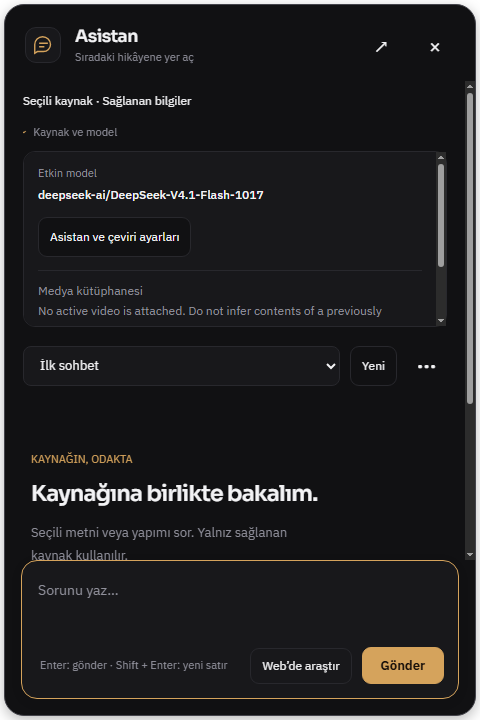
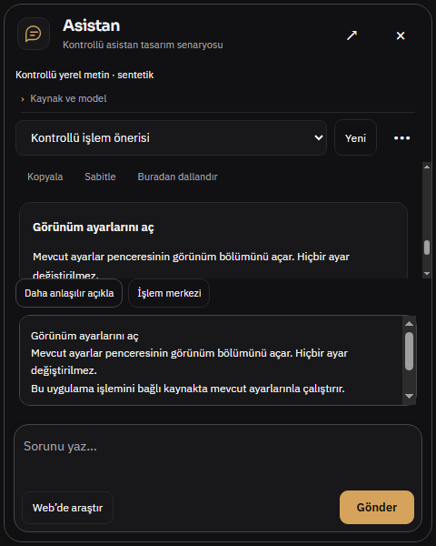

# Asistan tasarım denetimi — 1 Kasım 2026

Durum: asistan alt denetimi tamamlandı. İki güncel, doğrulanmış P2 bulgu; tarihsel tekrar sayılmadı; P0/P1 yok. Ürün/test kodu değiştirilmedi.

- Snapshot: `codex/design-coherence-20261101`, `2bb0e861de044ea25c70892009ce361fb651ebe0`.
- Platform: gerçek Windows Electron; izole yeni profil, kullanıcı uygulaması/profili ve canlı API yok.
- İlk kanıt: mevcut `tests/electron-assistant-design-tour.smoke.js` yeniden çalıştırıldı; 24 sentetik snapshot, 360×600 ve 480×720 CSS px, EN/TR, açık/koyu, zorlanmış device scale 1 (96 CSS dpi eşdeğeri). `capturePage()` gerçek Electron renderer görüntüsüdür; işletim sistemi çerçevesini içermez.
- Çıktı: `.uiprev/assistant-design-tour/1793503526855-after/result.json`: ok:true; boş durum, kaynak ayrıntısı, uzun kod, mesaj, reasoning ve menü; kaynak modeli/mesajları/starter etiketleri kontrollü sentetiktir. İngilizce sentetik verinin TR ekranında görünmesi yerelleştirme hatası olarak sayılmaz.
- İlk sandbox açılışı Mojo erişim engeliyle çalışmadı; izole Electron aynı komutla sandbox dışında açılıp 24 snapshot tamamlandı. Bu ürün hatası değildir.
- Kapsam ilkeleri: mevcut grafit/amber kimliğini koruyan Operate/Read incelemesi; geçmiş raporların PASS kayıtları yeni bulgu değildir.

## İlk doğrulamalar

24 durumdaki sayfa yatay taşması, composer görünürlüğü, mesajların composer üstünde kalması, kaynak açıklamasının kendi bounded alanı, uzun kodun kendi yatay kaydırması, menü Escape odağı, reduced motion ve kontrollü stream sırasında geçmiş mesaj konumu mevcut smoke tarafından geçti. Bu sonuç model yanıt kalitesi veya gerçek sağlayıcı doğrulaması değildir.

## Tamamlanan ek inceleme

Ana uygulamada native popup/overlay 1440×800 ve 800×800 içerik boyutlarında incelendi; gerçek yerelleştirilmiş kaynaksız başlangıç ve source disclosure yakalandı. Aynı üretim renderer ayrı izole BrowserWindow içinde 360/480 px genişlikte uzun mesaj, reasoning ve aksiyon onayıyla incelendi. Bu ayrı pencere test kabuğudur; üründe yeni bir bağımsız pencere özelliği bulunduğu iddia edilmez.

## Güncel bulgular: 2 doğrulama, tarihsel tekrar yok

## A-01 · P2 — Kaynak yokken seçili kaynak varmış gibi başlangıç durumu

**Gözlenen sorun (tercih değil).** Temiz profilde ana sayfa açık, video/kitap/yapım seçilmemişken panel “Seçili kaynak · Sağlanan bilgiler” ve “Kaynağı özetle” gösteriyor. “Kaynak ve model” açılınca Türkçe UI içinde `No active video is attached. Do not infer contents of a previously opened video.` iç talimatı kullanıcı metnine karışıyor. Kaynak sınırlaması aslında doğru, fakat boş durum kaynak varmış gibi konuşuyor ve geliştirici/model talimatını yerelleştirmeden gösteriyor.

- **Tekrar:** izole boş profil → ana sayfa → asistan balonunu aç → Kaynak ve model. Gerçek veri veya model isteği yok.
- **Native boyut:** ana pencere içerik 1440×800; native view x944/y56, 480×720; DPR/ekran scale 1; TR/koyu. 800×800 EN/açık tekrarında da “Selected source · Provided metadata” görülüyor.
- **Kanıt:** [kaynak ayrıntısı](assets/assistant-1440-tr-dark-source.png), [gerçek boş durum](assets/assistant-1440-tr-dark-empty.png), [EN/açık geniş](assets/assistant-800-en-light-expanded-empty.png), [ölçümler](assets/assistant-measurements.json).
- **Kod:** `src/renderer/renderer.js:19839–19849` kaynak yerine home/studio nesnesi ve İngilizce note üretir; `src/renderer/global-assistant.js:21–56,78` bu nesneden context, öneriler ve kullanıcı açıklaması üretir; `src/assistant-source-preview.js:8–10` kitap dışındaki her nesneyi seçili kaynak sayar.
- **Etki:** kullanıcı modelin hangi içeriği görebildiğini yanlış yorumlayabilir; kaynaksız özet eylemi çağrı yapmaya davet eder. Özetin gerçek API'de ne yaptığı sınanmadı; modelin hayalî içerik ürettiği iddia edilmez.

- **Somut öneri:** home/studio kaynak durumunu seçili içerikten ayır; “Henüz kaynak seçilmedi” / “No source selected” göster; özet/açıklama starter'ını kaynak gelene kadar kaynak seçme yönlendirmesiyle değiştir. Model güvenlik notunu prompt katmanında tut; görünür açıklamayı iki dilde kullanıcı odaklı yaz. Kütüphane arama ve genel uygulama yardımı kullanılabilir kalabilir.
- **Kabul:** temiz profil TR/EN ve açık/koyu modda hiç kaynak seçmeden panel açıldığında seçili eser/sağlanan içerik iddiası veya iç İngilizce talimat görünmez. Gerçek kitap/yapım seçilince doğru kaynak fişi ve özet geri gelir. Önceki video bağlamını yanlışlıkla eklememe koruması korunur.
- **Sınır:** genel yardımın kaynak olmadan kullanılması hata değildir; buradaki sorun bağlamın temsilidir. Tarihsel R819 modal katman bulgusundan farklıdır; o sorun yeniden sayılmadı.

## A-02 · P2 — Kısa panelde işlem onayının düğmeleri görünmeden açılması

**Gözlenen sorun.** Normal “Uygula” düğmesine native mouseDown/up gönderildikten sonra onay metni açılıyor fakat “Devam et” ve “Vazgeç” ilk görünür alanda yok. Kullanıcı işlemi tamamlamak için onay kutusunun kendi iç kaydırmasını keşfetmek zorunda. Aksiyon handler'ı odağı yeni karara taşımıyor; kaynak özetinden ayrı bir küçük kutuda aynı açıklama tekrarlanıyor. Bu durum yalnız uzun roman gibi uç bir metinle değil, iki kısa cümlelik görünüm ayarı önerisiyle oluştu.

- **Tekrar:** kontrollü snapshot'ta iki mesaj ve bir `app_action` kartı → mesaj alanını sonuna getir → Uygula → yeni onay kutusunu incele. Gerçek API/ayar eylemi çalıştırılmadı. Snapshot doğrudan native panel'e gönderildi; üretim kart render'ı ve click handler'ı değiştirilmedi.
- **Native viewport/theme/locale/DPI:** 480×600 ve 360×600 CSS px; TR/koyu; DPR 1, zorlanmış scale 1. 480×720 karşılaştırması düğmeleri görünür gösteriyor; 360×480 yalnız stress case, desteklenen asıl pencere boyutu kabul edilmiyor.
- **Kanıt:** [480×600 ilk onay](assets/assistant-480x600-action-after.png), [360×600 ilk onay](assets/assistant-360x600-action-after.png), [480×720 karşılaştırma](assets/assistant-480x720-action-after.png), [kısa panel ölçümleri](assets/assistant-action-short-measurements.json), [diğer ölçümler](assets/assistant-action-measurements.json).
- **Ölçüm:** 480×600'de `#review` y346…446 ve yüksekliği 100 px; `#reviewConfirm` y445,75…479,75. Böylece düğme kutunun scroll sınırının altında; ekran görüntüsünde Devam et/Vazgeç okunmuyor. Workspace scrollTop 0; active element onay düğmesi değil. 360×600'de onay düğmesi y464,94…498,94, review alt sınırı yine446.
- **Kod:** `src/renderer/assistant-overlay.css:79,105` onay bütününü overflow:auto ve kısa ekranda max-height:100 px yapar; `src/renderer/assistant-overlay.js:164` apply handler yalnız review hidden değerini ve metni değiştirir. Aynı dosya `:76,119` diğer onay girişlerinde zaten confirm.focus() kullanır.
- **Etki:** görünür bir sonraki adım yok; kullanıcı Uygula'nın sonuç vermediğini veya işlemin bittiğini düşünebilir. İşlem izinsiz uygulanmıyor, düğmeler DOM'dan kaybolmuyor; iç scroll/klavye ile erişim mümkün. P2, tamamlamayı bütünüyle engelleyen hata değildir.

- **Somut öneri:** onay metnini kaydırılabilir tutarken karar düğmelerini ayrı sabit satırda görünür bırak; onay açılırken başlığın/ilk kararın görünürlüğünü ve uygun odağı kur. Onay kutusu dış workspace içinde de görünür konuma getirilsin. Mesaj veya taslak silinmesin; native panel davranışı korunsun.
- **Kabul:** 480×600,360×600,480×720 ve EN/TR'de kart Uygula'sından sonra açıklama ve Devam et/Vazgeç ilk bakışta görünür; uzun açıklama kararları aşağı itmez. Tab/Shift+Tab ve Escape tutarlı; onay verilmeden action IPC gönderilmez. 360×480 ek dayanıklılık kontrolüdür.
- **Sınır:** sentetik mesaj ve öneri; canlı modelin doğru eylem üretmesi, işletim sistemi fare hit-routing'i ve gerçek uygulama ayarı sonucu test edilmedi. Mouse girdisi izole Electron webContents'e gönderildi. Mevcut smoke'un composer görünürlüğü başarısı bu iç onay görünürlüğünü kapsamıyor.

## Olumlu bulgular ve tasarım tercihleri

- Grafit/amber kimlik, kaynak fişi, Sora başlık ve IBM Plex metin hiyerarşisi popup'ta tutarlı; açık tema aynı içerik mimarisini sürdürüyor. Genişletme 480 px'den 780 px sınırına geçiyor; 800px ana içerikte view 776×736 oluyor.
- Composer ayrı flex satırı; uzun yanıt/kod onu örtmüyor. [Uzun kod](assets/assistant-480x720-long-code.png) kendi yatay scroll'una sahip; [reasoning](assets/assistant-360x600-reasoning-light.png) ayrı durumu ve iptali gösteriyor.
- Source disclosure ayrıntıyı bounded alanda tutuyor; menü Escape odağı ve reduced-motion mevcut smoke'da doğrulandı. Bunlar tarihsel testlerin güncel HEAD'de yeniden doğrulanmasıdır, yeni keşif sayılmaz.
- **Tercih / iyileştirme, hata sayısına dahil değil:** boş karşılama üstündeki “KAYNAĞIN, ODAKTA / YOUR SOURCE, IN FOCUS” eyebrow'u mevcut brief'e ek bilgi sağlamıyor; kaynak fişi ve ana başlık aynı işi zaten yapıyor. Kaldırılması ana çalışma alanı kimliğini koruyup daha az dikey alan kullanır. Ürün davranış kusuru diye sınıflandırılmadı.

## Detector ve kapsamın teknik sınırları

`impeccable context --target src/renderer/assistant-overlay.html` incumbent refinement'a izin verdi; eksik PRODUCT.md bu salt incelemede engel yapılmadı, drift onarılmadı. `impeccable detect --cdp 9238 --target assistant-overlay.html --json` gerçek görünen izole native renderer'a bağlandı. [Ham detector sonucu](assets/assistant-detector.json) uyarılarla exit 1 döndü; test crash'i değildir. 11 px kaynak/meta ve10 px rol etiketleri ile nested card uyarıları çıktı. Rol etiketi, conversation bubble ve composer gibi semantik sınırlar bağlamda anlamlı; bunlar otomatik biçimde doğrulanmış kusur/WCAG ihlali sayılmadı. 11 px yardımcı metin için tercih olarak büyütme düşünülebilir; ana yanıt metni14 px. Toplam hata sayısı **2 P2** olarak kaldı.

Detaylı ekran okuyucu, fiziksel dokunma,125/150/200% Windows ölçeği, gerçek sağlayıcı/model davranışı, native GPU/video, gerçek dosya veya uzun sohbet kalıcılığı bu tasarım alt denetiminde ölçülmedi. Bu nedenle tam WCAG uygunluğu veya performans puanı verilmez. Gerçek ekran VG27AQ1A 2560×1440/144 Hz, scaleFactor 1; zorlanan Electron device scale 1 ile DPR 1 ölçüldü. Kullanıcıya ait profil/sekme/ayar kullanılmadı.

Ana parent `capturePage()` native child WebContentsView'ı bileştirmediği için `*-parent.png` dosyaları asistanın konumunu kanıtlamaz. Asistanın gerçek piksel kanıtı ayrı `assistant-*.png`, konumu ise `assistant-measurements.json` view bounds'dur. Parent görüntüleri yalnız ana sayfanın seçimsiz durumunu ve ana pencere viewport'unu belgeler.

Kalıcı sonuçlar: [24 durum sonucu](assets/assistant-tour-result.json), [24 durum ölçümleri](assets/assistant-tour-measurements.json), [gerçek ana uygulama ölçümleri](assets/assistant-measurements.json), [aksiyon ölçümleri](assets/assistant-action-measurements.json), [480×600 onay ölçümleri](assets/assistant-action-short-measurements.json). İzole harness'ler `tmp/design-audit/assistant-native.cjs` ve `assistant-actions*.cjs` altında ignored geçici dosyalardır; ürün/test kaynağı değildir. Test dışındaki `docs/OFFLINE-MANIFEST.md`, diğer alt denetim raporları ve kişisel uygulama durumuna dokunulmadı. Commit/push yapılmadı.

Önerilen sonraki uygulama sırası: A-01 için bağlam/boş durum metni (`$impeccable clarify`), A-02 için kısa panel onay düzeni (`$impeccable adapt`), ardından aynı yakalamalarla `$impeccable polish`. Bu alt denetimde düzeltme yapılmadı.

