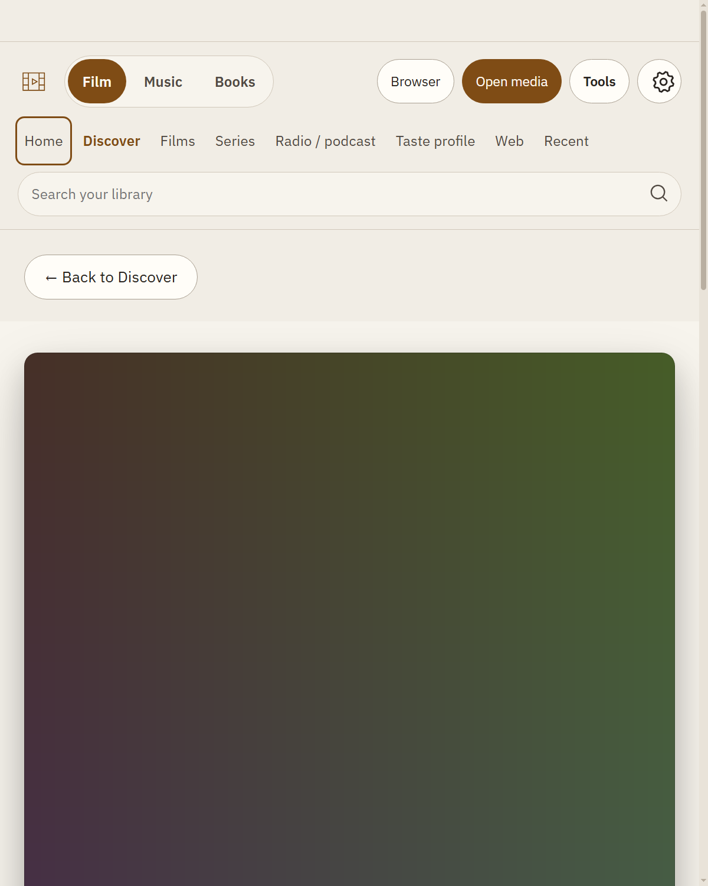
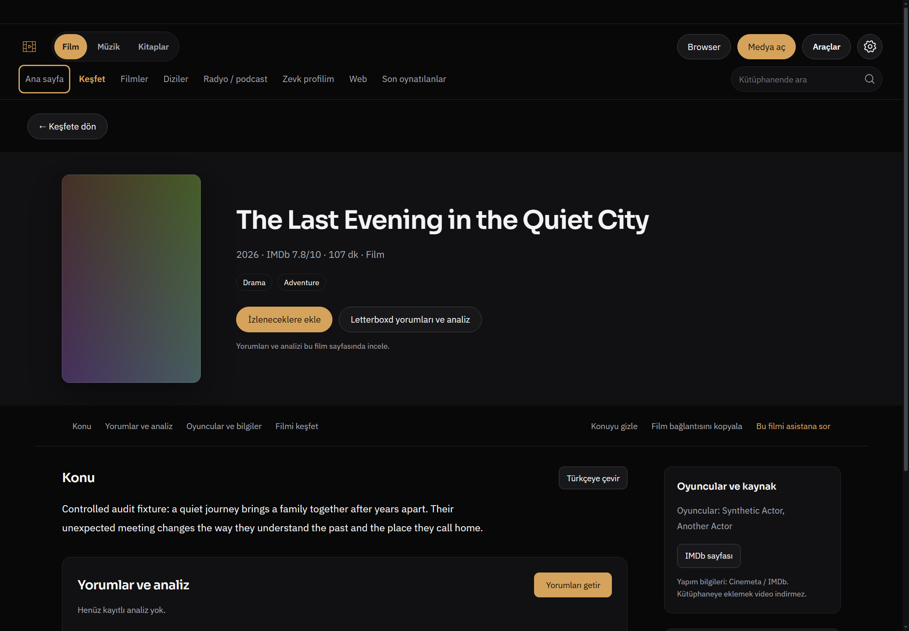
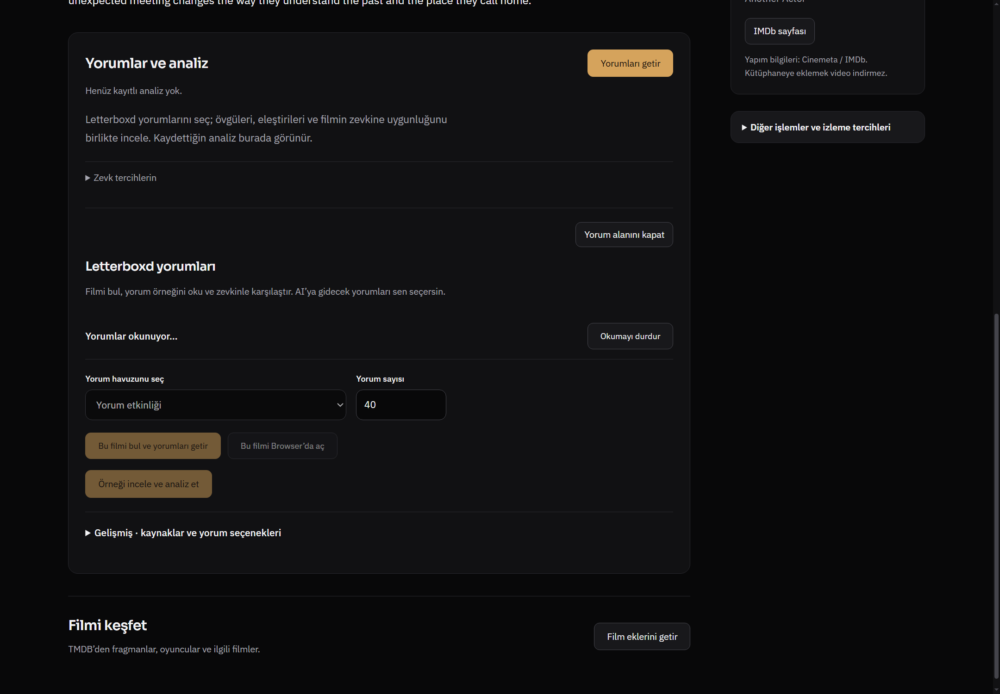
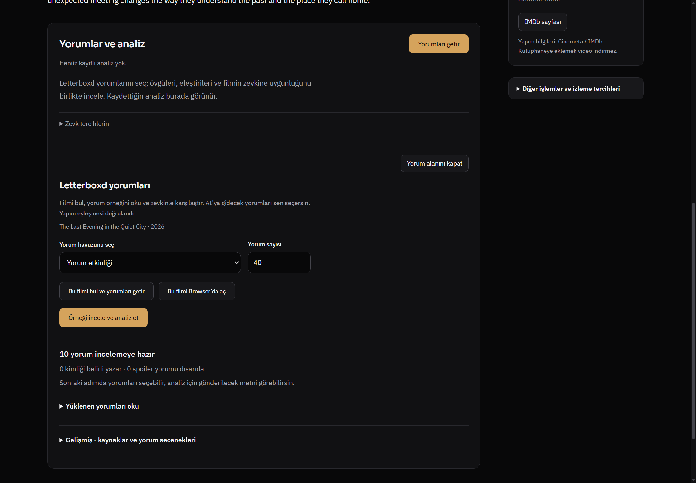

# Film ayrıntısı — yalnız tasarım incelemesi

1 Kasım 2026. İncelenen ürün kodu: `2bb0e861de044ea25c70892009ce361fb651ebe0`, dal `codex/design-coherence-20261101`. Ürün veya test dosyası değiştirilmedi. Bu belge öneri ve uygulama planıdır; düzeltme uygulanmadı.

Native Windows Electron, ayrı geçici profil, 1440×1000 TR koyu %100 ve 800×1000 EN açık %125 (640×800 CSS görünüm) kullanıldı. Windows ekran ölçeği nedeniyle PNG boyutları sırasıyla2160×1500 ve1200×1500. Başlık, afiş ve yorumlar kontrollü sentetik fixture; gerçek film içeriği, gerçek Letterboxd/AI sonucu veya kişisel veri değildir. Afişteki renk alanı test assetidir; ürünün gerçek afiş tasarımı diye değerlendirilmemiştir. Kaynak taşımaları IPC fixture ile yanıtlandı, ağ kapatıldı. [Ölçümler](assets/film-metrics.json).

## F1 — Dar ekranda afiş başlığı ve eylemleri ilk görünümün dışına itiyor

**Sınıf:** doğrulanmış responsive arayüz kusuru. **Öncelik:** yüksek. 800px pencerede %125 yakınlaştırmada ilk görünüm yalnız gezinme ve dev afişin üst kısmını gösteriyor; film adı, yıl, izlenecekler ve yorum eylemleri görünmüyor. Yatay taşma olmaması bu kompozisyon hatasını gizliyor.

**Önerilen düzeltme:** tam sayfa film masthead'i için `display:grid` sahipliğini açıkça tanımla; 640CSSpx'te130px afiş + esnek başlık sütunu, en dar ekranda küçük afiş + başlık üstte olacak biçimde düzenle. Afiş genişliğini kapsayıcıyla birlikte sınırla. Başlık ve ana eylemler görünür olmalı; afiş büyütme ayrı mevcut eylemde kalmalı. Grafit/amber ve açık tema token'ları korunmalı.

**Kod nedeni:** `media-discovery.css` içindeki `@media(max-width:700px)` `.md-detail-body { display:block; }` kuralı; `media-title.css` son responsive kuralları yalnız `grid-template-columns` değiştiriyor. `media-title.css:64` poster `width:100%` tanımı eski84px dar ekran posterini eziyor. 640CSSpx'te520px altındaki160px üst sınır da devreye girmiyor. Ölçümde bu hero1163.53CSSpx yüksekliğe çıkıyor; [JSON](assets/film-metrics.json) kaydı kesin geometriyi içeriyor.

**Kabul:** aynı modda başlık + iki ana eylem afişle birlikte ilk görünümde olmalı; afiş oranı2:3 kalmalı; 520,640,760,900CSSpx sınırları ayrıca gözden geçirilmeli. Erişilebilir büyük yazı/zoom korunmalı.

## F2 — Geniş ekran masthead'i güçlü fakat bilgiye geçiş gereğinden uzun

**Sınıf:** tasarım iyileştirmesi; işlevsel bug iddiası değildir. Geniş ekranda başlık okunaklı, iki ana eylem net ve gezinme tam sayfa. Ancak üst kabuk, ayrı geri satırı,402CSSpx masthead ve bölüm gezinmesi birlikte yorum başlığını yaklaşık883CSSpx'e taşıyor. Yorumlar filmin temel işlerinden biriyken ilk görünümün altına sıkışıyor.

**Önerilen düzeltme:** afişi180–200px aralığına indir; geri eyleminin ayrı satırdaki üst/alt boşluğunu azalt; başlığı sola hizalı tek görsel merkez olarak koru. Konu ile yorum alanının ilk ipuçları daha erken görülmeli. Film gezinmesi ve asistan eylemi korunmalı; önemli kontroller sırf sadelik için kaldırılmamalı.

**Kabul:**1440×1000'de kısa konu ve yorum alanının başlığı birlikte rahatça görünsün. Gerçek uzun film adı ve uzun Türkçe eylemlerle taşma olmasın. Hedef yalnız toplam yüksekliği küçültmek değil, film kimliğinden karar vermeye daha akıcı geçiştir.

## F3 — Yorum alanı açıldığında boş durum ve eylem üstte kalıyor

**Sınıf:** tasarım/akış iyileştirmesi; analiz kaybolması iddiası değildir. Yorum alanı açılmışken üstte hâlâ “Henüz kayıtlı analiz yok”, açıklama, amber “Yorumları getir” ve zevk tercihleri bulunuyor; ardından ayrı kapat eylemi ve ikinci Letterboxd başlığı geliyor. Kullanıcı aynı işi iki ayrı bölge gibi okuyor. İşlem sürerken de bu boş durum üstte kalıyor.

**Önerilen düzeltme:** boş durum yalnız editör kapalıyken tam açıklamalı sunulsun. Editör açıldığında aynı bölüm başlığı altında kaynak seçimi, sayım, durum ve iptal düzeni görünsün; üstteki aynı işe ait CTA düzenleme durumunu yansıtsın. Kapat eylemi aynı başlık satırında bulunsun; zevk tercihleri ve gelişmiş kaynak seçenekleri mevcut disclosure olarak korunmalı. “Kayıtlı analiz yok” ile “yorumlar yükleniyor” tek bir net iş durumu altında açıklanmalı.

**Kabul:** kapalı/boş, açık/hazır, yükleniyor, yükleme hatası, örnek hazır ve kayıtlı analiz ayrı görsel durumlar olarak kontrol edilmeli. Kapatınca açan düğmeye klavye odağı dönmeli. Kaynak doğrulama, yorum sayısı, spoiler seçimi, alıntı doğrulama ve mevcut analiz korunmalı.

## F4 — Örnek hazır durumunda bir sonraki eylem sonuç bilgisinden önce geliyor

**Sınıf:** bilgi hiyerarşisi iyileştirmesi. Kaynak seçimi, yeniden getirme ve browser eylemlerinin ardından amber “Örneği incele ve analiz et” geliyor; “10 yorum incelemeye hazır” bilgisi bunun altında ayrı çizgiden sonra yer alıyor. Bir sonraki eylem, hazırlık sonucundan kopuk.

**Önerilen düzeltme:** örnek hazır olduğunda yorum sayısı ve sınırlamalar önce, “Yüklenen yorumları oku” ve analiz önizlemesi hemen ardından gelsin. Kaynağı yeniden getir ve Browser'da aç ikincil işlem grubunda kalsın. Sağlanan yorum sayısı ile istenen sayının farklı olabilmesi açık kalmalı; fixture40 istenirken10 döndürmüştür, bu gerçek sağlayıcı davranışı diye sunulmaz.

**Kabul:** kullanıcı hazır örneği, hangi sayıda yorumun kullanılacağını ve AI'ya gitmeden metni inceleyebileceğini tek bakışta anlasın. Mevcut açık onay ve alıntı kontrolü aynı kalmalı.

## Uygulama sırası ve sınırlar

Önce F1'in CSS sahipliği ve poster sınırları düzeltilmeli. Ardından F2'nin masthead ritmi, F3'ün aynı bölüm içindeki editör durumu, F4'ün hazır örnek sırası ele alınmalı. Yeni marka, font, servis veya ayar şeması gerekmiyor. Mevcut Sora/IBM Plex ve çalışma zamanı tema token'ları yeterli.

Bu turda kayıtlı AI analizinin sonuç render'i, canlı sağlayıcı başarısı, gerçek poster/backdrop fotoğrafı, DRM/oynatma ve kişisel kütüphane incelenmedi. İlk Electron sandbox denemesi Windows erişim engeline takıldı; ayrı kontrollü profil native çalıştırmada görüntüler alındı. İlk fixture'ın doğrulama hatalı iki yakalaması düzeltilmiş fixture ile üzerine yazıldı ve bulgu sayılmadı.800px turunda önceki10 yorumluk taslak korunmuştur; `film-editor-800-en-light.png` bu yüzden boş editör değil hazır örnektir.800px “loading/sample” görüntüleri yeni isteğin tamamlandığını ayrıca beklemediği için yükleme kanıtı olarak kullanılmadı. Ürün/test değişikliği ve commit yoktur.

