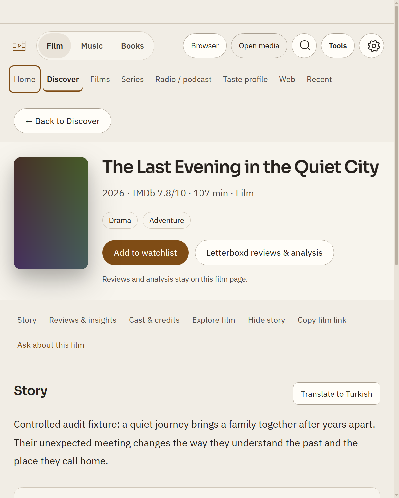
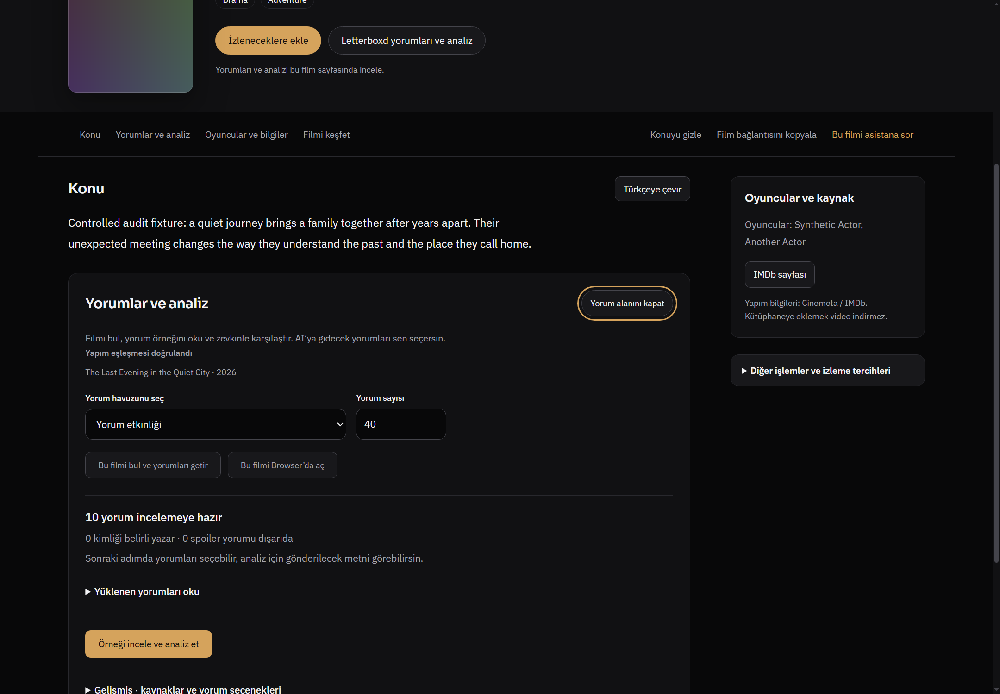
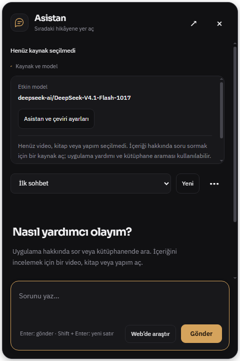
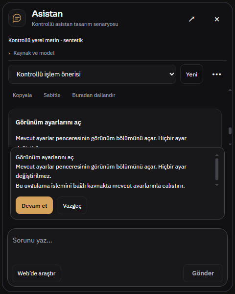
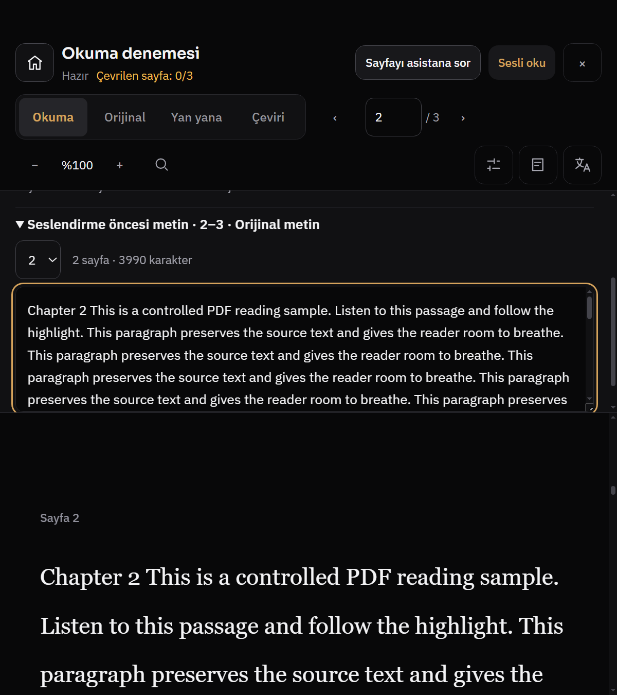
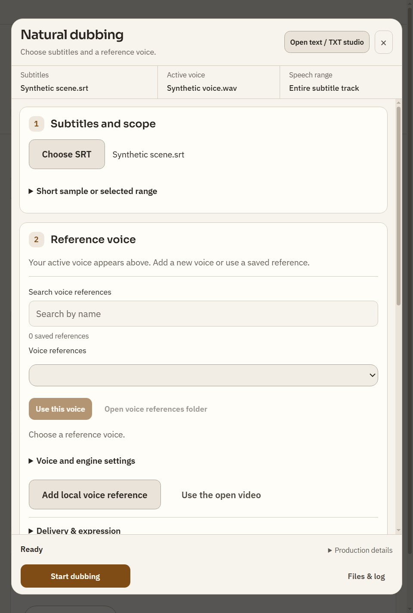
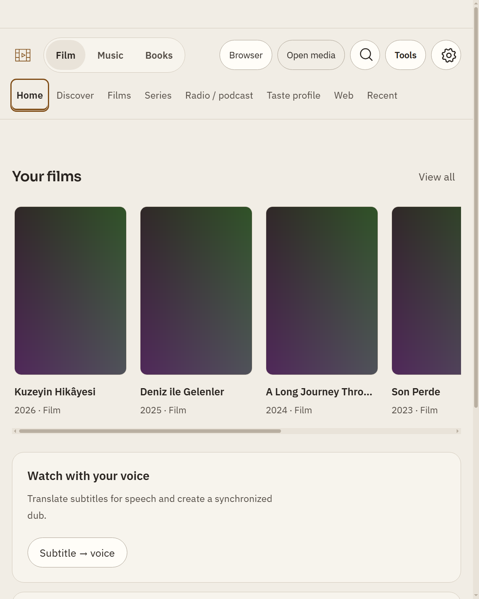
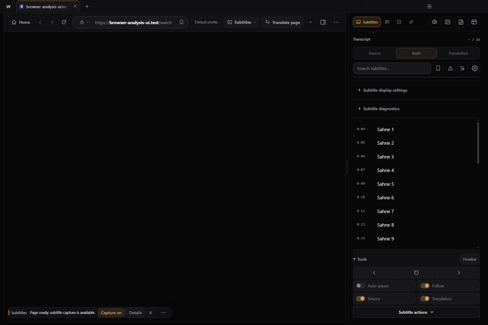

# R824 tasarım düzeltmeleri — uygulama ve görsel kabul

Kullanıcı salt raporlama sonrasında düzeltmeleri açıkça yetkilendirdi. Başlangıç `eb176cc35106cfab22b15b89c754714bfe5cce2f`; son ürün `2591a6c71eebaae54f60289d65527127c9563c55`. Dal `codex/design824-implementation`. Önceki rapor ve görüntüler değiştirilmeden tarihsel kanıt olarak korunur; [IMPLEMENTATION.json](IMPLEMENTATION.json) 13 kaydın devam durumudur. Bunlar 13 yeni bug değildir.

Üç GPT‑6.1 Sol medium ajan ayrı film/asistan/okuyucu-dublaj dosyalarında çalıştı; ortak kabuk, IPC aktarımı, dil, görsel sistem ve son teslim ebeveynde birleştirildi. Yeni framework, font, animasyon bağımlılığı, model veya API çağrısı yok. Gelişmiş seçenekler kaldırılmadı. Frontend Design Premium mevcut tasarım/UX sahipliği için; Frontend Design ve Impeccable görünür hiyerarşi/boşluk/tema kontrolü için okundu. HorizonX kodu, Product Design mockup'ı veya başka servis çıktısı kullanılmadı; bütün pluginler kullanılmış gibi sunulmaz.

## Film — F1–F4

**Değişiklik:** tam sayfa film masthead'inde grid sahipliği açık; dar poster sınırlı. R824'te 1163.53 px olan masthead 253.53 CSS px'e indi; başlık ve iki ana eylem ilk görünümde. Genişte 402→326 px. Geri satırı/başlık/yorum aralığı sıkılaştırıldı. Görüntüdeki afiş sentetik test assetidir; gerçek fotoğraf/afiş kalitesi bu kanıtla değerlendirilmez.

**Değişiklik:** yorum editörü aynı bölümün içine yerleşir; editör açıkken yinelenen boş durum saklanır. Kapat eylemi bölüm başlığında, odak girer ve kapanınca çağırana döner. Hazır yorum sayısı ve okuma bağlantısı analiz eyleminden önce gelir. Yenileme hatasında önceki örnek korunur, kurtarma görünür. Zevk tercihleri ve ileri kaynak seçimleri durur.

**Kabul:** native 12 görüntü;1440 TR koyu %100,800 EN açık %125 ve520/760/900 CSS px geometrileri geçti. Sekiz mevcut inline/editor testi geçti. [Ölçümler](assets/film-after-metrics.json). Canlı Letterboxd/AI/oynatma sonucu değildir.

## Asistan — A-01/A-02

**Değişiklik:** home/studio nesnesi artık ekli eser gibi etiketlenmez. İnsan açıklaması iki dilde; iç model talimatı kullanıcıya çıkmaz. Genel yardım/kütüphane/iş merkezi açık kalır; kaynak özetleme/açıklama starter'ları kaynak gelince görünür. Önceki video bağlamını eklemeyen prompt koruması tutuldu. `attached` bilgisi mevcut native snapshot temizleme sınırından boolean olarak aktarılır.

**Değişiklik:** uzun açıklama kendi alanında kayar; Devam et/Vazgeç ayrı görünür satırdadır. Uygula odağı yeni karara taşır; İptal/Escape çağıran düğmeye döner, kaynak değişimi bekleyen onayı iptal eder. Onay verilmeden action gönderilmez. Onay sırasında Gönder ikincilleşir; sohbet kaybolmaz. Panelde16px, küçük varyantta 12 px ritim korunur.

**Kabul:**18 Node testi,24 durum mevcut tasarım smoke'u ve5 kısa panel senaryosu geçti. [Karar sonucu](assets/assistant-after-review-result.json), [geometri](assets/assistant-after-review-measurements.json). Gerçek API veya ekran okuyucu kabulü değildir.

## Okuyucu ve dublaj — RD-01–RD-05

**Değişiklik:** görev paneli ve textarea kalır, aradaki gereksiz preview kaydırıcısı kaldırılır. Dar640×720CSSpx'te belge147.13→292.33 px (%20.4→%40.6);1024×768'de belge alanı %69.1→%77.9. Üst başlık/araçlar kompakt; ses paneli kapama ve odak dönüşü var. Görünür sayaç “Çevrilen sayfa” olarak açıklanır, locale değişiminde yenilenir. Kitap prose serifini korurken araç kontrolleri ortak aileye hizalanır.

**Değişiklik:** form sırası altyazı/kapsam → referans ses → üretim tercihleri. Başlık/özet/alt durum payı %41.4→%24.3; dar hazır gövde 675 px. Geçen süre ayrıntılara alındı; üretimde durdurma görünür. Hazır seste Sesi kullan baskın, yeniden üretim ikincil. Sözlük, gruplama, zamanlama, referans, aralık, doğal konuşma ve AI kontrolleri korunur; özel ayarlar sıfırlanmaz.

**Kabul:** PDF native sonuç `ok:true`; dublaj 22 düzen durumu ve dört dil/tema hazır/inceleme karşılaştırması geçti. Bütün eski HTML kimlikleri durur; yeni yalnız `pdfVoiceClose`. [Ayrıntılı RD sonuçları](READING-DUB-AFTER.md). Sinüs WAV/sentetik PDF gerçek seslendirme kalitesi kanıtı değildir.

## Ortak kabuk ve browser — S-01/S-02

**Değişiklik:** küçük ekranda arama düğmeyle açılır; odak girdiye geçer. Escape sorguyu silmeden kapatır; görünür temizleme yalnız sorguyu temizler ve odağı tutar. Genişte doğrudan arama kalır. Seçili medya modu nötr yüzey; sayfa seçimi alt çizgi, klavye odağı ayrı. Üstteki Medya aç, içerikteki ana görevi amber ağırlığıyla bastırmaz. Native select, scrollbar ve gelişmiş menüler korunur.

**Değişiklik:** kullanılabilir browser genişliği daralınca ses eylemleri zaten var olan menüye taşınır.1440 px/yan panelde adres metni39.33→232.58 CSS px;1280 px'de320 px.1440/%125'te193.8 px,1024/%125'te230.9 px; toolbar taşmıyor. SRT/ses menü proxy'leri mevcut; yeni işlev sahibi kopyalanmadı. Ana native video parent capture'da siyah görünebilir; ayrı yüzey ve video ilerlemesi ayrıca kontrol edildi.

**Kabul:** home/discovery 21 kontrol kaydı (arama açma/temizleme/Escape dahil), browser adres matrisi/menü/occlusion/fullscreen geçti. [Kabuk sonucu](assets/shell-after-result.json), [browser sonucu](assets/browser-after-result.json). Programatik odak halkası mouse bugı sayılmadı.

## Son kontroller, ara hatalar ve sınırlar

- Son üç hedefli Node grubu 18+8+9=35 test geçti; syntax kontrolleri temiz. [Çıkış kodları](assets/focused-after-checks.json).
- İlk i18n coverage beş eksik karşılık buldu (üç yeni reader etiketi, iki önceki sözlük kapsamı); EN sözlüğü tamamlandı, son i18n coverage geçti. Test eşiği/allow listesi gevşetilmedi.
- Bir hedefli kontrol kılıfının CP1254 terminal çıktısı Unicode karakterde kesildi; UTF-8 stdout ile yeniden çalıştırıldı. Çalışmayan sonraki kontroller önceki komut başarılı diye varsayılmadı.
- İlk Premium strict auditor denemesinde plugin dosyaları oturum yenilemesi sırasında bulunamadı; yeniden erişilebilir olduğunda tekrar denendi. Tarama tamamlandı, **exit1 ve 589 statik kayıt** verdi:570 actionless-button,13 textarea-resize,2 empty-href,2 novalidate,2 webkit-scrollbar. Temiz Premium kabulü iddia edilmez. En büyük grup bu eski vanilla/Electron kodunun dış JS handler'larını tanımıyor: örneğin `assistant-overlay.js:84–85` close/expand `.onclick`, `:92` form `.onsubmit` bağlıdır ve native testte çalışır. Bu karşı örnek bütün 589 kaydın sahte olduğu anlamına gelmez; kalan repo-geneli liste ayrıca triyaj gerektirir. [Ham strict sonuç](assets/premium-after-static.json). Impeccable geniş mevcut HTML taraması 220 warning/74 advisory verdi; bunların tamamı bu paketin yeni işlevsel hatası değildir. Hiçbir detector eşiği değiştirilmedi.
- `DESIGN.md` mevcut medya fontu Sora/IBM Plex sahipliği ve görev hiyerarşisini kaydeder. Eski Inter beyanı belgede uzlaştırıldı; tüm stüdyo fontlarını değiştirme veya bütün eski renk/şekil kurallarını temizleme yapılmadı.
- Son eklenen Redesign/MotionDesign/Superdesign/Themely/Design Arc/Designly paketleri keşfedildi; bu paketlerin servisleri çağrılmadı, GSAP/WebGL/şablon/tema bağımlılığı eklenmedi. Tek bir düzeltme turuna farklı tasarım sistemleri yığılmadı.
- Tam npm test ve uzun CI beklenmedi; start.bat açılışı, gerçek GPU/model/API, canlı siteler/hesaplar, bütün uygulama menüleri, fiziksel dokunma/ekran okuyucu ve kapsamlı animasyon performansı bu tur doğrulanmadı. Bu teslim bütün uygulamanın kusursuz olduğu veya kullanıcının nihai estetik onay verdiği anlamına gelmez.
- Kullanıcının kişisel dosyaları ve açık uygulaması korunur; kanıtlar ayrı sentetik profillerdendir. R824'teki 13 kayıt hedefli şekilde uygulandı; önceki raporlar tarihsel olarak korunur.
