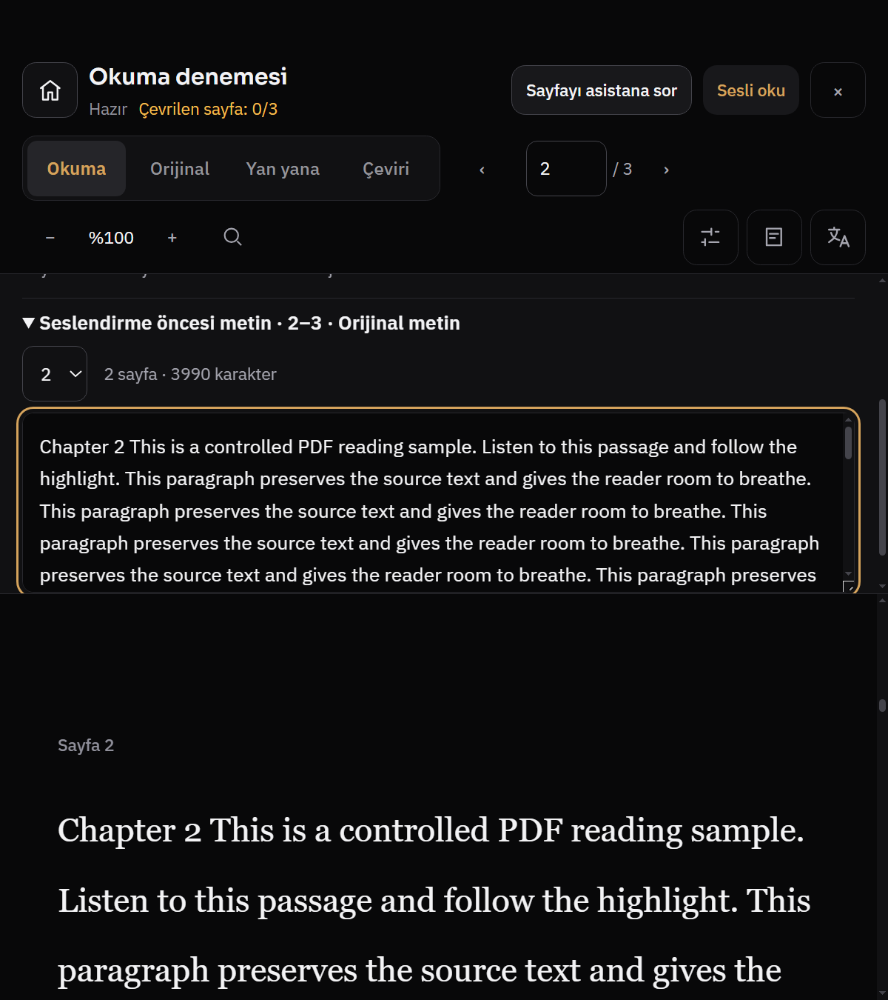
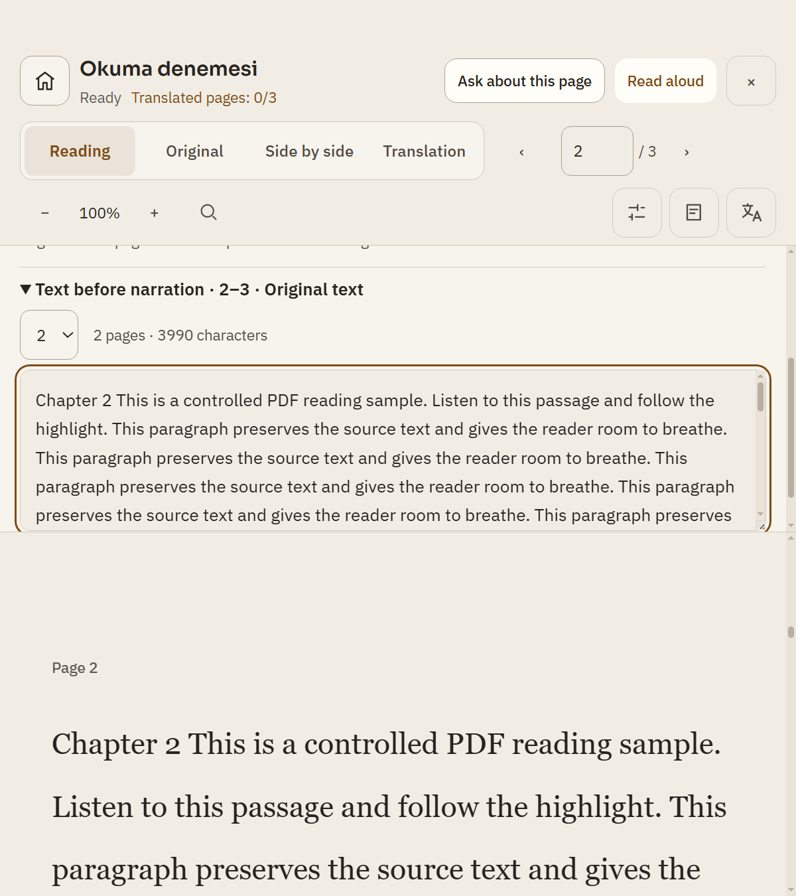
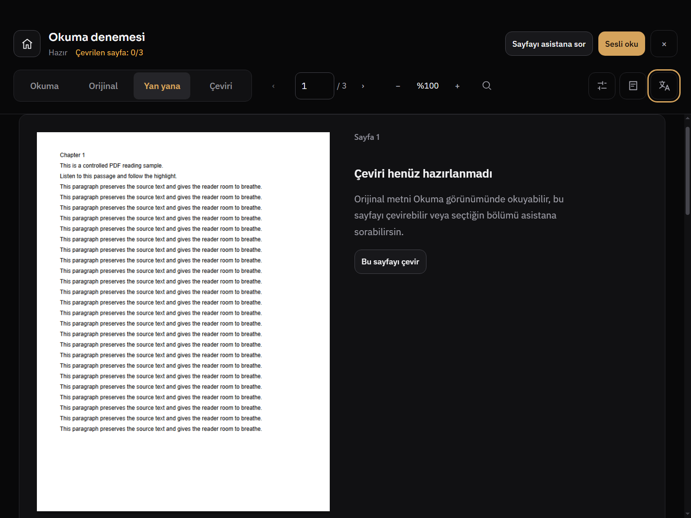
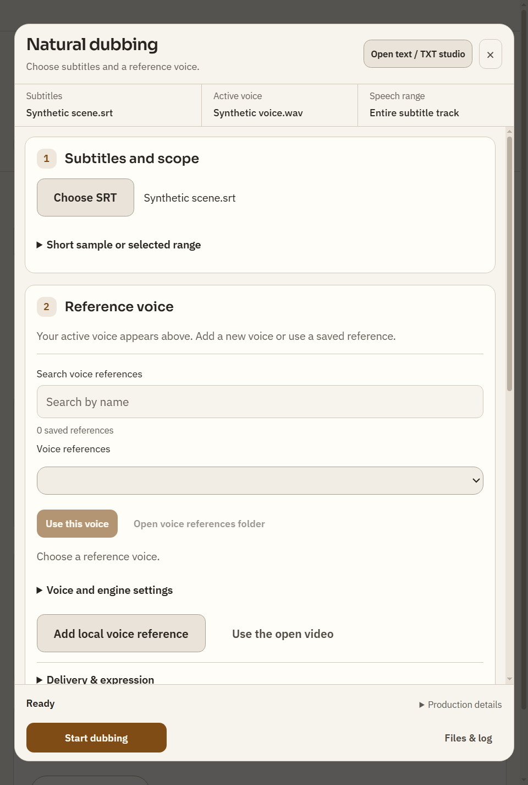
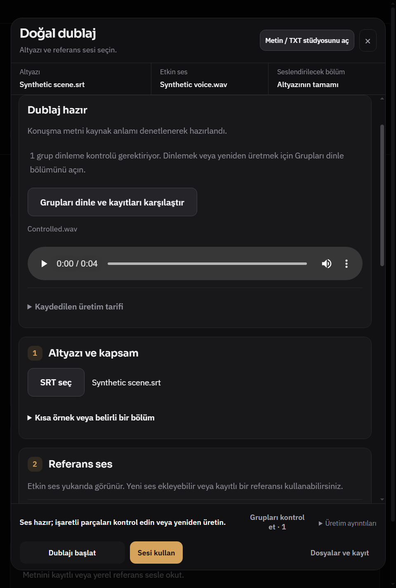
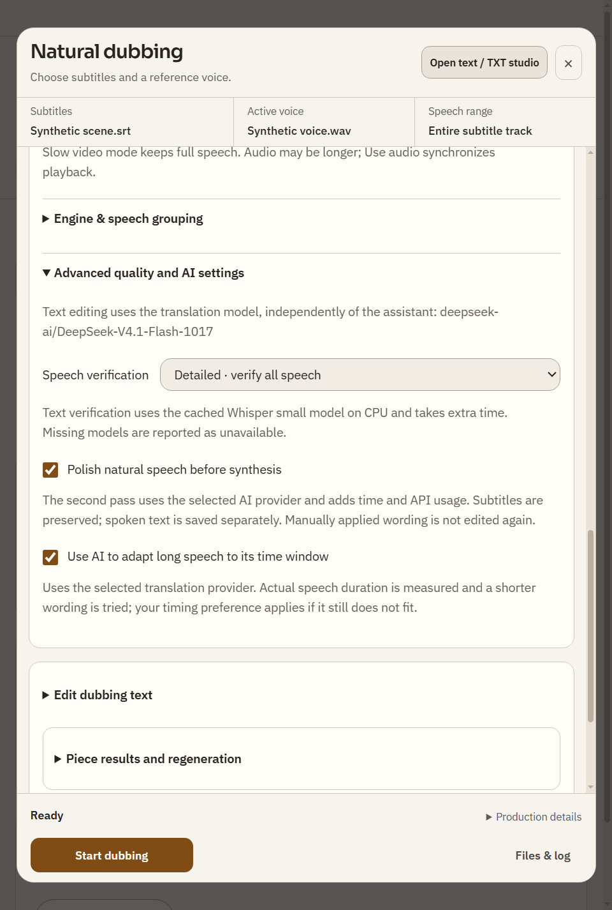
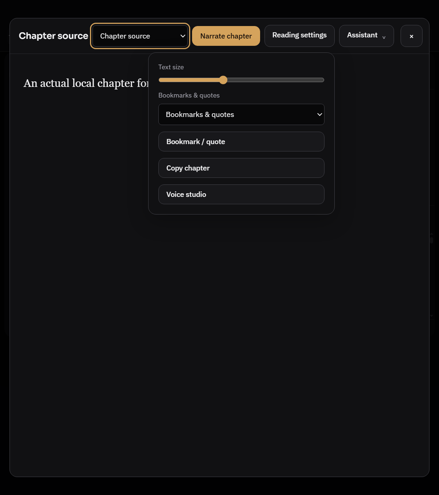

# R824 uygulama — PDF/kitap ve dublaj sonrası doğrulama

Başlangıç: `eb176cc35106cfab22b15b89c754714bfe5cce2f`, dal `codex/design824-implementation`. Kullanıcının uygulama yetkisiyle RD-01–05 işlendi; commit/push yapılmadı. Bu belge önceki salt denetimi değiştirmez. Kanıtlar gerçek Windows Electron renderer'ıdır; profil, PDF/TXT, SRT ve motor olayları sentetik; model/GPU/API üretimi yok.

## Değişiklik ve ölçüm

| Kayıt | Uygulama | Aynı koşuldaki sonuç |
|---|---|---|
| RD-01 | Ses panelinde tek görev kaydırıcısı; preview details kendi içinde kaymaz; metin kutusu uzun metni kaydırır. Panel 32dvh ile sınırlı; kapatma odağı Sesli oku'ya döndürür. | 800×900/%125 → CSS640×720; belge 147.13→292.33 px, %20.4→%40.6. Preview scroll/client eşit; panel + textarea dışında iç içe preview kaydırıcısı yok. |
| RD-02 | Windows pencere güvenli alanı korunarak başlık boşluğu azaltıldı; orta genişlikte üç ikincil araç ikon olarak aynı erişilebilir adlarla kalır. | 1024×768 normal görünümde belge 530.47→598.47 px, %69.1→%77.9; üst alan 237.53→169.53 px. |
| RD-03 | Parent renderer.js'de görünür “Çevrilen sayfa / Translated pages” etiketi; yerel locale hook ilerleme etiketini de yeniler. | Aynı açık PDF'de TR/EN tema matrisi görüntülerinde doğru görünür etiket. |
| RD-04 | Kaynak ve referans ses kartları üretim tercihinden önce; motor eyebrow kaldırıldı; başlık kısa; kaynak şeridi kompakt; geçen süre mevcut Üretim ayrıntıları açılır alanına taşındı. İptal yalnız üretimde, progress yalnız aktif işte; sonuçta Sesi kullan ana vurgu olur. | 640×950 hazır: sabit çerçeve 369.58→216.67 px (%41.4→%24.3), gövde 522.08→675 px. TR inceleme %25.9, EN inceleme %25.2; footer görünür. |
| RD-05 | Kitap araçları PDF ile aynı 10px düğme ve 14px panel ailesi, aynı “Okuma ayarları / Reading settings” adı; serif kitap metni korunur. | EN koyu/açık 800×900 kitap görüntüleri; kısa sentetik TXT yatay taşmıyor. |

Tüm mevcut statik HTML id'leri korundu; tek yeni id `pdfVoiceClose`. Ses/kapsam/AI/kalite/sözlük/mixer/proje/içe aktarma/yeniden üretim kontrolleri kaldırılmadı. Kontrol seçimi ve backend sözleşmesi değişmedi. [Ham id/ölçüm kaydı](assets/reader-dub-after-verification.json).

## Aynı dar PDF görünümü

Ses önizleme görevi ve uzun metin kutusu kayar; belge için 292.33 CSS px kalır. Aralık formuna görev panelinde yukarı kaydırarak erişilir. Ana Sesli oku düğmesi paneli her zaman kapatabilir; ek kapatma düğmesi de odağı ana düğmeye geri verir. Önceki üç iç içe panel/preview/textarea yerine panel+textarea vardır; belge bağımsız okuma kaydırıcısı olarak kalır.

Ek kombinasyonlar: [EN koyu](assets/reader-after-en-dark-125.png), [TR açık](assets/reader-after-tr-light-125.png). Electron içerik boyutu 800×900, zoom %125; CSS viewport640×720, DPR1.875. İç PDF ölçeği %100; uygulama zoomuyla karıştırılmaz.

1024×768, TR/koyu, Electron %100/DPR1.5. Üç araç grubu ikonları mevcut title/AX adlarını ve 40px hit alanlarını korur; sadece ikinci satıra taşan uzun etiketler kompaktlaşır.

## Dar dublaj hazır ve inceleme

640×950, Electron %100/DPR1.5. Altyazı ve referans ses seçicisi ilk gövde görünümündedir; gelişmiş üretim tercihleri aşağıda erişilebilir. [TR koyu hazır](assets/dub-after-tr-dark-ready.png), [TR açık hazır](assets/dub-after-tr-light-ready.png), [EN koyu hazır](assets/dub-after-en-dark-ready.png).

İnceleme gerektiği açıkça söylenir; Sesi kullan ana eylem, yeniden başlatma ikincil görünür. Sonuç “gerçek doğal ses kalitesi” değildir: kontrollü olay ve yapay WAV.

[EN açık inceleme](assets/dub-after-en-light-review.png), [EN koyu inceleme](assets/dub-after-en-dark-review.png), [TR açık inceleme](assets/dub-after-tr-light-review.png).

Üretim/AI ayrıntıları açılabiliyor; doğal konuşma, doğrulama, zamanlama ve paralellik kontrolleri korunuyor. Mevcut smoke, eski özel ayarları koruyup öneriyi açık eylemle seçmeyi; kullanıcı metin düzenlemesini korumayı; kaynak/genel telaffuz ayrımını ve özel ad uyarısından sözlüğe odaklanmayı doğruluyor.

## Kitap araçları

[Kitap açık araçlar](assets/reader-after-book-light-tools.png). Serif prose, yer imleri/alıntılar, bölüm kopyalama, ses üretimi ve ses stüdyosu korunur; araç düğmelerinin hap biçimi ortak okuyucu ailesiyle hizalanır.

## Kontroller

- `node --check` üç değişen JS dosyası: geçti (`pdf-reader-experience.js`, `dub-generator-ui.js`, `media-shelf-ui.js`).
- `git diff --check` sahip olunan yedi dosya: geçti. LF→CRLF bilgilendirmeleri hata değildir.
- Mevcut `tests/electron-pdf-reader-experience.smoke.js` geçici ignored `tmp/reader-rd824-acceptance.cjs` kılıfıyla: `results.json ok:true`. Ek dört tema/dil kombinde belge alanı ≥%40 ve preview overflow visible; paneli kapatma/odak dönüşü/aralığı koruma kontrolü geçti. [Ham sonuç](assets/reader-after-results.json).
- Mevcut `tests/electron-dub-natural.smoke.js`, `tmp/dub-rd824-acceptance.cjs` kılıfıyla: 22 görüntü/durum; yatay taşma yok, footer görünür, gövde footer üstünde. Ek dört ready kombinasyonda gövde diyalogun ≥%65'i ve ses seçicisi ilk görünümde; gelişmiş ayar açma ile dört review kombinasyonu yakalandı. [Ham kabul](assets/dub-after-acceptance.json).
- İlk ek PDF kılıfında aralık alanına yalnız `.value` atanıp kullanıcı `input` olayı gönderilmediğinden aç/kapa sonrası mevcut “geçerli sayfa” varsayımıyla 2–2 oldu, fixture'ın sonraki `[2,3]` beklentisi başarısızdı. Kullanıcı olayını doğru gönderen kılıfla tekrarlandı ve tam akış geçti; ürün verisi kaybı diye sunulmadı. İlk tam ürün smoke'u da bu ek kılıf kontrolü öncesinde geçmişti.
- Impeccable detect bir kez çalıştı (`tmp/rd824-impeccable.json`), exit1: 220 warning/74 advisory. Geniş HTML ve paylaşılan dosyalardaki mevcut küçük yazı/renk/köşe/font eşleştirmesi uyarıları dahil; “temiz geçti” iddiası yok. Başlangıç DESIGN.md'nin Inter/Sora-Plex uyuşmazlığı parent'ın ortak tasarım kapsamındadır; bu ajan DESIGN.md veya ortak token kaynağını değiştirmedi.

## Dosya sahipliği ve sınırlar

Bu ajanın ürün dosyaları: `src/renderer/pdf-reader.css`, `media-shelf.css`, `dub-natural.css`, `pdf-reader-experience.js`, `media-shelf-ui.js`, `dub-generator-ui.js`, `index.html` yalnız PDF/dub blokları. Renderer.js görünür sayaç değişikliğini parent yaptı. Ortak browser-chrome/media-home/assistant stilleri değiştirilmedi.

Başlangıç kabulünden sonra yeni hata riski oluşturan ayar/IPC değişikliği yok. Native select ve audio kontrollerinin platform sahipliği korunur. Tam npm test, canlı sağlayıcı, GPU, start.bat, gerçek uzun EPUB/PDF, ekran okuyucu konuşması, ölçülmüş kontrast matrisi ve %200 masaüstü zoomu bu tur sınanmadı. Dublaj %125 ayrıca yakalanmadı; istenen640×950/%100 ve PDF800×900/%125 koşulları tam dil/tema matrisiyle yakalandı. Eşzamanlı parent/diğer ajan ortak CSS değişiklikleri tamamlandıktan sonra parent'ın son entegrasyon görüntüsü önerilir.
