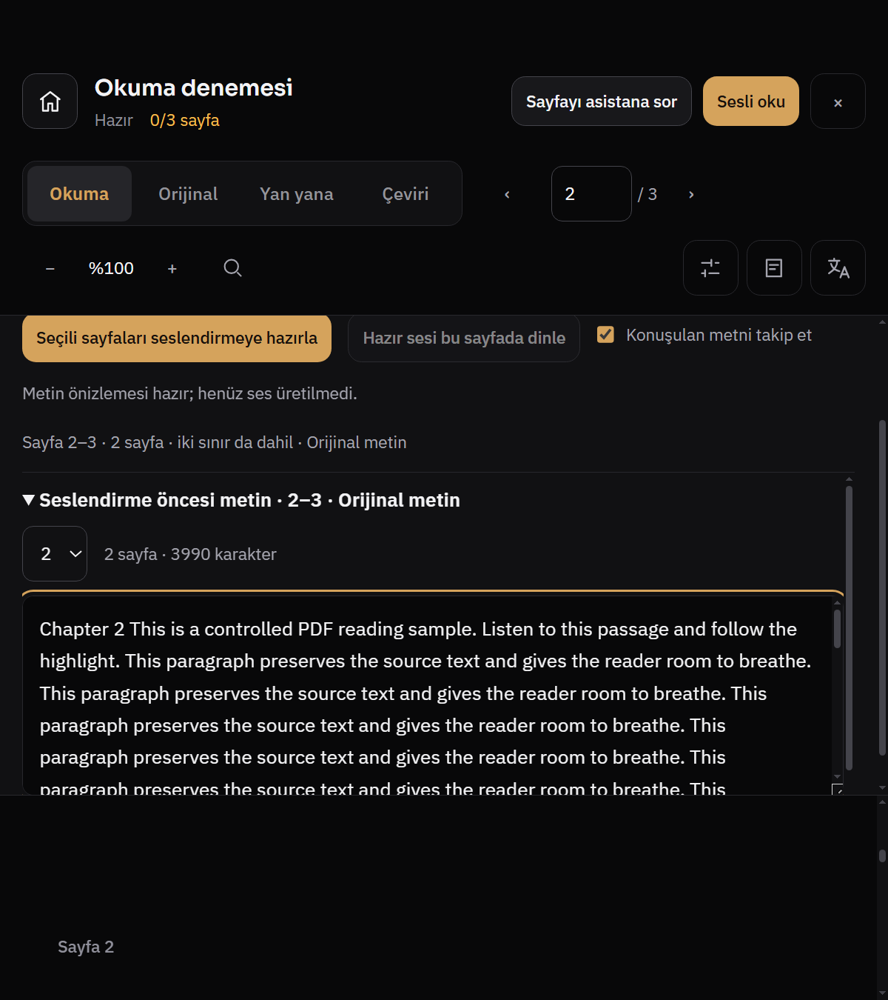
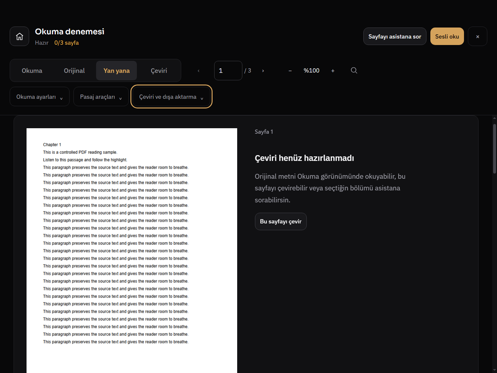
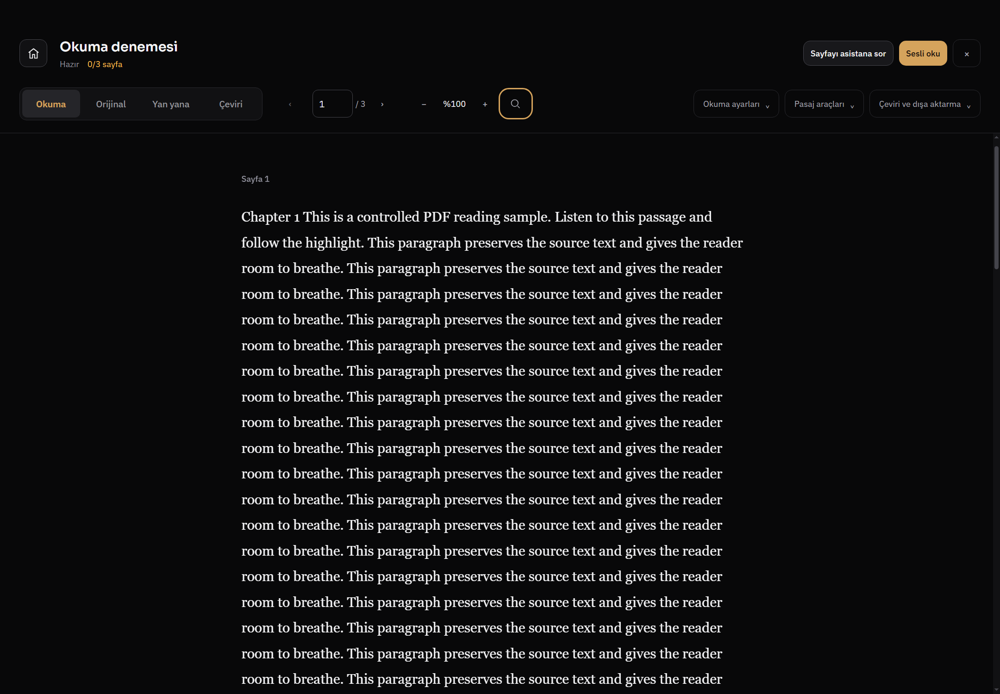
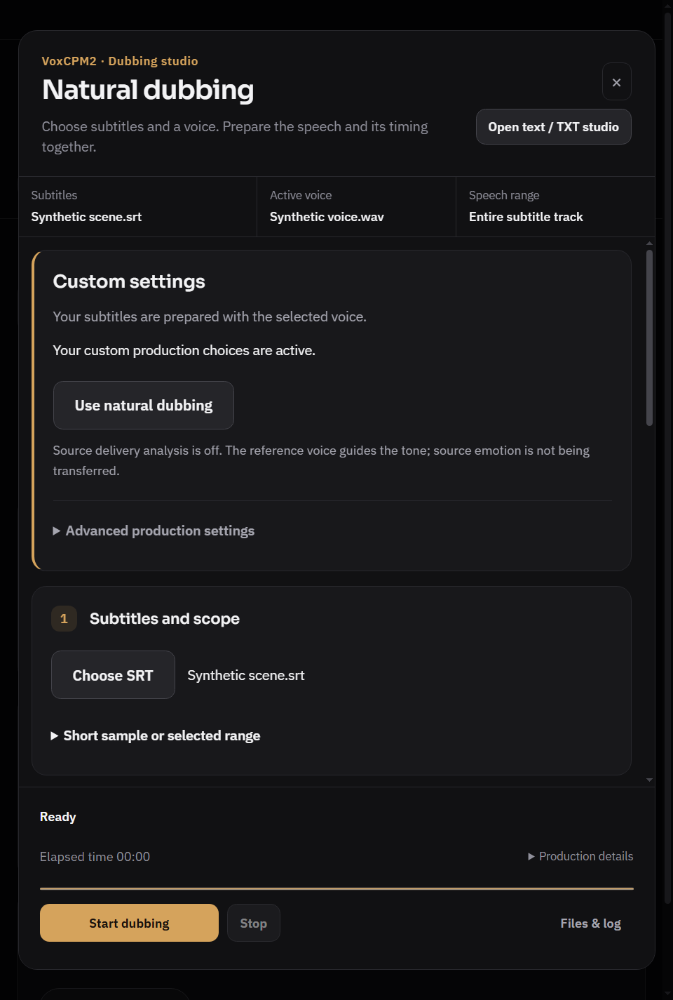
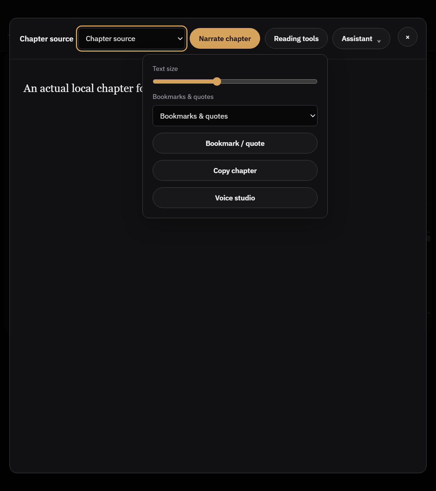
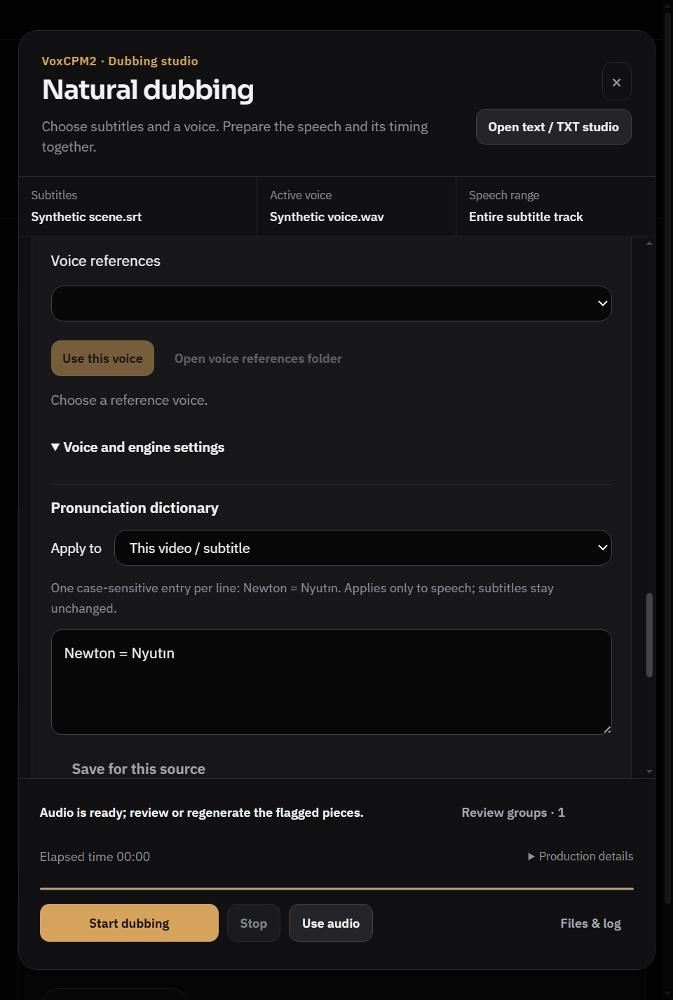
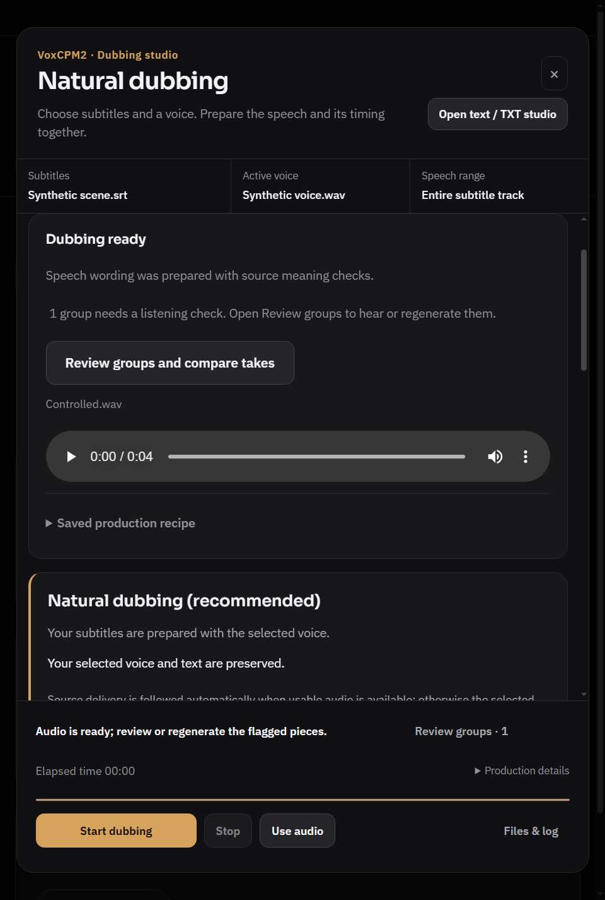

# PDF/kitap okuma ve altyazıdan dublaj — görsel denetim

Durum: tamamlandı; ürün/test koduna düzeltme uygulanmadı. Dal `codex/design-coherence-20261101`, tam HEAD `2bb0e861de044ea25c70892009ce361fb651ebe0`.

Denetim mevcut grafit/amber tasarımı, günlük Operate/Read kullanımını ve ileri kontrollerin erişilebilirliğini esas alır. frontend-design ve Impeccable context/craft-floor okundu; yeni tasarım görüşmesi yerine üst ajanın verdiği salt inceleme kapsamı kullanıldı. Kişisel profil, API anahtarı, canlı sağlayıcı veya GPU üretimi kullanılmadı.

## Yeniden üretim ve ortam

Windows native Electron (`D:\Whisper Local\node_modules\electron\dist\electron.exe`), repodaki `tests/electron-pdf-reader-experience.smoke.js` ve `tests/electron-dub-natural.smoke.js`. İzole profiller `.uiprev/pdf-reader678-1793503555024/profile` ve `.uiprev/dub-natural-1793503565094/profile`. İlk sandbox koşusu Windows erişim hatasıyla capture üretmedi; aynı komut yetkili native çalıştırmada görüntüleri üretti. GUI exe kabuğa erken döndüğünden süreç exit 0 tek başına başarı kanıtı sayılmadı; `results.json`/`acceptance.json` ayrıca kontrol edilir.

PDF üç sayfalık sentetik metindir; dublaj `Synthetic scene.srt`, kontrollü motor olayları ve yapay sinüs WAV kullanır. Görüntüler gerçek uygulama renderer'ıdır; gerçek model kalitesi iddiası yoktur.

## İlk değerlendirme

- PDF okuma modları ve çeviri/pasaj/okuma ayarlarının açılır grupları mevcut; aynı işlevleri yeni bir kalıcı panelde çoğaltmak gerekmiyor.
- Dublajda alt eylem alanı görünür kalıyor; ancak başlık + kaynak özeti + alt durum alanının toplam payı özellikle dar pencerede inceleniyor.

Bulgular ve somut öneriler aşağıda görüntülerle belgelenmiştir.

## Sonuç ve kanıt düzeni

Güncel tasarım denetimidir; aşağıdaki kayıtlar yeni fonksiyonel bug sayacı değildir. Tarihsel R815/R818/R819/R823 ve Night1000 kapsamının varlığı kontrol edildi; R818'in metin stüdyosunda %200 gövde çökmesi veya eski PDF font invariantı yeniden keşif diye sayılmadı. Bu tur beş tasarım kaydı var: iki ölçülmüş kullanılabilirlik yükü, iki sadeleştirme/uyum tercihi ve bir görünür etiket belirsizliği. `P2` günlük kullanım önceliğini belirtir, otomatik fonksiyonel hata sınıflaması değildir.

Ölçüler CSS px; Windows DPR 1.5. PNG fiziksel piksel boyutları %100'de CSS viewport ×1.5; Electron %125 zoomda DPR 1.875 olur. PDF içeriğinin `%100` zoom etiketi Electron arayüz zoomundan ayrıdır.

## RD-01 · P2 · Ses önizlemesi okumayı 147 px'e indiriyor; üç iç içe kaydırıcı

**Gözlenen kullanılabilirlik sorunu.** TR/koyu; native içerik 800×900, Electron zoom %125, CSS viewport 640×720; PDF içerik zoom %100. PDF aç → Sesli oku → sayfa 2–3 → Metni önizle. Aynı kontrol smoke içinde `text-preview-tr.png` olarak yakalanır.

**Önerilen düzeltme:** Ses hazırlama formunu kendi tek kaydırma sahibi olan görev çekmecesine al; panel içindeki `details` ve textarea'nın ayrı dikey sınırlarını kaldır ya da yalnız textarea'yı kaydır. Okumayla birlikte kullanımda üstte kompakt aralık/durum satırı ve “Önizlemeyi kapat” eylemi bırak. Üretim eylemi ile metin seçimi aynı görünür görev alanında kalsın.

**Ölçüm:** Başlık+araçlar 227.27 px, ses paneli 345.60 px; belge alanı 147.13 px = viewport'un %20.4'ü. Ses paneli 345/465 client/scroll, önizleme 244/268, textarea 143/602; üçü de ayrı kayıyor. Önizleme üstü 339.87, textarea üstü 428.53 CSS px; ekran görüntüsünde formun önceki kontrolleri zaten yukarıda kalmış. Ana belge de dördüncü ayrı kaydırıcıdır. Yatay taşma iddiası yok.

**Kod kanıtı:** `src/renderer/pdf-reader.css:92` panel `overflow:auto/max-height:32vh`; `:176` önizleme `overflow:auto/max-height:34vh`; `:181` textarea `max-height:min(180px,20vh)`; `:184` açık önizleme paneli `48vh`; `:97` belge kaydırıcısı. [Ham geometri](assets/reader-text-preview-tr.png.measure.json).

**Kabul:** 800×900/%125 TR/koyu ve EN/açıkta en fazla bir görev paneli kaydırıcısı + metin editörü; aralık, metin seçimi ve hazırlama eylemine erişim görünür ve anlaşılır olsun. Okuma ile görev birlikte sunuluyorsa belgeye en az 240 CSS px veya viewport'un %40'ı ayrılsın; görev tam ekran modundaysa belge alanı varmış gibi küçük bir şerit gösterilmesin. Bu eşikler önerilen tasarım kabulüdür, mevcut ürün sözleşmesi değildir.

## RD-02 · P2 · PDF'nin normal araç alanı dizüstünde yüksek; kompakt kitap çubuğu örnek alınabilir

**Ölçülmüş durum, sadeleştirme tercihi.** 1024×768, TR/koyu, Electron %100, Yan yana modu; PDF aç → Yan yana seç. Araçların açılır gruplarda olması doğru; yine de başlık ve iki satıra kırılan araç alanı toplam 237.53 px (%30.9) kullanıyor. Belge 530.47 px (%69.1). Örtüşme veya erişilemeyen kontrol gözlenmedi.

**Önerilen düzeltme:** Güvenli Windows pencere kontrol boşluğunu koruyarak kitap adı/durum/ana sayfa/kapamayı daha kısa bir satırda hizala. Birincil okuma gezinmesinde modlar + sayfa yeterli; zoom/araçlar ikinci kompakt grupta kalsın. “Sayfayı asistana sor” ve “Sesli oku” aynı anda büyük düğme olarak başlık yüksekliğini belirlemesin; okunur metinli tek bir araç grubu seçeneği değerlendirilsin. 40 px hedef alanları küçülterek kazanım üretme.

**Kod kanıtı:** `src/renderer/pdf-reader.css:13` toolbar; `:20` `min-height:86px` ve `:21` pencere güvenli alanı dahil üst padding; `:53` sarılabilir controls; `:63` mod grubu. [Geometri](assets/reader-laptop-tr.png.measure.json). Pencere kontrol alanı zorunlu olduğundan boşluğun tamamı “gereksiz” kabul edilmez.

**Kabul:** Aynı 1024×768 görünümde kapalı ikincil araçlarla belgeye en az %75 alan hedefle; pencere küçült/büyüt/kapat çakışması olmasın; TR/EN, %125 ve klavye odak halkaları korunsun. Alternatifin kullanıcı değerlendirmesi olmadan bu bir fonksiyonel hata diye sayılmamalı.

## RD-03 · P2 · Çevrilen sayfa sayacı, okuma ilerlemesi gibi görünüyor

**Görünür etiket belirsizliği.** PDF henüz çevrilmemişken açık Okuma/Orijinal modunda başlığın altında amber `0/3 sayfa`, gezinmede `1 / 3` var. İlk sayı belgenin yüklenmediği veya hiç okunmadığı izlenimini verebilir; erişilebilir adı çeviri ilerlemesi dese de görünen metinde “çeviri” yok. Gerçek kullanıcı yanlış anlaması ölçülmedi; arayüz anlamlandırma riski somut etikete dayanıyor.

**Önerilen düzeltme:** Sayaç görünürken “Çevrilen: 0/3 sayfa” yaz; salt Okuma/Orijinal modunda ikincil çeviri araçlarına taşı veya düşük vurgulu tut. Okuma konumu için tek bir sayfa gezinmesi sahibi bırak.

**Kod kanıtı:** `src/renderer/index.html:2223` `aria-label="Çevrilen sayfa ilerlemesi"`; `src/renderer/renderer.js:25086`–`:25099` çevrilmiş blokları sayıp yalnız `X/Y sayfa` yazıyor. Ekran 1440×1000, TR/koyu, Electron %100; sentetik üç sayfa. Sayaç yanlış hesaplıyor iddiası yok.

**Kabul:** TR/EN görünen etiket hangi ilerlemeyi saydığını açık söylesin; 0 çevrilmiş sayfa belge açılmamış gibi hata rengine/uyarıya dönüşmesin; gezinme sayfasıyla karıştırılabilecek iki açıklamasız kesir kalmasın.

## RD-04 · P2 · Dublajda sabit çerçeve %41 alan; işlem ayarı kartı kaynak seçiminden önce geliyor

**Ölçülmüş kullanılabilirlik yükü.** EN/koyu 640×950, Electron %100; dublaj aç → SRT seç → kayıtlı özel ayarlarla hazır durum. Başlık 138.58, kaynak özeti 57.33, footer 173.67 px; toplam 369.58 px = 893 px diyalog yüksekliğinin %41.4'ü. Form kaydırıcısı 522.08 px. İlk görünümde özel ayar açıklaması/öneri kartı ve SRT var; etkin sesi değiştirme alanı aşağıda. Footer görünür, butonlar çalışır; “kesildi/ulaşılamıyor” iddiası yok. TR/1440×950'de de çerçeve 364.29 px (%40.8).

**Önerilen düzeltme:** Başlığı tek ad ve kısa bağlamla kısalt; motor adı ve TXT stüdyosuna geçişi ikincil menüye al. Kaynak özeti satırını ilgili düzenleme alanına atlayan kompakt düğmeler yap. Başlangıçta alt alanı tek durum satırı + Başlat olarak tut; geçen süre/progress/üretim ayrıntılarını iş sürerken genişlet. Form sırası “Altyazı ve kapsam → Referans ses → Üretim tercihleri” olsun; mevcut özelleştirme durumunu kısa özetle koru, tüm kalite kontrollerini erişilebilir ayrıntıda tut. Doğal dublaj önerisini yok etme; açıklama bloklarını katla.

**Kod kanıtı:** `src/renderer/index.html:3774` üst etiket + başlık + açıklama + geçiş; `:3775` hazır kaynak şeridi; `:3777` sonuç kartı; `:3778` doğal/özel ayar kartı kaynak seçiminden önce; `:3806` kapsam; `:3870` referans yan sütunu; `:3930` footer. `src/renderer/browser-chrome.css:417` grid satırları; `:428` yalnız gövdenin kayması; `:455` footer; `:1824` başlık padding. [Ölçüler ve 13 durumun layout sonuçları](assets/dub-geometry-acceptance.json).

**Kabul:** 640×950 ve 820×950 hazır durumda kaynak ve etkin sesi düzenleme eylemleri ilk gövde görünümünde bulunabilsin. Başlık/özet/footer toplamı diyalog yüksekliğinin %30'unu hedeflesin; işlem sırasında durdurma erişimi ve mevcut görünür odak korunsun. Kayıtlı özel ayarlar kendiliğinden önerilene dönmesin.

## RD-05 · P3 · Kitap ve PDF okuma araçları aynı görev için farklı kontrol dilinde

**Estetik/etkileşim uyumu tercihi.** TXT kitap okuyucusu 800×900, EN, %100; Okuma araçları açık. Koyu ve açık tema doğru uygulanıyor; “kitap okuyucu açık temada takılı” bulgusu yok. Kitap adı ve bölüm seçimi aynı kısa sentetik başlığı iki kere gösteriyor; gerçek çok bölümlü kitapta bunlar farklı olabilir, genelleştirilmiş hata değildir. Asıl tercih: kitapta hap düğmeler, ayrı modal ve `Reading tools`/`Assistant`; PDF'de 10 px köşeli düğmeler, tam ekran çerçeve ve üç araç grubu var. İki okuma alanı birbirinden ayrı ürün gibi hissedebilir.

**Önerilen düzeltme:** Prose serifini koru; yalnız ortak okuma çubuğu dili kur: kitap/bölüm kimliği, sayfa/bölüm gezinmesi, Okuma ayarları, Pasaj araçları, Sesli oku. Kitabın tek kompakt başlığı (75.33 CSS px) iyi başlangıçtır; PDF'nin yüksekliğini kitaba taşımamak gerekir. Ortak popover/panel token'ları ve aynı düğme köşeleri kullanılabilir. Voice studio ve Narrate chapter farklı hedeflerse grup içinde kısa açıklamayla ayrıştır.

**Kod kanıtı:** `src/renderer/media-shelf-ui.js:267` ayrı modal; `:309` Reading tools; `:318` kompakt asistan; `src/renderer/media-shelf.css:44` sarılan başlık, `:50` serif prose, `:62` araç paneli; karşılaştırma `src/renderer/pdf-reader.css:35` düğme ailesi. [Açık tema kontrolü](assets/reader-text-reader-tools.png), [koyu geometri](assets/reader-text-reader-dark-tools.png.measure.json).

**Kabul:** Aynı görev adları TR/EN'de aynı olsun; araç popover'ları klavyeyle açılıp Escape ile kapansın ve odak tetikleyiciye dönsün. Prose fontu/serif ve temaya özgü kağıt rengi korunabilir. Bu kayıt tek başına hata düzeltme zorunluluğu veya kitap serifini kaldırma gerekçesi değildir.

## İleri kontrol ve sonuç görünümü kontrol notu

**Somut öneri:** Sözlükte kaynak/genel kapsam ve kaydetme eylemini editörle aynı görev grubunda tut; dar görünümde kaydetme eylemi editörden sonra kaydırmayla bulunabiliyor, küçük bir grup alt eylem satırı görünürlüğü artırabilir. Mevcut kaynak/genel ayrımı ve “altyazılar değişmez” açıklaması korunmalı. Bu ekran RD-04 alan yükünün sonucu olarak değerlendirilir, ayrıca yeni bug sayılmaz. `src/renderer/index.html:3870` sonrası ses/motor paneli; `src/renderer/dub-generator-ui.js:592` inceleme grubuna odak; mevcut smoke özel ad incelemesinden sözlüğü açıp textarea'ya odaklanıldığını doğruladı. Ekran okuyucu konuşması ölçülmedi.

**Somut öneri:** Sonuç hazırken ilk kart ve footer'daki inceleme durumunu tek özlü durum diliyle eşleştir; yeni üretim ayarı kartını ikincilleştir. Mevcut “1 group needs a listening check” ve “Use audio” ayrımı doğru: metin kontrolü insan dinlemesi yerine geçmiyor. Bu görüntü kontrollü olaylar ve sinüs WAV'ıdır; üretim kalitesi örneği değildir.

## Doğrulama ve sınırlar

- Mevcut PDF smoke'un ikinci ölçümlü koşusunda `results.json` → `ok:true`; dublaj ölçümlü koşusunda `acceptance.json` 13 durum: yatay taşma yok, footer görünür, gövde footer üstünde. Ham sonuç [reader-results.json](assets/reader-results.json); yalnız sentetik profil yollarını içerir.
- PDF TR/koyu, EN/açık; 1440×1000, 1024×768, 820×900 ve 800×900/%125 akışları yakalandı. Kitap EN/açık ve ek EN/koyu 800×900 görüntüsü incelendi. Dublaj TR/koyu 1440 ve 820, EN/koyu 640×950 incelendi; dublaj açık tema/%125 yeniden yakalanmadı.
- Windows GPU kapalı native renderer; normal `start.bat`, CUDA/GPU, canlı API, gerçek model üretimi, gerçek uzun EPUB/PDF, DRM/video native yüzeyi ve kişisel kitap kütüphanesi sınanmadı. Sentetik TXT çok kısa olduğundan kitap uzun okuma ritmi ve bölüm çeşitliliği için kanıt değildir.
- Mevcut smoke klavye/focus ve layout kontrolleri var; tüm kontrollerin AX ağacı, ekran okuyucu, kontrast oranları, hareket ve tüm hover durumları bu tur ayrıca ölçülmedi. Tema doğru görünür demek sayısal kontrast kabulü değildir.
- Ürün/test dosyası değiştirilmedi; sadece rapor ve kanıtlar eklendi, ignored `tmp/reader-design-audit.cjs` / `tmp/dub-design-audit.cjs` ölçüm kılıfları oluşturuldu. Commit/push yok. Tam test paketi ve CI bu salt tasarım raporu için çalıştırılmadı.

