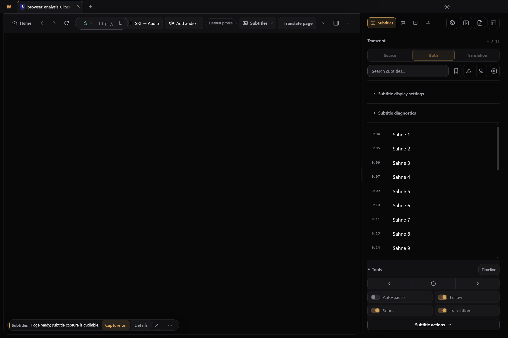
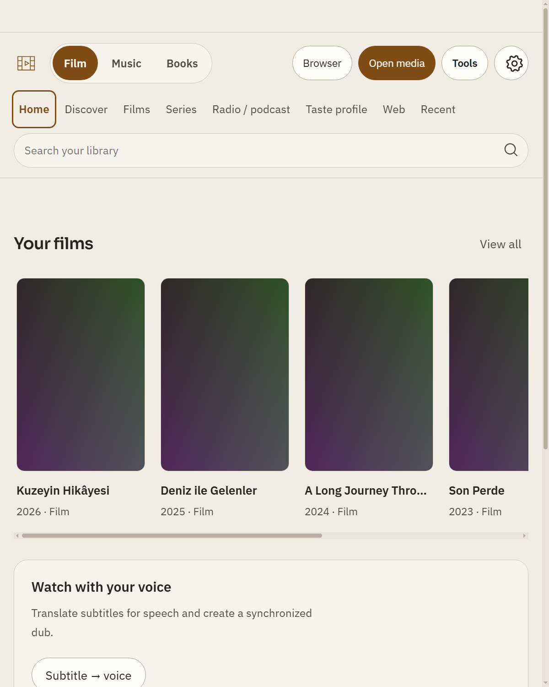
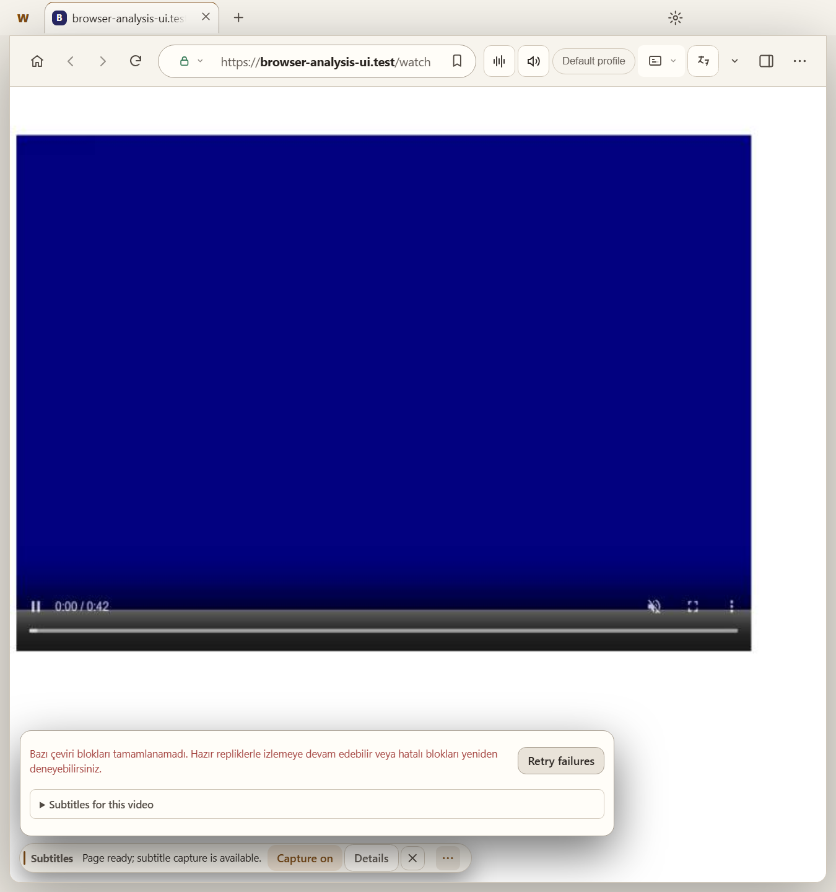

# Ortak gezinme ve browser — yalnız raporlama

İncelenen ürün: `2bb0e861de044ea25c70892009ce361fb651ebe0`. Windows Electron ayrı kontrollü profillerde çalıştırıldı; ürün/test dosyası değiştirilmedi. Kişisel profil ve canlı API kullanılmadı. Ana sayfa afişleri sentetik renk alanlarıdır: gerçek afiş eksikliği veya gerçek içerik tasarımı diye değerlendirilmez.

## S-01 · P2 · Yan panel açıkken browser adres metnine yalnız 39 CSS px kalıyor

**Doğrulanmış arayüz sorunu.** 1440×960 içerik boyutu, Electron %100, Windows DPR 1.5, koyu tema; browser'a geç → kontrollü video sayfası → Altyazılar yan panelini aç. Browser adres kapsayıcısı150 px'e sıkışıyor; kilit/gezinme/yer imi öğelerinden sonra gerçek metin girdisine39.33 CSS px kalıyor. Görüntüde sitenin adı yerine yalnız `https:/` gibi başlangıcı okunabiliyor. Adres editörü çalışmaz veya navigasyon bozulur iddiası yok; sorun okunabilirlik ve kimliği doğrulayabilme.

**Önerilen düzeltme:** Araç çubuğunun bütçesini toplam pencere yerine kullanılabilir browser genişliğine ve adres alanının asgari okunur metin genişliğine göre belirle. Etiketli SRT/ses/çeviri eylemlerini önce ikonlu veya ortak araç menüsüne geçir; ikincil eylemleri taşırken başlık, tooltip, klavye ve mevcut menü alternatiflerini koru. Adrese yeterli genişlik ver; alanı yalnız esneyen en zayıf sütun yapma. Yeni daraltma davranışı ürün koduna bu tur eklenmedi.

**Kanıt:** [ölçüm](assets/browser-toolbar-metrics.json): adres metni x280.74/genişlik39.33, kapsayıcı x212.74/genişlik150, viewport1440 CSS px. `src/renderer/browser-chrome.css:914` grid `auto minmax(150 px,1fr) auto`; `:1312` pencere920 px ve `:1328` container920 px etiket daraltma kuralları bu koşulda görünür etiketleri daraltmıyor. Bu, eşiklerin tek başına yeterli olmadığını gösterir; container uygulaması tamamen yok denmiyor.

**Kabul:** 1440/1280px pencerede yan panel kapalı/açık ve %100/%125/%150 durumlarında en az alan adı anlaşılır biçimde görünmeli; önerilen adres metni hedefi en az220 CSS px. Yalnız ikon görünümünde de SRT, ses, altyazı, sayfa çevirisi bulunabilsin. 900px dar pencere mevcut davranışını kaybetmesin; URL düzenleme, klavye seçimi, yer imi ve menü/occlusion kontrolü korunsun. 220px mevcut sözleşme değil, önerilen kabul hedefidir.

## S-02 · P3 · Küçük/zoomlu ekranda ortak başlık üç satıra yayılıyor

**Tasarım iyileştirmesi, örtüşme hatası değil.** 800×1000 pencere, EN/açık, Electron %125 →640×800 CSS px. Medya modu/eylemler, sayfa gezinmesi ve arama üç ayrı satıra çıkıyor. Başlık169.6 CSS px yüksekliğinde; pencere üst güvenli alanıyla birlikte ilk800 CSS px'in yaklaşık208px'i içerikten önce gidiyor. Yatay taşma yok, düğmeler erişilebilir; bunun için kontrolleri küçültmek veya gelişmiş özellikleri silmek önerilmiyor.

**Önerilen düzeltme:** Küçük görünümde medya modu ve mevcut sayfayı tek birincil satırda tutan, kalan sayfalara estetik bir gezinme seçicisinden erişen alternatif tasarla. Arama gerektiğinde açılan geniş bir satır olabilir; açıldığında odağı doğru almalı. Medya açma ve ayarlar erişimi kaybolmasın. Geniş görünümdeki tipografik sekme dili korunabilir; tüm ekranlara zorunlu yeni bir sol bar ekleme kararı bu raporda verilmedi.

**Kod/ölçüm:** `src/renderer/media-home.css:142–143`, `:160`, `:226–238` birikmiş wrap/grid/flex eşikleri; [shell-controls-result.json](assets/shell-controls-result.json) `tools-en-light-800` başlık632×169.6 CSS px, `tools-tr-dark-1440`1430×120 CSS px. [Geniş keşfet](assets/shell-discovery-1440-tr-dark.png) aynı kabuğun karşılaştırmasıdır.

**Kabul:** 640×800 CSS px'te arama kapalı günlük gezinmede en fazla iki okunur satır hedefle; seçili sayfa açık olsun. Tüm bölümler, araçlar ve ayarlar fare/klavyeyle erişilebilir kalsın. TR/EN uzun metinler, %125/%150, açılan arama, menü Escape ve odak dönüşü ayrıca kontrol edilsin. Bu düzen önerisi kullanıcı tarafından henüz onaylanmış tasarım değildir.

## Olumlu sonuçlar ve yanlış bulgu üretmeme notu

Mevcut `home-discovery-design`20 kontrol kaydı ve `browser-chrome-design` native akışı geçti. Ana sayfa/katalog/keşfette yatay taşma, Araçlar Escape kapanışı, filtre değişiminde yazılmış aramanın korunması, keşfet hatası/yeniden deneme ve ikincil tercihlerin klavye erişimi kontrol edildi. Browser'da32 px durum hapı, hata tekrar eylemi,900px popover sınırı, menü açılışında native yüzeyi örtme/geri getirme ve fullscreen gidiş-dönüşü geçti. [Ham browser sonucu](assets/browser-controls-result.json).

**Bu görüntü için öneri:** Çalışan dar adres/ikon düzenini S-01 için örnek al; yalnız geniş pencere/yan panel birleşiminde bütçeyi düzelt. Altyazı hata açıklamasını ve tekrar eylemini gizleyerek yer kazanma. Görseldeki lacivert video sentetik test videosudur; renk/oynatıcı tasarım kusuru olarak sayılmaz.

Programatik `MediaHomeUI.navigate` sonrasında Ana sayfa düğmesinde görülen klavye odağı halkası bu testte pointer hatası diye sayılmadı; gerçek fare gezinmesini temsil etmiyor. Parent screenshot'taki siyah native video alanı da ürünün siyah ekran hatası değildir; ayrı WebContentsView piksel yakalaması ve video ilerlemesi ayrıca sınandı.

Canlı siteler/reklamlar, gerçek thumbnail metadatası, kişisel koleksiyon, hareketin insan algısıyla değerlendirilmesi, GPU/DRM ve tüm pencere/Windows DPI birleşimleri doğrulanmadı. Tam npm test ve CI bu salt raporlama için çalıştırılmadı. Yakalama için mevcut testler değişmeden çalıştı; adres ölçümü için yalnız ignored `tmp/design-audit824/browser-metrics.cjs` kullanıldı.
