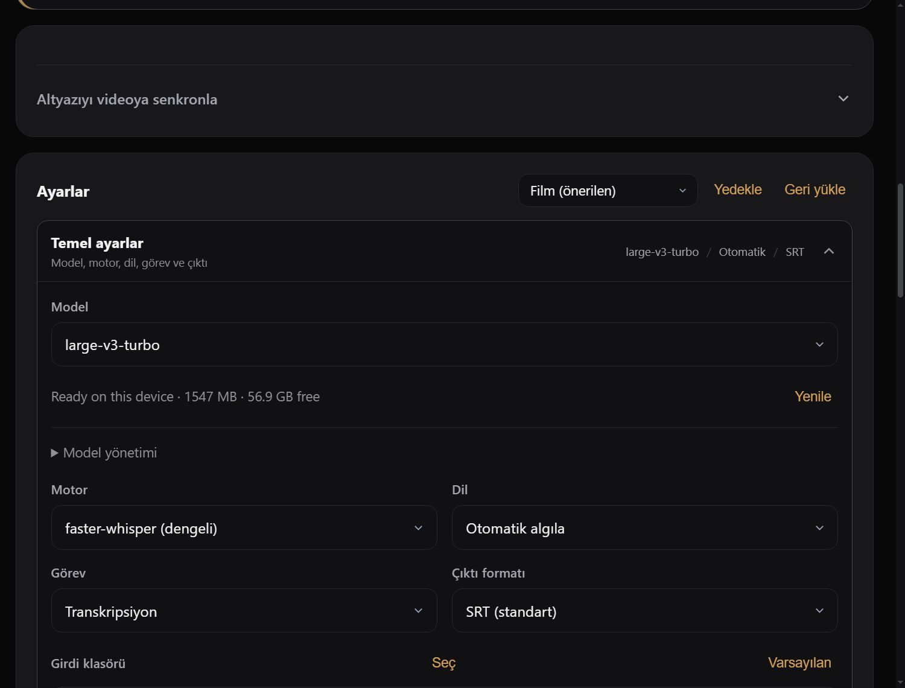
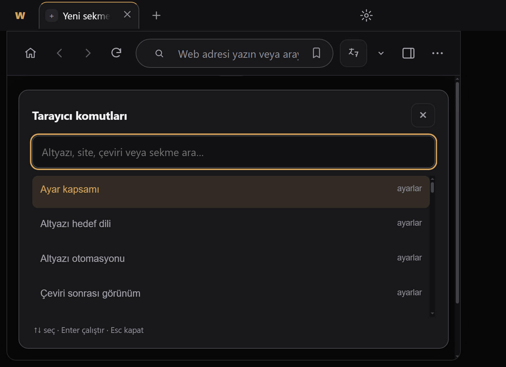
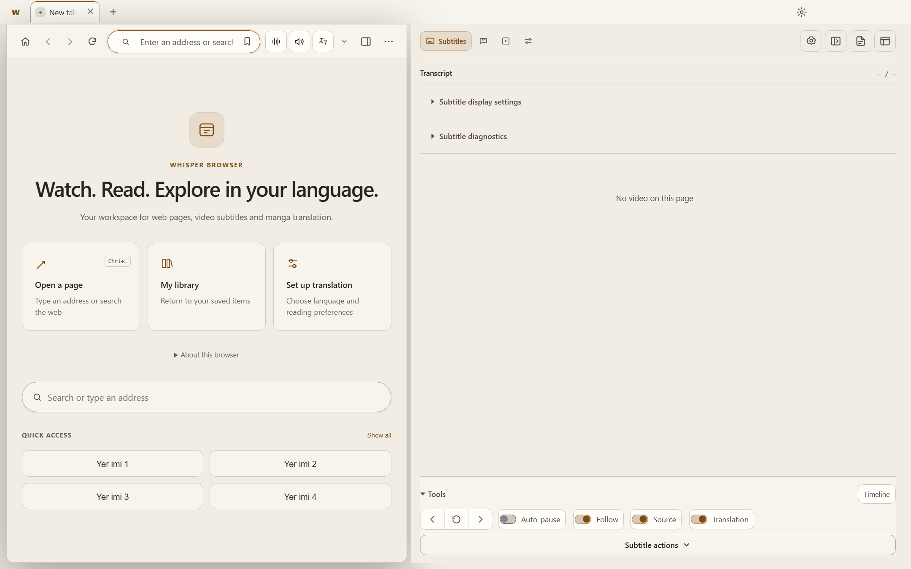
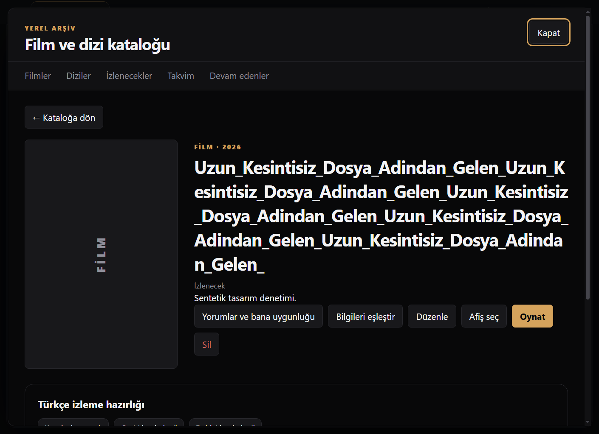

# R815 / R817 doğrulama ve düzeltme teslimi

Başlangıç: `3ea7518a`. Raporlar tarihsel kanıt olarak korundu; bu kayıt uygulanan değişiklikleri ayırır.

## Sonuç

- **R815: 134 bulgu tek tek ele alındı; 133 düzeltildi, 1 azaltıldı fakat açık.** Kimlik/kanıt/test eşlemesi [status.json](status.json) içindedir. Toplam benzersiz 134 kimlik kontrol edildi; aynı kökler yeni bug diye eklenmedi.
- **R817: 5 tasarım bulgusu düzeltildi.** Dar panel yerleşimi ve bölüm değişiminde okuma fontunun korunması önerileri de uygulandı.
- Son entegrasyon incelemesinde ASS biçim eşlemesi, mevcut-cache uyumluluğu, bitmiş indirme yolu, medya tarama sıklığı ve PDF iptal/son yanıt yaşam döngüsü de düzeltildi. Bu kontroller 133 sayısına ikinci kez eklenmedi.

PDF çevirisinde hedef dil/sağlayıcı/model/anahtar iş başlangıcında ana süreçte sabitlenir. Eski okuyucu/iş kartı yeni işlemi iptal edemez. Kaynak değişiminden sonra eski asistan, keşfet, manga ve medya yanıtları yeni içeriğe uygulanmaz. ASS/VTT/CEA metni, sayılar/olumsuzluk, altyazı sunum bilgisi ve yönetilen dosya sahipliği korunur. Model silme onayından sonra etkin iş tekrar kontrol edilir; yalnız onaylanan repo silinebilir. Tanıda altyazı/anahtar içeriği kesilmeden önce temizlenir.

## Açık teknik sınır: R815-B63

MediaElementAudioSourceNode ile işlenmiş aynı medya elementi sonradan izin vermeyen başka origin kaynağa geçerse tarayıcı sesi sıfırlayabilir. Graph bağını geri alma garantisi yoktur. **Şeffaf onarım yapılmış değildir.** Kaynak başına görünür sağlık uyarısı ve açık yeniden yükleme işlemi eklendi; kullanıcıdan habersiz gezinme veya CORS atlatma yapılmaz. CaptureStream yaklaşımı orijinal sesi kapatma/site reklam ve sessize alma davranışlarıyla ayrıca tasarlanmalıdır. Gerçek ses kabulü yapılmadan bu bulgu kapatılmayacak.

## Doğrulama

- Tam yerel koşu: 860 test dosyası; ilk koşu 28 dosyada başarısızdı. Entegrasyon düzeltmelerinden sonra **bu 28 dosyanın tamamı yeniden geçti**. İkinci tam koşu yapılmadı; nihai tek-koşu yeşil iddiası yok.
- Değişen 124 JS/Python dosyasında sözdizimi kontrolü geçti; ek şema ve deterministik kontroller 22/22 geçti. Yeni klasör yolu testi de ayrı geçti.
- PDF, kitap ve kaynak aktarımı odaklı son grup 45/45 geçti. IPC fuzz: 232 kanal / 10.040 çağrı / 0 ihlal. Başarı eşikleri yükseltilmedi; eski VM başlatıcıları gerçek üretim sözleşmelerine uyarlandı.
- Gerçek Electron/Chromium: 23 tasarım görüntüsü, dar panel, %100/125/150 ölçek; erişilebilirlik ağacında 4 gerçek sekme, axe ile 0 ihlal. Fikstürler kontrollüdür; kişisel profil ve uygulama kapatılmadı.
- Gerçek FFmpeg video paket/yeniden açma, WMV→MP4 AAC, gömülü font, M4B iptal ve zamanlama kontrolleri; bunlar fiziksel dinleme/GPU kalitesi kanıtı değildir.
- Canlı YouTube, gerçek model sağlayıcı, GPU TTS kalitesi ve insan kulağıyla dublaj kabulü bu teslimde yapılmadı.

Ayrıntı: [validation.json](validation.json). Yeniden üretim testleri kaynakla birlikte `tests/report815-*`, `tests/test_report815_backend.py`, `backend/test_report815_library.py` ve `tests/report817-*` altında bulunur. Native.smoke ve design.smoke dosyaları `npm test` tarafından otomatik koşulmaz; ayrı Electron başlatıcısı gerektirir.

## R815 geliştirme önerileri

Öneri bug değildir. Bu paket 37 önerinin hepsini teslim etmiş sayılmaz. Kısmi işler yalnız aşağıdaki kapsamla geçerlidir; kalan büyük mimari/ürün işleri ayrı çalışma gerektirir. Kullanıcının yedek/kurtarma kapsamını büyütmeme tercihi korunmuştur.

| Kimlik | Öneri | Bu teslimdeki durum |
|---|---|---|
|R815-G01|Dublaj inceleme durumu asistan iş kaydına da taşınmalı|Uygulanmadı — Separate feature proposal; no claim of delivery in this corrective package.|
|R815-G02|Uzun Türkçe çeviri ve dublaj kalitesi için hedefli inceleme paketi|Uygulanmadı — Separate feature proposal; no claim of delivery in this corrective package.|
|R815-G03|Dublaj başlatma kartında kapsamın görünürlüğü|Uygulanmadı — Separate feature proposal; no claim of delivery in this corrective package.|
|R815-G04|Uzun oturumlarda kaynak/listener bütçesinin gerçek ölçümü|Uygulanmadı — Separate feature proposal; no claim of delivery in this corrective package.|
|R815-G05|Kontrol varlığı yerine sınır zamanlamasını kapsayan Windows kabulü|Kısmi — PDF selection/configuration/lifecycle boundaries covered; native UI tested at100/125/150%, not complete200%GPU/site matrix.|
|R815-G06|Büyük yedekleri ana süreç dışında, ilerleme ve iptalle hazırla|Uygulanmadı — Separate feature proposal; no claim of delivery in this corrective package.|
|R815-G07|Uzun testler başarısız olsa da kısmi ölçümleri ve son aşamayı kaydet|Uygulanmadı — Separate feature proposal; no claim of delivery in this corrective package.|
|R815-G08|Yedeğin kapsadığı ve dışarıda bıraktığı veriyi işlem öncesinde tek envanterde göster|Uygulanmadı — Separate feature proposal; no claim of delivery in this corrective package.|
|R815-G09|Windows medya çıktısında kapsayıcı ve codec planını başlamadan doğrula|Kısmi — Known WMV/WMA→MP4 incompatibility selects AAC and actualFFmpeg test passes; general stream/codec preflight remains.|
|R815-G10|Taşınabilir kayıt kimliğini dosya konumundan ayır|Uygulanmadı — Separate feature proposal; no claim of delivery in this corrective package.|
|R815-G11|Donanıma göre ölçülen iş bütçesi ve gerçek zamanlı kaynak görünürlüğü ekle|Uygulanmadı — Separate feature proposal; no claim of delivery in this corrective package.|
|R815-G12|Geri yükleme sonrası bağlantı doğrulaması ve toplu yeniden bağlama özeti sun|Kısmi — Post-extraction paths and POSIX mapping repaired, real portable-video reopen tested; unified end-user link-health summary remains.|
|R815-G13|Denetlenen medya hedefini görünür kıl|Kısmi — Context-menu and source-bound commands target the correct frame/element; explicit visible target-selector redesign remains.|
|R815-G14|Ses işleme sağlık durumu ve güvenli kaynak değişimi|Sınır açık — Source/CORS health warning and explicit reload available; transparent audio graph recovery remains open withB63.|
|R815-G15|Sayfa genelinde tek bağlantı etiketi oturumu|Uygulandı — Unique frame-wide link-hint codes, global routing and cleanup; controlled native cross-origin fixture.|
|R815-G16|Akış tercihi deposu için veri kaybı olmadan kimlik geçişi|Kısmi — Distinct stream identity survives persistence; no guessed migration/recovery UI for ambiguous oldrecords.|
|R815-G17|Düşük maliyetli, olay destekli shadow medya yeniden keşfi|Kısmi — Late-open shadow discovery and bounded rescan corrected; closedroots remain unsupported, fullobserver128/soak budget not claimed.|
|R815-G18|Mini oynatıcıda ortak dil ve erişilebilirlik sözleşmesi|Uygulanmadı — Separate feature proposal; no claim of delivery in this corrective package.|
|R815-G19|Kaynak değişimi için kısa native kabul matrisi|Kısmi — Controlled native source/frame/shadow/restore checks passed; physical cross-origin audio restoration not verified andB63 remains.|
|R815-G20|Sıcak motor kapasitesinin yeniden boyutlandırılmasını açık politika yap|Uygulanmadı — Separate feature proposal; no claim of delivery in this corrective package.|
|R815-G21|Üretim öncesi kaynak ses parçası kimliğini tek tarifte dondur|Uygulanmadı — Separate feature proposal; no claim of delivery in this corrective package.|
|R815-G22|Kısa örnek için gerçek tahmini süre ve bütçe göster|Uygulanmadı — Separate feature proposal; no claim of delivery in this corrective package.|
|R815-G23|Kalite kartında akustik, ASR ve insan dinlemesini ayrı kanıtlar olarak tut|Uygulanmadı — Separate feature proposal; no claim of delivery in this corrective package.|
|R815-G24|Senkron önizlemesinde ölçülebilir güven özeti sun|Uygulanmadı — Separate feature proposal; no claim of delivery in this corrective package.|
|R815-G25|Dublajı dışa aktarmadan önce kısa lokal karışım önizlemesi ve hedef preflightı|Uygulanmadı — Separate feature proposal; no claim of delivery in this corrective package.|
|R815-G26|Canlı ASR dil geçişinde düşük güvenli ara gözlemlerin politikasını açıklaştır|Uygulanmadı — Separate feature proposal; no claim of delivery in this corrective package.|
|R815-G27|Yorum kanıtını sürüm ve kaynak kimliğiyle birlikte karşılaştır|Kısmi — Review decisions bind evidence version/fingerprint/source; no complete user-facing old/new-sample comparison.|
|R815-G28|Sohbette gerçekten diske yazılan son yanıt durumunu göster|Kısmi — Streaming replies persist periodic checkpoints; user-visible disk revision/flush/error interface remains.|
|R815-G29|Yorum okuma aşamalarını durdurma sahibiyle görünür kıl|Uygulanmadı — Separate feature proposal; no claim of delivery in this corrective package.|
|R815-G30|Tür bilgisini görünen dilden bağımsız kanonik kimlikle taşı|Uygulanmadı — Separate feature proposal; no claim of delivery in this corrective package.|
|R815-G31|Native oynatma işlemlerine doğrulanmış sonuç makbuzu ekle|Kısmi — External process launch acknowledgement now distinguishes spawn rejection; fullpause/seek/rate/volume receipt protocol remains.|
|R815-G32|Sağlayıcı bağlantı tanısında protokol aşamalarını ayır|Kısmi — MIME case/stream decoding and JSON compatibility fixed/tested; complete protocol-stage diagnostic view remains.|
|R815-G33|Dağıtımın gerçek dosya envanterini ve hashlerini üret|Uygulanmadı — Separate feature proposal; no claim of delivery in this corrective package.|
|R815-G34|Abonelikleri kanal başına son başarı ve dönen yenileme bütçesiyle yönet|Uygulanmadı — Separate feature proposal; no claim of delivery in this corrective package.|
|R815-G35|Kaydedilmiş iş akışını adlandır, seç ve çalıştırmadan önce adımlarını göster|Uygulanmadı — Separate feature proposal; no claim of delivery in this corrective package.|
|R815-G36|Canlı ASR’de ses kaynağı, capture ve model hazırlığını birlikte göster|Uygulanmadı — Separate feature proposal; no claim of delivery in this corrective package.|
|R815-G37|Yönetilen varlıkların sahiplik grafiğini ve onarım önizlemesini göster|Uygulanmadı — Separate feature proposal; no claim of delivery in this corrective package.|

## Görsel kanıt

