# R825 uygulaması — günlük kullanımın önceliği

1 Kasım 2026. Başlangıç `24e775672d9445cc7ce07d74adf030dbc3e5d05b`; ürün commit'i `20c8dc0998c6bc2f4bbd93dac7479d964d30726f`. [Özgün R825](../../BROWSER_BUG_REPORT_825.md) tarihsel denetim olarak korunur. Önceden master'a alınmış R817/R818/R819/R824 onarımları bu paketin tabanındadır; yeniden keşif sayılmaz.

Bu teslim R825'teki **beş UX önerisini ve bir LOW semantik hatayı** uygular. Bütün depodaki açık bugların kapanması veya nihai estetik onayı anlamına gelmez. Özellikle R815-B63 kaynak/CORS sınırı bu arayüz düzenlemesinin kapsamında kapanmış değildir.

| Kayıt | Uygulanan davranış | Korunan ayrıntı |
|---|---|---|
| U825-01 | Ayarlarda sağlayıcı, model ve maskeli anahtar önce gelir; durum tek kompakt satırdır. | Ayrı asistan sağlayıcısı seçildiğinde model/anahtar/Flex açılır; arama gizli ayrıntıya ulaşır. Kaydet/odak/alan kimliği korunur. |
| U825-02 | Asistan kaynak özeti tek satır; birincil öneri ve Diğer öneriler menüsü. Meşgulken kullanılamayan öneriler yer kaplamaz. | Kaynağın tam açıklaması, komutlar, işlem incelemesi, Escape ve odak dönüşü, İptal ve taslak korunur. |
| U825-03 | Hazır yorum sayısı ve okuma alanı önce; havuz/sayı/yenileme Yorum örneğini değiştir altında. | Hata sonrası eski örnek ve kaynak kurtarma seçenekleri kalır. Analiz öncesi seçim ve spoiler denetimi sürer. |
| U825-04 | Etkin ses açıkça gösterilir; boş kayıtlı liste formu gizlenir; üretim grubu sol sütundaki boşluğu doldurur. | Yerelden ekle ve referans klasörü erişilebilir; kayıtlı sesler ayrı ayrıntıda. Motor/kalite ve döküm seçenekleri gelişmiş üretimde kalır. |
| U825-05 | PDF seslendirme hazırlığı ihtiyaçta açılır; hazır ses sonrası kapanır. Kitap bölüm seçimi tek başlık olarak baskındır. | Sayfa aralığı, takip/oynatma, özgün PDF ve serif okuma korunur. Kaynak sahipliği ve geç yanıt korumaları değişmez. |
| D825-01 | Marka görseline erişilebilir adla uyumlu `role="img"` eklendi. | Dört son film durumunda axe `aria-prohibited-attr` artık çıkmıyor. Ekran okuyucu sesi test edilmedi. |

## Ayarlar ve asistan

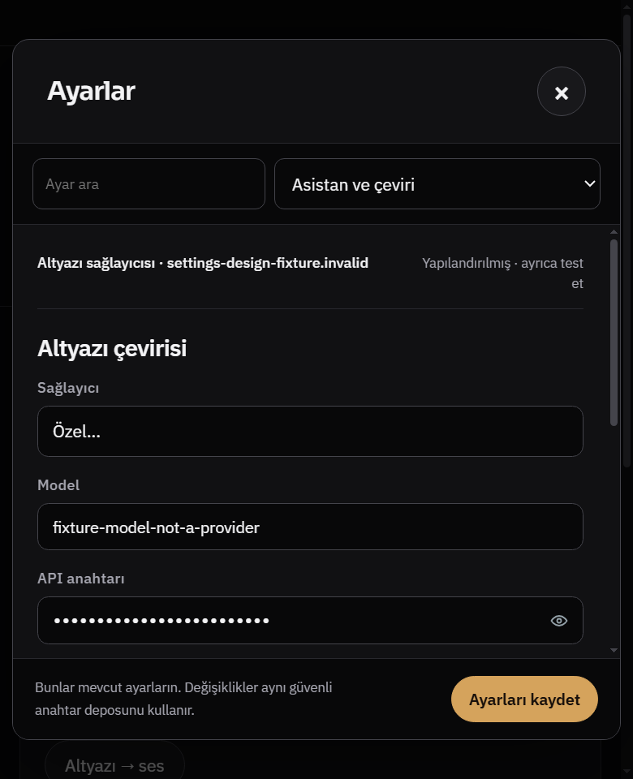

520×640 ve 640×720 CSS px'te sağlayıcı/model/anahtar için `scrollToReveal=0`. API anahtarı maskeli; ayrı asistan seçeneklerini gizlemek kayıtlı değerlerini silmez. Gelişmiş model listesi/test/anahtar araçları açılabilir.

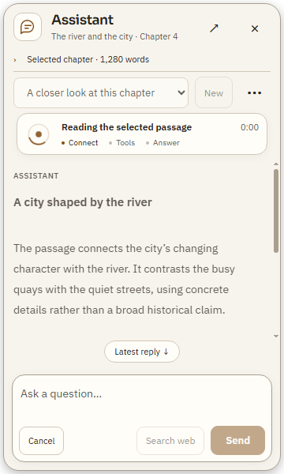

360×600 örneğinde yanıt alanı **141,86 → 229 CSS px**, yaklaşık **%61 artış**. Meşgul öneriler sıfır yükseklik alır. Bu tek senaryonun geometrisidir, tüm ekranlarda %61 iddiası değildir.

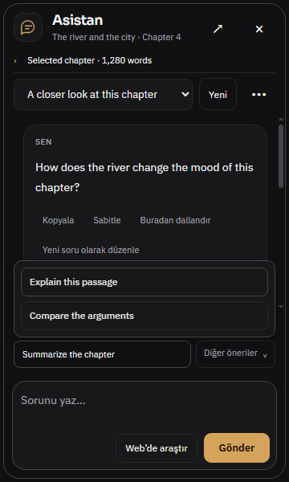

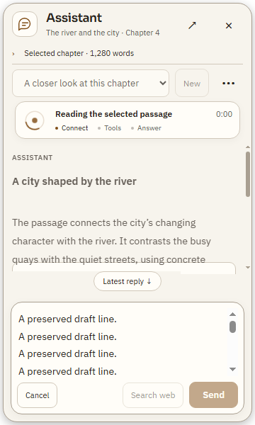

Kaynak ayrıntıları ve diğer komutlar kaldırılmadı. Klavye menü/Escape, işlem onayından dönüş, uzun kodun kendi içinde kayması ve azaltılmış hareket kabulü kontrollü Windows akışında geçti.

## Film yorumları

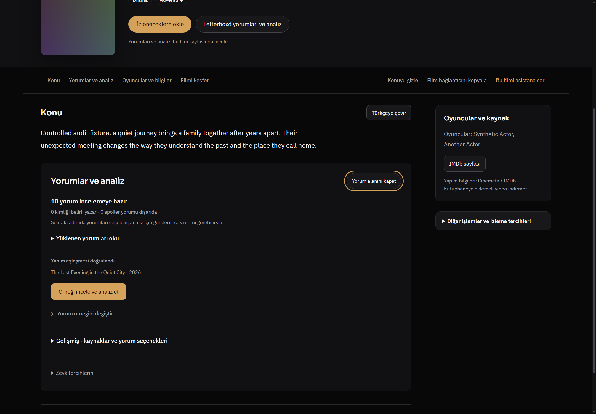

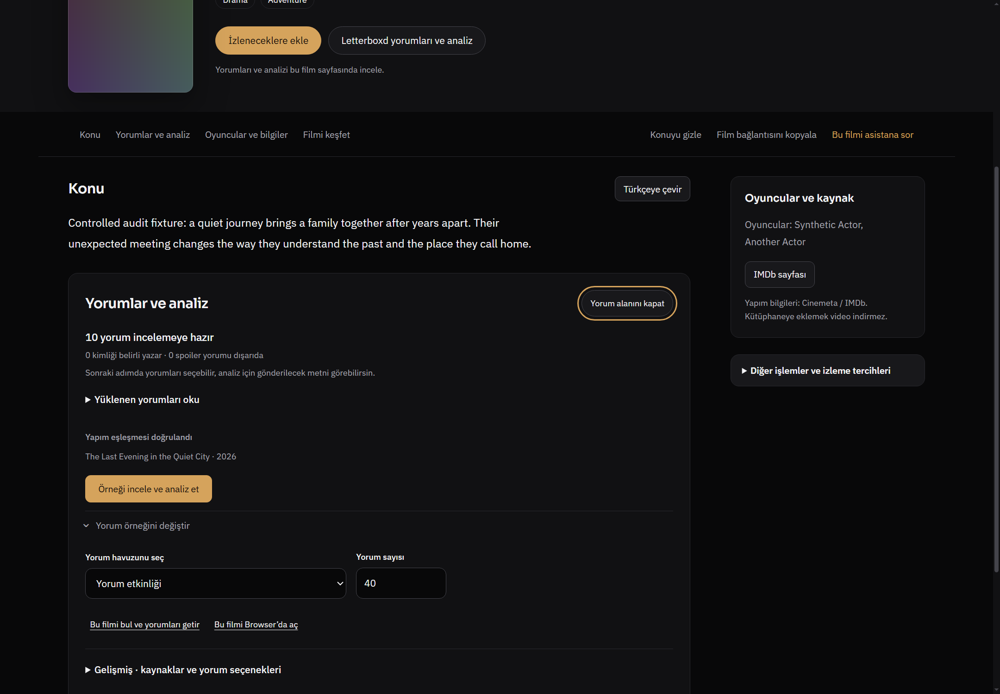


İlk örnek yokken getirme seçenekleri görünürdür. Örnek hazırken okuma ve analiz görevi öne alınır; sayı/havuz/yenileme ayrıntıya geçer. Browser bağlantısı ikinci büyük dolgu eylemi değildir. Yenileme başarısızsa eski örnek korunur ve kurtarma kontrolleri açılır. Sentetik yorumlar ve kapak kullanıldı; canlı Letterboxd/AI kalitesi bu tur sınanmadı.

## Dublaj ve referans sesi

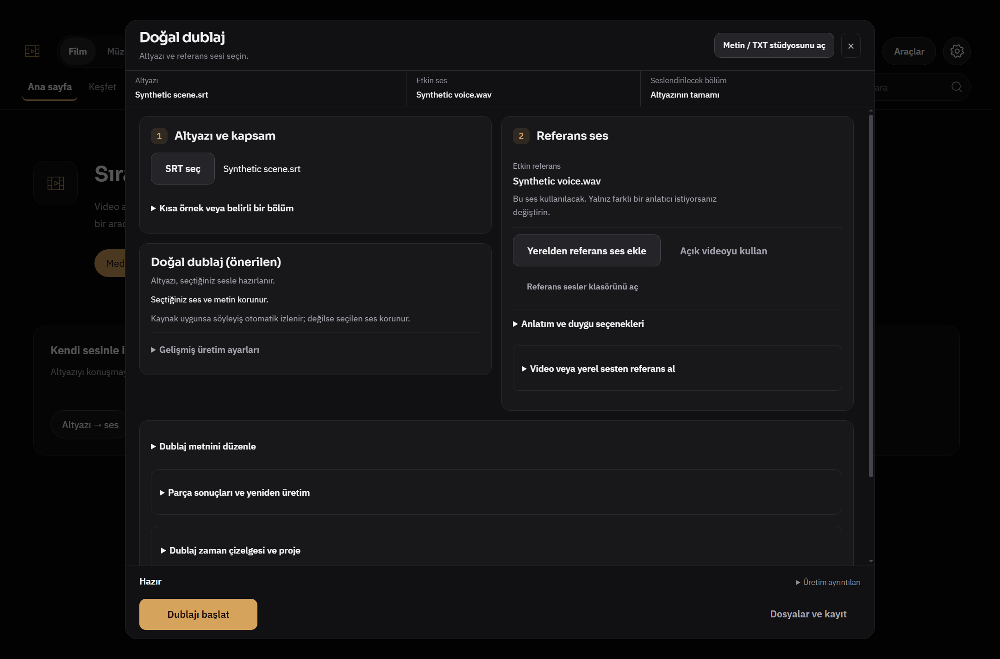

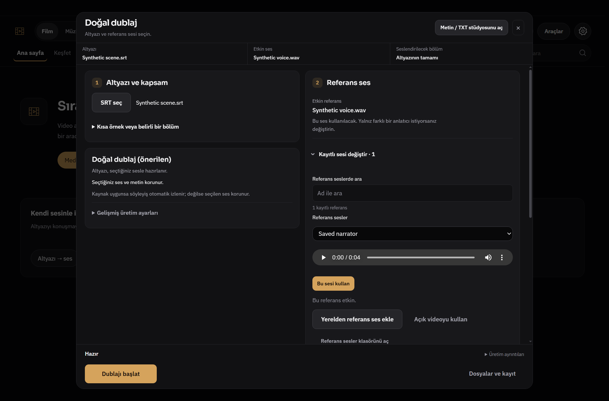

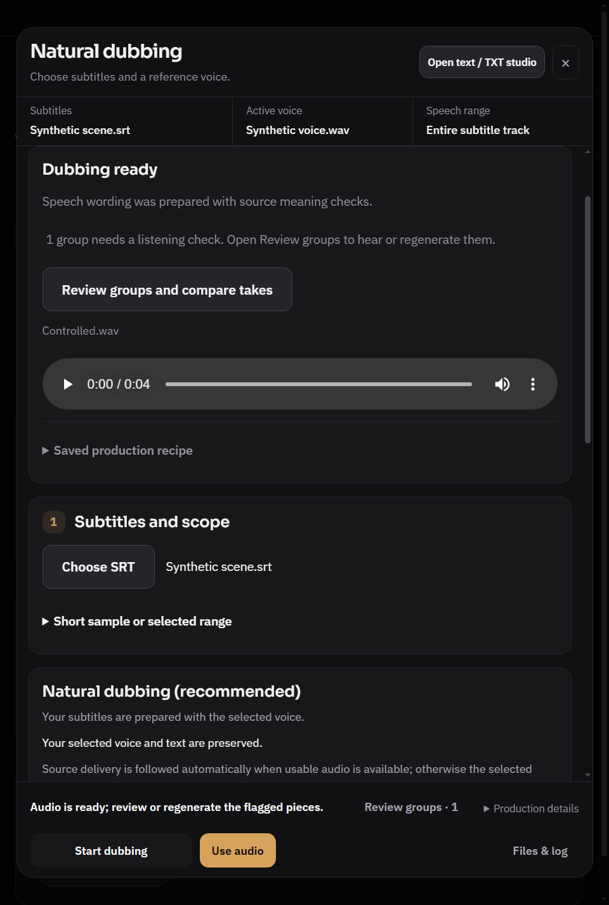

Kontrolde tamamlanan ek kullanılabilirlik düzeltmesi: kayıtlı referans listesi dublaj açılırken yüklenir; kullanıcı önce video kayıt panelini açmak zorunda değildir. Liste yenilemesi seçili ama uygulanmamış sesi etkin ses diye sunmaz, düzenlenmiş dökümü silmez. Okuma hatası son geçerli listeyi ve etkin sesi korur; yeniden yükleme eylemi sunar. Yeni regresyon bunu doğrudan gerçek renderer modülüyle doğrular. Yeni yerel model, sentez ayarı veya ses işlemesi eklenmedi.

## Kitap/PDF

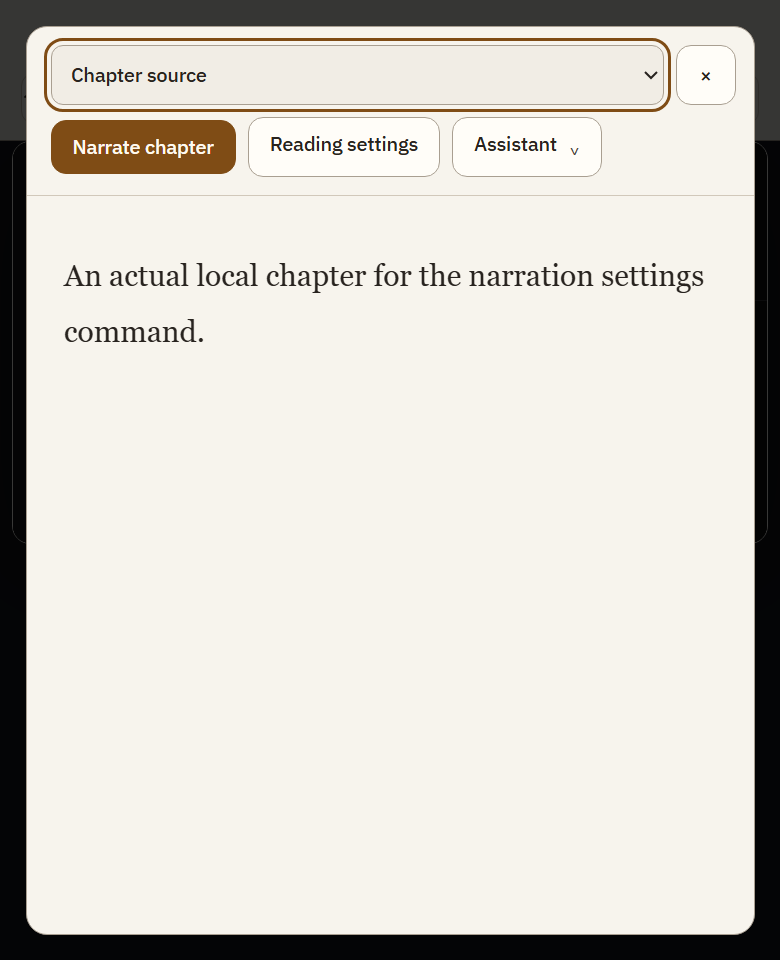

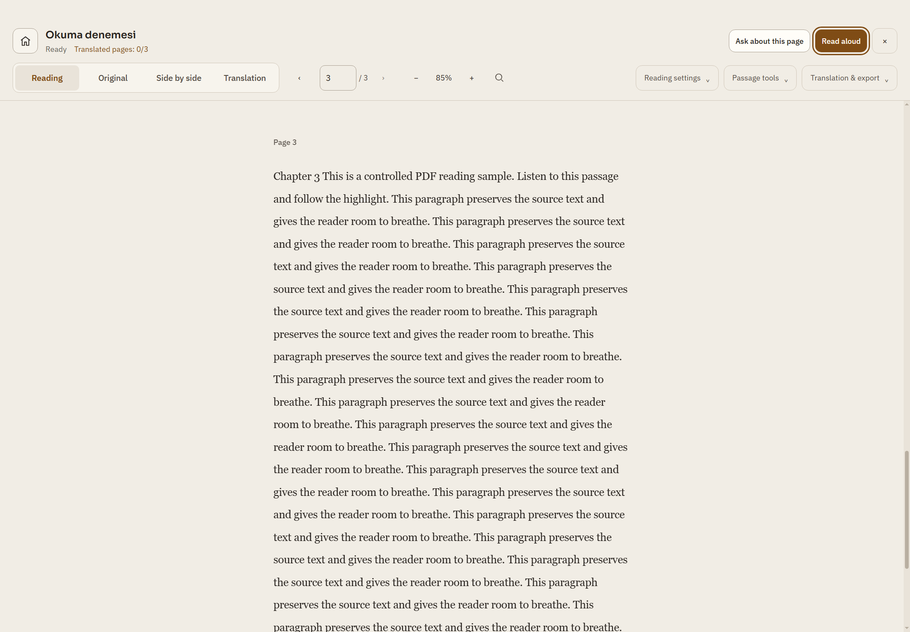

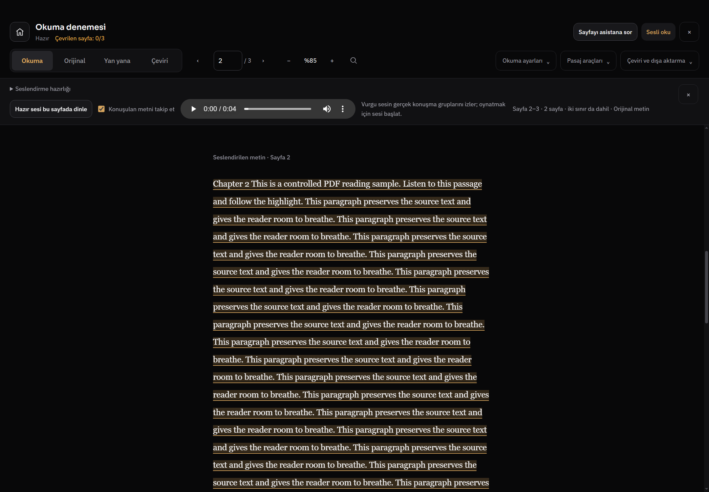

Sesli oku hazırlığı açar ve aralığa odaklanır. Hazır sesin oynatılması sonrası hazırlık kapanır; oynatma ve aralık bilgisi kalır. Yeniden açma, sayfa 2–3 seçimi ve belge/üretim sahipliği korumaları sınandı. Kontrollü WAV gerçek VoxCPM2 doğallığı kanıtı değildir.

## Doğrulama ve tekrar üretme

Son birleşik hedefli Node koşumları: **50 + 15 = 65 test, 0 başarısız**. Bunlar 65 yeni bug değildir.

```powershell
node --test --test-isolation=none tests/assistant-short-panel825.test.js tests/voice-reference-library825.test.js tests/app-settings-progressive.test.js tests/report815-assistant-regressions.test.js tests/report815-pdf-regressions.test.js tests/i18n-coverage.test.js
node --test --test-isolation=none tests/reports818-819-design.test.js tests/pdf-preparation-ownership.test.js tests/independent-books-flow.test.js
```

Değişen 18 JS dosyasında `node --check`, UTF-8/replacement karakter kontrolü, `git diff --check` ve eski HTML ID'lerinin korunması geçti. İki yeni davranış testi asistan önerileri/odak/kaynak değişimini ve referans listesi/döküm/hata sonrası yeniden yüklemeyi denetler. R815 asistan fixture'ı, artık modal yerine gerçek film sayfasını kullanan sözleşmeye uyarlandı; önceki hata ve geç yanıt iddiaları kaldırılmadı.

Windows Electron ayrı test profillerinde şu mevcut akışlar çalıştırıldı:

```powershell
& 'D:\Whisper Local\node_modules\electron\dist\electron.exe' tests/electron-settings-design-tour.smoke.js
& 'D:\Whisper Local\node_modules\electron\dist\electron.exe' tests/electron-assistant-design-tour.smoke.js
& 'D:\Whisper Local\node_modules\electron\dist\electron.exe' tests/electron-assistant-review824.smoke.js
& 'D:\Whisper Local\node_modules\electron\dist\electron.exe' tests/electron-film-design824.smoke.js
& 'D:\Whisper Local\node_modules\electron\dist\electron.exe' tests/electron-dub-natural.smoke.js
& 'D:\Whisper Local\node_modules\electron\dist\electron.exe' tests/electron-pdf-reader-experience.smoke.js
```

Ayar turu30 durum, asistan24 temel durum ve ek kısa panel/uzun taslak kabulü, film14 görüntü ve breakpoint kontrolleri, dublaj17 geometri kaydı/14 görüntü, okuyucu33 görüntülü akış. Bu sayılar farklı kanıt türleridir, test sayısına eklenmez. [ACCEPTANCE.json](ACCEPTANCE.json) ölçümleri, [MANIFEST.json](MANIFEST.json) seçili14 görüntünün ve dört axe çıktısının hashlerini içerir. Dört film axe örneğinde WCAG2/2.1 A/AA taramasında ihlal yok; uygulamanın tamamı için sertifika değildir. Axe yeniden üretme yardımcısı önceki [inspect-renderer.cjs](../probes/inspect-renderer.cjs) yaklaşımını son film durumlarına uygular.

Ara aşamalardaki başarısızlıklar başarı sayılmadı: Python'un Windows varsayılan kodlamasıyla yazılan geçici düzenlemeler Türkçe metni bozdu; UTF-8 ile geri düzeltildi ve yalnız son doğru görüntüler yayımlandı. Eski film fixture'ının modal varsayımı ve PDF fixture'ının sayfa metni/sahipliği uyuşmazlığı düzeltilerek yeniden koşuldu; ürün koruma eşiği gevşetilmedi. Son axe yardımcısının taşınan kaynak yolu hatası giderildi, yalnız ona ait kalan test penceresi kapatıldı. Kişisel uygulama kapatılmadı.

Frontend Design Premium/Impeccable ve önceki Redesign/Designly inceleme ölçütleri hiyerarşi ve görsel kontrol için kullanıldı. Tüm etiketli pluginlerin harici servisleri çağrıldı iddiası yok. Yeni bağımlılık/font/CDN/GSAP veya tema değiştirme yok; mevcut sürekli iş hareketi ve reduced-motion korunur. Statik Impeccable'ın mevcut yuvalama/2px sınır/yarıçap uyarıları tamamen temizlenmiş sayılmadı.

Tam npm test, `start.bat` ile yeniden açma, gerçek GPU/model, canlı sağlayıcı/siteler/hesap/DRM, FPS/uzun soak ve ekran okuyucu sesi bu tur yapılmadı. CI açık kalır, sonucu beklenmez. Kullanıcının kişisel profil/anahtar/dosyaları teslim dışıdır.
